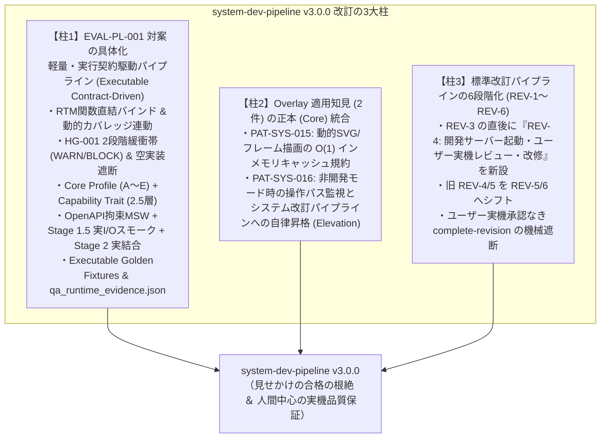
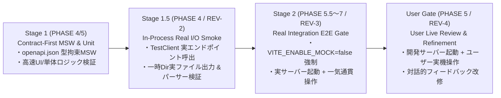
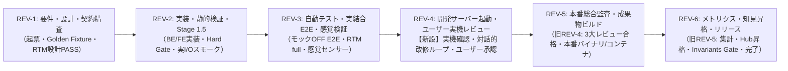

# system-dev-pipeline v3.0.0 改訂基本計画書（軽量・実行契約駆動パイプラインへの進化）

- **文書ID**: `PLAN-V300-001`
- **改訂対象システム**: `system-dev-pipeline`
- **対象バージョン**: `v2.6.2` ➔ `v3.0.0` (`.env` `APP_VERSION=3.0.0`)
- **策定日**: 2026-11-09
- **ステータス**: 計画策定完了 / 承認待ち (REV-1)
- **関連ドキュメント**:
  - [評価・考察レポート: system-dev-pipeline 抜本的改革案（ISSUE-PL-001）の客観的評価・弊害分析および対案提示](../評価考察_system-dev-pipeline抜本的改革案の客観的評価と対案.md) (`EVAL-PL-001`)
  - [検討課題: system-dev-pipeline が抱える構造的欠陥の分析と抜本的改革案](../検討課題_system-dev-pipeline構造的欠陥分析と抜本的改革案.md) (`ISSUE-PL-001`)
  - [パイプライン標準規約 (AGENTS.md)](../../../../.agents/plugins/system-dev-pipeline/rules/AGENTS.md)
  - [コア不変原則カタログ (CORE_INVARIANTS.md)](../../../../.agents/plugins/system-dev-pipeline/rules/CORE_INVARIANTS.md)
  - [システム改訂運用基準書テンプレート](../../../../.agents/plugins/system-dev-pipeline/templates/システム改訂運用基準書.md)

---

## 1. 改訂の背景と3大基本方針（Executive Summary）

`promotion-video-maker` 等の実践開発を通じて浮き彫りになった最大の課題は、すべての機械的品質ゲート（Hard Gate / RTM / 自動テスト）と3大レビューを通過したにもかかわらず実動環境で基本機能が破綻する **「見せかけの合格（Green Illusion）」**、および改訂プロセスにおいて **「ユーザーによる実機テストレビューと対話的改修」が計画から欠落する構造的問題** である。

本改訂（`v3.0.0`）では、[評価・考察レポート (`EVAL-PL-001`)](../評価考察_system-dev-pipeline抜本的改革案の客観的評価と対案.md) で提示された **「第2の Goodhart の法則（より巧妙な偽装コードの生成）やコンテキスト肥大化を招かず、実行可能な契約（Executable Contract）と実機エビデンスで実動品質を保証する対案」** を全面採用し、さらに現行 Overlay 知見の正本統合および改訂ライフサイクルの6段階化（`REV-1`〜`REV-6`）を統合した以下の **3大柱** を実装する。



---

## 2. 【柱1】`EVAL-PL-001` 5大対案の具体化設計

### 2.1 対案1：AIハーネス V3（テスト関数直結RTM・動的カバレッジ連携・弾力的行数ガード）

#### (1) `traceability_checker.py` の2重トートロジーバグ修正と厳格バインド
1. **計画書混入バグの即時廃止**:
   - `scan_test_artifacts()` から `docs/plans/シナリオテスト計画書.md` を完全削除し、実行可能なテストコード（`.py`, `.ts`, `.tsx`, `.js`, `.rs`）のみを検査対象とする。
2. **ファイル全文単純一致の廃止と「有効テスト関数スコープ直結バインド」**:
   - 従来の `if req_id in content: obj.test_refs.append(...)`（ファイル先頭コメントへの `[REQ-*]` まとめ書きや、AST無効化テストの素通りを許すバグ）を廃止する。
   - **Python テスト (`.py`)**: AST で `test_*` 関数を解析し、`check_python_test_validity(node)` が `True`（有効な関数呼び出し＋非トートロジーアサーションが存在）と判定した関数についてのみ、その **関数名・docstring・デコレータ・関数本体ソースセグメント（および直前3行のコメント）** に含まれる `[REQ-*]` を `obj.test_refs` に登録する。
   - **TypeScript / JavaScript / Rust テスト (`.ts`, `.tsx`, `.js`, `.rs`)**: `test(...)` / `it(...)` / `fn test_*` ブロック単位でスコープを切り出し、以下の「浅いアリバイテスト」を機械除外した上で、有効なテストブロック内（および直前コメント）の `[REQ-*]` のみをカウントする：
     - 定数比較のみ（`expect(true).toBe(true)` 等）
     - DOM要素の存在確認（`toBeInTheDocument()`, `toBeDefined()`, `not.toBeNull()`）のみで構成され、`fireEvent` / `userEvent` 後の状態変化検証やモック関数呼び出し引数検証（`toHaveBeenCalledWith` 等）、属性・テキスト変化検証が一切存在しないテストブロック。
3. **動的カバレッジ（Branch / Line Coverage）証跡との連動オプション**:
   - `--coverage-json <path>`（または `coverage/coverage-summary.json`, `metrics/coverage.json` の自動検出）をサポートし、実ビジネスロジックの分岐・行カバレッジが閾値（デフォルト 70%）未満の場合は RTM フル検証（`--mode full`）で警告・遮断できる仕組みを導入する。

#### (2) `harness_guard.py` のインセンティブ適正化（HG-001 緩衝帯 ＆ HG-010 空実装遮断）
1. **HG-001（行数制限）への2段階緩衝帯（Two-Tier Line Limit）の導入**:
   - AIが行数上限（250行/400行）の即時 `BLOCK` を恐れて業務ロジックを削ぎ落とす（縮退実装）負のインセンティブを断つため、ソフト上限（`WARN`）とハード上限（`BLOCK`）の2段階制に移行する：
     - **フロントエンド (`.tsx`, `.ts`, `.jsx`, `.js`)**:
       - `251〜350行`: **`WARN`（分割推奨警告）** — コミット自体は遮断せず、PHASE 5.5（`dev-review-code`）での自然なHooks/Subcomponent分割を促す。
       - `351行以上`: **`BLOCK`（物理遮断）** — 従来通りコミットおよびゲートを即時遮断。
     - **バックエンド (`.py`, `.rs`)**:
       - `401〜550行`: **`WARN`（分割推奨警告）**
       - `551行以上`: **`BLOCK`（物理遮断）**
2. **HG-010（明白な未実装・プレースホルダー縮退の機械遮断）の新設**:
   - 別スクリプト（`anti_placeholder_guard.py`）の乱立による実行漏れを防ぐため、`harness_guard.py` の標準ルール `HG-010` として統合する。
   - 偽陽性（正当なデフォルト値返却への誤検知）を避け、以下の**明白な手抜き・未実装パターンのみ**を決定論的に `BLOCK` する：
     - バックエンド（Python AST）: 関数・メソッド本体（docstring除く）が `pass`、`...`（Ellipsis）、`raise NotImplementedError(...)` のみで構成されている実装（抽象基底クラス `@abstractmethod` や Protocol 定義は除外）。
     - バックエンド/フロントエンド共通: 生成系ロジック内のダミーコメント文字列返却（`<!-- Generated -->`, `<!-- TODO -->`, `placeholder_output` 等）、および JSX イベントハンドラの空関数直書き（`onClick={() => {}}`, `onSubmit={() => {}}`）。

---

### 2.2 対案2：Core Profile（A〜E維持）＋ Capability Trait（機能トレイト）の2.5層方式

48通りの組み合わせ爆発を招くフル直交合成（Composite Profile）を退け、実証済みの **Core Profile（Profile A〜E）** を維持した上で、複合アプリケーション固有の物理検証要件を **Capability Trait（機能トレイト）** として追加バインドする **2.5層モデル** を導入する。

| トレイト識別子 | 適用対象の特徴 | 自動バインドされる追加物理検証ガード（Gate / Evidence 要件） |
| :--- | :--- | :--- |
| **`+trait:local-api`** | Profile C/D 等で FastAPI / Express 等のローカルAPIサーバーを同梱する構成 | ・Stage 1.5（`TestClient` 実疎通）必須<br>・Stage 2 での実ポート起動＆フロントエンドからの実HTTP通信E2E必須 |
| **`+trait:media-export`** | XML (FCPXML等), JSON, WAV, MP4, PDF 等の構造化ファイル・メディア出力を伴う構成 | ・`tests/fixtures/golden/` への期待出力フィクスチャ配置必須<br>・出力ファイルの実在（サイズ > 0）＋標準パーサー（XML/WAV/JSON等）による構造一致検証必須 |
| **`+trait:frame-render`** | Remotion, Canvas, WebGL 等でフレーム駆動型アニメーションや動的SVGを連続合成する構成 | ・描画状態パラメータをキーとする O(1) インメモリキャッシュ実装必須（`PAT-SYS-015`）<br>・長尺フレーム描画時のメモリリーク抑止検証必須 |
| **`+trait:external-cli`** | FFmpeg, DaVinci Resolve, Cloud CLI 等の外部プロセスを呼び出す構成 | ・非対話フラグ（`--quiet`, `-y` 等）およびタイムアウト保護必須<br>・コマンド未インストール環境での Graceful Degradation / 実機疎通検証必須 |
| **`+trait:dual-mode-workspace`** | システム開発とコンテンツ制作（動画制作・PKM・分析等）が同一リポジトリに同居する構成 | ・操作対象パス監視による Scope Guard スリープ即時解除と `start-revision` 自律昇格必須（`PAT-SYS-016`） |

- **台帳スキーマ統合**: `project_state.json` の `project_metadata` に `"capability_traits": []` を追加し、`state_manager.py init --traits local-api,media-export` で設定可能とする。

---

### 2.3 対案3：Dual-Stage Testing Gate（OpenAPI拘束MSW ＋ Stage 1.5 実I/Oスモーク ＋ Stage 2 実結合E2E）

MSWモックによる実結合エラー隠蔽（ルーティング不一致・Pydantic 422エラー・ファイル未生成）を早期かつ確実に遮断するため、テストゲートを以下の段階で構成する。



1. **Stage 1（Contract-First MSW）**:
   - フロントエンドの MSW ハンドラー（`src/mocks/handlers.ts`）を手書きの自由な JSON で記述することを禁じ、バックエンドから出力した `openapi.json` 由来の生成型（`api.generated.ts`）でレスポンス型を拘束する。
2. **Stage 1.5（インプロセス実I/O・物理ファイルスモークテスト）**:
   - PHASE 4（および改訂 `REV-2`）のバックエンド実装完了時点で、ブラウザを立ち上げる前に FastAPI `TestClient` 等を用いたインプロセス結合テストを実行する。
   - 一時ディレクトリ（`tmp_path` + UUID）へ実際にファイル（FCPXML/WAV/JSON/DBレコード）を出力させ、Python 標準パーサー（`xml.etree.ElementTree`, `wave`, `json`）で構文・必須タグ・属性の妥当性を数秒で機械検証する。
3. **Stage 2（モックOFF実サーバー結合E2E）**:
   - PHASE 5 後半〜PHASE 6（および改訂 `REV-3`）において、`VITE_ENABLE_MOCK=false` を強制し、バックエンド実サーバーとフロントエンドを実通信させてユーザージャーニー（作成・更新・取得・ファイル出力・削除）を一気通貫で検証する。

---

### 2.4 対案4：Executable Golden Fixtures（`tests/fixtures/golden/`）による契約駆動設計

1. **設計書からの巨大サンプル物理分離（コンテキスト圧迫防止）**:
   - 4大基本設計書（Markdown）の本文中に数百行の XML や JSON を直書きしてトークンを浪費する代わりに、期待される入出力の具象サンプル（Golden Master）は **`tests/fixtures/golden/`** 配下に実ファイル（例: `expected_timeline.fcpxml`, `sample_project_payload.json`）として配置し、設計書からは相対リンク（`[expected_timeline.fcpxml](../../../tests/fixtures/golden/expected_timeline.fcpxml)`）で参照する。
2. **Single Source of Truth（設計＝テスト期待値の一致）**:
   - Stage 1.5 および Stage 2 の自動テストは、`tests/fixtures/golden/` のファイルを直接読み込んで出力結果のツリー構造・必須属性・スキーマと比較する。これにより「設計書の仕様」と「テストのアサーション基準」が物理的に単一ファイルに統合され、AI による中抜き・ダミー文字列出力を根絶する。
3. **画面仕様書におけるコンパクトな振る舞い契約（Pre/Post Condition 表）**:
   - `templates/画面仕様書.md` のインタラクション定義テーブルに「操作トリガー」「呼び出しAPI / Payload」「状態変化（Store/DOM）」「エラー時挙動」の4列契約フォーマットを標準化する。

---

### 2.5 対案5：Active QA Agent ＆ `qa_runtime_evidence.json` による機械的ゲートロック

1. **使い捨てプローブの禁止と永続テストスイート統合**:
   - 🛡️ `qa-engineer` がレビュー時に作成する実機検証スクリプトは一時ファイルとせず、必ず `tests/e2e/` または `scripts/verify_*.py` としてリポジトリへ永続化する。
2. **機械的実行証跡 `metrics/qa_runtime_evidence.json` の標準化**:
   - Stage 2 実結合テストまたは QA 検証ランナーの実行時に、以下の構造を持つ `metrics/qa_runtime_evidence.json` を自動出力する：
     ```json
     {
       "schema_version": "3.0.0",
       "verified_at": "2026-11-09T22:00:00+09:00",
       "mock_mode_disabled": true,
       "backend_live_checks": {"total_endpoints_tested": 5, "status_200_count": 5},
       "artifact_integrity_checks": [
         {"artifact": "output.fcpxml", "byte_size": 4820, "parser_valid": true, "golden_match": true}
       ],
       "sensory_checks": {"console_error_count": 0, "wcag_aa_pass": true},
       "overall_status": "PASS"
     }
     ```
3. **`state_manager.py` による Evidence Gate 物理遮断**:
   - `state_manager.py` による `PHASE_7` 遷移時および `complete-revision` 実行時、`metrics/qa_runtime_evidence.json` が存在し、`mock_mode_disabled == true` かつ `overall_status == "PASS"` であることを機械検査する（Profile E 等の純粋スクリプト構成は単体・統合テスト結果で代替）。

---

## 3. 【柱2】現在 Overlay 適用中の Knowledge（2件）の正本（Immutable Core）適用計画

現在 `~/.gemini/knowledge-hub/overlay/LOCAL_FEEDBACK_RULES.md`（および `active_claims/`）に適用されている以下の2件の知見を、V3.0.0 の Immutable Core（ルール・エージェント・スキル・スクリプト）へ完全昇格（Upstream）し、Overlay を 0 件（クリーン状態）へリセットする。

### 3.1 現行 Overlay スナップショット（統合対象原票）

```markdown
## [SYS] 拡張ガードレール (LOCAL_FEEDBACK_RULES.md より)
1. [PAT-SYS-015 / CLAIM-20261107-promotion-video-maker-PAT-SYS-015]
   - フレーム駆動型レンダリングにおいて動的SVGやベクターパーツを合成する場合、描画状態パラメータ（スタイル、シード、感情、状態インデックス等）を結合した決定論的キーによるインメモリキャッシュ（`Map<string, string>` 等）を配備し、同一状態のSVG文字列の再計算を抑止しなければならない。
   - キャッシュの導入により、長尺レンダリング時のメモリフットプリントをフレーム数に依存しない定数オーダー O(1) に収束させ、GC負荷によるフレームドロップおよびメモリリークを未然に防止すること。
   - キャッシュミス時の生成失敗に対しては例外を握りつぶさずに検知し、安全なプレースホルダーへのフォールバック機構を担保すること。
2. [PAT-SYS-016 / CLAIM-20261109-promotion-video-maker-PAT-SYS-016]
   - 業務・コンテンツ制作等の非開発モード適用環境において、エージェントが操作対象とするファイルパスを監視し、システム本体コード領域（バックエンド、フロントエンド、正本設計書等）への編集操作が試行された場合は、規約スリープ免責を即時無効化（インターセプト）しなければならない。
   - システム領域の変更を検知した際は、手動宣言を要求することなく「システム開発・改訂パイプライン（`start-revision`）」への自律昇格（Elevation）を実施し、状態管理台帳（`project_state.json`）のモードを決定論的に更新した上で、ハードゲートおよび品質監査を強制適用すること。
   - 状態管理台帳にセッション動作モードを永続化し、スレッド分割を跨いでも直前の作業モードと改訂ステータスを一意に復元・維持すること。
```

### 3.2 各知見の正本（Core & Scripts）統合マッピング

| Pattern ID | 統合種別 | 正本反映先ファイル & セクション | 機械的強制（Executable Guard）への落とし込み |
| :--- | :--- | :--- | :--- |
| **`PAT-SYS-015`**<br>動的SVG/フレーム描画の O(1) キャッシュ規約 | `SUBSUMPTION`<br>(Core + Trait統合) | 1. `rules/AGENTS.md`: §4.1 定常コア設計規範（リソースリーク防止）および §4.2 `+trait:frame-render`<br>2. `agents/ui-designer.md`: フレーム駆動・動的ベクター合成時の決定論的キーキャッシュ（`Map<string, string>`）実装義務と安全フォールバック<br>3. `skills/dev-review-code/SKILL.md`: フレームループ内の無キャッシュSVG再生成の監査項目追加<br>4. `PIPELINE_MANIFEST.json` & `FEEDBACK_LEDGER.md`: V3.0.0 吸収登録 | ・`+trait:frame-render` 選択時、`dev-review-code` の機能等価性・パフォーマンス監査チェックリストでキャッシュ機構の存在を必須検証 |
| **`PAT-SYS-016`**<br>操作パス監視による Scope Guard 自律昇格とモード永続化 | `SUBSUMPTION`<br>(Core + Script統合) | 1. `rules/AGENTS.md`: §0 規約適用スコープ境界（Scope Guard）に「操作パス監視によるスリープ免責即時インターセプトと `start-revision` 自律昇格（Elevation）」「`session_mode` 台帳永続化」を統合<br>2. `rules/CORE_INVARIANTS.md`: `INV-01` / `INV-07` に非開発モードからのシステムコード無断改変禁止を明記<br>3. `agents/conductor.md`: 非開発モード中に `backend/`, `frontend/`, `src/`, `docs/設計書/Current/` 等の変更が必要となった場合のゼロクリック `start-revision` 自律昇格手順を定義<br>4. `PIPELINE_MANIFEST.json` & `FEEDBACK_LEDGER.md`: V3.0.0 吸収登録 | 1. **`scripts/state_manager.py`**: `project_metadata.session_mode`（`"DEV_PIPELINE"` \| `"CONTENT_PRODUCTION"`）を新設・永続化。`set-mode` コマンド追加、`start-revision` 実行時に自動的に `session_mode = "DEV_PIPELINE"` へ昇格。<br>2. **`scripts/harness_guard.py` (`HG-011`)**: `project_state.json` が `PRODUCTION_ACTIVE`（または `session_mode == "CONTENT_PRODUCTION"`）かつ `current_revision_status == "IDLE"` の状態で、システム本体コード領域（`backend/`, `frontend/`, `src/`, `src-tauri/`, `docs/設計書/Current/`）のファイルが変更・ステージングされた場合、**`[HG-011] Scope Guard Violation: 未起票のシステム本体コード改変`** としてコミットを物理遮断し、`state_manager.py start-revision` の実行を強制する。 |

---

## 4. 【柱3】改訂ライフサイクル標準パイプラインの6段階化（`REV-1` 〜 `REV-6`）

### 4.1 改訂の背景と目的
V2.6.2 で導入した5段階パイプライン（`REV-1`〜`REV-5`）では、`REV-3`（AIによるテスト・感覚センサー検証）の直後に `REV-4`（本番総合監査・ビルド）へ進む定義となっていた。そのため、**「開発サーバーを起動してユーザー自身が実機でアプリケーションを操作・確認し、発見された使い勝手の問題やバグを対話的に改修する工程」** が改訂計画から欠落することが度々発生していた。

これを根本解決するため、`REV-3` の直後に **`REV-4: 開発サーバー起動・ユーザー実機レビュー・対話的改修 (User Live Review & Interactive Refinement)`** を独立フェーズとして明確に定義し、以降のフェーズを1つずつ後ろへシフトして **全6段階（`REV-1`〜`REV-6`）** の標準改訂パイプラインへルールを変更する。

### 4.2 新旧改訂パイプライン対比と6段階フロー定義



| 新フェーズ | 旧フェーズ | フェーズ名称 | 主な実施内容と完了ゲート（Exit Criteria） |
| :---: | :---: | :--- | :--- |
| **`REV-1`** | `REV-1` | **要件・設計・契約フィクスチャ精査**<br>*(Planning, Design & Contracts)* | ・`state_manager.py start-revision` による `REV-1`〜`REV-6` 計画スケルトン展開<br>・差分要件（`[REQ-*]`）採番、4大基本設計書更新、`tests/fixtures/golden/` 配置<br>・**Gate**: `dev-review-arch` & `traceability_checker.py --mode design` PASS |
| **`REV-2`** | `REV-2` | **実装・静的検証・Stage 1.5 スモーク**<br>*(Implementation, Hard Gate & Smoke)* | ・BE/FE差分実装、OpenAPI型同期（Contract-First MSW）<br>・Stage 1.5 インプロセス実I/O・物理ファイル出力＆パーサー検証<br>・**Gate**: `harness_guard.py --all` PASS & Stage 1.5 スモークテスト PASS |
| **`REV-3`** | `REV-3` | **自動テスト・実結合E2E・感覚センサー検証**<br>*(Automated E2E & Sensory)* | ・シナリオテスト拡充（異常系20%以上、3階層深層アサーション、トートロジー排除）<br>・Stage 2 モックOFF（`VITE_ENABLE_MOCK=false`）実データ一気通貫E2E検証<br>・Chrome DevTools MCP 感覚センサー検証（コンソールエラー0件、WCAG AA 4.5:1）<br>・**Gate**: `traceability_checker.py --mode full` PASS & `qa_runtime_evidence.json` 発行 |
| **`REV-4`** | **【新設】** | **開発サーバー起動・ユーザー実機レビュー・改修**<br>*(User Live Review & Refinement)* | ・👑 コンダクターが実結合モード（モックOFF）で開発サーバー（Docker / Uvicorn + Vite / Tauri dev）を起動し、ユーザーへ実機確認を要請<br>・ユーザーの実機テストレビューに基づく指摘事項・改善要望の改修（BE/FE/Architect委譲）と回帰検証（`harness_guard.py` + テスト再実行）の反復ループ<br>・**Gate**: ユーザーによる実機レビュー完了承認（`state_manager.py record-approval --phase REV_4`） |
| **`REV-5`** | 旧 `REV-4` | **本番総合監査・成果物ビルド**<br>*(System Review & Production Build)* | ・`REV-4` の改修完了コードに対するコード品質レビュー（`dev-review-code`: `CLEAN`）およびシステム総合レビュー（`dev-review-system`: `RELEASE APPROVED`）<br>・本番配布成果物の物理ビルド（Profile D: `npm run tauri build` / Profile A: 本番コンテナ確認）<br>・**Gate**: 3大レビュー全合格 ＆ 本番成果物の物理実在確認 |
| **`REV-6`** | 旧 `REV-5` | **メトリクス・知見昇格・リリース**<br>*(Metrics, Evolution & Closure)* | ・定量メトリクス集計（`metrics_collector.py --all --sync-state`）<br>・Knowledge Hub 知見昇格（`wiki-proposer` ➔ 監査 ➔ `ask_question` 承認 ➔ Overlay再生成）<br>・**Gate**: `state_manager.py complete-revision`（Invariants Gate: 成果物＋メトリクス＋未処理原票ゼロ＋実行証跡JSON＋**`REV-4` ユーザー承認済**）PASS ＆ `dev-git-release` |

### 4.3 `state_manager.py` による `REV-4`（ユーザー実機レビュー）スキップ防止の機械的強制
単なるドキュメント上のルール変更にとどめず、`scripts/state_manager.py` に以下の機械的ロックを組み込むことで、`REV-4` の計画欠落および実行スキップを物理的に不可能にする：
1. **`scaffold_revision_plan()` の6段階化**:
   - `start-revision` 実行時に生成される `00_改訂基本計画書.md` のチェックリストを `REV-1`〜`REV-6` に更新し、`REV-4_開発サーバー起動・ユーザー実機レビュー・改修手順書.md` を含む6つの手順書ファイルを自動生成する。
2. **`revisions.rev_phases` 進捗トラッキングと `record-approval --phase REV_4`**:
   - `start-revision` 時に `revisions` オブジェクト内に `rev_phases`（`REV_1`〜`REV_6` のステータスと、`REV_4` の `user_review_approved: false` フラグ）を初期化する。
   - `REV-4` でユーザーから実機OKを得た際、`python3 scripts/state_manager.py record-approval --phase REV_4` を実行することで `user_review_approved: true` が記録される。
3. **`validate_revision_closure_invariants()` における `[INV-REV-04]` 遮断**:
   - `complete-revision` 実行時、`revisions.rev_phases.REV_4.approved` が `True` でない場合、**`[INV-REV-04] REV-4（開発サーバー起動・ユーザー実機テストレビュー）のユーザー承認が記録されていません`** として Exit Code 1 でクローズを物理遮断する（Profile E 等のUI・サーバーを持たないCLI/スキル改訂でも、ユーザーへの動作確認結果提示と承認記録を必須とする）。

---

## 5. 作業トラック別・詳細改修計画（Work Breakdown Structure）

本 v3.0.0 改訂作業を以下の **5つのトラック（Track 1〜Track 5）** に整理し、依存関係の順（コアスクリプト ➔ ルール・エージェント ➔ スキル ➔ テンプレート・スケルトン・設計書・サンプル文書 ➔ マニフェスト・Hub退役・グローバル同期）で実行する。

### Track 1：コアスクリプト群（AIハーネス V3 & 6段階改訂管理）の改修

| 対象ファイル | 主な改修内容 | 対応する柱・課題 |
| :--- | :--- | :--- |
| **`scripts/traceability_checker.py`**<br>(及び `skeletons/common/scripts/`) | 1. `docs/plans/シナリオテスト計画書.md` を `test_files` から完全除外。<br>2. ファイル全文に対する単純 `if req_id in content:` マッチングを廃止し、**有効と判定されたテスト関数ブロック（Python AST 関数ノード / TS・JS・Rust のテストブロックおよび直上3行コメント）内の `[REQ-*]` のみを `obj.test_refs` に紐付ける厳格バインド**へ改修。<br>3. TS/JS テストの浅いアサーション（`toBeInTheDocument()` のみでイベント後の状態変化やモック呼出検証がないケース）の検知・無効化ロジックを強化。<br>4. `--coverage-json` 引数（または `coverage/coverage-summary.json` 自動読込）による分岐カバレッジ閾値チェック機能を追加。 | ・柱1 (対案1-1, 1-2) |
| **`scripts/harness_guard.py`**<br>(及び `skeletons/common/scripts/`) | 1. **`HG-001`（行数制限）の2段階緩衝帯化**: FE `251〜350行` / BE `401〜550行` を `WARN`（分割推奨）、FE `>350行` / BE `>550行` を `BLOCK`（物理遮断）に変更。<br>2. **`HG-010`（明白な空実装・未実装遮断）の追加**: Python AST による `pass` / `...` / `NotImplementedError` 単独関数の検知（抽象メソッド除く）、ダミー生成コメント（`<!-- Generated -->` 等）、JSX 空イベントハンドラ（`onClick={() => {}}`）を `BLOCK`。<br>3. **`HG-011`（Path-Based Scope Guard / `PAT-SYS-016`）の追加**: `project_state.json` が `PRODUCTION_ACTIVE` かつ `revisions.current_revision_status == "IDLE"`（または `session_mode == "CONTENT_PRODUCTION"`）の状態で、`backend/`, `frontend/`, `src/`, `src-tauri/`, `docs/設計書/Current/` が変更された場合にコミットを `BLOCK` し、`start-revision` への自律昇格を強制。 | ・柱1 (対案1-3)<br>・柱2 (`PAT-SYS-016`) |
| **`scripts/state_manager.py`**<br>(及び `skeletons/common/scripts/`) | 1. **`schema_version` `"3.0.0"` 化 & 新メタデータ対応**: `project_metadata` に `capability_traits`（リスト）および `session_mode`（`"DEV_PIPELINE"` / `"CONTENT_PRODUCTION"`）を追加し、`render_markdown()` に反映。`set-mode` および `set-traits` サブコマンドを追加。<br>2. **`start-revision` の自律昇格 & 6段階スケルトン生成 (`REV-1`〜`REV-6`)**: `start-revision` 実行時に `session_mode` を `"DEV_PIPELINE"` へ自動昇格し、`revisions.rev_phases`（`REV_1`〜`REV_6`）を初期化。`scaffold_revision_plan()` で `REV-1`〜`REV-6` のチェックリストと6つの手順書を自動生成。<br>3. **`record-approval` の `REV_4` 対応**: `--phase REV_4` 指定時に `revisions.rev_phases.REV_4.approved = True` を記録。<br>4. **`validate_revision_closure_invariants()` の V3.0 強化**: 従来の3項目（成果物・メトリクス・未処理原票）に加え、④ **`[INV-REV-04]` `REV-4` ユーザー実機レビュー承認済みの確認**、⑤ **`[INV-QA-01]` `metrics/qa_runtime_evidence.json`（またはTrait要求証跡）のPASS確認** を追加。 | ・柱1 (対案2, 対案5)<br>・柱2 (`PAT-SYS-016`)<br>・柱3 (`REV-1`〜`REV-6`) |

---

### Track 2：ルール（`AGENTS.md` / `CORE_INVARIANTS.md`）および5大エージェント定義の刷新

※ `reconciler_core.py audit-budget` の絶対行数制限（`rules/AGENTS.md` ≦ 220行、`agents/*.md` ≦ 120行）および Lineage ID 混入禁止（`PAT-*`, `CLAIM-*` 本文記載禁止）を厳守して更新する。

| 対象ファイル | 主な改修内容 | 行数上限 |
| :--- | :--- | :---: |
| **`.agents/plugins/system-dev-pipeline/rules/AGENTS.md`** | ・タイトルを `(System Dev Pipeline Rule V3.0.0)` に更新。<br>・**§0 (Scope Guard)**: 操作対象パス監視によるスリープ免責即時インターセプトと `start-revision` 自律昇格、`session_mode` 台帳永続化を明記（`PAT-SYS-016`）。<br>・**§4.1 (第1層: 定常コア規範)**:<br>  - `HG-001` の2段階行数ガード（ソフト上限 250/400行 WARN、ハード上限 350/550行 BLOCK）と空実装遮断（`HG-010`）。<br>  - RTM テスト関数直結バインド、分岐カバレッジ連携、Executable Golden Fixtures（`tests/fixtures/golden/`）。<br>  - Dual-Stage Testing Gate（OpenAPI型拘束MSW ＋ Stage 1.5 実I/Oスモーク ＋ Stage 2 実結合E2E）。<br>  - フレーム駆動・動的SVGレンダリングにおける決定論的キー O(1) インメモリキャッシュと安全フォールバック（`PAT-SYS-015`）。<br>・**§4.2 (第2層: 展開プロファイル & Capability Traits)**: Core Profile（A〜E）維持 ＋ Capability Traits（`+trait:local-api`, `+trait:media-export`, `+trait:frame-render`, `+trait:external-cli`, `+trait:dual-mode-workspace`）の2.5層体系を定義。<br>・**§5 (3大レビュー & Evidence Gate)**: Active QA プローブの永続テスト化と `metrics/qa_runtime_evidence.json` による機械ロック。<br>・**§10.2 (改訂ライフサイクル)**: **`REV-1`〜`REV-6` の6段階標準パイプライン**（`REV-4`: 開発サーバー起動・ユーザー実機レビュー・対話的改修）と `complete-revision` の5大 Invariants Gate を定義。 | ≦ 220行 |
| **`.agents/plugins/system-dev-pipeline/rules/CORE_INVARIANTS.md`** | ・`Core Invariants Catalog V3.0.0` に更新。<br>・`INV-01`: `session_mode` 永続化と非開発モード時のパス監視・自律昇格を追加。<br>・`INV-03`: 2段階行数制限（ソフト上限 250/400行 WARN、ハード上限 350/550行 BLOCK）および空実装・縮退実装禁止（`HG-010`）を定義。<br>・`INV-07`: 3大レビュー・実結合E2E実行証跡（`qa_runtime_evidence.json`）・改訂 `REV-4` ユーザー実機レビュー承認なきフェーズ進行・クローズ禁止を明記。 | 制限なし<br>(簡潔維持) |
| **`agents/conductor.md`** | ・非開発モード時のパス監視とゼロクリック `start-revision` 自律昇格（Elevation）責務。<br>・改訂 `REV-1`〜`REV-6` の統括、特に **`REV-4` における開発サーバー起動・ユーザー実機テストレビュー要請・改修オーケストレーション・`record-approval --phase REV_4` 実行** を明記。 | ≦ 120行 |
| **`agents/architect.md`** | ・Core Profile (A〜E) ＋ Capability Traits の選定提案。<br>・PHASE 3 / REV-1 における **Executable Golden Fixtures（`tests/fixtures/golden/`）** の設計・配置と、設計書からの相対リンク参照（Markdown肥大化防止）。 | ≦ 120行 |
| **`agents/backend-engineer.md`** | ・2段階行数制限（400行WARN / 550行BLOCK）と空実装絶対禁止（`HG-010`）。<br>・PHASE 4 / REV-2 における `openapi.json` 出力と **Stage 1.5（`TestClient` による実ファイル生成＋標準パーサー検証）** の実装。 | ≦ 120行 |
| **`agents/ui-designer.md`** | ・2段階行数制限（250行WARN / 350行BLOCK）と空ハンドラ禁止（`HG-010`）。<br>・Contract-First MSW（`openapi.json` 生成型によるハンドラー型拘束）。<br>・フレーム駆動型描画・動的SVG合成時の決定論的キー O(1) インメモリキャッシュ実装と安全フォールバック（`PAT-SYS-015`）。 | ≦ 120行 |
| **`agents/qa-engineer.md`** | ・Active QA プロトコル：受動的ハンコ押しレビューの禁止、検証プローブの `tests/e2e/` 永続化、Golden Fixture 突合、**`metrics/qa_runtime_evidence.json` の生成と検証**。 | ≦ 120行 |

---

### Track 3：全19スキル（`skills/*/SKILL.md`）の V3.0.0 刷新

※ 全スキルとも 120行バジェット以内・Lineage ID 混入ゼロを維持する。

1. **`dev-phase1-setup` / `dev-phase2-requirements`**:
   - Capability Traits（`+trait:*`）の診断・選定と `state_manager.py init --traits ...` の実行手順を追加。
2. **`dev-phase3-design` / `dev-review-arch`**:
   - 巨大サンプル直書きを廃し、`tests/fixtures/golden/` への Executable Golden Fixtures 配置と画面仕様書 Pre/Post 条件テーブルの策定・監査を追加。
3. **`dev-phase4-env-build`**:
   - OpenAPI スキーマからの TypeScript 型生成と MSW ハンドラー型拘束（Contract-First MSW）、および **Stage 1.5（インプロセス実I/O・物理ファイル生成・パーサー検証スモークテスト）** の実行手順を追加。
4. **`dev-phase5-walkthrough` / `dev-review-code`**:
   - `HG-001`（WARN帯の分割検討）および `HG-010`（空実装・ダミー出力遮断）、Golden Fixture との構造一致、`+trait:frame-render` 時の O(1) キャッシュ実装監査（`PAT-SYS-015`）を追加。
5. **`dev-phase6-testing` / `dev-phase7-release` / `dev-review-system`**:
   - Stage 2（`VITE_ENABLE_MOCK=false` 実サーバー起動・実結合E2E・物理ファイルパーサー検証）の実行、テスト関数直結 `[REQ-*]` バインドと分岐カバレッジ検証、および **`metrics/qa_runtime_evidence.json` の出力・監査** を統合。
6. **`dev-phase8-rules`**:
   - 運用移行後の改訂ライフサイクルを **`REV-1`〜`REV-6`（6段階）** として案内し、非開発モード同居時の操作パス監視・自律昇格（`PAT-SYS-016`）を明記。

---

### Track 4：テンプレート・スケルトン・正本設計書・`doc_samples/` の全面同期

1. **改訂運用基準書の6段階化（`REV-1`〜`REV-6`）**:
   - `.agents/plugins/system-dev-pipeline/templates/システム改訂運用基準書.md`（および必要に応じてプロジェクト展開先）を `REV-1`〜`REV-6` へ全面改定し、`REV-4: 開発サーバー起動・ユーザー実機レビュー・対話的改修` の詳細手順と完了ゲートを明記。
2. **スキーマ・設計書テンプレートの V3.0 対応**:
   - `templates/project_state.schema.json`: `schema_version: "3.0.0"`, `capability_traits`, `session_mode`, `revisions.rev_phases` (`REV_1`〜`REV_6`) を追加。
   - `templates/要件定義書.md`, `技術要件定義書.md`, `ビジネスロジック仕様書.md`, `画面仕様書.md`, `シナリオテスト計画書.md`, `*レビュー結果報告書.md.template`: Capability Traits、Executable Golden Fixtures (`tests/fixtures/golden/`)、Stage 1.5 / Stage 2 テストゲート、`qa_runtime_evidence.json` を反映。
3. **ワークスペース正本設計書 (`docs/設計書/Current/`) および `doc_samples/` (全10文書) の V3.0.0 刷新**:
   - `docs/設計書/Current/` 配下のパイプライン設計書群および `.agents/plugins/system-dev-pipeline/doc_samples/` 配下の全10文書について、V3.0.0 の新仕様（Executable Contract、2段階行数制限、Capability Traits、Stage 1.5/2、O(1)描画キャッシュ、Path-Based Scope Guard、`REV-1`〜`REV-6` 改訂パイプライン）を反映し、文書末尾の改定履歴テーブルに `3.0.0` の改定記録を追記する。

---

### Track 5：マニフェスト・台帳更新、Knowledge Hub 退役処理、グローバルデプロイ同期

1. **`plugin.json` / `PIPELINE_MANIFEST.json` / `FEEDBACK_LEDGER.md` の更新**:
   - `.agents/plugins/system-dev-pipeline/.gemini-plugin/plugin.json`（または `plugin.json`）の `version` を `"3.0.0"` に更新。
   - `PIPELINE_MANIFEST.json` の `version` を `"3.0.0"` に更新し、`absorbed_patterns` に `PAT-SYS-015`（`CLAIM-20261107-promotion-video-maker-PAT-SYS-015`）および `PAT-SYS-016`（`CLAIM-20261109-promotion-video-maker-PAT-SYS-016`）を追加（計32パターン）。
   - `FEEDBACK_LEDGER.md` に V3.0.0 吸収レコード（`PAT-SYS-015`, `PAT-SYS-016`）を追記。
2. **機械的検証ゲート（Hard Gate & Reconciler Budget Audit）の実行**:
   - `python3 .agents/plugins/system-dev-pipeline/scripts/harness_guard.py --all` ➔ **PASS**
   - `bash .agents/plugins/system-dev-pipeline/scripts/pipeline-reconciler.sh --audit-budget` ➔ **PASS（全ファイル行数上限以内・Lineage ID 混入 0件）**
3. **Central Knowledge Hub の Upgrade 実行と Overlay クリーンリセット**:
   - `bash .agents/plugins/system-dev-pipeline/scripts/pipeline-reconciler.sh --upgrade` を実行し、`active_claims/` の2件（`PAT-SYS-015`, `PAT-SYS-016`）を `archive/upstreamed/` へ自動退役させ、`~/.gemini/knowledge-hub/overlay/LOCAL_FEEDBACK_RULES.md` がアクティブ 0 件（クリーン状態）になることを確認。
4. **グローバル環境へのデプロイ同期 (`template-pipeline-sync`)**:
   - ユーザー承認のもと `bash .agents/skills/template-pipeline-sync/scripts/sync_pipeline.sh --deploy` を実行し、グローバル環境（`~/.gemini/config/plugins/system-dev-pipeline`）とワークスペース正本を完全一致（`[SYNCED]`）させる。

---

## 6. 本 v3.0.0 改訂作業の進行チェックリスト（新標準 `REV-1` 〜 `REV-6` 準拠）

本計画書自体も、新設された **6段階標準改訂パイプライン（`REV-1`〜`REV-6`）** に則って以下のサブ手順書群に従い進行する。

- [x] **[REV-1: 要件・設計・契約フィクスチャ精査](./REV-1_要件・設計・契約フィクスチャ精査手順書.md)**
  - [x] `.env` の `APP_VERSION=3.0.0` 設定確認
  - [x] `template-pipeline-sync --status` による事前同期診断（未吸収 Overlay 原票2件の特定）
  - [x] `v3.0.0` 改訂基本計画書および `REV-1`〜`REV-6` 手順書の策定（本ドキュメント群）
  - [ ] ユーザーによる改訂計画のレビュー・承認
- [ ] **[REV-2: 実装・静的検証・Stage 1.5 スモーク](./REV-2_実装・静的検証・Stage1.5スモーク手順書.md)**
  - [ ] Track 1: コアスクリプト（`traceability_checker.py`, `harness_guard.py`, `state_manager.py`）の V3.0 実装と `skeletons/common/scripts/` ミラー同期
  - [ ] Track 2: `rules/AGENTS.md`, `rules/CORE_INVARIANTS.md`, `agents/*.md` (5種) の更新（Overlay 2知見の統合含む）
  - [ ] Track 3: 全19スキル (`skills/*/SKILL.md`) の更新
  - [ ] Track 4: `templates/`, `skeletons/`, `docs/設計書/Current/`, `doc_samples/` (全10文書) の更新
  - [ ] `harness_guard.py --all` および `pipeline-reconciler.sh --audit-budget` PASS
- [ ] **[REV-3: 自動テスト・実結合E2E・感覚センサー検証](./REV-3_テスト・実結合E2E・感覚センサー検証手順書.md)**
  - [ ] 改修した `traceability_checker.py` / `harness_guard.py` / `state_manager.py` の実動作・異常系遮断テスト（ダミーテスト遮断、2段階行数制限、`REV-4` 未承認時の `complete-revision` 遮断、`HG-010`/`HG-011` 遮断）の実行と検証
- [ ] **[REV-4: 開発サーバー起動・ユーザー実機レビュー・改修](./REV-4_開発サーバー起動・ユーザー実機レビュー・改修手順書.md)** *(★新設フェーズ)*
  - [ ] 改訂された V3.0.0 スクリプト・テンプレート・設計書・監査ツールの実行結果およびデモンストレーションをユーザーへ提示し、実機確認（テストレビュー）を実施
  - [ ] ユーザーからのフィードバックに基づく対話的改修と再検証
  - [ ] ユーザーからの実機レビュー承認取得
- [ ] **[REV-5: 本番総合監査・成果物ビルド](./REV-5_本番総合監査・成果物ビルド手順書.md)** *(旧 REV-4)*
  - [ ] `dev-doc-reviewer` / `dev-review-code` / `dev-review-system` 相当の全体整合性・品質監査 PASS
  - [ ] `plugin.json`, `PIPELINE_MANIFEST.json`, `FEEDBACK_LEDGER.md` の V3.0.0 更新確認
- [ ] **[REV-6: メトリクス・知見昇格・リリース](./REV-6_メトリクス・知見昇格・リリース手順書.md)** *(旧 REV-5)*
  - [ ] `pipeline-reconciler.sh --upgrade` による Overlay 2知見（`PAT-SYS-015`, `PAT-SYS-016`）の `archive/upstreamed/` 自動退役と `LOCAL_FEEDBACK_RULES.md` クリーン化
  - [ ] `sync_pipeline.sh --deploy` によるグローバル環境への反映と `[SYNCED]` 確認
  - [ ] Git コミット・リリース完了
