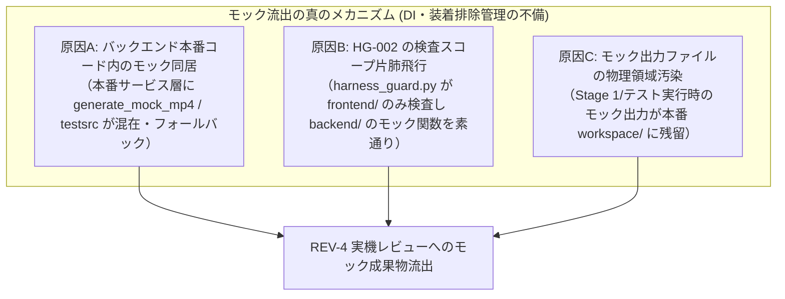
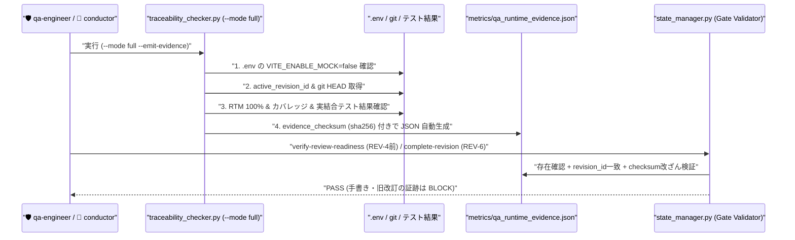
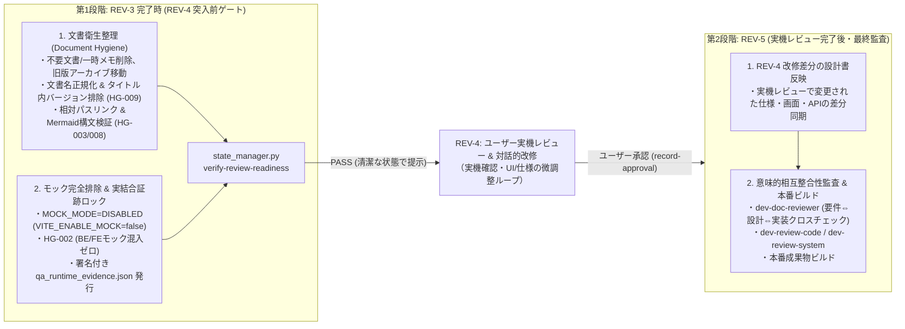

# 評価・考察レポート: V3.0 ハーネス死角フィードバックの客観的評価と改善設計案（モック管理・証跡機械化・REV-4前ゲート設計）

- **文書ID**: `EVAL-PL-002`
- **対象文書**: [パイプライン改善フィードバック報告書: V3.1 AIハーネス死角克服と意味的監査の導入](./パイプライン改善フィードバック報告書_V3.1_AIハーネス死角克服と意味的監査の導入.md)
- **先行評価文書**: [評価・考察レポート: system-dev-pipeline 抜本的改革案（ISSUE-PL-001）の客観的評価・弊害分析および対案提示](./評価考察_system-dev-pipeline抜本的改革案の客観的評価と対案.md) (`EVAL-PL-001`)
- **対象システム**: `system-dev-pipeline` (現行バージョン: V3.0.0 ➔ 改善反映ターゲット: V3.0.1 / V3.1.0)
- **作成日**: 2026-11-10
- **関連スクリプト・規約**:
  - [AGENTS.md](../../../.agents/plugins/system-dev-pipeline/rules/AGENTS.md)
  - [state_manager.py](../../../.agents/plugins/system-dev-pipeline/scripts/state_manager.py)
  - [harness_guard.py](../../../.agents/plugins/system-dev-pipeline/scripts/harness_guard.py)
  - [traceability_checker.py](../../../.agents/plugins/system-dev-pipeline/scripts/traceability_checker.py)
  - [システム改訂運用基準書テンプレート](../../../.agents/plugins/system-dev-pipeline/templates/システム改訂運用基準書.md)

---

## 1. エグゼクティブ・サマリ（総合評価）

[パイプライン改善フィードバック報告書](./パイプライン改善フィードバック報告書_V3.1_AIハーネス死角克服と意味的監査の導入.md) にて報告された「単体・結合テストおよび RTM・Hard Gate がすべて合格（100% PASS）した状態で、ユーザー実機レビュー（`REV-4`）に開発用モック（カラーバー映像 `testsrc`・正弦波音声 `sine=440`）や未整理の文書群がそのまま提示された事象」は、V3.0.0 パイプラインの運用設計における重要な死角を突いている。

しかし、報告書の原因分析（死角①〜③）と改善提言（提言1〜4）を客観的なソフトウェア工学およびハーネス設計の観点から俯瞰すると、**「対処すべき本質的欠陥（死角②・③）」と「過剰特化による副作用を招く対症療法（死角①に対する RGB/FFT 波形監査の標準組込）」を明確に切り分ける必要がある**。

本レポートにおける結論は以下の3点に集約される：

1. **死角①（モック流出問題）への見解 — 「事後コンテンツ波形監査」ではなく「モックの装着・排除と出力隔離の厳格管理」で解決すべき**:
   - 報告書が提言する「Active Semantic Auditor（RGB ヒストグラム解析や FFT 周波数スペクトル解析の標準ハーネス化）」は、特定の FFmpeg フィルタ（`testsrc` / `sine=440`）への過剰適合（Over-fitting）であり、第2の Goodhart の法則（ノイズ波形やグラデーション生成による容易な回避）を招くため、汎用パイプラインの標準機構としては不適切である。
   - 本事象の真因は「生成されたファイルの中身を FFT 解析しなかったこと」ではなく、**「本番コード経路へのモック生成ロジックの混入（DI 境界の未分離）」および「モック動作時に生成されたダミーファイルの実ワークスペース残留（モックの装着・排除管理の不備）」** にある。したがって、専用のメディア波形監査機構を新設するのではなく、`harness_guard.py`（`HG-002`）によるバックエンドモック混入・フォールバック遮断と、モック解除時の出力領域クリーンアップ（装着と排除の規律徹底）によって根絶すべきである。
2. **死角②（`qa_runtime_evidence.json` の自己申告構造）への見解 — 実装バグの即時修正と「ツール直結・署名付き自動生成」の導入**:
   - 現行 [state_manager.py](../../../.agents/plugins/system-dev-pipeline/scripts/state_manager.py) を実コード監査した結果、そもそも証跡 JSON を機械生成するスクリプトが存在せず（エージェントの手書き自己申告に依存）、さらに **「ファイル自体が存在しない場合はエラーにならず素通りする（`if qa_evidence_path.is_file():`）」という致命的な実装欠陥** が確認された。
   - エージェントによる JSON 直接編集を禁止し、`traceability_checker.py --mode full`（またはテスト実行ラッパー）が実テスト結果・環境変数（`VITE_ENABLE_MOCK=false`）・対象改訂ID（`active_revision_id`）を検証した上で、SHA-256 チェックサム付きで決定論的に証跡 JSON を発行する仕組みへ改修する必要がある。
3. **死角③（`REV-4` 突入前ゲートの欠落とドキュメント整理時期）への見解 — ドキュメント精査の「2段階分離（`REV-3` 衛生整理 vs `REV-5` 仕様整合）」と Pre-Review Gate の新設**:
   - 現行パイプラインがドキュメント相互整合性チェック（`dev-doc-reviewer`）を `REV-5` に配置しているのは、「`REV-4` のユーザー実機レビューにおける対話的改修（仕様・UIの微調整）を最終設計書へ反映するため」という合理的な理由に基づく。
   - しかし、その結果として **「文書名の規約違反（`HG-009`）、不要文書・旧版ファイルの放置、リンク切れ、およびモック未解除状態」のままユーザーを `REV-4` に招き入れる死角** が生じていた。
   - これを解決するため、ドキュメント管理を **「第1段階（`REV-3` 完了時 / `REV-4` 直前）：文書名・不要文書整理・形式衛生の確立」** と **「第2段階（`REV-5`）：`REV-4` 改修差分の仕様書反映・内容整合性監査」** の2段階に明確に分離し、`state_manager.py` に `REV-4` 突入前ゲート（`verify-review-readiness`）を実装する。

---

## 2. 報告事象と「3大死角」の客観的検証（実コード照合診断）

フィードバック報告書が挙げた3つの死角について、主観や推測を排し、現行 V3.0.0 のスクリプト実装およびプロセス定義と照合した客観的診断結果を以下に示す。

### 2.1 死角①の検証：なぜ開発用モック（`testsrc` / `sine=440`）が `REV-4` に流出したのか？

報告書は「ハーネスがファイルの構文正常性（`is_file()` や `ffprobe`）しか見ておらず、コンテンツの意味的真偽（RGB や音声波形）を検査しなかったこと」を死角①として挙げている。しかし、システムアーキテクチャの観点から因果関係を辿ると、本質的な原因は別の箇所にある。



1. **[harness_guard.py](../../../.agents/plugins/system-dev-pipeline/scripts/harness_guard.py) における `HG-002`（直書きモック排除）のスコープ欠落**:
   - 現行 [harness_guard.py](../../../.agents/plugins/system-dev-pipeline/scripts/harness_guard.py) の 108〜116行目を確認すると、`HG-002` は `src/components/`, `src/pages/`, `src/hooks/`, `src/services/`（フロントエンド領域）のみを対象に `mockUsers|dummyData|MOCK_*` を検査している。
   - すなわち、**バックエンド（`backend/`）の本番サービス層に `generate_mock_mp4` や FFmpeg の `testsrc` / `sine=440`、あるいはエラー時にダミーファイルを生成して返すフォールバック処理が直書きされていても、`HG-002` は一切検知しない**。
2. **モックの「装着」と「排除（アンマウント＋キャッシュ消去）」のライフサイクル未定義**:
   - フロントエンドの MSW モックは `VITE_ENABLE_MOCK=false` の環境変数切替で比較的容易にパージできるが、ファイル出力を伴うバックエンド処理において、開発・単体テスト時に生成されたモック用メディアファイルが実行ワークスペース（`workspace/` 等）に書き出されたまま放置されると、環境変数を本番モードに切り替えても「既にディスク上に存在するモックファイル」がそのまま参照・再生されてしまう。

### 2.2 死角②の検証：`qa_runtime_evidence.json` の自己申告構造とスクリプト上の欠陥

報告書が指摘する「自己申告型の JSON 監査は AI エージェントの過信・思い込みによるすり抜けを防げない」という指摘は、現行 [state_manager.py](../../../.agents/plugins/system-dev-pipeline/scripts/state_manager.py) の実装事実によって 100% 裏付けられる。

1. **実コード上の致命的欠陥（ファイル不在時のサイレントパス）**:
   - [state_manager.py](../../../.agents/plugins/system-dev-pipeline/scripts/state_manager.py) の 538〜548行目（`validate_revision_closure_invariants` 関数内）は以下の実装となっている：
     ```python
     # 5. 実結合QA実行証跡 (qa_runtime_evidence.json) 検証 (V3.0.0)
     qa_evidence_path = Path("metrics/qa_runtime_evidence.json")
     if qa_evidence_path.is_file():
         try:
             qa_data = json.loads(qa_evidence_path.read_text(encoding="utf-8"))
             if not qa_data.get("mock_mode_disabled"):
                 violations.append("[INV-QA-01] ...")
     ```
   - `if qa_evidence_path.is_file():` に対する **`else:` 分岐（ファイルが存在しない場合の `violations.append`）が欠落している**。つまり、`metrics/qa_runtime_evidence.json` を作成し忘れた（存在しない）場合、エラーにならず無条件で Invariants Gate を通過してしまうバグが存在する。
2. **生成主体の不在（LLM による手書き JSON の許容）**:
   - パイプライン内のどのスクリプト（`traceability_checker.py`, `harness_guard.py`, `state_manager.py`）にも、`metrics/qa_runtime_evidence.json` を生成・出力するコードが存在しない。
   - その結果、エージェントは `REV-3` において `write_file` ツール等で手動作成した JSON を配置しており、テスト実行結果や環境状態との機械的な紐づけ（署名・改訂ID一致・タイムスタンプ検証）が全く働いていない。

### 2.3 死角③の検証：`REV-4` 突入前ゲートの不在とドキュメント整理のタイミング問題

現行の [システム改訂運用基準書テンプレート](../../../.agents/plugins/system-dev-pipeline/templates/システム改訂運用基準書.md) および [state_manager.py](../../../.agents/plugins/system-dev-pipeline/scripts/state_manager.py) のフェーズ設計を照合すると、以下の構造的ギャップが確認できる。

1. **`REV-4`（ユーザー実機レビュー）の位置づけとゲート配置の非対称性**:
   - 初回開発フェーズ（`PHASE 1`〜`8`）では、[state_manager.py](../../../.agents/plugins/system-dev-pipeline/scripts/state_manager.py) の `cmd_set_phase`（244〜259行目）において、`PHASE_4` 遷移時に `arch_review == PASS`、`PHASE_6` 遷移時に `code_review == CLEAN`、`PHASE_7` 遷移時に `system_review == RELEASE APPROVED` を要求する Gate Interlock が実装されている。
   - これに対し、改訂パイプライン（`REV-1`〜`REV-6`）では、**すべての機械的検証（`validate_revision_closure_invariants`）が最終フェーズである `REV-6` の `complete-revision` 実行時に一括集中しており、`REV-3` から `REV-4`（ユーザー提示）へ進む時点でのインターロックが存在しない**。
2. **「仕様内容の最終精査（`REV-5`）」と「文書構成・不要文書の整理（`REV-4` 前）」の混同**:
   - `REV-4` ではユーザーが実機を触りながら追加要望や UI/挙動の微修正を指示する（対話的改修ループ）ため、仕様書本文の細部やレビュー結果報告書の最終確定を `REV-5` で行う設計自体は非常に合理的である。
   - しかし、**「不要になった旧検討メモ・一時ファイルの削除」「旧バージョン設計書のアーカイブ移動」「正本設計書ファイル名やタイトルからの個別バージョン番号排除（`HG-009`）」「相対パスリンク切れ解消（`HG-003`）」といったドキュメントの衛生整理（Document Hygiene）** まで `REV-5` に後回しにした結果、ユーザーが `REV-4` でワークスペースを確認した際に、未整理の不要文書や規約違反の文書名が目に入る事態を招いている。

---

## 3. フィードバック報告書の改善提言に対する客観的評価と対案

フィードバック報告書の提言1〜4に対する評価マトリクスと、ユーザー見解を踏まえた最適化対案を以下に示す。

### 3.1 改善提言の評価マトリクス

| 対象死角 | フィードバック報告書の提言 | 客観的評価 | 採否判定と理由 (Pros / Cons) | 本レポートの推奨対案 (Counter-Proposals) |
| :--- | :--- | :---: | :--- | :--- |
| **死角①**<br>モック成果物の流出 | **提言1 & 4**:<br>`+trait:media-export` における「Active Semantic Auditor（RGBヒストグラム・FFT波形解析）」の標準スクリプト組込と全数走査 | **✕ 不採用**<br>（過剰特化・対症療法） | **【Cons】**<br>・`testsrc` や `sine=440` という特定コマンドへの過剰適合であり、汎用パイプラインの責務を逸脱<br>・AIがホワイトノイズやグラデーションを生成すれば容易にすり抜ける（第2のGoodhart化）<br>・モックの装着/排除さえ正しく管理すれば不要な機構 | **【対案1】モックの装着・排除ライフサイクルとDI境界の厳格管理**<br>1. `HG-002` をバックエンド・CLI領域へ拡張し、本番コード内のモック生成関数・ダミーフィルタ（`testsrc`, `sine=` 等）・例外時モックフォールバックを静的遮断<br>2. モック動作時の出力先を本番 `workspace/` から物理隔離し、モックOFF切替時にモック由来キャッシュを強制パージ |
| **死角②**<br>`qa_runtime_evidence.json` の自己申告 | **提言3**:<br>エージェントの手書き廃止と、ツールによる疎通ログ・SHA-256ハッシュの直接埋め込み・署名化 | **◎ 採用**<br>（要軽量化・標準化） | **【Pros】**<br>・AIの思い込みによる自己申告 PASS を決定論的に防止可能<br>**【Cons】**<br>・音声スペクトル解析結果まで JSON に埋め込むのは過剰であり、テストランナー実行結果とモック設定状態の署名拘束で十分 | **【対案2】`traceability_checker.py` 等による証跡JSONの決定論的生成と `state_manager.py` 検証バグ修正**<br>1. `state_manager.py` のファイル不在時素通りバグ（`else:` 欠落）を即時修正<br>2. 証跡JSONはスクリプトのみが生成し、`active_revision_id`・`git_head`・`.env` のモックOFF状態・テスト終了コードを束ねた `evidence_checksum` で改ざん・手書きを遮断 |
| **死角③**<br>`REV-4` 突入前ゲートの欠落 & 文書未整理 | **提言2**:<br>`state_manager.py verify-review-readiness` の新設と開発サーバー起動前ブロック | **◎ 採用**<br>（文書整理の2段階化を統合） | **【Pros】**<br>・ユーザー実機レビュー（`REV-4`）の前に不備を機械遮断できるため手戻り防止効果が極めて高い<br>・`REV-4` 前の文書整理（文書名・不要文書排除）を組み込む絶好のゲートとなる | **【対案3】ドキュメント精査の「2段階分離」と `REV-4` Pre-Review Readiness Gate の実装**<br>1. **REV-3完了時（REV-4前）**: 文書名正規化・不要文書整理・`harness_guard.py --all`・モック完全解除・証跡JSONを `verify-review-readiness` で機械検証<br>2. **REV-5**: `REV-4` の対話的改修結果を反映した上でのドキュメント相互整合性（`dev-doc-reviewer`）と最終監査を実施 |

---

### 3.2 各改善領域の深掘り考察と具体的設計

#### (1) 死角①への対応：監査用波形解析を設けず「モックの装着と排除」を構造的に統制する設計

ユーザーの指摘通り、**「開発・単体テスト時にモックをどう装着し、実結合（`REV-3` Stage 2）および実機レビュー（`REV-4`）に入る際にどう排除するか」** が明確に管理されていれば、出力された動画の色や音声の周波数を検査する監査ツールは一切不要である。

具体的には、以下の **3つの管理ルール（コード境界・設定切替・ストレージ隔離）** に集約する：

1. **コード境界の徹底（`harness_guard.py` `HG-002` のバックエンド拡張）**:
   - **原則**: 本番実行されるモジュール（`backend/app/`, `src/`, `frontend/src/` のうち `mocks/` や `tests/` 以外）の中に、モックデータやダミーメディアを生成するロジック（`generate_mock_*`, `testsrc`, `sine=`, `anoisesrc`, `Mock*` クラス）を同居させてはならない。また、`try ... except` で本番処理が失敗した際にモック生成へフォールバックする実装（Silent Mock Fallback）を全面禁止する。
   - **機械的ガード**: `harness_guard.py` の `HG-002` の検査対象をフロントエンドだけでなく `backend/` および `src-tauri/` にも拡大し、本番コード内のモック生成識別子・ダミー生成コマンド文字列・例外フォールバックをコミット時点で `BLOCK` する。
2. **設定切替の一元化（`MOCK_MODE` と `.env` の連動検証）**:
   - `Stage 1`（単体・MSW検証）と `Stage 2 / REV-4`（実結合・実機レビュー）の切り替えにおいて、`.env` の `VITE_ENABLE_MOCK=false`（およびバックエンドのモック無効化設定）と `project_state.json` の `"mock_mode": "DISABLED"` を同期させる。
3. **ストレージ隔離（モック生成物の本番ワークスペース汚染防止）**:
   - テストやモック動作時に出力される一時ファイル・ダミーファイルは、必ず `tmp/` や `tests/ results/` などの隔離ディレクトリ（または `pytest` の `tmp_path` フィクスチャ）へ出力させ、ユーザーが `REV-4` で参照する実ワークスペース（`workspace/` や本番 DB）には一切書き込ませない。

---

#### (2) 死角②への対応：`qa_runtime_evidence.json` の決定論的生成と自己申告の排除

AI エージェントが「テストが通ったから大丈夫だろう」と自らの手で `metrics/qa_runtime_evidence.json` を作成・編集する余地をなくすため、`PROJECT_STATE.md` と同じ **「スクリプト専任生成 ＋ SHA-256 チェックサム検証」** アーキテクチャを適用する。



1. **[state_manager.py](../../../.agents/plugins/system-dev-pipeline/scripts/state_manager.py) の検証ロジック修正**:
   - `metrics/qa_runtime_evidence.json` が**存在しない場合は即座に `[INV-QA-01]` 違反として `BLOCK`** する（現行の `if qa_evidence_path.is_file():` 素通りバグの修正）。
   - JSON 内に記録された `revision_id` が `project_state.json` の `active_revision_id` と一致していることを検証する（過去の改訂で出力された古い証跡 JSON の使い回しを防止）。
   - ペイロードから計算した SHA-256 ハッシュと `evidence_checksum` フィールドを照合し、エージェントがテキスト編集ツール（`write_file` / `edit_file`）で JSON を手書き・改ざんした場合はチェックサム不一致で遮断する。
2. **[traceability_checker.py](../../../.agents/plugins/system-dev-pipeline/scripts/traceability_checker.py) への証跡発行機能の統合**:
   - 新たなスクリプトを増やして管理を複雑化させるのではなく、`REV-3` で必ず実行される `traceability_checker.py --mode full` が全要件のテストカバレッジ・異常系比率・動的カバレッジ基準の PASS を確認した際、あわせて `.env` のモック設定（`VITE_ENABLE_MOCK=false`）および `harness_guard.py --all` の結果を確認し、署名付きの `metrics/qa_runtime_evidence.json` を自動出力する。

---

#### (3) 死角③への対応：ドキュメント精査の「2段階分離」と `REV-4` 突入前レディネスゲート

ユーザーの指摘にある **「`REV-4` でのレビューによってシステムに変更を加える可能性があるため、最終的な仕様内容の精査は `REV-5` に置くべきだが、文書名や不要文書の整理などは `REV-4` の前に済ませておくべき」** という方針は、改訂パイプラインの手戻り最小化とレビュー品質向上の両面から極めて合理的である。

これをパイプライン規約およびツールに落とし込むため、改訂フェーズにおけるドキュメント管理と検証ゲートを以下の **2段階（Stage A / Stage B）** に再定義する。



##### ドキュメント精査の2段階分離テーブル

| 区分 | 実施フェーズ | 目的 | 具体的な実施・検査項目 | 検証手段 |
| :--- | :---: | :--- | :--- | :--- |
| **第1段階:<br>ドキュメント衛生・構造整理**<br>(Document Hygiene & Structure) | **`REV-3` 完了時**<br>（`REV-4` 突入直前） | ユーザーが `REV-4` で実機とワークスペースを閲覧する前に、不要なゴミファイルや命名規則違反、初期実装分の未反映を一掃し、整然とした状態でレビューを迎える。 | 1. **不要文書の整理・削除**: 作業用の一時メモ、重複ドラフト、不要になった検証ファイルの削除<br>2. **アーカイブ分離**: `docs/設計書/Current/` には現行正本のみを置き、旧版文書は適切なアーカイブ/履歴フォルダへ移動<br>3. **文書名・タイトル規約遵守**: ファイル名の正規化、正本タイトルからの個別バージョン表記 `(v1.x)` 排除（`HG-009`）<br>4. **リンク・構文健全性**: 相対パスリンク切れゼロ（`HG-003`）、Mermaid ラベルクォート遵守（`HG-008`）<br>5. **`REV-1〜2` 実装分のベースライン反映**: 実機レビュー前に既知となっている仕様変更の反映 | `harness_guard.py --all`<br>＋<br>`state_manager.py verify-review-readiness` |
| **第2段階:<br>ドキュメント内容・相互整合性精査**<br>(Semantic Cross-Check & Final Sync) | **`REV-5`**<br>（`REV-4` 承認後） | `REV-4` のユーザー実機レビューおよび対話的改修ループで発生した仕様・UI・ロジックの変更を正本設計書へ過不足なく反映し、リリース前の完全な整合性を保証する。 | 1. **`REV-4` 改修差分の反映**: 実機レビュー中に変更された画面項目、API レスポンス、ビジネスロジック境界条件の設計書への逆反映<br>2. **多次元クロスチェック**: 要件定義書 ⇔ 4大基本設計書 ⇔ 実装コード間の意味的矛盾・記述漏れの精査<br>3. **改定履歴テーブルの最終更新**: 対象バージョン・改訂依頼番号・最終変更内容の記録 | `dev-doc-reviewer`<br>＋<br>`dev-review-code`<br>＋<br>`dev-review-system` |

##### `state_manager.py verify-review-readiness`（REV-4 突入前物理ゲート）の仕様

`REV-3` を完了して `REV-4`（開発サーバー起動・ユーザー実機レビュー要請）へ進む際、および `record-approval --phase REV_4` を実行する際の前提条件として、`state_manager.py` に `verify-review-readiness` サブコマンド（およびフェーズ遷移インターロック）を設ける。本コマンドは以下の4項目を機械検査し、1つでも未達があれば Exit Code 1 で遮断する：

1. **Hard Gate 完全合格（`HG-001`〜`HG-011`）**:
   - `harness_guard.py --all` を内部呼び出しし、コードおよびドキュメントの形式違反（`HG-002` モック混入、`HG-003` 絶対パス、`HG-008` Mermaid 構文、`HG-009` 正本文書タイトルのバージョン混入、`HG-010` 空実装）が **0件** であること。
2. **ドキュメントディレクトリの衛生状態確認（Document Hygiene Check）**:
   - `docs/設計書/` 直下に未整理の野良ファイルが放置されていないこと（正本は `docs/設計書/Current/` に集約されていること）。
   - `docs/設計書/Current/` 配下に `.bak`, `.tmp`, `_old`, `_draft` やバージョン番号付きファイル名（例: `*_v1.0.md`）などの未整理文書が混入していないこと。
3. **モック解除状態の物理確認（Mock Disengagement Check）**:
   - `.env` ファイルが存在する場合、`VITE_ENABLE_MOCK=true` が有効になっていないこと（`VITE_ENABLE_MOCK=false` であること）。
   - `project_state.json` の `mock_mode` が `"DISABLED"`（実結合モード）に切り替えられていること（または `verify-review-readiness` 合格時に自動で `"DISABLED"` へ更新）。
4. **最新・署名付き `qa_runtime_evidence.json` の実在と妥当性**:
   - `metrics/qa_runtime_evidence.json` が実在し、`revision_id` が現在進行中の `active_revision_id` と一致し、`mock_mode_disabled == true` かつ `overall_status == "PASS"` であり、`evidence_checksum` が正当であること。

---

## 4. パイプラインへの具体的な改修アクションプラン

本考察に基づき、`system-dev-pipeline`（V3.0 系）へ反映すべき具体的な改修項目を以下の4点に整理する。いずれも外部ライブラリ依存を追加せず、既存の標準 Python スクリプト群と規約テンプレートの改修のみでクリーンに実装可能である。

| 優先度 | 改修対象ファイル | 改修内容の要点 | 解決する死角 |
| :---: | :--- | :--- | :---: |
| **P1**<br>(即時) | `scripts/harness_guard.py`<br>(`skeletons/common/scripts/` 同期) | **1. `HG-002`（モック混入・フォールバック遮断）のバックエンド拡大**:<br>・検査対象に `backend/` や `src-tauri/`（テスト・モック専用ディレクトリ除く）を追加し、`generate_mock_*`、`testsrc`、`sine=`、`anoisesrc` 等のダミー生成記述および `except` ブロック内でのモック返却を `BLOCK`。<br>**2. `HG-009`（文書衛生検査）の強化**:<br>・`docs/設計書/Current/` 内のタイトルだけでなく、ファイル名自体のバージョンサフィックス（`*_v1.*.md` 等）や一時ファイル（`*.bak`, `*draft*`）の混入、および `docs/設計書/` 直下の未整理ファイル放置を検知・遮断。 | **死角①**<br>**死角③** |
| **P1**<br>(即時) | `scripts/state_manager.py`<br>(`skeletons/common/scripts/` 同期) | **1. `validate_revision_closure_invariants` のバグ修正と署名検証**:<br>・`metrics/qa_runtime_evidence.json` 不在時に `[INV-QA-01]` で確実に `BLOCK` する `else` 分岐を追加。<br>・`revision_id == active_revision_id` および `evidence_checksum` の整合性検査を追加。<br>**2. `verify-review-readiness` サブコマンド（REV-4 突入前ゲート）の新設**:<br>・`REV-4` 開始前（および `set-phase REV_4` 時）に、`harness_guard.py --all` PASS、文書整理状態、モック解除状態、`qa_runtime_evidence.json` の適合性を一括検証するゲートを実装。 | **死角②**<br>**死角③** |
| **P2**<br>(高) | `scripts/traceability_checker.py`<br>(`skeletons/common/scripts/` 同期) | **1. `metrics/qa_runtime_evidence.json` の決定論的自動生成**:<br>・`--mode full` 合格時に、現行の `active_revision_id`、`git rev-parse HEAD`、`.env` の `VITE_ENABLE_MOCK` 状態、RTM カバレッジ結果、および改ざん防止用 `evidence_checksum`（SHA-256）を格納した証跡 JSON を機械出力する機能を追加（エージェントの手書きを廃止）。 | **死角②** |
| **P2**<br>(高) | `rules/AGENTS.md`<br>`templates/システム改訂運用基準書.md`<br>`skills/dev-doc-reviewer/SKILL.md` | **1. ドキュメント精査の2段階分離と `REV-3`/`REV-4` 手順の明文化**:<br>・`REV-3` の完了条件に「第1段階：文書名・不要文書の衛生整理」と `python3 scripts/state_manager.py verify-review-readiness` の PASS を追加。<br>・`REV-4` の前提条件として、モックの完全排除（出力領域のクリーンアップ含む）と `verify-review-readiness` 合格を義務化。<br>・`REV-5` は「第2段階：`REV-4` 改修差分の設計書反映と意味的相互整合性監査（`dev-doc-reviewer`）」であることを明確化。 | **死角①**<br>**死角③** |

---

## 5. 総括

今回のフィードバック事象から得られる最大の教訓は、**「出口で生成物のピクセルや音声波形を解析する複雑な監査網（Active Semantic Auditor）を張り巡らせるよりも、入口と経路でモックの装着・排除を厳格に分離し、ユーザーレビュー（`REV-4`）の手前に決定論的なレディネスゲート（文書衛生＋モック解除＋機械生成証跡）を置く方が、遥かにシンプルかつ確実に死角を塞げる」** という点である。

1. **死角①** は、特別な波形解析ツールを作らずとも、`HG-002` のバックエンド適用（本番コードへのモック生成混入遮断）とモック出力先の物理隔離・パージという**「モックの装着と排除の規律」**で根本解決できる。
2. **死角②** は、`state_manager.py` のファイル不在素通りバグを塞いだ上で、`qa_runtime_evidence.json` を**エージェントの手書きからスクリプトによる署名付き機械生成**へ移行することで完全に克服できる。
3. **死角③** は、`REV-4` でのシステム変更を見越して最終的な仕様整合性監査（`dev-doc-reviewer`）を `REV-5` に残しつつ、**文書名の正規化や不要文書の整理、およびモック解除確認を `REV-3` 完了時の `verify-review-readiness` ゲートへ前倒しする「2段階分離モデル」**によって、手戻りのないクリーンな実機レビュー体験を実現できる。
