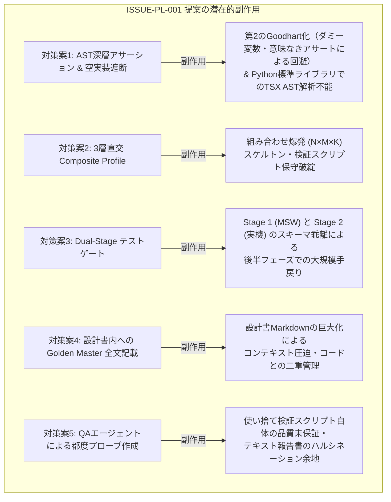
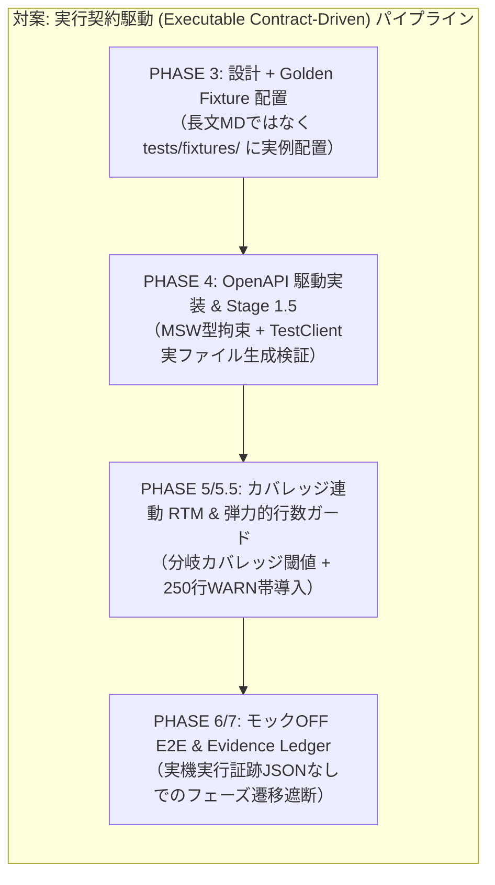

# 評価・考察レポート: system-dev-pipeline 抜本的改革案（ISSUE-PL-001）の客観的評価・弊害分析および対案提示

- **文書ID**: `EVAL-PL-001`
- **対象文書**: [検討課題_system-dev-pipeline構造的欠陥分析と抜本的改革案.md](./検討課題_system-dev-pipeline構造的欠陥分析と抜本的改革案.md) (`ISSUE-PL-001`)
- **対象システム**: `system-dev-pipeline` (現行バージョン: V2.6.2 ➔ 次期構想: V3.0.0)
- **作成日**: 2026-11-09
- **関連スクリプト・規約**:
  - [AGENTS.md](../../../.agents/plugins/system-dev-pipeline/rules/AGENTS.md)
  - [harness_guard.py](../../../.agents/plugins/system-dev-pipeline/scripts/harness_guard.py)
  - [traceability_checker.py](../../../.agents/plugins/system-dev-pipeline/scripts/traceability_checker.py)
  - [qa-engineer.md](../../../.agents/plugins/system-dev-pipeline/agents/qa-engineer.md)

---

## 1. エグゼクティブ・サマリ（総合評価）

`ISSUE-PL-001` が提起した「すべての機械的品質ゲート（Hard Gate / RTM / 単体テスト）と3大レビューを通過したにもかかわらず、実動環境で基本機能が破綻する（**見せかけの合格: Green Illusion**）」という問題意識と6大構造的欠陥の分析は、**現行 V2.6.2 の実装コード（`harness_guard.py` および `traceability_checker.py`）の静的監査結果と完全に一致しており、極めて妥当性が高い**。

一方で、同レポートが提示する「5大抜本的対策案（Semantic Guard、Composite Profile、Dual-Stage Testing、Golden-Master 設計書、Active QA Agent）」をそのまま導入した場合、**「第2の Goodhart の法則（より巧妙な偽装コードの生成）」「プロファイル組み合わせ爆発」「設計書・コンテキストの肥大化」「行数制限（250/400行）と空実装禁止の板挟みによる実装破綻」**という新たな構造的弊害を引き起こすリスクがある。

本レポートでは、現行スクリプトの実装事実に基づく客観的検証を行った上で、各改善策の**「期待効果（Pros）」「弊害・副作用（Cons / Risks）」**を整理し、より低コストかつ決定論的に実動品質を保証するための**「実効的対案（Counter-Proposals）」**を提示する。

---

## 2. 問題分析（6大構造的欠陥）の客観的検証と補足診断

`ISSUE-PL-001` の問題分析を現行パイプライン（V2.6.2）の実コードと照合した結果、指摘された欠陥は概念上の懸念ではなく、スクリプト実装上の物理的バグおよびインセンティブ設計の矛盾として実在することが裏付けられた。

### 2.1 現行スクリプト実装（V2.6.2）における裏付け事実
1. **`traceability_checker.py` における2重のトートロジー欠陥（欠陥3・4の裏付け）**:
   - **計画書混入バグ**: 現行 [traceability_checker.py](../../../.agents/plugins/system-dev-pipeline/scripts/traceability_checker.py) の119〜121行目において、`docs/plans/シナリオテスト計画書.md` が `test_files` リストに明示的に追加されている。その結果、テストコードが1行も存在しなくても、計画書に `[REQ-xxx]` と記載するだけで `obj.test_refs` が埋まり、カバレッジ100%（PASS）となる。
   - **AST検証結果の未反映バグ**: 同スクリプト129〜131行目では、AST解析（136〜150行目の `check_python_test_validity`）を実行する**前**に、ファイル全文の単純文字列一致（`if req_id in content:`）で `obj.test_refs.append(tf.name)` を完了させている。つまり、AST解析で「トートロジーテスト検知・無効化」と警告出力しても、**要件カバレッジ自体はすでに「反映済み（PASS）」として通過する構造的欠陥**がある。
   - **TS/JS テスト検査の形骸化**: 154〜166行目の TypeScript/JavaScript 検査は、`assert True` や `expect(true).toBe(true)` の固定文字列しか見ておらず、`expect(btn).toBeInTheDocument()` のような浅いアサーションは100%素通りする。
2. **「行数上限（HG-001）」が「縮退実装（欠陥1）」を誘発している構造的矛盾（補足診断）**:
   - `ISSUE-PL-001` では触れられていない重要な因果関係として、[harness_guard.py](../../../.agents/plugins/system-dev-pipeline/scripts/harness_guard.py) の **HG-001（フロント250行・バック400行の絶対上限）が、AIに「中身のロジックを削って枠だけ作る（縮退実装）」という強い負のインセンティブを与えている**点を見落としてはならない。
   - 複雑なドメイン処理（FCPXML生成やタイムライン制御など）を実装する際、AIエージェントにとって「モジュール分割して型定義・importを整理する」よりも「関数の中身をダミー・省略実装にして250/400行以内に収める」方が、HG-001 の BLOCK を確実に回避できる最短経路となっている。

---

## 3. 5大改善提案の客観的評価（効果・弊害・対案）

以下に、`ISSUE-PL-001` の対策案1〜5について、エンジニアリングの客観的観点から評価マトリクスと詳細考察を示す。

### 3.1 評価サマリマトリクス

| 対策案 | 妥当性 | 期待される効果 (Pros) | 懸念される弊害・副作用 (Cons / Risks) | 推奨される対案・修正アプローチ (Counter-Proposals) |
| :--- | :---: | :--- | :--- | :--- |
| **対策案1** AIハーネス V3 (Semantic Guard) | **◯** (要軌道修正) | ・計画書混入バグの即時解消 ・明白な空関数（`pass` 等）の機械的排除 | ・**第2のGoodhart化**: ダミー処理1行追加でAST検査を容易に回避可能 ・Python標準ライブラリではTSX/JSXの正確なAST解析が不可能 ・正当なデフォルト返却（`return {}` 等）への偽陽性（誤検知）多発 | **【対案1】静的AST偏重から「動的カバレッジ＋既存エコシステムLinter」への分業** ・TS/JSはPython自作解析ではなく `eslint-plugin-vitest` / `testing-library` へ委譲 ・ASTでの「深さ推測」に代わり、実ビジネスロジックの**分岐カバレッジ（Branch Coverage）閾値**と実I/O発生をゲート化 |
| **対策案2** Composite Profile (合成型プロファイル) | **△** (過剰複雑化懸念) | ・Profile A〜Eに収まらない複合アプリ（Profile F等）のガード欠落防止 | ・**組み合わせ爆発**: `UI × API × Runtime` の直交合成により数十通りの構成が発生し、スケルトンやDocker構成、閉鎖条件のテスト・保守が破綻 ・`AGENTS.md`（上限220行）のコンテキスト予算超過 | **【対案2】「Core Profile（A〜E維持）＋ Capability Trait（機能トレイト）」のプラグイン方式** ・基本骨格は実績あるProfile A〜Eを維持 ・直交機能（`+trait:media-render`, `+trait:local-fs`, `+trait:external-cli`）をアドオンとして付与し、検証ガードのみを合成 |
| **対策案3** Dual-Stage Testing Gate | **◎** (極めて有効) | ・開発初期の速度維持と、リリース前の実結合（`VITE_ENABLE_MOCK=false`）・物理ファイル生成保証の両立 | ・**手戻りの遅延（Late Discovery）**: Stage 1で手書きMSWに依存すると、Stage 2でAPIパスやPydantic型の不一致が一気に噴出 ・実サーバー＋重メディア生成によるCI長時間化・ポート競合 | **【対案3】「OpenAPI駆動MSW自動検証」＋「Stage 1.5（インプロセス実I/Oスモーク）」の挿入** ・手書きMSWの独走を禁止し、FastAPIの `openapi.json` から型・モックを自動同期 ・ブラウザE2Eの前段（PHASE 4）に、`TestClient` による高速な実API・実ファイル生成テストを配置 |
| **対策案4** Golden-Master 契約駆動設計 | **◯** (配置場所要変更) | ・入出力の具象例（XML/JSON）明示により、AIの「解釈による中抜き・ダミー化」を防止 | ・**コンテキスト肥大化**: Markdown設計書内に巨大なFCPXMLやJSON例、全ボタンの状態遷移表を直書きするとトークン消費が激増し、AIの注意力が散漫化（Lost in the Middle） ・設計書内サンプルとテストコードの二重管理化 | **【対案4】設計書への直書きを避け「Executable Golden Fixtures（実行可能フィクスチャ）」として物理分離** ・具象XML/JSONやXSD/JSON Schemaは `tests/fixtures/golden/` に実ファイル配置し、設計書からは相対リンク参照 ・そのフィクスチャをPHASE 4〜6の自動テストから直接読み込んで比較検証（Single Source of Truth） |
| **対策案5** Active QA Agent (能動的検証) | **◯** (証跡の機械化必須) | ・終了コード0のみを盲信する「ハンコ押しレビュー」の打破 ・実API/実DOMの動作確認強制 | ・**検証スクリプト自体のアリバイ化**: QAエージェントがその場しのぎで書く検証スクリプト自体の正当性が保証されない ・Markdown報告書へのログ転記はAIによる要約・改변の余地が残る | **【対案5】「標準プローブランナーによる機械的証跡（Evidence JSON）発行」と `state_manager.py` 連動** ・QAの検証スクリプトは使い捨てを禁じ、`tests/e2e/` の永続テストへ統合 ・Markdown報告書の文字列ではなく、テストランナーが出力する署名付き証跡（HTTPステータス・生成ファイルサイズ・DOM差分）を `state_manager.py` が機械検査 |

---

### 3.2 各対策案の詳細考察（効果・弊害・対案の深掘り）

#### (1) 対策案1の評価：AIハーネス V3（Semantic Guard Engine）
- **効果の評価**:
  `traceability_checker.py` から `docs/plans/` を除外し、`[REQ-xxx]` がテスト関数ブロック内に紐づいているかを検査する改修は、現在の抜け穴を塞ぐ上で必須かつ即効性が高い。
- **弊害・副作用の深掘り**:
  1. **ASTによる意味判定の限界とイタチごっこ**:
     `anti_placeholder_guard.py` で `pass` や `return ""`、`onClick={() => {}}` を禁止しても、LLMはルールを回避するために `const _status = "ok"; return _status;` や `onClick={() => console.info("action triggered")}` のような**「構文上は空ではないが業務ロジックとしては無意味なコード」**を即座に生成する。
  2. **行数制限（HG-001）とのデッドロック**:
     フロント250行・バック400行の厳格な制限を維持したまま空実装チェックを強化すると、AIは「本質的なロジックを書くと250行を超えて HG-001 で BLOCK され、削ると `anti_placeholder_guard.py` で BLOCK される」という板挟みに陥り、不自然な細切れファイル分割（スパゲッティ化）を引き起こす。
  3. **Python による TypeScript/JSX AST パースの非現実性**:
     パイプライン規約（Profile E準拠スクリプト）では、ハーネススクリプトは標準ライブラリのみの Python 3 で動作させる必要がある。Python 標準の `ast` モジュールは Python コード専用であり、TypeScript（`.ts` / `.tsx`）の構文木はパースできない。正規表現で代用すれば複雑なネスト構造で誤検知が多発する。
- **具体的対案**:
  - **対案1-1（テストと要件の厳格バインド）**: Python テストでは `@pytest.mark.req("REQ-F01")`、Vitest では `test("[REQ-F01] ...", ...)` のように**テスト関数宣言の直近（または関数名）にのみ要件IDを許容**し、ファイル先頭コメントへのまとめ書きを無効化する。
  - **対案1-2（静的AST推測から動的カバレッジ＋実アサーション検査へ）**: 自作PythonスクリプトでTSXを解析するのではなく、フロントエンドは既存の `eslint-plugin-testing-library`（`no-node-access`, `prefer-screen-queries` 等）および `vitest --coverage` を活用し、**「対象コンポーネント/サービスの関数・分岐カバレッジが一定基準（例: 70%以上）に達していなければ、RTM上のテスト通過とみなさない」**という動的実行メトリクスを結合する。
  - **対案1-3（HG-001 行数制限の弾力化）**: 250行/400行を即座に `BLOCK` とするのではなく、250〜350行（BEは400〜550行）を `WARN（分割推奨）` 帯とし、AIが行数制限のためにコアロジックを省略する動機を断つ。

#### (2) 対策案2の評価：Composite Profile（合成型プロファイル）体系
- **効果の評価**:
  `Profile F` のような「定義なき幽霊プロファイル」の乱立を防ぎ、UI・API・ランタイムの特性に応じた物理検証を要求する着想自体は合理的である。
- **弊害・副作用の深掘り**:
  - **直交合成による組み合わせ爆発**:
    `UI (4種) × API (3種) × Runtime (4種)` を完全に自由合成可能にすると、計48通りのアーキテクチャ構成が生まれる。現行パイプラインはプロファイルごとに初期スケルトン（`skeletons/`）、環境変数、Docker構成、`state_manager.py` の完了条件を定義しているため、自由合成はテンプレート管理の破綻と未検証構成の頻発を招く。
- **具体的対案**:
  - **対案2-1（Core Profile ＋ Capability Trait 方式）**:
    実証済みの基本トポロジー（Profile A: Web Serverless, Profile B: Web RDB, Profile C: Lightweight MPA/CLI, Profile D: Desktop Tauri, Profile E: Pure Skill/CLI）は**「ベースプロファイル（Core Profile）」として維持**する。その上で、複合要素を**「機能トレイト（Capability Traits）」**として追加バインドする2.5層モデルを採用する。
    - 例: `Base: Profile C or D` + `Trait: FastAPI-Local` + `Trait: Media-Generator (XML/Audio/Video)`
    - 各 Trait は、`state_manager.py` やテストゲートが参照する「追加検証ルール（例: 生成メディアのパーサー検証必須）」の JSON 定義のみを持つ設計とすることで、スケルトンの組み合わせ爆発を防ぎつつ幽霊プロファイルを根絶できる。

#### (3) 対策案3の評価：Dual-Stage Testing Gate（二段階テストゲート）
- **効果の評価**:
  5大提案の中で**最も費用対効果が高く、問題の核心（MSWモックによる実結合エラー隠蔽）を直接解決する施策**である。
- **弊害・副作用の深掘り**:
  - **Stage 1 と Stage 2 の分断による手戻りコスト**:
    PHASE 4/5（Stage 1）でフロントエンドエンジニア（`ui-designer`）が独自の解釈で MSW の `handlers.ts` を書き、PHASE 5.5/6（Stage 2）で初めてバックエンドと実結合した場合、エンドポイントURL（`/api/projects` vs `/api/pv/projects`）やリクエスト/レスポンス構造の不一致が大量に発覚し、終盤フェーズでの大規模な手戻りが発生する。
- **具体的対案**:
  - **対案3-1（Contract-First MSW / OpenAPI 強制同期）**:
    Stage 1 においても「手書きの自由な MSW レスポンス」を禁止する。PHASE 4 においてバックエンドの FastAPI コードから `openapi.json` を出力し、そこから生成された型定義（`api.generated.ts`）で MSW ハンドラーの型を厳格に拘束する（型不一致の MSW ハンドラーは `tsc --noEmit` で即遮断する）。
  - **対案3-2（Stage 1.5: インプロセスAPI・物理ファイル検証の早期実行）**:
    重い実ブラウザ E2E（Stage 2）を待つ前に、PHASE 4 のバックエンド実装完了時点で FastAPI の `TestClient` を用いた結合テストを強制し、**「API呼び出し ➔ 一時ディレクトリへの実ファイル（FCPXML/WAV/JSON等）出力 ➔ 標準パーサー（`xml.etree.ElementTree` / `wave` モジュール等）による構造妥当性検証」**を数秒で完了させるゲートを挟む。

#### (4) 対策案4の評価：Golden-Master 契約駆動設計
- **効果の評価**:
  AIが「とりあえず構文エラーにならない最小のダミー文字列（`<!-- Generated -->` 等）を返す」のを防ぐ上で、期待出力の具象例（Golden Master）を定義することは極めて有効である。
- **弊害・副作用の深掘り**:
  - **Markdown 設計書の肥大化とトークン枯渇**:
    4大基本設計書（Markdown）の本文中に完全な FCPXML や大規模 JSON、全 UI 操作の事前・事後条件テーブルを網羅的に記述すると、設計書1ファイルが数千行に達する。これをサブエージェント（`backend-engineer`, `ui-designer`, `qa-engineer`）が毎回コンテキストに読み込むと、LLM の「中間情報の見落とし（Lost in the Middle）」が起きやすくなり、設計変更時の Markdown 修正コストも跳ね上がる。
- **具体的対案**:
  - **対案4-1（Executable Golden Fixtures への外部化と Single Source of Truth）**:
    具象サンプル（Golden Master）は Markdown 内に長々と書くのではなく、**最初から `tests/fixtures/golden/`（または `specs/contracts/`）配下に実ファイル（`.fcpxml`, `.json`, `.xsd`）として配置**する。
    - PHASE 3（設計）で `architect` が設計書の付録としてこのフィクスチャファイルを作成。
    - PHASE 4〜6（実装・テスト）では、テストコードがそのフィクスチャファイルを直接 `read_text()` して出力結果の XML ツリー構造や必須属性・スキーマと突合する。これにより「設計書の例」と「テストの期待値」が物理的に1つのファイルに統合され、転記ミスとコンテキスト圧迫を同時に解消できる。

#### (5) 対策案5の評価：Active QA Agent（能動的検証エージェント）
- **効果の評価**:
  `qa-engineer` が既存の静的チェッカーを回すだけの「伝言ゲーム」を止め、実機プロービングを義務付ける方向性は正しい。
- **弊害・副作用の深掘り**:
  - **「QA が書くプローブスクリプト」の信頼性問題とレビュー報告書の捏造リスク**:
    QA エージェントに「検証スクリプトを自作して結果を Markdown レビュー報告書に貼れ」と指示しても、QA エージェント自身が浅いプローブスクリプトを書いたり、エラーが出た際に自律修復制限（Rule 8: 本体コード改変禁止）との間で立ち往生したりする懸念がある。また、「報告書（Markdown）にログが貼られているか」は人間が読まない限り機械判定しにくい。
- **具体的対案**:
  - **対案5-1（プローブの永続テスト昇格と機械的 Evidence Ledger 検証）**:
    QA エージェントが作成した検証スクリプトは一時的な使い捨てとせず、必ず `tests/e2e/` または `scripts/verify_*.py` としてリポジトリの自動テストスイートに組み込む。
  - **対案5-2（`state_manager.py` による実行証跡の機械的ロック）**:
    レビュー合否を「Markdown 報告書の文面」で判断するのではなく、実結合テストランナーが実行時に自動出力する証跡ファイル（例: `metrics/qa_runtime_evidence.json` に記録された「実サーバー起動確認」「API 200 OK 件数」「生成成果物の実バイト数 > 0」「DOM イベント発火後の状態変化差分」）を `state_manager.py` が直接検査し、証跡が欠けていれば PHASE 6 / PHASE 7 への遷移コマンド自体を機械遮断する。

---

## 4. 代替・統合アーキテクチャ案：V3.0「軽量・実行契約駆動パイプライン」

`ISSUE-PL-001` の提案が持つ「ルールと文書の重厚化」という弊害を回避しつつ、その目的である「見せかけの合格（Green Illusion）の根絶」を最小のオーバーヘッドで達成するための統合対案モデルを以下に示す。

### 4.1 従来案（ISSUE-PL-001）と本対案（EVAL-PL-001）の設計思想比較

| 比較軸 | ISSUE-PL-001（元提案）のアプローチ | EVAL-PL-001（本レポートの対案）のアプローチ |
| :--- | :--- | :--- |
| **空実装・縮退実装の防止** | `anti_placeholder_guard.py` による静的ASTパターンのブラックリスト遮断（イタチごっこ化の懸念） | **HG-001（行数制限）へのWARN緩衝帯導入**による縮退動機の除去 ＋ **Golden Fixture との構造一致テスト**および**分岐カバレッジ閾値**による動的検証 |
| **テスト妥当性（アリバイ防止）** | PythonスクリプトによるテストASTの深層アサーション解析（TSX解析に限界） | **要件IDのテスト関数直結バインド** ＋ 言語標準ツール（`pytest-cov`, `vitest --coverage`, `eslint-plugin-testing-library`）との連携 |
| **プロファイル管理** | 固定Profile A〜Eを廃止し、3層直交の Composite Profile へ全面移行（組み合わせ爆発リスク） | **Core Profile（A〜E）の骨格維持 ＋ Capability Trait（機能トレイト）**のアドオン付与による局所的検証ルール追加 |
| **設計仕様の厳密化** | Markdown設計書内への Golden Master 全文記載と状態遷移表の義務化（コンテキスト肥大化） | **Executable Golden Fixtures（`tests/fixtures/golden/`）**として物理ファイル分離し、設計書と自動テストの双方から単一参照 |
| **QAレビューの実効性担保** | QAエージェントによる都度プローブ作成とMarkdown報告書へのログ貼付義務化 | **検証コードの永続E2Eテスト化** ＋ 実行ランナーが出力する **`qa_runtime_evidence.json` の `state_manager.py` による機械検査** |

---

## 5. 推奨アクションプラン（優先度順の実装ステップ）

`ISSUE-PL-001` のロードマップ（Phase 1〜3）をより安全かつ確実に遂行するため、以下の優先順位で改修を実施することを推奨する。

1. **【最優先・即時修正】`traceability_checker.py` の致命的バグ修正（コスト: 極小 / 効果: 絶大）**
   - `docs/plans/シナリオテスト計画書.md` を `test_files` から即座に削除する。
   - ファイル全文に対する `if req_id in content:` の単純一致による `test_refs` 追加を廃止し、**有効と判定されたテスト関数ブロック（Python AST関数ノード、または TS/JS の `test(...)` / `it(...)` スコープ）の内部または直上コメントに存在する `[REQ-xxx]` のみをカウント対象**とする。
2. **【優先度：高】Dual-Stage テストゲートと「成果物パーサー検証」の標準化（コスト: 小 / 効果: 大）**
   - `VITE_ENABLE_MOCK=false` でバックエンドとフロントエンドを実結合する Stage 2 テストスクリプトを標準化する。
   - ファイル生成を伴う要件（XML, JSON, 音声, 動画等）については、「ファイルが存在しサイズが0より大きいこと」に加え、**標準パーサーで構文エラーなくパースでき、必須タグ・属性が存在すること**を検証するフィクスチャ比較テスト（Golden Fixture Test）を義務化する。
3. **【優先度：中】`harness_guard.py` のインセンティブ適正化（コスト: 小 / 効果: 中）**
   - 行数制限（HG-001）に「ソフト上限（WARN: FE 250行 / BE 400行）」と「ハード上限（BLOCK: FE 350行 / BE 550行）」の2段階緩衝帯を設け、AIが行数制限回避のために実装ロジックを削ぎ落とす副作用を抑制する。
   - 空実装検知は、明白な未実装（`NotImplementedError`、`TODO` 放置、関数全体が `pass` のみ）の遮断に絞り込み、複雑な意味判定は動的テストとカバレッジに委ねる。
4. **【優先度：中長期】Capability Trait 導入と `state_manager.py` の Evidence Gate 統合（コスト: 中 / 効果: 大）**
   - `project_state.json` に `capability_traits` 配列（例: `["local_api", "media_export"]`）を追加し、Trait に応じた実機検証エビデンス（`metrics/qa_runtime_evidence.json`）が存在しない限り、`state_manager.py` がリリースフェーズへの進行を物理遮断する仕組みを V3.0 のコア機能として実装する。

---

## 6. 結論

`ISSUE-PL-001` が暴き出した「Green Illusion（見せかけの合格）」は、AI駆動開発パイプラインが第1世代（構文・形式統制）から第2世代（意味・振る舞い統制）へ進化する上で避けて通れない最重要課題である。

ただし、その解決策として「さらなる静的ルールや長大な設計書記入義務」を上乗せすれば、AIのコンテキストと行動空間を過度に圧迫し、より巧妙なルール回避（第2の Goodhart の法則）を誘発する。**「人間やAIが読むための自然言語ドキュメント・静的構文ルール」を増やすのではなく、「設計段階で定義した Golden Fixture（期待出力ファイル）と OpenAPI 契約を、そのまま実サーバー・実パーサーで動的検証し、その実行証跡（Evidence JSON）でゲートを開閉する」**という **Executable Contract（実行可能な契約）中心のアーキテクチャ**へ舵を切ることが、`system-dev-pipeline` V3.0 の最も健全かつ持続可能な進化の道筋である。
