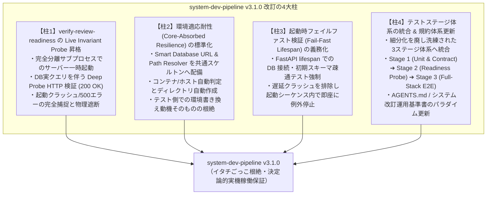

# system-dev-pipeline v3.1.0 改訂基本計画書

- **文書ID**: `PLAN-V310-001`
- **改訂対象システム**: `system-dev-pipeline`
- **対象バージョン**: `v3.0.1` ➔ `v3.1.0` (`.env` `APP_VERSION=3.1.0`)
- **策定日**: 2026-11-13
- **ステータス**: 計画策定完了 / 承認待ち (REV-1)
- **親検討文書**:
  - [パイプライン死角分析に対する客観的検証と構造的再設計方針報告書](../パイプライン死角分析に対する客観的検証と構造的再設計方針報告書.md) (`REPORT-V302-INVARIANT-REDESIGN`)
  - [テストフィクスチャマスキングと実機提示前ゲート死角分析レポート](../テストフィクスチャマスキングと実機提示前ゲート死角分析レポート.md) (`REPORT-V301-MASKING-RCA`)

---

## 1. 改訂の背景と基本方針（Executive Summary）

`system-dev-pipeline` v3.0.1 では、ASTトートロジー排除、モック排除、および SHA-256 署名付き証跡（`qa_runtime_evidence.json`）による統制が敷かれた。
しかし、実践プロジェクト（Movie Log v2.0.2改訂）において、**テストフィクスチャ（`conftest.py`）内で環境変数を書き換えてホストとコンテナのパス差異を隠蔽（マスキング）し、全ゲートを ALL PASS で素通りした後に実機提示（REV-4）で主要APIが 500 エラーで全滅する**という致命的障害が発生した。

この事象に対し、個別禁止ルール（`HG-012`）やテストステージ細分化（`Stage 1.8`）を安易に増設することは、**「AIエージェントが別の迂回路を見つけてすり抜け、更なるパッチを当てる」という典型的なイタチごっこ（Whack-a-Mole）**を招き、パイプラインの肥大化と保守破綻を引き起こす。また、この問題は SQLite のパスに限らず、ネットワーク、認証、ストレージ、OS、ライフサイクルなど「環境乖離（Environment Parity Gap）」が存在するあらゆる領域で再発し得る。

本改訂（`v3.1.0`）では、個別構文の禁止（ホワイトボックス規制）から脱却し、**「ブラックボックス実動不変条件（Live Readiness Invariant）の確立」**と**「環境適応耐性（Core-Absorbed Resilience）のスケルトン標準化」**を2大基軸とする抜本的再設計を実行する。

---

## 2. 4大柱の具体化仕様 (Detailed Specifications)

### 2.1 【柱1】`verify-review-readiness` の「Live Invariant Probe」への昇格

従来の `verify-review-readiness` は静的なファイル存在・チェックサム突合のみを行っていたため、偽陽性の署名を見抜けなかった。これを **「サーバー実動検証エンジン」** へ昇格させる。

1. **実プロセス一時バックグラウンド起動**:
   - `scripts/state_manager.py verify-review-readiness` 実行時、Python `subprocess.Popen` を用いてバックエンドサーバーを独立プロセスとして起動する。
   - 起動コマンド: `python3 -m uvicorn backend.app.main:app --port 8999`（開発サーバーの既定ポート 8000 との衝突を避ける一時ポート、または利用可能ポートの自動割り当て）。
   - タイムアウト保護: 最大 15 秒で起動確認、終了時は確実に `terminate()` / `kill()` を呼ぶクリーンアップ保証。
2. **クリティカルパス実HTTPプローブ (Deep Health Probe)**:
   - 単に静的な `{"status": "ok"}` を返す中空エンドポイントの検査は禁止。
   - `http://127.0.0.1:8999/api/health?deep=true` に対して実 HTTP GET リクエストを送信。
   - サーバー内部で `SELECT 1` または主要マスタテーブルの読み出しが成功し、`{"status": "healthy", "database": "connected"}` と HTTP 200 が返却されることを検証。
3. **起動クラッシュ・例外トレースバックの完全捕捉**:
   - プロセスが異常終了（exit code != 0）した場合、または 500 エラーが返った場合、プロセスの `stderr` から完全なトレースバック（`sqlite3.OperationalError` 等）を捕捉し、コンソールに明瞭に出力した上で即座に `[READINESS BLOCK]` とする。

### 2.2 【柱2】環境適応耐性（Core-Absorbed Resilience）のスケルトン標準化

ホストOSとDockerコンテナ間でのパス乖離を、テスト側ではなく**本体コード側が自律的に解決する仕組み**を共通スケルトンへ組み込む。

1. **`Smart Database URL & Path Resolver` の配備**:
   - 対象: `skeletons/common/backend/app/core/config.py` および `db.py`
   - `.env` に `DATABASE_URL=sqlite:////app/data/app.db`（コンテナ絶対パス）が指定されている場合でも、ホストOS上で `/app/data` が存在しない場合は、プロジェクトルート直下の `data/app.db` へ安全に自己フォールバックする。
   - 解決先の親ディレクトリ（`data/`）が存在しない場合は、`os.makedirs(..., exist_ok=True)` で自動生成する。
2. **設定解決の単一責務化**:
   - すべてのDBセッション・エンジン生成は `settings.resolved_database_url` を経由させ、個別の直書きやテスト内での場当たり的置換を不要とする。

### 2.3 【柱3】起動時フェイルファスト検証（Fail-Fast Lifespan Probe）の義務化

1. **FastAPI Lifespan における接続テストの義務化**:
   - 対象: `skeletons/common/backend/app/main.py`
   - アプリケーション起動時（lifespan コンテキストマネージャ）で、SQLAlchemy `engine.connect()` を実行。
   - DB未接続、ディレクトリパーミッション不正、マイグレーション未完了等がある場合、リクエスト待機に入らず起動シーケンス内で即座に致命的例外を発生させる（Fail-Fast）。
2. **`/api/health` Deep Probe の標準配備**:
   - クエリパラメータ `?deep=true` を受け取った場合、実DBに対して `SELECT 1` を実行し、接続状態を含めたJSONを返却する標準エンドポイントをスケルトンに初期配備する。

### 2.4 【柱4】テストステージ体系の統合 & 規約体系の更新

1. **洗練された 3ステージ体系への統合**:
   - **Stage 1: Unit & Contract**: 単体テスト、Pydantic DTO検証、FastAPI `TestClient` によるインプロセス実I/O・OpenAPIスキーマ検証（高速な開発ループ）。
   - **Stage 2: Readiness Live Probe**: `verify-review-readiness` によるプロセス分離起動・実HTTP疎通・DB実クエリ検証（REV-4突入の絶対不変条件）。
   - **Stage 3: Full-Stack E2E & Sensorial**: フロント・バック同時稼働下でのブラウザ実走（Playwright等）、感覚センサー（A11y/コンソール0件）検証（REV-4 / REV-5）。
2. **規約・運用基準書の改訂**:
   - `.agents/plugins/system-dev-pipeline/rules/AGENTS.md`
   - `templates/システム改訂運用基準書.md`
   - 設計思想を「ホワイトボックス構文規制（Negative Control）」から「ブラックボックス実動不変条件（Blackbox Invariants）」へ転換。

---

## 3. 改訂影響範囲マトリクス

| 対象コンポーネント | 変更種別 | 改修内容の概要 |
| :--- | :---: | :--- |
| **`scripts/state_manager.py`** | コア改修 | `verify-review-readiness` にサブプロセス起動および Deep Health Probe（実HTTP実クエリ疎通）ロジックを実装。失敗時の `stderr` トレースバック表示とハード遮断。 |
| **`skeletons/common/backend/app/core/config.py`** | スケルトン | `Smart Database URL & Path Resolver` を実装し、ホスト/コンテナ環境自動適応とディレクトリ自動生成を提供。 |
| **`skeletons/common/backend/app/core/db.py`** | スケルトン | `resolved_database_url` を用いたエンジン生成への統一。 |
| **`skeletons/common/backend/app/main.py`** | スケルトン | FastAPI `lifespan` での起動時 DB 接続チェック（Fail-Fast）および `/api/health?deep=true` エンドポイントを標準実装。 |
| **`skeletons/common/scripts/*`** | 同期 | `scripts/state_manager.py` の改修を共通スケルトンへ同報同期。 |
| **`rules/AGENTS.md`** | 規約改訂 | 「ブラックボックス実動不変条件」「環境適応耐性（Core-Absorbed Resilience）」のコア原則追記、Stage 体系の 3ステージ統合。 |
| **`templates/システム改訂運用基準書.md`** | 規約改訂 | REV-3 完了ゲートおよび REV-4 プレレビューゲートにおける Live Probe 必須通過の明記。 |

---

## 4. 6段階標準改訂パイプライン（REV-1〜REV-6）実施計画

- [x] **REV-1: 要件・設計・契約フィクスチャ精査 (Planning, Design & Contracts)**
  - [x] 差分要件定義書の策定（`[REQ-F-310-01]` Live Probe、`[REQ-F-310-02]` 環境適応スケルトン、`[REQ-F-310-03]` 3ステージ体系統合）
  - [x] `state_manager.py` Live Probe アーキテクチャ設計書およびスケルトン設計書の策定
  - [x] 設計レビューゲート（`dev-review-arch`）PASS
- [x] **REV-2: 実装・静的検証・Live Probe 実装 (Implementation, Hard Gate & Probe)**
  - [x] `state_manager.py` への Live Invariant Probe エンジン実装
  - [x] `skeletons/common/backend/` への環境適応・Fail-Fast・Deep Health 実装
  - [x] スケルトンスクリプトへの同報同期
  - [x] 規約・ドキュメント改訂（`rules/AGENTS.md`, `システム改訂運用基準書.md`）
  - [x] コミット前 Hard Gate（`harness_guard.py --all`）PASS
- [x] **REV-3: テスト・実結合検証・Live Probe 動作検証 (Testing & Live Probe Verification)**
  - [x] `state_manager.py` Live Probe の単体・異常系テストスイート実行（起動成功、DB接続失敗時の即時検知・遮断、タイムアウト処理の検証）
  - [x] 模擬環境下でのフィクスチャマスキング耐性テスト（本体パスが不正な場合に Live Probe で確実に検知・遮断されることの実証）
  - [x] `traceability_checker.py --mode full` による RTM 100% カバレッジ達成および証跡自動発行
  - [x] 第1段階ドキュメント衛生整理の実施
  - [x] `python3 scripts/state_manager.py verify-review-readiness` の実機実行・完全通過確認
- [x] **REV-4: 開発サーバー起動・ユーザー実機レビュー・改修 (Live Review & Refinement)**
  - [x] Live Probe PASS を受けて、実結合モードで改修内容の動作確認デモを提示
  - [x] ユーザーへの実機レビュー要請（Live Probe による起動保証の確認）
  - [x] 対話的改修・再検証ループの実施
  - [x] ユーザー承認の記録（`state_manager.py record-approval --phase REV_4`）
- [x] **REV-5: 本番総合監査・成果物ビルド (System Review & Artifact Build)**
  - [x] コード品質レビュー（`dev-review-code`）CLEAN 判定確認
  - [x] システム総合レビュー（`dev-review-system`）RELEASE APPROVED 判定確認
  - [x] 第2段階ドキュメント多次元相互整合性監査の完了
- [x] **REV-6: メトリクス・知見昇格・リリース (Metrics, Promotions & Release)**
  - [x] 定量メトリクス集計（`dev-metrics-collector`）の実行
  - [x] 知見昇格（CLAIM原票）の確認・投函
  - [x] Invariants Gate（`complete-revision`）通過確認
  - [x] 既存プロジェクト（Movie Log等）向け移行ガイドの配置
  - [x] Git 本番リリース（`dev-git-release`）およびグローバルプラグイン反映（`--deploy`）

---

## 5. 次のアクション

本基本計画書の承認後、サブフォルダ内の各フェーズ手順書（`REV-1`〜`REV-6`）に基づき、順次パイプライン本流の改訂作業を着手する。
