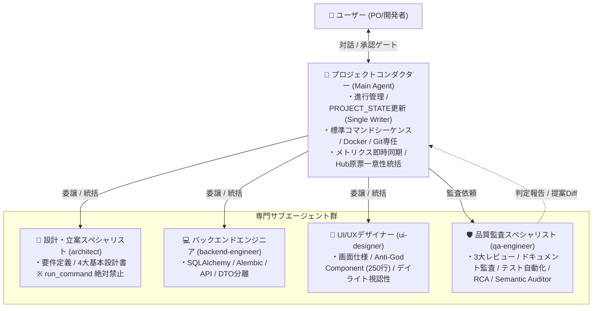
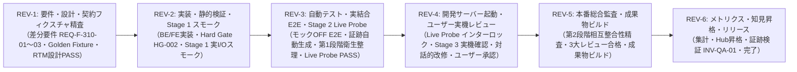

# AI駆動システム開発フェーズ定義書（軽量・実行契約駆動・6段階改訂パイプライン準拠版）

文書バージョン: 3.1.0  
改定日: 2026-11-13  
対象バージョン: AI駆動システム開発ライフサイクルテンプレート V3.1.0 (`APP_VERSION=3.1.0`)  
ステータス: 正式改訂版 (Current 正本)  
関連文書:
- [AI駆動システム開発手順書.md](./AI駆動システム開発手順書.md)
- [定量測定・フィードバック設計書.md](./定量測定・フィードバック設計書.md)
- [ProfileA詳細設計書.md](./ProfileA詳細設計書.md)
- [ProfileD詳細設計書.md](./ProfileD詳細設計書.md)
- [レビューシステム設計書.md](./レビューシステム設計書.md)
- [エージェント設計書.md](./エージェント設計書.md)
- [状態管理機構設計書.md](./状態管理機構設計書.md)
- [システム改訂運用基準書.md](../../../.agents/plugins/system-dev-pipeline/templates/システム改訂運用基準書.md)

---

## 1. 目的と位置付け

本文書は、Antigravity環境におけるAI駆動システム開発ライフサイクル（新規開発 PHASE 1〜8、および本番リリース後の継続的システム改訂プロセス `REV-1`〜`REV-6`）において、**メインエージェント（コンダクター）、4つの専門サブエージェント（architect, backend-engineer, ui-designer, qa-engineer）、決定論的スキル群、およびユーザー（開発者/PO）** が協調して開発・改訂を完遂するためのフェーズ定義、作業工程、および役割分担を規定する仕様正本である。

### 1.1 V3.0.0 改訂の 3 大柱
1. **【柱1】軽量・実行契約駆動パイプライン (Executable Contract-Driven)**:
   - RTM テスト関数直結バインド & 動的カバレッジ連携、2段階行数制限緩衝帯（FE 250/350行、BE 400/550行）& 空実装遮断（`HG-010`）。
   - Core Profile (A〜E) ＋ Capability Traits（2.5層方式）。
   - Contract-First MSW ＋ Stage 1.5 実I/Oスモーク ＋ Stage 2 実結合E2E。
   - Executable Golden Fixtures (`tests/fixtures/golden/`) ＆ `metrics/qa_runtime_evidence.json`。
2. **【柱2】Overlay 知見の正本統合と自律昇格**:
   - 動的描画 O(1) インメモリキャッシュ規約、非開発モード時の操作パス監視とシステム改訂パイプラインへの自律昇格（`HG-011`）。
3. **【柱3】標準改訂パイプラインの6段階化 (REV-1〜REV-6)**:
   - `REV-4: 開発サーバー起動・ユーザー実機レビュー・対話的改修` の新設と、ユーザー承認なきクローズの機械遮断（`[INV-REV-04]`）。

### 1.2 V3.0.1 改訂の 3 大柱
1. **【柱1】本番コードからのモック・ダミー記述・例外フォールバックの機械的完全排除 (`[REQ-F-301-01]`, `HG-002`)**:
   - バックエンド（`backend/`）およびCLI（`src-tauri/`）本番コードにおけるモック生成識別子（`generate_mock_*`, `dummy_*`, `Mock[A-Z0-9_]+`）、ダミーメディア生成記述（`testsrc`, `sine=`, `anoisesrc`, `color=black`）、および例外発生時のサイレントモックフォールバック記述をコミット前・CIで機械的に遮断。
2. **【柱2】署名付き動的証跡 JSON 自動生成と台帳改ざん・不在素通り防止 (`[REQ-F-301-02]`, `[INV-QA-01]`)**:
   - `metrics/qa_runtime_evidence.json` のエージェント手動作成・手書きを全面廃止し、`traceability_checker.py --mode full` 成功時にツール署名（Gitコミットハッシュ、タイムスタンプ、SHA-256）付きで決定論的に自動生成。
   - `state_manager.py` における証跡不在時の素通りバグを修正し、`active_revision_id` 一致および SHA-256 再計算による改ざん検証を強制。
3. **【柱3】ドキュメント精査の2段階分離と REV-4 事前検査ゲート配備 (`[REQ-F-301-03]`)**:
   - ドキュメント精査を「第1段階: REV-3 文書衛生・構造整理 (Document Hygiene)」と「第2段階: REV-5 意味的相互整合性精査 (Semantic Cross-Check)」に分離。
   - REV-4 実機レビュー突入前に物理検査コマンド `state_manager.py verify-review-readiness`（Pre-Review Readiness Gate）を配備し、未通過時の `set-phase REV_4` 実行をインターロック遮断。

### 1.3 V3.1.0 改訂の 4 大柱
1. **【柱1】verify-review-readiness の Live Invariant Probe 昇格 (`[REQ-F-310-01]`)**:
   - 静的署名検査から「実プロセス一時バックグラウンド起動（独立ポート・15秒タイムアウト保護・確実なプロセス回収）」へ昇格。
   - `/api/health?deep=true` に対する実HTTP GETリクエストにより、実DBクエリ疎通（HTTP 200 OK & healthyレスポンス）を物理検証。
   - 起動クラッシュ・500エラー・例外トレースバック（`sqlite3.OperationalError` 等）の完全捕捉と `[READINESS BLOCK]` による物理ハード遮断。
2. **【柱2】環境適応耐性 (Core-Absorbed Resilience) のスケルトン標準化 (`[REQ-F-310-02]`)**:
   - `Smart Database URL & Path Resolver` を共通スケルトンへ配備。コンテナ内絶対パス（`/app/data`）がホスト上に存在しない場合、プロジェクトルート相対の `data/` へ自律フォールバックし、ディレクトリを自動作成（`os.makedirs(..., exist_ok=True)`）。
   - テスト側（`conftest.py` 等）で環境変数を書き換えてパス乖離をマスキングする動機そのものを根絶。
3. **【柱3】起動時フェイルファスト検証 (Fail-Fast Lifespan) の義務化 (`[REQ-F-310-02]`)**:
   - FastAPI `lifespan` 起動フック内で SQLAlchemy `engine.connect()` による初期DB疎通を強制。
   - パス不一致や権限不正、マイグレーション未完了がある場合、リクエスト待機に入らず起動シーケンス内で即座に例外停止（Fail-Fast）。
4. **【柱4】テストステージ体系の 3ステージ統合 & 規約体系更新 (`[REQ-F-310-03]`)**:
   - 複雑化・細分化したステージ（Stage 1.5, 1.8等）を廃止し、洗練された「3ステージ体系」へ統合：
     - **Stage 1: Unit & Contract**: 単体テスト、Pydantic DTO検証、FastAPI `TestClient` によるインプロセス実I/O・OpenAPIスキーマ検証。
     - **Stage 2: Readiness Live Probe**: `verify-review-readiness` によるプロセス分離起動・実HTTP疎通・DB実クエリ検証（REV-4突入の絶対不変条件）。
     - **Stage 3: Full-Stack E2E & Sensorial**: フロント・バック同時稼働下での実結合E2E、感覚センサー（コンソールエラー0件、WCAG AA 4.5:1）検証。
   - 「ホワイトボックス構文規制からブラックボックス実動不変条件（Live Readiness Invariant）へのパラダイムシフト」。

---

## 2. 5大エージェント協調モデルと責務境界

---

## 3. 開発フェーズ詳細定義 (新規開発 PHASE 1〜8)

### PHASE 1: プロジェクトの準備 (Project Setup)
- **ステータス表記**: `PHASE_1_SETUP`
- **目的**: 新規開発プロジェクトの初期実行基盤、検証済み静的スケルトン、ローカルナレッジ領域、および状態管理台帳を自動生成・配備する。
- **開始条件 (Entry Criteria)**: 対象プロジェクト専用の作業ディレクトリが準備され、Antigravity でワークスペースとして開かれており、`system-dev-pipeline` プラグインが有効であること。
- **主担当エージェント**: 👑 プロジェクトコンダクター (`conductor`)
- **詳細作業工程 (`PROJECT_STATE.md` 準拠)**:
  1. `dev-phase1-setup` スキルの発動。
  2. Central Knowledge Hub（`~/.gemini/knowledge-hub/`）初期化 & 未処理原票確認（`pipeline-reconciler.sh --status`）。
  3. 静的スケルトン基盤展開（`skeletons/common/`, `skeletons/profile-a/` 等）。
  4. 環境変数初期化（`.env` に `APP_VERSION=1.0.0`, `VITE_ENABLE_MOCK=true` 等を設定）。
  5. 永続ナレッジ領域初期化（`wiki/patterns/{local,universal,rejected}`, `wiki/archive/`, `promotions/`）。
  6. 知見・メトリクス領域初期化（`wiki/`, `metrics/`, `promotions/` の `.gitignore` 自動登録）。
  7. 知見昇格提示サマリ初期配置（`TEMPLATE_PROMOTIONS.md`）。
  8. `PROJECT_STATE.md` 初期化（2層プロファイル・MOCK_MODE・Knowledge Hub 連携状態記録）。
- **完了条件 (Exit Criteria)**:
  - ディレクトリ基盤および `.env` が配置されていること。
  - `PROJECT_STATE.md` が正常に生成され、未処理原票が 0 件（または確認済み）であること。

---

### PHASE 2: 要件定義 (Requirements Definition)
- **ステータス表記**: `PHASE_2_REQUIREMENTS`
- **目的**: システムの機能・非機能要件を明確化し、2層構造プロファイル体系に基づいて最適な展開アーキテクチャを選定・合意する。
- **開始条件 (Entry Criteria)**: PHASE 1 が完了していること。
- **主担当エージェント**: 📐 設計・立案スペシャリスト (`architect`)
- **詳細作業工程 (`PROJECT_STATE.md` 準拠)**:
  1. 📐 `architect`: ユーザー要件ヒアリング、ディシジョンツリーによるプロファイル選定 (Profile A〜E)。
  2. 📐 `architect`: `docs/設計書/Current/要件定義書.md` の作成（定常コア8項目＋プロファイル固有非機能要件）。
  3. **【承認ゲート】👤 ユーザー: 要件定義書・選定プロファイルの明示的承認**。
- **完了条件 (Exit Criteria)**:
  - `docs/設計書/Current/要件定義書.md` が配置され、プロファイル選定が完了していること。
  - ユーザーの明示的承認が得られていること。

---

### PHASE 3: 基本設計 (Basic Design)
- **ステータス表記**: `PHASE_3_DESIGN`
- **目的**: 4大基本設計書を策定し、基本設計レビューゲートを通過させる。
- **開始条件 (Entry Criteria)**: PHASE 2 の承認ゲートを通過していること。
- **主担当エージェント**: 📐 設計・立案スペシャリスト (`architect`)
- **監査担当エージェント**: 🛡️ 品質監査スペシャリスト (`qa-engineer`)
- **詳細作業工程 (`PROJECT_STATE.md` 準拠)**:
  1. 📐 `architect`: 4大基本設計書の策定（技術要件定義書、テーブルスキーマ定義書、ビジネスロジック仕様書、画面仕様書）。
  2. 🛡️ `qa-engineer`: ドキュメント相互整合性チェック（`dev-doc-reviewer`、最大5回ループ）。
  3. 🛡️ `qa-engineer`: 基本設計レビュー（`dev-review-arch`、判定: `PASS` または `CONDITIONAL PASS` 必須）。
  4. **【承認ゲート】👤 ユーザー: 基本設計レビュー結果の明示的承認**。
- **完了条件 (Exit Criteria)**:
  - 4大基本設計書が配置され、相互整合性監査および基本設計レビューを通過していること。
  - ユーザーの明示的承認が得られていること。

---

### PHASE 4: 開発環境構築 & システム実装 (Environment Setup & Implementation)
- **ステータス表記**: `PHASE_4_ENV_BUILD` ➔ `PHASE_4_IMPLEMENTATION`
- **目的**: 静的スケルトンを展開し、BE・FEの並行実装、標準コマンドシーケンス（Alembic/Codegen/CI）の自動実行、コンテナ構成・Git初期化を完遂する。
- **開始条件 (Entry Criteria)**: PHASE 3 の基本設計承認を通過していること。
- **主担当エージェント**: 👑 `conductor` (統括), 💻 `backend-engineer`, 🎨 `ui-designer`
- **詳細作業工程 (`PROJECT_STATE.md` 準拠)**:
  1. 👑 コンダクター: `dev-git-init` による Git 初期化、`feature` ブランチ作成。
  2. 💻 BE / 🎨 UI: 並行委譲による実装（Anti-God Module 400行制限、Anti-God Component 250行制限、デイライト視認性明暗ペア厳守）。
  3. 👑 コンダクター: 標準コマンドシーケンス統括実行（Alembicマイグレーション生成・適用、TypeScript型自動生成、コミット前CIローカル検証）。
  4. 👑 コンダクター: Dockerコンテナビルド・起動確認（`docker compose up --build -d`）。
- **完了条件 (Exit Criteria)**:
  - Dockerコンテナが正常起動し、全静的検査（Ruff, Type-check, Lint）が PASS していること。

---

### PHASE 5: ウォークスルー検証 & コード品質レビュー (Walkthrough & Code Review)
- **ステータス表記**: `PHASE_5_WALKTHROUGH` ➔ `PHASE_5_5_CODE_REVIEW`
- **目的**: モック・実結合両モードでのUI/APIウォークスルーを実施し、実装を正としてドキュメントを同期した上で、PHASE 5.5 コード品質レビューを通過させる。
- **開始条件 (Entry Criteria)**: PHASE 4 の実装およびコンテナ起動が完了していること。
- **主担当エージェント**: 👑 `conductor`, 🛡️ `qa-engineer`
- **詳細作業工程 (`PROJECT_STATE.md` 準拠)**:
  1. 👑 コンダクター: モック有効モード（`VITE_ENABLE_MOCK=true`）での動作確認。
  2. 👑 コンダクター: 実結合モード（`VITE_ENABLE_MOCK=false`）での動作確認（サイレントフォールバック厳格禁止 Fail-Fast）。
  3. 📐 `architect`: コードを正とした API 仕様書同期（`docs/設計書/Current/バックエンドAPI仕様書.md`）。
  4. 🛡️ `qa-engineer`: `dev-review-code` コード品質レビュー（判定: `CLEAN` 必須 / 250行制限、直書きモック排除、DTO分離機械的検査）。
  5. **【承認ゲート】👤 ユーザー: コード品質レビュー結果の明示的承認**。
- **完了条件 (Exit Criteria)**:
  - モック/実結合の両モードでウォークスルーが成功していること。
  - `dev-review-code` で判定 `CLEAN` を獲得し、ユーザーの明示的承認が得られていること。

---

### PHASE 6: 結合・シナリオテスト & 自律修復 (Scenario Testing & Auto-Healing)
- **ステータス表記**: `PHASE_6_TESTING`
- **目的**: 結合・シナリオテスト計画を策定し、自動テストおよび自律修復ループを実行して品質を確定させ、失敗のRCAをWikiへ永続化する。
- **開始条件 (Entry Criteria)**: PHASE 5.5 で判定 `CLEAN` を獲得していること。
- **主担当エージェント**: 🛡️ `qa-engineer` (Wiki Maintainer 兼任)
- **詳細作業工程 (`PROJECT_STATE.md` 準拠)**:
  1. 🛡️ `qa-engineer`: `docs/plans/シナリオテスト計画書.md` 作成（モック有効/無効両面シナリオ）。
  2. 🛡️ `qa-engineer`: 自動テスト実行・修復ループ（成功率100%達成、最大5回ループ）。
     - Profile D の場合: 一時ディレクトリ配下に UUID 付き実ファイルDBを動的プロビジョニングし、マイグレーションとWAL並行性を本番同等に検証後アトミック破棄（PAT-TEST-001）。
  3. 🛡️ `qa-engineer`: Wiki Maintainer によるエラー根本原因（RCA）記録（`wiki/patterns/`）。
  4. **【承認ゲート】👤 ユーザー: リリース準備移行の明示的承認**。
- **完了条件 (Exit Criteria)**:
  - シナリオテスト成功率 100% を達成していること。
  - 発生した全失敗の RCA がローカル Wiki へ記録され、ユーザーの明示的承認が得られていること。

---

### PHASE 7: 本番リリース (Production Release)
- **ステータス表記**: `PHASE_7_RELEASE`
- **目的**: システム総合レビューを通過させ、本番適用作業手順書に基づいて本番環境へ安全にデプロイする。
- **開始条件 (Entry Criteria)**: PHASE 6 の全テスト合格および承認ゲートを通過していること。
- **統括・デプロイ担当**: 👑 `conductor`
- **監査担当エージェント**: 🛡️ `qa-engineer`
- **詳細作業工程 (`PROJECT_STATE.md` 準拠)**:
  1. 👑 コンダクター: `docs/plans/本番適用作業手順書.md` 作成（ロールバック手順・Litestream同期確認手順明記）。
  2. 🛡️ `qa-engineer`: `dev-review-system` システム総合レビュー（判定: `RELEASE APPROVED` 必須）。
     - 本番用 `VITE_ENABLE_MOCK=false` 二重防御検証（Fail-Fast 含む）。
     - IAP JWT 署名検証ミドルウェア有効化検証。
     - Profile A: `entrypoint.sh` による正規スーパーバイザー起動保証 (`exec litestream replicate ... -exec`)（SIGTERM シグナル伝播と最終 WAL フラッシュ同期保証）。
     - Litestream レプリケーション設定および監視エンドポイント検証。
     - 平文シークレット完全排除、非root実行確認。
  3. 👑 コンダクター: 本番環境（Cloud Run等）初回デプロイ実行（`--quiet` 非対話フラグ＋`schedule` タイムアウト監視）。
  4. 🛡️ `qa-engineer`: IAM / IAP セキュリティ設定監査。
  5. **【承認ゲート】👤 ユーザー: 本番稼働確認の明示的承認**。
- **完了条件 (Exit Criteria)**:
  - `dev-review-system` で `RELEASE APPROVED` を獲得していること。
  - 本番環境でヘルスチェックが正常応答し、ユーザーの明示的承認が得られていること。

---

### PHASE 8: ドキュメント改訂管理・Central Knowledge Hub 自己進化の開始 (Knowledge & Handover)
- **ステータス表記**: `PHASE_8_HANDOVER` ➔ `PRODUCTION_ACTIVE`
- **目的**: 開発定量メトリクスを集計し、PROJECT_STATE へ即時同期した上で、汎用知見を Central Knowledge Hub へ投函・3段階意味的監査を実施して Local Overlay へ即時反映し、Git本番リリースを完遂する。
- **開始条件 (Entry Criteria)**: PHASE 7 の本番稼働承認を通過していること。
- **統括担当**: 👑 `conductor`
- **意味的監査担当**: 🛡️ `qa-engineer` (Semantic Auditor)
- **詳細作業工程 (`PROJECT_STATE.md` 準拠)**:
  1. 👑 コンダクター: 定量メトリクス集計実行（`dev-metrics-collector`）。
     - `metrics/system_health_report.md` (総合診断レポート) 生成。
     - `metrics/development_phase_report.md` (フェーズ推移レポート) 生成。
     - `metrics/development-metrics-summary.json` (集計サマリJSON) 出力。
  2. 👑 コンダクター: **`PROJECT_STATE.md` 定量サマリ即時同期 (PAT-SYS-002)**。
     - 診断レポートの主要数値（総合スコア、グレード、各カテゴリスコア、消費トークン、ツール呼出数、LOC等）を `PROJECT_STATE.md` の「プロジェクト定量メトリクスサマリ」へ即時反映し、ヘッダー更新日時を更新。
  3. 👑 コンダクター: `wiki-compactor` によるWiki整理・原票クラスタリング。
  4. 👑 コンダクター: `wiki-proposer` による標準化知見原票（`CLAIM-*.md`）生成 & `~/.gemini/knowledge-hub/inbox/` 投函。
     - **グローバル一意性確定 (PAT-SYS-006)**: Knowledge Hub 全域を走査し、全環境で未使用の最新連番を採番。
  5. 🛡️ `qa-engineer`: 3段階意味的整合性監査（新・複合検証ゲート Gate 1〜4: Invariants監査、4分類矛盾監査、過剰適合排除、純度＆絶対行数バジェット監査、**pattern_id 重複衝突排除**）実行。
  6. **【承認ゲート】👤 ユーザー: `ask_question` モーダルによる知見昇格・裁定承認 (`./TEMPLATE_PROMOTIONS.md`)**。
  7. 👑 コンダクター: `pipeline-reconciler.sh` による `overlay/LOCAL_FEEDBACK_RULES.md` クリーン再生成（または Core 統合）。
  8. ⚙️ `dev-git-release`: 先頭サニタイズ処理を経て `feature` を `main` へ Squash Merge（`Release v1.0.0`）、Push、次期 `feature` 切り直し。
  9. ⚙️ `dev-phase8-rules`: 改訂運用ルールファイル群の配置。
  10. 👑 コンダクター: ステータスを `PRODUCTION_ACTIVE` へ移行。
- **完了条件 (Exit Criteria)**:
  - 定量メトリクスが `PROJECT_STATE.md` へ同期反映されていること。
  - 知見昇格判定が完了し、`LOCAL_FEEDBACK_RULES.md` が正常更新されていること。
  - Git タグ `v1.0.0` が打鍵され、次期改訂ブランチが用意されていること。
  - `PROJECT_STATE.md` のステータスが `PRODUCTION_ACTIVE` になっていること。

---

## 4. システム改訂プロセス (REVISION: REV-1 〜 REV-6)

本番リリース完了以降（`PRODUCTION_ACTIVE`）の継続的な改訂運用は、[システム改訂運用基準書.md](../../../.agents/plugins/system-dev-pipeline/templates/システム改訂運用基準書.md) に基づき以下の6段階標準改訂パイプラインで進行する。

1. **REV-1: 要件・設計・契約フィクスチャ精査**:
   - `state_manager.py start-revision` による計画スケルトン自動展開と `session_mode = "DEV_PIPELINE"` 昇格。差分要件定義（`REQ-F-310-01`〜`03`）、4大基本設計書更新、`tests/fixtures/golden/` 配置、`dev-review-arch` PASS。
2. **REV-2: 実装・静的検証・Stage 1 スモーク**:
   - 2段階行数制限（250/350行、400/550行）、本番コードモック・ダミー完全排除（`HG-002`）、空実装遮断（`HG-010`）、OpenAPI型同期、Stage 1 (Unit & Contract) インプロセス実I/Oスモークテスト、`harness_guard.py --all` PASS。
3. **REV-3: 自動テスト・実結合E2E・Stage 2 Live Probe 検証**:
   - テスト関数直結 RTM 検証（`traceability_checker.py --mode full`）、Stage 2 モックOFF実データ一気通貫E2E検証、感覚センサー検証、署名付き動的証跡（`metrics/qa_runtime_evidence.json`）自動生成。第1段階ドキュメント衛生・構造整理を実施し、`state_manager.py verify-review-readiness` による Stage 2 Live Probe PASS（独立サブプロセス起動・Deep Health実DBクエリ疎通）を確認。
4. **REV-4: 開発サーバー起動・ユーザー実機レビュー・対話的改修**:
   - REV-4 実機レビュー突入前に物理検査コマンド `state_manager.py verify-review-readiness`（Stage 2 Live Probe）PASS をインターロック前提条件として実結合開発サーバー起動、Stage 3 フルスタック実機確認、ユーザー実機テストレビュー要請、対話的改修ループ、ユーザー承認記録（`state_manager.py record-approval --phase REV_4`）。
5. **REV-5: 本番総合監査・成果物ビルド**:
   - 第2段階ドキュメント意味的相互整合性精査、コード品質レビュー（`dev-review-code`: CLEAN）、システム総合レビュー（`dev-review-system`: RELEASE APPROVED）、本番成果物の物理ビルド。
6. **REV-6: メトリクス・知見昇格・リリース**:
   - 定量メトリクス集計、Knowledge Hub 知見昇格、5大 Invariants Gate 自動検証（`state_manager.py complete-revision` による `[INV-QA-01]` 証跡実在＆改ざん検証）、`dev-git-release`。

---

## 5. 各エージェントの絶対禁止事項 (Guardrails)

| エージェント | 絶対禁止事項 (Hard Gate Guardrails) |
| :--- | :--- |
| 👑 **コンダクター** | ・`PROJECT_STATE.md` 以外のサブエージェントによる状態更新の許可 ・大文字 `V` を含むタグの付与（先頭サニタイズ必須） ・承認ゲートをバイパスしたフェーズ進行 ・REV-4 事前物理検査ゲート未通過での REV-4 突入 ・REV-4 ユーザー実機レビュー未承認での改訂クローズ (INV-REV-04) |
| 📐 **アーキテクト** | ・**いかなる場合も `run_command` を呼び出してはならない（二重防御ガード）** ・生SQL前提のスキーマ設計（Alembic必須） |
| 💻 **バックエンド** | ・Git操作、デプロイ実行、DB強制上書き、コンテナ起動停止コマンドの実行 ・本番コード内へのモック・ダミー記述・例外フォールバック混入 (HG-002) ・ハード上限550行超過、空実装・縮退実装の放置 (HG-010) ・生SQLによる手動DDL操作 |
| 🎨 **UIデザイナー** | ・Git操作、デプロイ実行、DB操作コマンドの実行 ・ハード上限350行超過、空JSXイベントハンドラ直書き (HG-010) ・コンポーネント内へのダミーデータ直書き（MSW必須） |
| 🛡️ **QAエンジニア** | ・**システム本体のプログラムコードの直接改変（必ず提案Diffをコンダクターへ報告）** ・使い捨てプローブの放置（tests/e2e/への永続化義務） ・動的証跡 JSON (qa_runtime_evidence.json) の手動作成・手書き ・自律修復ループの5回超過反復（5回失敗時は中断しユーザー報告） |

---

## 6. ドキュメント改定履歴

| 対象バージョン | 改定日 | 改訂依頼番号 | 改定内容 |
| :--- | :--- | :--- | :--- |
| 2.6.0 | 2026-10-26 | - | 初回Current正本化 |
| 3.0.0 | 2026-11-10 | PLAN-V300-001 | 軽量・実行契約駆動パイプライン進化 (Golden Fixtures、2段階行数制限、Stage 1.5/2、6段階改訂 REV-1〜REV-6、自律昇格) |
| 3.0.1 | 2026-11-10 | PLAN-V301-001 | 本番コードモック完全排除(HG-002)、署名付き動的証跡生成・状態台帳改ざん検証(REQ-F-301-02)、2段階ドキュメント精査・REV-4事前物理検査ゲート(REQ-F-301-03) |
| 3.1.0 | 2026-11-13 | PLAN-V310-001 | verify-review-readiness の Live Invariant Probe 昇格(REQ-F-310-01)、環境適応耐性スケルトン・Fail-Fast Lifespan 標準化(REQ-F-310-02)、3ステージテスト体系統合(REQ-F-310-03) |
