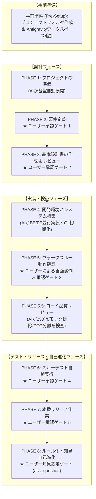
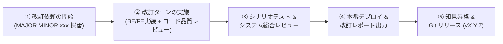

# AI駆動システム開発手順書 V2.5（Central Knowledge Hub・SemVer準拠・5大エージェント協調手順）

文書バージョン: 2.5  
作成日: 2026-10-25  
対象バージョン: AI駆動システム開発ライフサイクルテンプレート V2.5.0  
ステータス: 正式改訂版 (Current 正本)  
関連文書:
- [AI駆動システム開発フェーズ定義書V2.5.md](./AI駆動システム開発フェーズ定義書V2.5.md)
- [定量測定・フィードバック設計書V2.5.md](./定量測定・フィードバック設計書V2.5.md)
- [V2.5改変計画書.md](./V2.5改変計画書.md)
- [ProfileA詳細設計書.md](./ProfileA詳細設計書.md)
- [ProfileD詳細設計書.md](./ProfileD詳細設計書.md)
- [レビューシステム設計書V2.5.md](./レビューシステム設計書V2.5.md)
- [エージェント設計書V2.5.md](./エージェント設計書V2.5.md)
- [状態管理機構設計書V2.5.md](./状態管理機構設計書V2.5.md)

---

## 1. はじめに

### 1.1 本書の目的
本書は、ユーザー（開発者・プロダクトオーナー）が `system-dev-pipeline` を利用して、迷うことなくスムーズにシステム開発を推進できるようにするための**実践的オペレーションガイド**である。

`PROJECT_STATE.md`（プロジェクト進行状態管理票）に定義されたフェージング（新規開発 PHASE 1〜8、および本番リリース後の継続改訂管理）と作業工程をベースに、**「各フェーズでユーザー自身が行うべきこと（User Action）」** を明確に示し、その裏で **「AI（コンダクターおよび専門サブエージェント）が自律実行する作業内容（AI Execution）」** を要約・可視化して作業工程の流れを説明する。

### 1.2 5大エージェント協調体制と役割分担
本パイプラインでは、以下の役割分担に基づいて作業が自律推進される。ユーザーは基本的に **メインエージェントである「👑 プロジェクトコンダクター」と対話するだけ** で全工程をコントロールできる。

| エージェント | 役割と責務 | 主な担当作業 |
| :--- | :--- | :--- |
| 👑 **コンダクター** (`conductor`)<br>*[メインエージェント]* | **プロジェクト進行管理・統括**<br>・`PROJECT_STATE.md` の一元更新（Single Writer）<br>・標準コマンドシーケンス統括実行<br>・Docker/Git/デプロイ専任実行<br>・メトリクス即時同期 (PAT-SYS-002) | ユーザーとの対話窓口、サブエージェントへの作業委譲、環境構築、Git運用、リリース作業、メトリクス台帳即時同期 |
| 📐 **アーキテクト** (`architect`)<br>*[専門サブエージェント]* | **要件定義・アーキテクチャ・基本設計**<br>・2層プロファイル選定（Profile A〜E）<br>・4大基本設計書策定<br>※ `run_command` は絶対禁止 | 要件定義書、技術要件定義書、テーブル定義書、ロジック仕様書、API仕様同期 |
| 💻 **バックエンドエンジニア** (`backend-engineer`)<br>*[専門サブエージェント]* | **サーバーサイド実装・マイグレーション**<br>・SQLAlchemy 2.0 / Alembic マイグレーション<br>・DTO・パーサー物理分離（PAT-CODE-001）<br>・IAP JWT認可、ヘルスチェック実装 | FastAPI/Rust実装、マイグレーションコード、単体テスト、構文チェック |
| 🎨 **UIデザイナー** (`ui-designer`)<br>*[専門サブエージェント]* | **UI/UX設計・フロントエンド実装**<br>・グランドデザイン新規格準拠<br>・Anti-God Component（250行制限）<br>・デイライト視認性担保（PAT-UI-001）<br>・MSWモックハンドラー構築 | 画面仕様書、React/Vue/Tauriフロント実装、Tailwind CSS明暗ペアスタイリング、モック制御 |
| 🛡️ **QAエンジニア** (`qa-engineer`)<br>*[専門サブエージェント]* | **品質監査・多次元レビュー・テスト自動化**<br>・3大レビューゲート監査<br>・ドキュメント整合性多次元クロスチェック<br>・スルーテスト自動実行＆RCAナレッジ記録<br>・知見原票の3段階意味的監査 (Semantic Auditor) | 基本設計レビュー、コード品質レビュー、システム総合レビュー、シナリオテスト、Wiki Maintainer、pattern_id 一意性監査 |

---

## 2. 全体作業フロー概要



---

## 3. 各フェーズの開発手順（新規開発 PHASE 1〜8）

### 3.0 事前準備: プロジェクトフォルダの作成とAntigravityワークスペース設定 (Pre-Setup)
新規にシステム開発をスタートする際、**PHASE 1 の初期化コマンドを実行する前に、ユーザー自身がローカルPC上で新規プロジェクト用の作業ディレクトリ（フォルダ）を用意し、Antigravity のワークスペースとして開く（追加する）必要があります。**

#### 👤 ユーザーが行うべきこと (User Action)
1. **新規プロジェクト用フォルダの作成**:
   ```bash
   mkdir -p ~/workspace/my-new-app
   cd ~/workspace/my-new-app
   ```
2. **Antigravity でプロジェクトフォルダを開く（ワークスペース追加）**:
   メニューから `File` > `Open Folder...` を選択し、上記フォルダを開きます。
3. **プラグインの確認**:
   Antigravity 上で `system-dev-pipeline` プラグインが有効であることを確認します。
4. **新規チャットの開始**:
   Antigravity 上で新規チャットセッションを開始します。

---

### 3.1 PHASE 1: プロジェクトの準備 (Project Setup)
- **ユーザー指示**: 「PHASE 1 プロジェクトの準備を開始してください。」
- **AI自律実行**: 静的スケルトン展開、`.env` 初期化、`PROJECT_STATE.md` 生成、Knowledge Hub 未処理原票確認。

### 3.2 PHASE 2: 要件定義 (Requirements Definition)
- **ユーザー指示**: 「PHASE 2 要件定義を開始してください。」
- **AI自律実行**: プロファイル（Profile A〜E）選定、`要件定義書.md` 策定。
- **承認ゲート 1**: ユーザーによる要件定義書・選定プロファイルの承認。

### 3.3 PHASE 3: 基本設計 (Basic Design)
- **ユーザー指示**: 「PHASE 3 基本設計を開始してください。」
- **AI自律実行**: 4大基本設計書策定、ドキュメント相互整合性チェック、基本設計レビュー（`dev-review-arch`）。
- **承認ゲート 2**: ユーザーによるレビュー結果（`PASS` / `CONDITIONAL PASS`）の承認。

### 3.4 PHASE 4: 開発環境構築 & システム実装
- **ユーザー指示**: 「PHASE 4 開発環境構築とシステム実装を開始してください。」
- **AI自律実行**: `dev-git-init` による Git 初期化、BE/FE 並行実装、標準コマンドシーケンス（Alembic, Codegen, Lint, Pytest）、コンテナビルド・起動。

### 3.5 PHASE 5: ウォークスルー検証 & コード品質レビュー
- **ユーザー指示**: 「PHASE 5 ウォークスルー検証を開始してください。」
- **AI自律実行**: モック有効/実結合両モード検証（Fail-Fast 遵守）、API 仕様書同期、`dev-review-code` による 250行制限・直書きモック排除・DTO 分離監査。
- **承認ゲート 3**: ユーザーによるウォークスルー動作およびコード品質レビュー（`CLEAN`）の承認。

### 3.6 PHASE 6: 結合・シナリオテスト & 自律修復
- **ユーザー指示**: 「PHASE 6 シナリオテストを実行してください。」
- **AI自律実行**: シナリオテスト自動実行、自律修復ループ（最大5回）、Profile D での一時実ファイルDB動的プロビジョニング（`temp_db` / PAT-TEST-001）、Wiki Maintainer による RCA 記録。
- **承認ゲート 4**: ユーザーによるテスト成功率 100% の承認。

### 3.7 PHASE 7: 本番リリース (Production Release)
- **ユーザー指示**: 「PHASE 7 本番リリース作業を開始してください。」
- **AI自律実行**: `本番適用作業手順書.md` 策定、`dev-review-system` 総合レビュー（Profile A では `litestream run` スーパーバイザー化確認）、本番デプロイ実行（`--quiet` ＋ `schedule` 監視）。
- **承認ゲート 5**: ユーザーによる本番稼働確認の承認。

### 3.8 PHASE 8: ルール化と Central Knowledge Hub 自己進化 (Knowledge & Handover)
- **ユーザー指示**: 「dev-phase8-rules スキルを実行し、メトリクス集計、知見の Central Knowledge Hub 投函、および Git 本番リリースを実行してください。」
- **AI自律実行**:
  1. **メトリクス集計 (`dev-metrics-collector`)**:
     - 4モジュールエンジンにより、`metrics/system_health_report.md`、`metrics/development_phase_report.md`、`metrics/development-metrics-summary.json` を一括出力（PAT-SYS-003, 004）。
  2. **`PROJECT_STATE.md` 定量サマリ即時同期 (PAT-SYS-002)**:
     - 診断レポートの主要数値を `PROJECT_STATE.md` の「プロジェクト定量メトリクスサマリ」へ即時反映し、ヘッダー更新日時を更新。
  3. **Wiki 集約と原票投函 (`wiki-proposer`)**:
     - `./wiki/patterns/universal/` から標準化知見原票（`CLAIM-*.md`）を生成。
     - **Knowledge Hub 全域を走査して未使用最新連番を採番 (PAT-SYS-006)**。
  4. **3段階意味的整合性監査**:
     - QAが新・複合検証ゲート Gate 1〜4（Invariants、矛盾、過剰適合排除、純度＆行数バジェット、**pattern_id 重複衝突排除**）を実行。
  5. **知見昇格裁定**: `ask_question` モーダルによるユーザー承認。
  6. **Local Overlay 反映**: `pipeline-reconciler.sh`（`reconciler_core.py`）により `LOCAL_FEEDBACK_RULES.md` をクリーン再生成。
  7. **Git 本番リリース (`dev-git-release`)**:
     - 先頭サニタイズ処理を経て `git tag "v1.0.0"` を付与し、`main` へ Squash Merge して Push。
     - 次期改訂用の `feature` ブランチを新規作成。
  8. **改訂運用ルールの配備 (`dev-phase8-rules`)**: `PROJECT_STATE.md` を `PRODUCTION_ACTIVE` へ移行。

---

## 4. 本番リリース後のシステム改訂手順 (REVISION)

本番リリース（PHASE 8 完了）以降の追加開発・バグ修正は、[システム改訂ルール.md](../../../.agents/plugins/system-dev-pipeline/templates/システム改訂ルール.md) に基づき以下の改訂サイクルで安全に実施します。



1. **改訂依頼の発令**: 👑 コンダクターが `MAJOR.MINOR.xxx`（例: `1.0.001`）を採番し、`PROJECT_STATE.md` の改訂テーブルを更新。
2. **実装とコード品質レビュー**: 💻 BE / 🎨 UI が実装し、🛡️ QA が `dev-review-code`（250行制限、直書きモック排除、DTO分離）で監査。
3. **ログの永続化**: `/revise-log/vn.m/vn.m_revise-review_xxx.md` にレビュー結果と作業内容を記録。
4. **テスト・総合レビュー**: シナリオテストと `dev-review-system` を実行。
5. **デプロイとレポート作成**: 本番デプロイ後、`docs/vn.m改訂レポート.md` を出力。
6. **Git タグリリース**: `dev-git-release` により、パッチまたはマイナーバージョンをインクリメント（例: `v1.0.1` または `v1.1.0`）してタグ付け・マージ。
