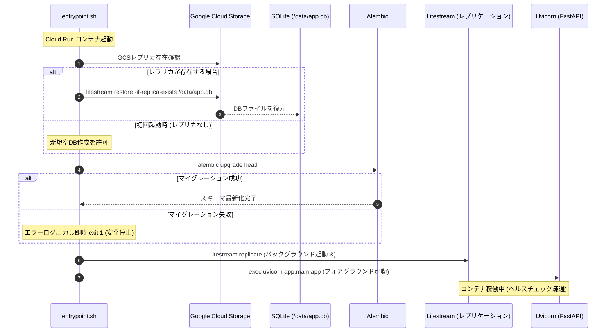
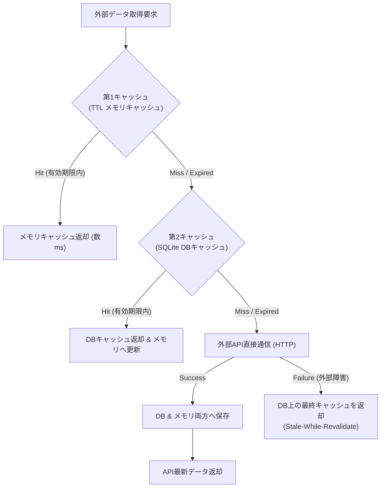

# Profile A 詳細設計書 (Profile A Golden Path Detailed Specification)

文書バージョン: 1.0  
作成日: 2026-10-15  
対象バージョン: AI駆動システム開発ライフサイクルテンプレート V2.4  
ステータス: 正式設計書 (Approved Specification)  
関連文書:
- [V2.4改変計画書.md](./V2.4改変計画書.md)
- [V2.3システムプロファイル構造設計書.md](../V2.3/V2.3システムプロファイル構造設計書.md)
- [AI駆動開発テンプレート_事前組込推奨要件・設計・留意事項_総合レポート.md](../../検討課題/V2.2/AI駆動開発テンプレート_事前組込推奨要件・設計・留意事項_総合レポート.md)
- [システムプロファイル設計および事前組込アーキテクチャ検討レポート.md](../../検討課題/V2.2/システムプロファイル設計および事前組込アーキテクチャ検討レポート.md)
- [追加検討課題_モックアップ制御と画面デザイン標準化.md](../../検討課題/V2.2/追加検討課題_モックアップ制御と画面デザイン標準化.md)
- [レビューシステム設計書V2.4.md](./レビューシステム設計書V2.4.md)
- [AI駆動システム開発フェーズ定義書V2.4.md](./AI駆動システム開発フェーズ定義書V2.4.md)
- [エージェント設計書V2.4.md](./エージェント設計書V2.4.md)
- [01_グランドデザイン基本仕様書.md](../../../.agents/plugins/system-dev-pipeline/templates/グランドデザイン/01_グランドデザイン基本仕様書.md)
- [02_UIコンポーネントカタログ及び実装パターン.md](../../../.agents/plugins/system-dev-pipeline/templates/グランドデザイン/02_UIコンポーネントカタログ及び実装パターン.md)
- [03_画面仕様書テンプレート.md](../../../.agents/plugins/system-dev-pipeline/templates/グランドデザイン/03_画面仕様書テンプレート.md)

---

## 1. はじめに

### 1.1 Profile A の定義と位置づけ
**Profile A（サーバーレス極小コストWeb型）** は、AI駆動システム開発テンプレートにおける**「最優先リファレンススタック（ゴールデンパス）」**である。

本プロファイルは、個人開発、小規模SaaS、社内Webツール、業務ユーティリティなどを対象とし、**「月額数百円以下の極小インフラコスト（実質無料枠〜数十円運用）」** と **「本番稼働に耐えうる高可用性・耐障害性・セキュリティ」** を両立することを目的として設計されている。

### 1.2 実稼働4プロジェクトから得られた教訓と克服課題
先行して本スタックで実稼働に至った4つのシステム（`bicycle-log`、`Movie Log`、`Gardening Log`、`bicycle-maintenance`）の横断分析レポート（[AI駆動開発テンプレート_事前組込推奨要件・設計・留意事項_総合レポート.md](../../検討課題/V2.2/AI駆動開発テンプレート_事前組込推奨要件・設計・留意事項_総合レポート.md)）により、以下の「6大技術的負債」が後工程・運用期に顕在化することが判明した：

1. **フロントエンドの God Component 化**: 1ファイルにUI、ステート、API通信、エラーハンドリングが密集（数百〜千行）。
2. **データベース運用の脆弱性**: Alembic未導入による手動 `ALTER TABLE` 乱立、SQLiteの型・タイムゾーン差異、単一ライター競合。
3. **セキュリティ・認可層の形骸化**: 前段プロキシ（IAP）前提によるFastAPI側JWT署名検証の未実装、ローカル用モックの放置。
4. **型安全性・スキーマ同期の断片化**: PydanticとTypeScriptの手動二重管理・タイポ。
5. **テスト・CI/CDパイプラインの不足**: バックエンド単体・スモークテストの不足、自動CIワークフロー未整備。
6. **モックの野良残存**: コンポーネント内直書きモックによる実API疎通レビュー阻害。

Profile A 詳細設計書は、これらの問題を事後修正するのではなく、**テンプレートの初期スケルトンコードおよび設計規約として最初から組み込む（Shift-Left）** ための完全な技術仕様を規定する。

---

## 2. システムアーキテクチャ全体像

Profile A は、Google Cloud Platform（Cloud Run, Cloud Storage, Cloud IAP）と、軽量なOSSスタック（FastAPI, SQLite, Litestream, React, Vite, Tailwind CSS）を有機的に統合したアーキテクチャである。

```mermaid
flowchart TB
    subgraph ClientLayer["クライアント環境 (Web Browser)"]
        Browser["React 18 SPA (Vite)<br/>Tailwind CSS / グランドデザイン<br/>MSW (開発時モック) / Canvas WebP圧縮"]
    end

    subgraph SecurityPerimeter["Google Cloud インフラ境界"]
        IAP["Google Cloud IAP<br/>(Identity-Aware Proxy)<br/>OAuth2 ユーザー認証 / JWT署名付与"]
        GCS[("Google Cloud Storage<br/>(Litestream レプリカバケット)")]
    end

    subgraph CloudRunInstance["Google Cloud Run (単一コンテナ / max-instances=1)"]
        subgraph Container["Docker コンテナ (Alpine / Debian Slim)"]
            Entry["entrypoint.sh<br/>(起動オーケストレーション)"]
            
            subgraph BackendApp["バックエンド (FastAPI / Uvicorn)"]
                Static["SPA 静的ファイル配信<br/>(HTML, JS, CSS)"]
                Auth["core/auth.py<br/>IAP JWT 署名二重検証"]
                Router["API ルーター<br/>(/api/v1/...)"]
                Health["内部監視エンドポイント<br/>(/api/internal/...)"]
                Cache["外部API二重キャッシュ<br/>(TTL Memory + DB Cache)"]
            end

            subgraph DataLayer["データ永続化 & マイグレーション"]
                Alembic["Alembic マイグレーション<br/>(起動時 alembic upgrade head)"]
                SQLite[("SQLite データベース<br/>(WAL モード, timeout=5000)")]
                Litestream["Litestream プロセス<br/>(非同期 WAL レプリケーション)"]
            end
        end
    end

    Browser -->|1. HTTPS リクエスト| IAP
    IAP -->|2. 認証済みリクエスト + X-Goog-IAP-JWT-Assertion| Entry
    Entry -->|3. 静的SPA配信| Static
    Static -.->|SPA描画| Browser
    Browser -->|4. REST API 呼び出し| Router
    Router --> Auth
    Auth -->|署名検証・ユーザー特定| Router
    Router --> Cache
    Router --> Alembic
    Router --> SQLite
    Entry -->|起動時リストア| GCS
    Litestream -->|非同期継続バックアップ| GCS
    Entry -->|Alembic自動適用| Alembic
    Entry --> Litestream
    Entry --> BackendApp
```



### 2.1 主要技術スタック一覧

| レイヤー | 採用技術 | バージョン/規約 | 選定理由・役割 |
| :--- | :--- | :--- | :--- |
| **コンテナ基盤** | Google Cloud Run | 第2世代実行環境 | 従量課金・コールドスタート対応・極小コスト |
| **インスタンス制御**| Cloud Run 設定 | `max-instances=1` | SQLiteの単一ライター制約保護・データ整合性担保 |
| **データ永続化** | SQLite | 3.40+ (WALモード) | サーバーレスローカルDB、極小レイテンシ |
| **バックアップ/同期**| Litestream | 0.3.13+ | WALログのGCSリアルタイム非同期レプリケーション |
| **マイグレーション**| Alembic | 1.13+ | DBスキーマ変更の完全自動追跡・ロールフォワード |
| **バックエンド** | FastAPI / Python | 3.11+ / Uvicorn | 高速API、Pydantic OpenAPI自動生成、非同期I/O |
| **設定管理** | Pydantic Settings | 2.0+ | 環境変数厳格型付け・プレースホルダー即死ガード |
| **認可・セキュリティ**| Cloud IAP + Google Auth| JWT署名検証 | 社内/個人アカウント制限、アプリ層での二重防御 |
| **フロントエンド** | React | 18+ (SPA) + Vite | 高速ビルド、豊富なエコシステム |
| **スタイリング** | Tailwind CSS | 3.4+ / 4.x | グランドデザイン規格準拠、セマンティックカラー |
| **モック制御** | MSW (Mock Service Worker)| 2.0+ | サービスワーカーによる通信遮断、環境変数切替 |
| **画像最適化** | HTML5 Canvas | WebP (700×700px, 80%)| クライアント事前圧縮による帯域・ストレージ節約 |
| **型定義自動化** | openapi-typescript | 7.0+ | FastAPIスキーマからの型自動生成 |

---

## 3. 静的スケルトン構成マップ (`skeletons/profile-a/`)

AIエージェントによるコード生成時のブレを防止するため、テンプレートの `skeletons/profile-a/` に以下のファイル群を事前配備する。

```
skeletons/profile-a/
├── docker/
│   ├── Dockerfile                  # 本番マルチステージコンテナ定義
│   ├── docker-compose.yml          # ローカル開発用コンテナ環境
│   ├── entrypoint.sh               # 確定起動オーケストレーションスクリプト
│   └── litestream.yml              # Litestream GCSレプリケーション定義
│
├── backend/
│   ├── alembic/
│   │   ├── env.py                  # SQLAlchemy メタデータ自動検出設定
│   │   ├── script.py.mako          # マイグレーション雛形
│   │   └── versions/               # マイグレーションリビジョン（Git管理）
│   ├── alembic.ini                 # Alembic 構成ファイル
│   ├── core/
│   │   ├── __init__.py
│   │   ├── config.py               # Pydantic Settings (環境変数厳格バリデーション)
│   │   ├── auth.py                 # IAP JWT 署名検証依存性 (get_current_user)
│   │   └── cache.py                # 外部API二重キャッシュ基盤 (TTL + DB)
│   ├── db/
│   │   ├── __init__.py
│   │   ├── session.py              # SQLite WAL / timeout / foreign_keys セッション
│   │   └── base.py                 # SQLAlchemy 宣言的Baseクラス
│   ├── api/
│   │   ├── __init__.py
│   │   └── internal/
│   │       ├── __init__.py
│   │       ├── health.py           # /api/internal/health (死活・DB接続監視)
│   │       └── litestream.py       # /api/internal/litestream/status (同期ラグ監視)
│   ├── tests/
│   │   ├── conftest.py             # テスト用DBフィクスチャ (インメモリSQLite)
│   │   └── test_smoke.py           # スモークテスト・ヘルスチェック検証
│   ├── pyproject.toml              # Ruff, mypy, pytest 設定
│   └── requirements.txt            # バックエンド依存ライブラリ一覧
│
└── frontend/
    ├── src/
    │   ├── components/
    │   │   ├── ui/                 # グランドデザイン準拠共通UI部品
    │   │   │   ├── Button.tsx
    │   │   │   ├── Modal.tsx
    │   │   │   ├── Drawer.tsx
    │   │   │   ├── Input.tsx
    │   │   │   └── Table.tsx
    │   │   └── layout/
    │   │       ├── Header.tsx
    │   │       └── Sidebar.tsx
    │   ├── hooks/
    │   │   ├── useTheme.ts         # ダーク/ライト/システムテーマ切り替え
    │   │   └── useImageCompressor.ts # Canvas WebP 700x700px 事前圧縮フック
    │   ├── services/
    │   │   └── apiClient.ts        # Axios/Fetch 共通クライアント (エラー共通処理)
    │   ├── mocks/
    │   │   ├── browser.ts          # MSW ワーカースタートアップ
    │   │   └── handlers.ts         # MSW モックハンドラー基盤
    │   ├── types/
    │   │   └── api.generated.ts    # openapi-typescript 自動生成型 (プレースホルダー)
    │   ├── utils/
    │   │   └── dateTime.ts         # Aware UTC ➔ JST 変換ユーティリティ
    │   ├── App.tsx
    │   ├── main.tsx                # VITE_ENABLE_MOCK 判定・MSW初期化
    │   └── index.css               # グランドデザイン Tailwind CSS 設定
    ├── package.json                # openapi-typescript codegen スクリプト同梱
    ├── tsconfig.json
    ├── vite.config.ts
    └── tailwind.config.js          # グランドデザイン デザイントークン設定
```

---

## 4. コンテナ・起動シーケンス詳細設計

### 4.1 マルチステージ Dockerfile
フロントエンドの静的ビルドと、バックエンド Python 実行環境を単一コンテナに統合する。

```dockerfile
# ==============================================================================
# Stage 1: フロントエンド ビルドステージ
# ==============================================================================
FROM node:20-slim AS frontend-builder
WORKDIR /app/frontend

COPY frontend/package*.json ./
RUN npm ci

COPY frontend/ ./
# 本番ビルド時はモックを完全無効化
ENV VITE_ENABLE_MOCK=false
RUN npm run build

# ==============================================================================
# Stage 2: バックエンド & 実行ステージ
# ==============================================================================
FROM python:3.11-slim-bookworm AS runner

# システム依存パッケージおよび Litestream のインストール
RUN apt-get update && apt-get install -y --no-install-recommends \
    curl \
    ca-certificates \
    sqlite3 \
    && rm -rf /var/lib/apt/lists/*

# Litestream のバイナリ取得
ADD https://github.com/benbjohnson/litestream/releases/download/v0.3.13/litestream-v0.3.13-linux-amd64.tar.gz /tmp/litestream.tar.gz
RUN tar -C /usr/local/bin -xzf /tmp/litestream.tar.gz && rm /tmp/litestream.tar.gz

WORKDIR /app

# バックエンド依存パッケージのインストール
COPY backend/requirements.txt ./
RUN pip install --no-cache-dir -r requirements.txt

# アプリケーションソースコードのコピー
COPY backend/ ./backend/
COPY docker/litestream.yml /etc/litestream.yml
COPY docker/entrypoint.sh /app/entrypoint.sh
RUN chmod +x /app/entrypoint.sh

# Stage 1 でビルドしたフロントエンド静的アセットをコピー
COPY --from=frontend-builder /app/frontend/dist ./frontend/dist

# データ永続化ディレクトリの準備
RUN mkdir -p /data

EXPOSE 8080
ENV PORT=8080
ENV PYTHONPATH=/app/backend

ENTRYPOINT ["/app/entrypoint.sh"]
```

### 4.2 `entrypoint.sh` の確定起動シーケンス
Cloud Run 起動時のレースコンディションや、マイグレーション未適用によるスキーマ不整合を防止するため、厳密な同期シーケンスを保証する。



```bash
#!/bin/bash
set -e

echo "=== [Profile A] Starting Cloud Run Container ==="

DB_PATH="/data/app.db"
export DATABASE_URL="sqlite:///${DB_PATH}"

# 1. Litestream リストア処理
if [ -n "$LITESTREAM_BUCKET" ]; then
    echo "--> Checking for existing Litestream replica in GCS..."
    if litestream restore -if-replica-exists -config /etc/litestream.yml "${DB_PATH}"; then
        echo "--> Database restored successfully or no replica found."
    else
        echo "FATAL: Litestream restore failed! Aborting startup to prevent split-brain." >&2
        exit 1
    fi
else
    echo "--> WARNING: LITESTREAM_BUCKET is not set. Running without replication."
fi

# 2. Alembic マイグレーション適用
echo "--> Applying database migrations with Alembic..."
cd /app/backend
if alembic upgrade head; then
    echo "--> Alembic migrations applied successfully."
else
    echo "FATAL: Alembic migration failed! Aborting startup." >&2
    exit 1
fi
cd /app

# 3. Litestream レプリケーション並行起動 & Uvicorn 起動
if [ -n "$LITESTREAM_BUCKET" ]; then
    echo "--> Starting Litestream replication in background..."
    litestream replicate -config /etc/litestream.yml &
    LITESTREAM_PID=$!
fi

echo "--> Starting Uvicorn server on port ${PORT:-8080}..."
exec uvicorn core.main:app --host 0.0.0.0 --port "${PORT:-8080}"
```

---

## 5. データ永続化 & マイグレーション詳細仕様

### 5.1 SQLite エンジン構成規約
SQLiteをサーバー環境で安定稼働させるため、`backend/db/session.py` で以下の接続パラメータを強制する。

```python
# backend/db/session.py
from sqlalchemy import create_engine, event
from sqlalchemy.orm import sessionmaker
from core.config import settings

engine = create_engine(
    settings.DATABASE_URL,
    connect_args={
        "check_same_thread": False,
        "timeout": 5.0,  # busy_timeout=5000ms: ロック解放待機
    },
    pool_pre_ping=True,
)

@event.listens_for(engine, "connect")
def set_sqlite_pragma(dbapi_connection, connection_record):
    cursor = dbapi_connection.cursor()
    # 1. WAL (Write-Ahead Logging) モード有効化 (読み書き並行性向上)
    cursor.execute("PRAGMA journal_mode=WAL;")
    # 2. 外部キー制約の強制
    cursor.execute("PRAGMA foreign_keys=ON;")
    # 3. 同期レベルの最適化 (NORMAL: WALモード下での十分な安全性と高速性)
    cursor.execute("PRAGMA synchronous=NORMAL;")
    # 4. busy_timeout の再設定 (ミリ秒)
    cursor.execute("PRAGMA busy_timeout=5000;")
    cursor.close()

SessionLocal = sessionmaker(autocommit=False, autoflush=False, bind=engine)

def get_db():
    db = SessionLocal()
    try:
        yield db
    finally:
        db.close()
```

### 5.2 Litestream レプリケーション設定 (`docker/litestream.yml`)
```yaml
# docker/litestream.yml
dbs:
  - path: /data/app.db
    replicas:
      - type: gcs
        bucket: "${LITESTREAM_BUCKET}"
        path: "db-replica"
        retention: 720h  # 30日間スナップショット・WAL保持
        sync-interval: 1s
```

### 5.3 Alembic マイグレーション完全仕様

#### 5.3.1 生SQL手動DDLの完全禁止
- **絶対規約**:
  コード内での `engine.execute("CREATE TABLE ...")` や `ALTER TABLE` などの直接実行、および `Base.metadata.create_all(bind=engine)` を**本番コードおよび初期化ロジックから完全に排除**する。
- **スキーマ管理の一元化**:
  すべてのテーブル作成・変更・削除は、Alembic のリビジョンスクリプト経由でのみ適用される。

#### 5.3.2 `alembic/env.py` の標準設定（SQLite型変換サポート）
SQLiteにおける `ALTER TABLE` の制限（カラム型変更や制約変更の困難さ）を克服するため、`batch_mode=True` を強制する。

```python
# backend/alembic/env.py
from logging.config import fileConfig
from sqlalchemy import engine_from_config, pool
from alembic import context

from core.config import settings
from db.base import Base  # すべてのモデルがインポートされているBase

config = context.config
if config.config_file_name is not None:
    fileConfig(config.config_file_name)

target_metadata = Base.metadata

def run_migrations_online() -> None:
    configuration = config.get_section(config.config_ini_section)
    configuration["sqlalchemy.url"] = settings.DATABASE_URL
    
    connectable = engine_from_config(
        configuration,
        prefix="sqlalchemy.",
        poolclass=pool.NullPool,
    )

    with connectable.connect() as connection:
        context.configure(
            connection=connection,
            target_metadata=target_metadata,
            render_as_batch=True,  # SQLite用バッチモード強制 (ALTER TABLE制約回避)
            compare_type=True,     # 型変更の自動検知
        )

        with context.begin_transaction():
            context.run_migrations()

run_migrations_online()
```

#### 5.3.3 テーブル設計規約（タイムゾーン & `user_id` 拡張性）
- **タイムゾーン規約**:
  テーブルの日時カラムはすべて `DateTime(timezone=True)` で定義し、デフォルト値には Aware UTC（`datetime.now(timezone.utc)`）を指定する。
- **`user_id` 拡張性規約**:
  初期段階で単一ユーザー運用であっても、将来のマルチテナント化・複数ユーザー対応時にスキーマ破壊的大改変が発生することを防ぐため、**すべての業務主要テーブルに `user_id` カラム（STRING / NOT NULL またはインデックス付き）を最初から配備**する。

```python
# モデル定義の標準パターン
from datetime import datetime, timezone
from sqlalchemy import Column, Integer, String, DateTime
from db.base import Base

class Item(Base):
    __tablename__ = "items"

    id = Column(Integer, primary_key=True, index=True)
    user_id = Column(String(128), index=True, nullable=False) # IAPユーザーID
    title = Column(String(255), nullable=False)
    created_at = Column(DateTime(timezone=True), default=lambda: datetime.now(timezone.utc), nullable=False)
    updated_at = Column(DateTime(timezone=True), default=lambda: datetime.now(timezone.utc), onupdate=lambda: datetime.now(timezone.utc), nullable=False)
```

---

## 6. セキュリティ & 認可アーキテクチャ (IAP JWT 二重防御)

### 6.1 IAP JWT 二重防御の思想
Cloud Run の前段に Google Cloud IAP を配置することで不正なアクセスを遮断するが、それだけに依存せず、**アプリケーション層（FastAPI）で `X-Goog-IAP-JWT-Assertion` ヘッダーの暗号署名を直接検証する二重防御**を標準実装する。これにより、内部ネットワークのバイパスやプロキシ設定ミスによる認証すり抜けを完全防止する。

### 6.2 署名検証ミドルウェア / DI (`backend/core/auth.py`)

```python
# backend/core/auth.py
from fastapi import Header, HTTPException, status, Depends
from google.auth.transport import requests
from google.oauth2 import id_token
from pydantic import BaseModel
from core.config import settings

class AuthenticatedUser(BaseModel):
    user_id: str
    email: str

def get_current_user(
    x_goog_iap_jwt_assertion: str | None = Header(None, alias="X-Goog-IAP-JWT-Assertion")
) -> AuthenticatedUser:
    """
    IAP JWTアサーションを検証して認証済みユーザーを返却するFastAPI依存性。
    DEBUG=True かつローカル実行時のみモックユーザーを返却。本番環境では署名検証を強制。
    """
    # 開発環境・ローカル実行時のセーフティバイパス
    if settings.DEBUG:
        if settings.ALLOW_LOCAL_AUTH_BYPASS:
            return AuthenticatedUser(
                user_id="local-dev-user-001",
                email="dev@example.com"
            )

    if not x_goog_iap_jwt_assertion:
        raise HTTPException(
            status_code=status.HTTP_401_UNAUTHORIZED,
            detail="Missing required IAP JWT assertion header."
        )

    try:
        # Google 公開鍵による署名検証および Audience 検証
        payload = id_token.verify_token(
            x_goog_iap_jwt_assertion,
            requests.Request(),
            audience=settings.IAP_AUDIENCE
        )
        return AuthenticatedUser(
            user_id=payload["sub"],
            email=payload.get("email", "")
        )
    except Exception as e:
        raise HTTPException(
            status_code=status.HTTP_401_UNAUTHORIZED,
            detail=f"Invalid IAP JWT assertion: {str(e)}"
        )
```

### 6.3 Pydantic Settings 環境変数設定 (`backend/core/config.py`)

```python
# backend/core/config.py
from pydantic_settings import BaseSettings
from pydantic import field_validator
import sys

class Settings(BaseSettings):
    PROJECT_NAME: str = "Profile A Web System"
    DEBUG: bool = False
    ALLOW_LOCAL_AUTH_BYPASS: bool = False
    
    # DB & インフラ設定
    DATABASE_URL: str = "sqlite:////data/app.db"
    LITESTREAM_BUCKET: str = ""
    
    # IAP 設定 (本番では必須)
    IAP_AUDIENCE: str = ""
    
    # 外部API設定
    EXTERNAL_API_KEY: str = ""

    @field_validator("IAP_AUDIENCE")
    def validate_iap_audience(cls, v, info):
        # 本番環境 (DEBUG=False) では IAP_AUDIENCE の未設定やプレースホルダーを禁止
        debug = info.data.get("DEBUG", False)
        if not debug:
            if not v or v.startswith("[YOUR_") or "example" in v:
                raise ValueError("FATAL: IAP_AUDIENCE must be properly configured in production!")
        return v

    class Config:
        env_file = ".env"
        case_sensitive = True

settings = Settings()
```

---

## 7. フロントエンドアーキテクチャ (Anti-God Component & グランドデザイン)

### 7.1 ディレクトリ責務分離と行数制限
フロントエンドのコード品質を担保するため、以下の物理分離と行数ルールを強制する。
- **1ファイル最大250行制限**:
  画面やコンポーネントが250行を超えそうな場合、必ず子コンポーネントまたはカスタムフックへ分割する。
- **カスタムフックへの責務集約**:
  状態管理（`useState`）、データフェッチ（`useEffect`）、ハンドラーロジックはコンポーネント内に書かず、`hooks/use[Domain].ts` に集約する。

```tsx
// 例: src/hooks/useItems.ts (責務分離の標準パターン)
import { useState, useEffect, useCallback } from 'react';
import { ItemDto } from '../types/api.generated';
import { apiClient } from '../services/apiClient';

export function useItems() {
  const [items, setItems] = useState<ItemDto[]>([]);
  const [loading, setLoading] = useState(false);
  const [error, setError] = useState<string | null>(null);

  const fetchItems = useCallback(async () => {
    setLoading(true);
    try {
      const data = await apiClient.getItems();
      setItems(data);
      setError(null);
    } catch (err: any) {
      setError(err.message || 'Failed to fetch items');
    } finally {
      setLoading(false);
    }
  }, []);

  useEffect(() => {
    fetchItems();
  }, [fetchItems]);

  return { items, loading, error, refresh: fetchItems };
}
```

### 7.2 グランドデザイン標準の採用
`doc_samples/グランドデザイン/` に基づき、UIスタイルとインタラクションを統一する。
- **グリッドと余白**: 4px/8px の倍数グリッド（`p-2`, `p-4`, `p-6`, `gap-4`）。
- **ウィンドウ形態選定**:
  - 簡易登録・確認ダイアログ: `StandardModal.tsx`（最大幅 `max-w-lg`）。
  - 詳細表示・複合フォーム: `Drawer.tsx`（右スライドイン、幅 `w-full max-w-md` または `max-w-xl`）。
- **テーマ切り替え**: `useTheme.ts` による Light / Dark / System 3モードのシームレスな同期。

### 7.3 ブラウザ側 Canvas WebP 事前圧縮フック (`useImageCompressor.ts`)
アップロード画像の帯域消費および GCS ストレージ容量を抑制するため、ブラウザ側で 700×700px 正方形・品質80% の WebP 画像へ事前圧縮する標準フックを提供する。

```typescript
// frontend/src/hooks/useImageCompressor.ts
import { useCallback } from 'react';

interface CompressOptions {
  maxWidth?: number;
  maxHeight?: number;
  quality?: number;
}

export function useImageCompressor() {
  const compressToWebP = useCallback(
    (file: File, options: CompressOptions = {}): Promise<Blob> => {
      const { maxWidth = 700, maxHeight = 700, quality = 0.8 } = options;

      return new Promise((resolve, reject) => {
        const img = new Image();
        img.src = URL.createObjectURL(file);
        img.onload = () => {
          URL.revokeObjectURL(img.src);
          let width = img.width;
          let height = img.height;

          // アスペクト比を維持して最大サイズ内に収める
          if (width > height) {
            if (width > maxWidth) {
              height = Math.round((height * maxWidth) / width);
              width = maxWidth;
            }
          } else {
            if (height > maxHeight) {
              width = Math.round((width * maxHeight) / height);
              height = maxHeight;
            }
          }

          const canvas = document.createElement('canvas');
          canvas.width = width;
          canvas.height = height;
          const ctx = canvas.getContext('2d');
          if (!ctx) {
            reject(new Error('Failed to get canvas 2D context'));
            return;
          }

          ctx.drawImage(img, 0, 0, width, height);
          canvas.toBlob(
            (blob) => {
              if (blob) resolve(blob);
              else reject(new Error('Canvas toBlob failed'));
            },
            'image/webp',
            quality
          );
        };
        img.onerror = () => reject(new Error('Failed to load image for compression'));
      });
    },
    []
  );

  return { compressToWebP };
}
```

---

## 8. モックアップ制御アーキテクチャ (MSW + 環境変数切替)

### 8.1 案C（環境変数切替）と案A（直書きモック禁止）の統合
- **環境変数値**: `.env` 内で `VITE_ENABLE_MOCK=true` または `false` を設定。
- **初期化ロジック (`frontend/src/main.tsx`)**:
  アプリケーション起動時に環境変数を評価し、`true` の場合のみ Service Worker を起動してリクエストを横取りする。

```typescript
// frontend/src/main.tsx
import React from 'react';
import ReactDOM from 'react-dom/client';
import App from './App';
import './index.css';

async function prepareApp() {
  if (import.meta.env.VITE_ENABLE_MOCK === 'true') {
    const { worker } = await import('./mocks/browser');
    await worker.start({
      onUnhandledRequest: 'bypass', // 未定義リクエストは通過させる
    });
    console.warn('[MSW] Mock Service Worker is running in mock mode.');
  }
}

prepareApp().then(() => {
  ReactDOM.createRoot(document.getElementById('root')!).render(
    <React.StrictMode>
      <App />
    </React.StrictMode>
  );
});
```

### 8.2 モックハンドラー定義 (`frontend/src/mocks/handlers.ts`)
```typescript
// frontend/src/mocks/handlers.ts
import { http, HttpResponse } from 'msw';

export const handlers = [
  http.get('/api/v1/items', () => {
    return HttpResponse.json([
      {
        id: 1,
        user_id: 'mock-user-123',
        title: 'Mock Item 1',
        created_at: '2026-10-15T00:00:00Z',
        updated_at: '2026-10-15T00:00:00Z',
      },
    ]);
  }),
];
```

---

## 9. 外部API連携 & キャッシュアーキテクチャ

外部サービス（天候API、外部認証、スクレイピング、書誌情報等）へのアクセスにおいて、APIキーのレートリミット保護および外部ダウン時の可用性を担保するため、**TTLメモリ ＋ DB永続化の「二重キャッシュ機構」** を標準配備する。



---

## 10. 可観測性 & ヘルスチェック

Cloud Run の自動リカバリや、Litestream のサイレント障害（レプリケーション停止）を検知するため、専用のヘルスチェックエンドポイントを標準配備する。

1. **`/api/internal/health`**:
   - アプリケーションプロセスの生存、および SQLite への接続性（`SELECT 1`）を同期検証。
2. **`/api/internal/litestream/status`**:
   - WALレプリケーションの最終同期時刻、未レプリケートWALサイズ、レプリケーションエラーログの有無を検証。遅延が一定時間（例: 5分以上）発生している場合は HTTP 503 を返却。

---

## 11. 自動CI/CDパイプライン (GitHub Actions)

コミット時およびプルリクエスト時に実行される `.github/workflows/ci.yml` を初期配備する。

```yaml
# .github/workflows/ci.yml
name: Profile A CI Pipeline

on:
  push:
    branches: [ main, develop ]
  pull_request:
    branches: [ main, develop ]

jobs:
  backend-checks:
    runs-on: ubuntu-latest
    defaults:
      run:
        working-directory: backend
    steps:
      - uses: actions/checkout@v4
      - name: Set up Python
        uses: actions/setup-python@v5
        with:
          python-version: '3.11'
          cache: 'pip'
      - name: Install dependencies
        run: pip install -r requirements.txt pytest ruff mypy
      - name: Lint with Ruff
        run: ruff check .
      - name: Type check with Mypy
        run: mypy .
      - name: Run Smoke Tests
        run: pytest

  frontend-checks:
    runs-on: ubuntu-latest
    defaults:
      run:
        working-directory: frontend
    steps:
      - uses: actions/checkout@v4
      - name: Set up Node.js
        uses: actions/setup-node@v4
        with:
          node-version: 20
          cache: 'npm'
          cache-dependency-path: frontend/package-lock.json
      - name: Install dependencies
        run: npm ci
      - name: Lint
        run: npm run lint
      - name: Type check
        run: npm run type-check
      - name: Build Test
        run: npm run build
        env:
          VITE_ENABLE_MOCK: "false"
```

---

## 12. エージェント実装ガイドライン & 監査基準

各フェーズおよびロールにおける具体的な行動指針と、レビューゲートでの検査基準を定義する。

### 12.1 エージェント別実装規約
- **`architect`**:
  - 全テーブルに `user_id` を配置したER設計。
  - 外部連携箇所の二重キャッシュ仕様明文化。
  - モック制御（MSW/環境変数）の記載。
- **`backend-engineer`**:
  - 生SQL DDL禁止、Alembic マイグレーション完全適用。
  - Pydantic Settings 厳格運用、IAP JWT検証依存性（`get_current_user`）の全業務API適用。
  - 標準コマンドシーケンス（`alembic revision --autogenerate`, `alembic upgrade head`）の遵守。
- **`ui-designer`**:
  - 1コンポーネント最大250行制限の遵守。
  - `components/ui/` のグランドデザイン部品再利用。
  - コンポーネント内直書きモックの完全禁止、MSWハンドラーへのモック集約。
  - アップロード画面への `useImageCompressor` 適用。

### 12.2 レビューゲート監査チェックリスト (Profile A 固有)

| レビューゲート | 必須監査項目 | 判定基準 (REJECT条件) |
| :--- | :--- | :--- |
| **PHASE 3: 基本設計 (`dev-review-arch`)** | - Cloud Run `max-instances=1` 制約の記載<br/>- Alembic マイグレーション前提の記載<br/>- IAP JWT 署名検証設計の記載<br/>- 外部APIキャッシュ設計の記載 | いずれか1つでも欠落している場合は即時 REJECT |
| **PHASE 5.5: コード品質 (`dev-review-code`)** | - フロントエンド 250行超過ファイルの有無<br/>- コンポーネント内直書きダミーデータの有無<br/>- 生SQL DDL (`CREATE TABLE` 等) の有無<br/>- 環境変数直読み (`os.environ.get`) の有無 | 違反箇所が検出された場合は即時 REJECT |
| **PHASE 7: システム総合 (`dev-review-system`)** | - `.env.production` の `VITE_ENABLE_MOCK=false` 確認<br/>- `DEBUG=False` 設定確認<br/>- プレースホルダー文字列の完全排除<br/>- `entrypoint.sh` 起動順序（リストア➔Alembic➔Uvicorn）の完全性 | 本番漏洩リスクまたは起動順序不備がある場合は即時 REJECT |

---

## 13. 完了基準 (Definition of Done)

本詳細設計書は、以下の基準を満たした時点で有効とする。

1. **仕様の具体性**:
   `entrypoint.sh`, `session.py`, `env.py`, `auth.py`, `useImageCompressor.ts`, `ci.yml` など、主要基盤コードがそのまま実装・スケルトン配置可能なレベルで具体化されていること。
2. **整合性**:
   [V2.3システムプロファイル構造設計書.md](../V2.3/V2.3システムプロファイル構造設計書.md) および [V2.4改変計画書.md](./V2.4改変計画書.md) と完全に整合していること。
3. **相対パス規約の遵守**:
   すべての関連文書へのリンクが相対パスで記述されていること。
