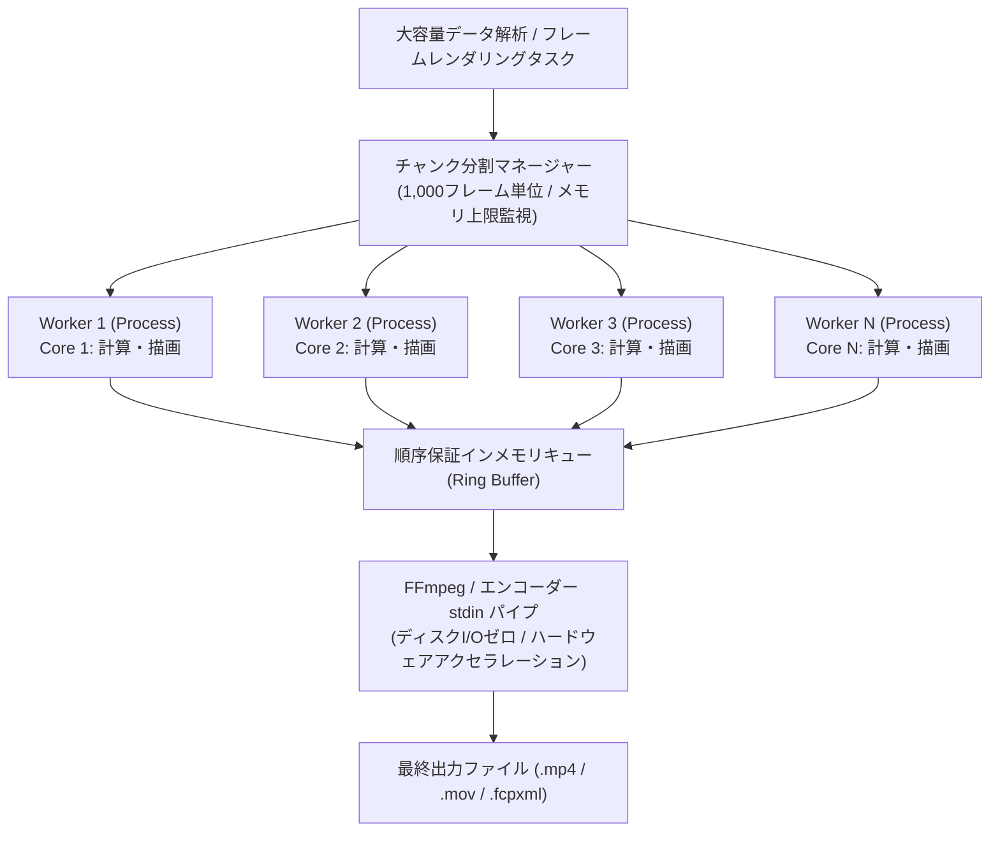

# Profile D 詳細設計書 (Profile D Desktop Application Detailed Specification)

文書バージョン: 1.0  
作成日: 2026-10-15  
対象バージョン: AI駆動システム開発ライフサイクルテンプレート V2.2  
ステータス: 正式設計書 (Approved Specification)  
関連文書:
- [V2.2システムプロファイル構造設計書.md](./V2.2システムプロファイル構造設計書.md)
- [ProfileA詳細設計書.md](./ProfileA詳細設計書.md)
- [V2.2改変計画書.md](./V2.2改変計画書.md)
- [システムプロファイル設計および事前組込アーキテクチャ検討レポート.md](../../検討課題/V2.2/システムプロファイル設計および事前組込アーキテクチャ検討レポート.md)
- [グランドデザイン_他フレームワーク・デスクトップアプリ適用評価レポート.md](../../検討課題/V2.2/グランドデザイン_他フレームワーク・デスクトップアプリ適用評価レポート.md)
- [追加検討課題_モックアップ制御と画面デザイン標準化.md](../../検討課題/V2.2/追加検討課題_モックアップ制御と画面デザイン標準化.md)
- [AI駆動開発テンプレート_事前組込推奨要件・設計・留意事項_総合レポート.md](../../検討課題/V2.2/AI駆動開発テンプレート_事前組込推奨要件・設計・留意事項_総合レポート.md)
- [レビューシステム設計書V2.2.md](./レビューシステム設計書V2.2.md)
- [AI駆動システム開発フェーズ定義書V2.2.md](./AI駆動システム開発フェーズ定義書V2.2.md)
- [エージェント設計書V2.2.md](./エージェント設計書V2.2.md)
- [01_グランドデザイン基本仕様書.md](../../../.agents/plugins/system-dev-pipeline/templates/グランドデザイン/01_グランドデザイン基本仕様書.md)
- [02_UIコンポーネントカタログ及び実装パターン.md](../../../.agents/plugins/system-dev-pipeline/templates/グランドデザイン/02_UIコンポーネントカタログ及び実装パターン.md)
- [03_画面仕様書テンプレート.md](../../../.agents/plugins/system-dev-pipeline/templates/グランドデザイン/03_画面仕様書テンプレート.md)
- [04_他フレームワーク・デスクトップアプリ適用評価レポート.md](../../../.agents/plugins/system-dev-pipeline/templates/グランドデザイン/04_他フレームワーク・デスクトップアプリ適用評価レポート.md)

---

## 1. はじめに

### 1.1 Profile D の定義と位置づけ
**Profile D（PCローカルデスクトップアプリ型）** は、AI駆動システム開発テンプレートにおいて、**「PCローカル環境（Windows / macOS / Linux）で自律稼働する高付加価値スタンドアロンアプリケーション」** を迅速かつ安全に構築するためのリファレンスアーキテクチャである。

本プロファイルは、以下の要件を持つシステムを主要ターゲットとする：
1. **完全ローカル完結・データ主権保証**: センシティブな生体情報、機密ドキュメント、大容量メディアデータをクラウドにアップロードせず、ローカル環境のみで安全に処理・永続化する。
2. **OSネイティブ機能との密結合**: ファイルシステムへの直接高速アクセス、OSネイティブファイル/フォルダピッカー、グローバルショートカット、マルチウィンドウ、GPU/ハードウェアアクセラレーションの最大活用。
3. **オフライン耐性 & ゼロインフラコスト**: 外部サーバー通信を前提とせず、月額インフラ費用0円で永久にスタンドアロン稼働可能。

### 1.2 先行稼働システム（`gps-overlay`）の実績と抽出課題
本プロファイルのアーキテクチャは、サイクリング・テレメトリ・オーバーレイシステム（`gps-overlay` v1.0.0）の実稼働およびその客観的評価レポートから得られた知見を基盤としている。

`gps-overlay` は、Tauri v2 + Vue 3 + Python Sidecar (FastAPI, pandas, Pillow, FFmpeg) というハイブリッド構成を採用し、完全ローカルでのApple ProRes 4444透過動画出力およびDaVinci Resolve / FCPXMLタイムライン自動同期を実現した（総合評価 88/100点、全39自動テスト合格率100%）。

しかし、同システムの詳細監査（[システム客観的評価と改善提言レポート.md](../../検討課題/V2.2/グランドデザイン_他フレームワーク・デスクトップアプリ適用評価レポート.md) 参照）により、デスクトップ特有の以下の課題が浮き彫りとなった：
1. **Sidecar プロセス管理の脆弱性**: アプリ起動時のバックエンド初期化待ち（ポーリング）や、強制終了時のゾンビプロセス残留リスク。
2. **ローカル通信のセキュリティ境界**: `127.0.0.1` 経由のHTTP通信に対するマシン内別プロセスからの不正アクセス遮断機構の欠如。
3. **Web前提UI設計との摩擦**: OSネイティブタイトルバーとの衝突（macOSトラフィックライトボタンやWindows最小化/最大化ボタンとの重なり）、ドラッグ領域の未定義、`localStorage` の揮発リスク。
4. **長大・重計算処理におけるスケーラビリティ**: Python GIL制約による単一スレッド直列レンダリングの頭打ちと、大容量データ処理時のメモリ圧迫。
5. **開発環境とネイティブビルドの二重性**: ホストマシンの環境汚染を防ぎつつ、ネイティブパッケージングを行うパイプラインの標準化不足。

> [!NOTE]
> なお、上記監査において指摘された「フロントエンド単一コンポーネント肥大化（`CanvasEditor.vue` 1,318行等）」および「バックエンド単一ファイル肥大化（`renderer.py` 1,171行等）」については、テンプレート第1層の「定常的コア設計規範（Anti-God Component / 1ファイル最大250行制限、カスタムフック/Composable分離、モジュール責務分離）」によってすでに解決・制度化されているため、本文書では重複を省き、**Profile D 固有のアーキテクチャ要件に特化して規定**する。

---

## 2. システムアーキテクチャ全体像

Profile D は、**Tauri v2 (Rust)** を中核シェルとし、Web標準フロントエンド（React / Vue + Tailwind CSS）の豊かな表現力と、強力なローカルバックエンド（Python Sidecar / Rust Core）の計算能力を安全に統合するハイブリッド構成を採用する。

```mermaid
flowchart TB
    subgraph HostOS["ホスト OS 環境 (Windows / macOS / Linux)"]
        FS[("ローカルファイルシステム<br/>(動画, ログ, プロジェクト設定)")]
        OSDialog["OS ネイティブダイアログ<br/>(File/Folder Picker, Message Box)"]
        HW["GPU / ハードウェアアクセラレータ<br/>(VideoToolbox, NVENC, QSV)"]
    end

    subgraph TauriApp["Tauri v2 アプリケーション実行境界"]
        subgraph NativeShell["Tauri Core (Rust)"]
            AppWindow["ネイティブウィンドウ管理<br/>(Frameless / Drag Region / Traffic Lights)"]
            SidecarMgr["Sidecar ライフサイクルマネージャー<br/>(起動, ヘルスチェック, ゾンビ回収)"]
            SecToken["動的セッショントークン生成器<br/>(UUIDv4 / 起動時注入)"]
            TauriIPC["Tauri IPC コマンドハンドラー"]
        end

        subgraph FrontendLayer["フロントエンド層 (WebView2 / WebKitGTK / WKWebView)"]
            UI["React 18 / Vue 3 SPA<br/>Tailwind CSS (グランドデザイン規格)<br/>Frameless TitleBar (pl-20 / pr-[140px])"]
            StorageAdapter["IStorageAdapter<br/>(Tauri Store / Local File 透過永続化)"]
            APIClient["API クライアント<br/>(X-App-Session-Token 自動注入)"]
            MSW["モック制御層 (MSW / DI アダプター)"]
        end

        subgraph SidecarLayer["バックエンド / 計算エンジン (Python Sidecar 等)"]
            FastAPI["ローカル FastAPI サーバー (127.0.0.1:RandomPort)<br/>Uvicorn / シングルインスタンス"]
            TokenAuth["core/auth.py<br/>セッショントークン検証ミドルウェア"]
            ComputeEngine["重計算・データ解析エンジン<br/>(pandas, CairoSVG, Pillow)"]
            MultiProc["multiprocessing チャンク並列化<br/>(マルチコアCPU分散処理)"]
            StreamPipeline["インメモリ パイプライン<br/>(FFmpeg stdin / 標準出力ストリーム)"]
            LocalDB[("ローカル SQLite / ファイルストア<br/>(WALモード / 高速I/O)")]
        end
    end

    UI -->|ウィンドウ移動ドラッグ| AppWindow
    UI -->|ネイティブファイル選択| TauriIPC
    TauriIPC --> OSDialog
    UI -->|設定・ステート永続化| StorageAdapter
    StorageAdapter -->|Tauri Store 経由| FS
    
    SidecarMgr -->|1. プロセス起動 + トークン/ポート注入| FastAPI
    SidecarMgr -->|2. 死活監視・SIGTERM/SIGKILL制御| FastAPI
    SecToken -.->|シークレット共有| SidecarMgr
    SecToken -.->|シークレット注入| UI

    UI -->|3. ローカルHTTP REST/SSE (トークン検証)| APIClient
    APIClient --> TokenAuth
    TokenAuth --> FastAPI
    
    FastAPI --> ComputeEngine
    FastAPI --> LocalDB
    LocalDB --> FS
    ComputeEngine --> MultiProc
    MultiProc --> StreamPipeline
    StreamPipeline -->|ハードウェアエンコード| HW
    StreamPipeline --> FS
```

### 2.1 主要技術スタック一覧

| レイヤー | 採用技術 | バージョン/規約 | 選定理由・役割 |
| :--- | :--- | :--- | :--- |
| **ネイティブシェル** | Tauri | v2.0+ (Rust) | メモリ消費極小（数十MB）、強固なセキュリティサンドボックス、Sidecar標準統括 |
| **フロントエンド** | React 18+ または Vue 3 | TypeScript | コンポーネント指向UI、豊富なエコシステム（Fabric.js, Leaflet等との親和性） |
| **スタイリング** | Tailwind CSS | 3.4+ / 4.x | グランドデザイン規格準拠、4px/8pxグリッド、絶対値併記 |
| **ローカルエンジン** | Python Sidecar | Python 3.11+ | 豊富なデータサイエンス・画像・動画解析ライブラリ（pandas, fitparse, CairoSVG等） |
| **ローカルAPI通信** | FastAPI / Uvicorn | 0.110+ | 非同期I/O、OpenAPIスキーマ自動出力、SSE（Server-Sent Events）進捗通知 |
| **プロセスセキュリティ**| 動的セッショントークン | `X-App-Session-Token` | マシン内他プロセスからの不正APIアクセス完全遮断 |
| **データ永続化** | ローカル SQLite / Tauri Store | WALモード, `timeout=5000` | 高速ローカル保存、オフライン完全自律 |
| **メディア/重計算** | FFmpeg + multiprocessing | ネイティブバイナリ | インメモリパイプ描画、チャンク並列化によるマルチコアCPU分散 |
| **開発環境** | Docker Compose | 2段階ハイブリッド運用 | 日常開発・API検証・自動テストのホスト環境完全隔離 |

---

## 3. 静的スケルトン構成マップ (`skeletons/profile-d/`)

Profile D を選択した際にプロジェクトルートへ自動展開される標準ディレクトリ・ファイル構成を以下に定義する。

```
skeletons/profile-d/
├── src-tauri/                      # Tauri v2 ネイティブ基盤 (Rust)
│   ├── src/
│   │   ├── main.rs                 # エントリポイント・マルチウィンドウ制御
│   │   ├── lib.rs                  # プラグイン初期化
│   │   ├── sidecar.rs              # Sidecar ライフサイクル・ヘルスチェック・ゾンビ回収
│   │   └── commands.rs             # ネイティブダイアログ・OS操作IPCコマンド
│   ├── Cargo.toml                  # Rust 依存定義 (tauri, tauri-plugin-shell, tauri-plugin-store)
│   ├── tauri.conf.json             # ウィンドウ形態 (Frameless), 権限, Sidecar定義
│   └── capabilities/
│       └── default.json            # Tauri v2 厳格アクセス権限マニフェスト
│
├── frontend/                       # フロントエンド (React/Vue + Vite + Tailwind)
│   ├── src/
│   │   ├── components/
│   │   │   ├── layout/
│   │   │   │   ├── FramelessTitleBar.tsx  # OS別セーフエリア対応タイトルバー (Drag Region)
│   │   │   │   ├── SplitPane.tsx          # リサイザブル左右/上下分割ペイン
│   │   │   │   ├── CollapsibleSidebar.tsx # アイコン幅↔展開幅トグルサイドバー
│   │   │   │   └── StatusBar.tsx          # 画面最下部常駐ステータス・進捗バー
│   │   │   └── ui/                        # グランドデザイン準拠共通UI部品 (Button, Modal等)
│   │   ├── hooks/
│   │   │   ├── useNativeDialog.ts         # OSネイティブファイル/フォルダピッカー呼び出し
│   │   │   ├── useShortcuts.ts            # グローバルアクセラレータキー (Ctrl/Cmd+S等)
│   │   │   ├── useStorage.ts              # IStorageAdapter 永続化フック
│   │   │   └── useSidecarStatus.ts        # Sidecar 起動状態・死活監視フック
│   │   ├── services/
│   │   │   ├── apiClient.ts               # 動的トークン自動付与ローカルHTTPクライアント
│   │   │   └── storage/
│   │   │       ├── adapter.interface.ts   # IStorageAdapter 共通抽象インターフェース
│   │   │       ├── tauriStoreAdapter.ts   # デスクトップ本番用 (tauri-plugin-store)
│   │   │       └── localStorageAdapter.ts # Web/Dockerモック開発用アダプター
│   │   ├── mocks/
│   │   │   ├── browser.ts                 # MSW初期化 (VITE_ENABLE_MOCK=true時)
│   │   │   └── handlers.ts                # ローカルAPIモックハンドラー
│   │   ├── types/
│   │   │   └── api.generated.ts           # OpenAPI 自動生成型定義
│   │   ├── App.tsx
│   │   └── main.tsx
│   ├── package.json
│   ├── vite.config.ts
│   └── tailwind.config.js
│
├── backend/                        # ローカル計算エンジン / API (Python Sidecar)
│   ├── core/
│   │   ├── __init__.py
│   │   ├── config.py               # Pydantic Settings (ランダムポート・トークン受取)
│   │   ├── security.py             # X-App-Session-Token 検証ミドルウェア
│   │   └── logger.py               # JST・log_id 付き構造化JSONロギング
│   ├── db/
│   │   ├── __init__.py
│   │   └── session.py              # ローカル SQLite (WAL, timeout=5000, 外部キー)
│   ├── engine/
│   │   ├── __init__.py
│   │   ├── pipeline.py             # multiprocessing チャンク並列処理基盤
│   │   └── stream_pipe.py          # FFmpeg / 外部プロセス双方向パイプ制御
│   ├── api/
│   │   ├── __init__.py
│   │   ├── internal/
│   │   │   └── health.py           # /api/internal/health (Tauriヘルスチェック用)
│   │   └── v1/                     # 業務APIルーター
│   ├── tests/
│   │   ├── conftest.py
│   │   └── test_smoke.py
│   ├── pyproject.toml              # Ruff, mypy, pytest 設定
│   ├── requirements.txt
│   └── pyinstaller.spec            # Sidecar シングルバイナリ生成定義
│
├── docker/                         # 2段階ハイブリッド開発環境 (ホスト環境非汚染)
│   ├── docker-compose.yml          # フロントエンド・バックエンド並行開発用コンテナ
│   ├── Dockerfile.backend          # バックエンド開発・単体テスト用
│   └── Dockerfile.frontend         # フロントエンド開発・E2Eテスト用
│
└── .github/workflows/
    ├── ci.yml                      # コミット時自動CI (Lint, TypeCheck, Unit/Smoke Test)
    └── release-desktop.yml         # タグプッシュ時ネイティブパッケージング (Tauri Build)
```

---

## 4. ネイティブシェル & Sidecar 統合アーキテクチャ

### 4.1 Sidecar ライフサイクル管理（ゾンビ防止 & 確実な起動）
デスクトップアプリにおいて、UIの終了後もバックエンドのPythonプロセスがメモリ上に常駐し続ける「ゾンビプロセス化」は、ユーザーのリソースを圧迫する重大な欠陥である。Tauri Core（Rust）側で厳格なライフサイクルオーケストレーションを実装する。

#### 1. 起動シーケンス
1. **ランダムポート & セッショントークン生成**:
   Tauri Core は起動時に OS から利用可能なランダムポート（例: `50000〜65000`）を割り当て、暗号学的に安全な UUIDv4 セッショントークンを生成する。
2. **プロセス起動**:
   Tauri の `Command::new_sidecar` を利用し、環境変数またはコマンドライン引数としてポート番号とトークンを注入して Python Sidecar をバックグラウンド起動する。
3. **ヘルスチェックポーリング**:
   フロントエンドへ画面を描画する前に、Tauri Core は `/api/internal/health` に対して最大 5 秒間（100ms 間隔）HTTP ポーリングを実施し、`HTTP 200 OK` を確認する。失敗した場合はユーザーに分かりやすいエラーダイアログを表示して終了する。

#### 2. 終了シーケンス（ゾンビプロセス根絶）
1. **正常終了時**:
   Tauri ウィンドウの「閉じる」イベント（`RunEvent::ExitRequested` / `WindowEvent::CloseRequested`）をフックし、Sidecar プロセスに対してまず **`SIGTERM`（ソフトシャットダウン）** を送信する。
2. **タイムアウト時の強制回収**:
   2秒以内にプロセスが終了しない場合、またはアプリが強制終了（SIGINT/クラッシュ）された場合、Rust のドロップハンドラおよび OS シグナルハンドラが直ちに **`SIGKILL`（`child.kill()`）** を発行し、プロセスツリーごと完全に強制終了する。

```rust
// src-tauri/src/sidecar.rs (実装骨格)
use tauri::plugin::{Builder, TauriPlugin};
use tauri::{AppHandle, Manager, RunEvent};
use std::process::Command;
use std::sync::Mutex;

pub struct SidecarState {
    pub child_pid: Mutex<Option<u32>>,
    pub session_token: String,
    pub port: u16,
}

pub fn kill_sidecar(state: &SidecarState) {
    let mut pid_guard = state.child_pid.lock().unwrap();
    if let Some(pid) = *pid_guard {
        #[cfg(unix)]
        unsafe {
            libc::kill(pid as i32, libc::SIGTERM);
            std::thread::sleep(std::time::Duration::from_millis(500));
            libc::kill(pid as i32, libc::SIGKILL);
        }
        #[cfg(windows)]
        {
            let _ = Command::new("taskkill").args(&["/F", "/T", "/PID", &pid.to_string()]).output();
        }
        *pid_guard = None;
    }
}
```

### 4.2 動的セッショントークン検証（マシン内セキュリティ境界）
ローカルホスト（`127.0.0.1`）で HTTP サーバーを起動する場合、同一マシン上で動作するブラウザや悪意あるスクリプト、別アプリからのリクエスト（Drive-by攻撃）に晒されるリスクがある。

- **トークン注入**: Tauri Core からフロントエンドへ初期設定として動的トークンを渡し、UI からの全 HTTP リクエストにカスタムヘッダー `X-App-Session-Token` を自動付与する。
- **FastAPI 側での強制検証**:
  FastAPI のミドルウェア（`core/security.py`）において、ヘルスチェック（`/api/internal/health`）を除くすべてのエンドポイントでヘッダーを照合し、不一致または欠落時は即座に `403 Forbidden` で破棄する。

```python
# backend/core/security.py
from fastapi import Request, HTTPException, status
from starlette.middleware.base import BaseHTTPMiddleware
from core.config import settings

class SessionTokenAuthMiddleware(BaseHTTPMiddleware):
    async def dispatch(self, request: Request, call_next):
        # ヘルスチェックおよびドキュメントはバイパス可能
        if request.url.path in ["/api/internal/health", "/docs", "/openapi.json"]:
            return await call_next(request)
            
        token = request.headers.get("X-App-Session-Token")
        if not token or token != settings.APP_SESSION_TOKEN:
            raise HTTPException(
                status_code=status.HTTP_403_FORBIDDEN,
                detail="Unauthorized local access: Invalid or missing session token."
            )
        return await call_next(request)
```

---

## 5. フロントエンド & 画面グランドデザイン適応規約

デスクトップアプリケーションにおけるUI/UXは、通常のブラウザWebとは異なる固有の物理的制約・操作性を要求する。テンプレートの `doc_samples/グランドデザイン/` を基盤としつつ、以下のデスクトップ標準仕様を義務化する。

### 5.1 フレームレス・ウィンドウ & タイトルバー規格 (Frameless Window)
OS標準の無骨なタイトルバーを排し、アプリケーション全体の一体感を高めるフレームレス構造を採用する。

```
┌──────────────────────────────────────────────────────────────────────────────────────────────────┐
│ [● ● ●] (macOS セーフエリア: 80px)      マイアプリケーション - プロジェクトA (ドラッグ領域)     [— □ ✕] (Win)│ 32px
├──────────────────────────────────────────────────────────────────────────────────────────────────┤
│                                                                                                  │
│   常設アイコンサイドバー (64px) │ メインコンテンツ領域 (スプリットペイン対応)                     │
│   [ファイル]                   │                                                                  │
│   [編集]                       │                                                                  │
│   [解析]                       │                                                                  │
│   [エクスポート]               │                                                                  │
│                                                                                                  │
├──────────────────────────────────────────────────────────────────────────────────────────────────┤
│ 常駐ステータスバー: 接続中 (127.0.0.1:54321) │ 処理ステータス: 待機中 │ メモリ: 124MB            │ 24px
└──────────────────────────────────────────────────────────────────────────────────────────────────┘
```

1. **OS別セーフエリア・パディング**:
   - **macOS**: ウィンドウ左上にトラフィックライトボタン（赤・黄・緑）が配置されるため、ヘッダー左端に `pl-20`（約80px）の余白を必ず確保し、ロゴやメニューとの重なりを防止する。
   - **Windows / Linux**: ウィンドウ右上に最小化・最大化・閉じるボタンが配置されるため、ヘッダー右端に `pr-[140px]` の余白を確保するか、最上部に高さ 32px の独立ドラッグバーを配置する。
2. **ドラッグ領域とクリック領域の分離**:
   - 移動可能なタイトルバー領域には `data-tauri-drag-region` を付与する。
   - その内部に配置されるボタン、入力フォーム、リンクには明示的に `app-region: no-drag`（または Tailwind のクラス規約）を適用し、クリック操作がドラッグに化ける誤動作を防止する。
3. **ウィンドウサイズ制約**:
   - レイアウト崩れを未然に防ぐため、`tauri.conf.json` において**最小ウィンドウサイズ（Min Window Size: 例 960x640px）** を必ず定義する。

### 5.2 デスクトップ固有レイアウト & インタラクション
1. **リサイザブル・スプリットペイン（Split Pane）**:
   一覧画面と詳細プレビュー画面を並行表示する場合、Webの「画面遷移」ではなく、境界線をマウスでドラッグして幅・高さを動的調整できるスプリットペインコンポーネント（`src/components/layout/SplitPane.tsx`）を使用する。
2. **常設折りたたみサイドバー（Collapsible Sidebar）**:
   全画面を覆うモバイル用オーバーレイドロワーを廃止し、左側に常設されるアイコンサイドバー（幅 64px ↔ 展開時 240px）を採用する。
3. **OSネイティブダイアログの優先利用**:
   ファイルのインポート・エクスポート、保存先フォルダの選択において、ブラウザの `<input type="file">` は使用禁止とし、Tauri IPC 経由の OS ネイティブダイアログ（`tauri-plugin-dialog`）を必ず呼び出す。これにより、絶対ファイルパスの直接取得と大容量ファイルの安全なストリーム処理を保証する。
4. **グローバルキーボードショートカット**:
   `useShortcuts.ts` カスタムフックを配備し、以下の標準アクセラレータキーをサポートする：
   - `Ctrl/Cmd + S`: プロジェクト・設定の即時保存
   - `Ctrl/Cmd + O`: ファイルオープンダイアログ展開
   - `Ctrl/Cmd + F`: 検索入力フォーカス
   - `Ctrl/Cmd + ,`: 設定画面展開
   - `Escape`: 開いているモーダル/ポップアップの閉鎖

### 5.3 ストレージ抽象化層 (`IStorageAdapter`)
ブラウザの `localStorage` は、WebViewの再起動やキャッシュクリア、OSアップデートによって容易に揮発・消失する。設定情報や作業状態を安全に永続化するため、ストレージアクセスを直接記述せず、アダプターパターンにより抽象化する。

```typescript
// frontend/src/services/storage/adapter.interface.ts
export interface IStorageAdapter {
  getItem<T>(key: string, defaultValue: T): Promise<T>;
  setItem<T>(key: string, value: T): Promise<void>;
  removeItem(key: string): Promise<void>;
  clear(): Promise<void>;
}
```
- **デスクトップ本番**: `tauriStoreAdapter.ts`（`tauri-plugin-store` によりローカルファイルシステムの JSON/TOML へ安全に書き込み）。
- **Docker/Webモック開発**: `localStorageAdapter.ts`（開発用コンテナ環境で透過的にフォールバック）。

---

## 6. 重計算・並列処理・ストリーミング処理基盤

デスクトップアプリの最大の利点は、クライアントマシンのマルチコアCPU、大容量メモリ、ローカルGPUをフル活用できる点にある。大容量データ解析や動画レンダリング等において、UIを一切フリーズさせず、高速に処理を完了するための基盤仕様を規定する。

### 6.1 `multiprocessing` チャンク並列化アーキテクチャ
Python Sidecar を利用する場合、Python GIL（Global Interpreter Lock）により単一プロセスではマルチコアCPUの性能を引き出せない。

1. **データチャンク分割**:
   処理対象（大量のログ行、時系列データ、動画フレーム等）を、CPU物理コア数（例: `os.cpu_count() - 1`）に応じた最適なチャンク（例: 1,000単位）に分割する。
2. **ワーカープロセスプール**:
   `concurrent.futures.ProcessPoolExecutor` または `multiprocessing.Pool` を利用し、各ワーカーが独立したプロセス空間で並列ラスタライズ・数値計算を実行する。
3. **インメモリバッファ結合**:
   中間結果をディスクに書き出すと I/O ボトルネックが発生するため、共有メモリ（`multiprocessing.shared_memory`）またはインメモリパイプを介して順序制御しながらストリーム出力（FFmpegのstdin等）へ流し込む。



### 6.2 SSE (Server-Sent Events) によるリアルタイム進捗通知
長時間のバックグラウンド処理において、フロントエンドが進捗状況を把握できるように、ポーリングではなく SSE（Server-Sent Events）エンドポイント（`/api/v1/tasks/{task_id}/progress`）を標準提供する。

- **通知ペイロード標準**:
  ```json
  {
    "task_id": "9b1deb4d-3b7d-4bad-9bdd-2b0d7b3dcb6d",
    "progress_percent": 68.5,
    "current_step": 6850,
    "total_steps": 10000,
    "eta_seconds": 45,
    "status": "PROCESSING",
    "log_message": "Rendering chunk 7/10..."
  }
  ```
- フロントエンドの `StatusBar.tsx` はこのストリームを受信し、スムーズな進捗プログレスバーとETA（残り時間予測）を常時表示する。

---

## 7. 2段階ハイブリッド開発・検証環境（Docker ↔ ネイティブ）

デスクトップアプリ開発において、開発者のローカルOS環境に直接PythonパッケージやRustビルドツール、FFmpeg等をインストールさせると、OSバージョンの差異や環境汚染によって「開発者マシンでは動くが他環境でビルド不能」という問題が頻発する。

Profile D では、**「日常開発は Docker Compose で完全隔離し、最終検証・パッケージングのみをホストネイティブで行う」** という2段階ハイブリッド運用を標準化する。

```
┌────────────────────────────────────────────────────────────────────────────────────────┐
│                        Profile D 2段階ハイブリッド運用フロー                           │
├────────────────────────────────────────────────────────────────────────────────────────┤
│                                                                                        │
│   【第1段階: 日常開発・単体テスト・モック検証 (Docker 完全隔離環境)】                   │
│     ホストマシンを一切汚染せず、Docker Compose 上で高速イテレーションを回す             │
│                                                                                        │
│     ・フロントエンド開発: `localhost:5173` (Vite Hot-Reload)                           │
│     ・バックエンド開発:   `localhost:8000` (Uvicorn Auto-Reload)                       │
│     ・モックモード検証:   `VITE_ENABLE_MOCK=true` (MSW 透過結合)                       │
│     ・自動単体・結合検証: `docker compose exec backend pytest`                         │
│     ・UIコンポーネント検査: `docker compose exec frontend npm run lint`                │
│     ・Playwright E2E:     ヘッドレスブラウザコンテナによる全自動画面遷移検証             │
│                                                                                        │
│                                       ▼ コード確定・PRマージ                           │
│                                                                                        │
│   【第2段階: ホストネイティブパッケージング & リリース (Tauri Build)】                 │
│     OSネイティブシェル (Rust) と Sidecar バイナリを最終バンドル                        │
│                                                                                        │
│     1. Sidecar バイナリビルド: `pyinstaller python-engine.spec`                        │
│     2. Tauri ネイティブビルド: `cargo tauri build` (または GitHub Actions ランナー)    │
│     3. 配布パッケージ出力:     `.dmg` (macOS), `.msi / .exe` (Windows), `.deb` (Linux) │
│                                                                                        │
└────────────────────────────────────────────────────────────────────────────────────────┘
```

### 7.1 Docker Compose 構成仕様 (`docker/docker-compose.yml`)
- フロントエンド（Node.js）とバックエンド（Python）をコンテナとして立ち上げ、ホストのブラウザから `http://localhost:5173` で動作確認可能とする。
- この際、Tauri固有のAPI（ダイアログ等）は `localStorageAdapter` およびモックフックにより透過的に擬似動作するため、Docker内だけでも全機能の95%を検証できる。

---

## 8. エージェント振る舞い規約（PHASE 1〜8 における責務）

Profile D が選択された場合、各エージェントは以下のプロファイル特化規約に従って行動する。

### 8.1 👑 プロジェクトコンダクター (`conductor`)
1. **PHASE 1 (環境初期化)**:
   - `skeletons/profile-d/` を展開し、`.env` にローカル用設定（`ENABLE_MOCK=true`, `APP_SESSION_TOKEN=local-dev-token`）を配置。
   - `PROJECT_STATE.md` の `Profile` を `Profile D (PCローカルデスクトップアプリ型)` に確定記録。
2. **標準コマンド統括**:
   - Docker環境での型同期: `docker compose exec frontend npm run codegen:types`
   - CI同等検証（`ruff check`, `pytest`, `npm run lint`, `npm run type-check`）の統括実行。
   - 最終リリース時のネイティブビルド案内。

### 8.2 📐 設計・立案スペシャリスト (`architect`)
1. **PHASE 2 (要件定義)**:
   - ディシジョンツリーに基づき Profile D を選定。
   - 対象OS（macOS, Windows, Linux）、最小ウィンドウサイズ、ローカル永続化対象データを定義。
2. **PHASE 3 (基本設計)**:
   - **画面設計書**: Frameless Window規格（セーフエリアパディング、ドラッグ領域）、スプリットペイン、ステータスバーを漏れなく記述。
   - **ロジック設計書**: Sidecar ライフサイクル、ゾンビ回収手順、動的セッショントークン検証仕様、重計算並列化設計を明記。
   - 【絶対遵守】`run_command` の呼び出し禁止。

### 8.3 💻 バックエンドエンジニア (`backend-engineer`)
1. **PHASE 4 (構築・実装)**:
   - FastAPI アプリケーションを構築し、`X-App-Session-Token` 検証ミドルウェアを初期実装。
   - `/api/internal/health` ヘルスチェックエンドポイントの提供。
   - 重計算・データ変換ロジックを `engine/` 配下に分離し、1ファイル400行制限および単一責務の原則（SRP）を遵守。
   - 生SQL手動DDLを禁止し、SQLAlchemy / SQLite WALセッションを正しく実装。

### 8.4 🎨 UI/UXデザイナー (`ui-designer`)
1. **PHASE 4 (フロントエンド実装)**:
   - **Anti-God Component の厳格遵守**: 1コンポーネント最大250行制限を死守し、Fabric/Leaflet/グラフ描画等の重い処理は Custom Hooks（`hooks/`）へ完全に物理分離する。
   - **直書きモックの完全排除**: モックデータは必ず `mocks/handlers.ts` に配置し、コンポーネント内ハードコードを禁止。
   - `FramelessTitleBar`、`SplitPane`、`StatusBar` を配置し、OSごとのパディング（macOS `pl-20` 等）を反映。
   - ストレージアクセスは `useStorage`（`IStorageAdapter`）を経由。

### 8.5 🛡️ 品質監査スペシャリスト (`qa-engineer`)
1. **PHASE 3 ゲート (`dev-review-arch`)**:
   - Profile D 必須要件（Sidecarゾンビ対策、動的トークン、Frameless規格、IStorageAdapter）が設計書に網羅されているかを監査。
2. **PHASE 5.5 ゲート (`dev-review-code`)**:
   - フロントエンド250行制限の機械的検査。
   - コンポーネント内直書きモックの機械的検出・排除。
   - ネイティブダイアログ利用規約（`<input type="file">` の残存禁止）の検証。
3. **PHASE 7 ゲート (`dev-review-system`)**:
   - 本番用 `VITE_ENABLE_MOCK=false` 二重防御の確認。
   - Sidecar 起動・ヘルスチェック・ゾンビ回収シーケンスの完全性検証。
   - 動的トークン未検証エンドポイントが存在しないことの監査。

---

## 9. 3大レビューゲート合否判定基準 (Profile D 特化マトリクス)

各レビューゲートにおいて、定常コア8項目に加えて機械的・批判的に検査される Profile D 固有の合否判定チェックリストを規定する。

### 9.1 基本設計レビュー (`dev-review-arch` / PHASE 3 完了ゲート)

| 検査項目 | 判定基準 (PASS要件) | 違反時の措置 |
| :--- | :--- | :--- |
| **Sidecar ライフサイクル設計** | 起動ポーリング、正常終了SIGTERM、異常時SIGKILLのプロセス回収手順が明記されていること | `REJECT` (設計修正へ差し戻し) |
| **動的セッショントークン設計** | Tauri ➔ Sidecar 間で起動時共有されるトークン検証仕様が定義されていること | `REJECT` (セキュリティ欠陥) |
| **Frameless タイトルバー仕様** | macOS（`pl-20`）およびWindows（`pr-[140px]`）のセーフエリアとドラッグ領域が明記されていること | `CONDITIONAL PASS` (加筆指示) |
| **ストレージ永続化抽象化** | `localStorage` 直書きを排除し、`IStorageAdapter` 経由の設計となっていること | `REJECT` (揮発リスク) |
| **重計算並列化アーキテクチャ** | 大容量データ処理において `multiprocessing` チャンク並列化またはストリームパイプが検討されていること | `CONDITIONAL PASS` (要件に応じて判断) |

### 9.2 コード品質レビュー (`dev-review-code` / PHASE 5.5 完了ゲート)

| 検査項目 | 判定基準 (CLEAN要件) | 違反時の措置 |
| :--- | :--- | :--- |
| **1ファイル最大250行制限** | すべてのフロントエンドコンポーネントが 250 行以内であること（Canvas/Map操作等の分離確認） | `BLOCKED` (UIへリファクタ委譲) |
| **直書きモック排除** | コンポーネント内部にダミー配列・擬似オブジェクトが直書きされていないこと | `BLOCKED` (MSWへ移行) |
| **ネイティブファイルピッカー** | ブラウザ標準の `<input type="file">` が使われておらず、Tauri ダイアログが使用されていること | `REFACTOR RECOMMENDED` |
| **ドラッグ領域とクリックの競合** | `data-tauri-drag-region` 内部のボタン・入力要素に `app-region: no-drag` が適用されていること | `REFACTOR RECOMMENDED` |
| **バックエンド行数 & SRP** | バックエンドの単一ファイルが 400 行以内であり、描画・計算・通信が適切にモジュール分割されていること | `REFACTOR RECOMMENDED` |

### 9.3 システム総合レビュー (`dev-review-system` / PHASE 7 リリース直前ゲート)

| 検査項目 | 判定基準 (RELEASE APPROVED要件) | 違反時の措置 (ゼロ・トレランス) |
| :--- | :--- | :--- |
| **本番モックOFF二重防御** | 本番ビルド環境において `VITE_ENABLE_MOCK=false`（または未定義）であり、MSWが休止すること | `RELEASE BLOCKED` (即時リリース停止) |
| **動的トークン検証の有効化** | `core/security.py` のトークン検証ミドルウェアが有効化され、ダミー迂回されていないこと | `RELEASE BLOCKED` (セキュリティ侵害) |
| **ゾンビプロセス強制終了検証** | アプリ強制終了時に Sidecar プロセスが確実に回収され、残存しないことの実機確認 | `RELEASE BLOCKED` (リソースリーク) |
| **平文シークレット完全排除** | ソースコードおよび設定ファイル内に平文APIキーや機密情報がハードコードされていないこと | `RELEASE BLOCKED` (情報漏洩防止) |

---

## 10. まとめと実装チェックリスト

Profile D は、Web技術の俊敏性とネイティブアプリの圧倒的な処理能力・データ主権を両立する強力なアーキテクチャである。先行プロジェクト `gps-overlay` の教訓を活かし、事後修正ではなく**初期スケルトンおよび設計規約へ Shift-Left させる**ことで、AI駆動開発における手戻りを最小化し、商用製品水準のデスクトップアプリケーションを自律的に構築することが可能となる。

### 開発着手時チェックリスト (Shift-Left 推進用)
- [ ] `PROJECT_STATE.md` で `Profile D` を宣言したか？
- [ ] `skeletons/profile-d/` を正しくプロジェクトルートへ展開したか？
- [ ] macOS セーフエリア（`pl-20`）をタイトルバーに設定したか？
- [ ] コンポーネントが250行を超えていないか？（重いロジックは Hooks/Composable に抽出したか？）
- [ ] `<input type="file">` を使わず OS ネイティブダイアログを呼び出しているか？
- [ ] Sidecar 起動時に動的トークンを発行し、APIクライアントから付与しているか？
- [ ] アプリ終了時に Sidecar が確実に kill されることを確認したか？
- [ ] 日常のテストを Docker Compose 上で自動実行したか？
