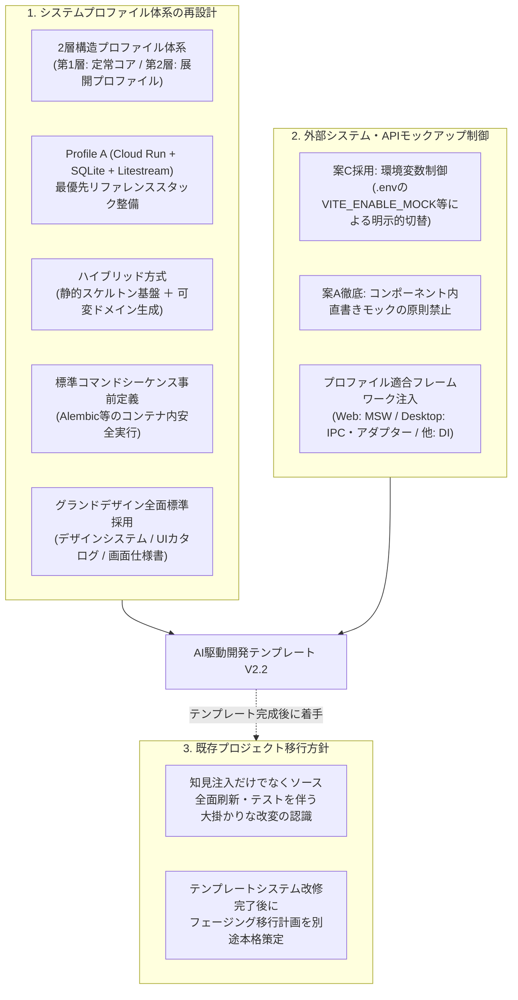
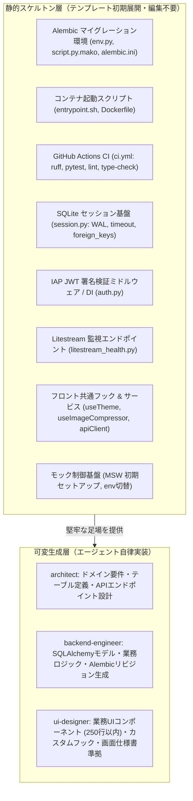
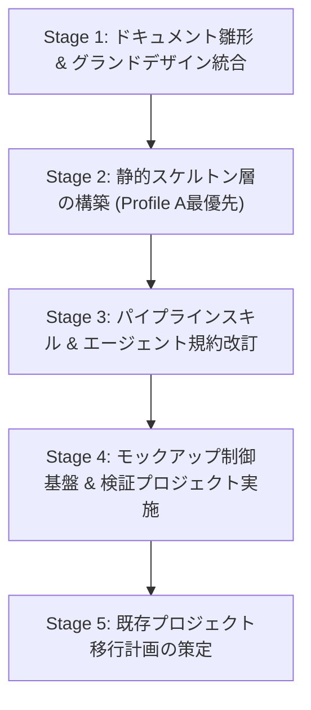

# V2.2 改変計画書 (AI駆動システム開発テンプレート V2.2)

文書バージョン: 1.0  
作成日: 2026-10-14  
対象バージョン: AI駆動システム開発ライフサイクルテンプレート V2.2  
ステータス: 正式計画書 (Approved Plan)  
関連文書:
- [V2.2システムプロファイル構造設計書.md](./V2.2システムプロファイル構造設計書.md)
- [ProfileA詳細設計書.md](./ProfileA詳細設計書.md)
- [システムプロファイル設計および事前組込アーキテクチャ検討レポート.md](../../検討課題/V2.2/システムプロファイル設計および事前組込アーキテクチャ検討レポート.md)
- [追加検討課題_モックアップ制御と画面デザイン標準化.md](../../検討課題/V2.2/追加検討課題_モックアップ制御と画面デザイン標準化.md)
- [グランドデザイン_他フレームワーク・デスクトップアプリ適用評価レポート.md](../../検討課題/V2.2/グランドデザイン_他フレームワーク・デスクトップアプリ適用評価レポート.md)
- [AI駆動開発テンプレート_事前組込推奨要件・設計・留意事項_総合レポート.md](../../検討課題/V2.2/AI駆動開発テンプレート_事前組込推奨要件・設計・留意事項_総合レポート.md)
- [AI駆動システム開発フェーズ定義書V2.2.md](./AI駆動システム開発フェーズ定義書V2.2.md)
- [レビューシステム設計書V2.2.md](./レビューシステム設計書V2.2.md)
- [エージェント設計書V2.2.md](./エージェント設計書V2.2.md)
- [エージェント・スキル・テンプレート再構成設計計画書V2.2.md](./エージェント・スキル・テンプレート再構成設計計画書V2.2.md)
- [V1.0プロジェクトアップグレードスキル策定および移行計画書.md](../V2.1/V1.0プロジェクトアップグレードスキル策定および移行計画書.md)
- [グランドデザイン標準仕様書（Design System Base）概要](../../doc_samples/グランドデザイン/README.md)
- [01_グランドデザイン基本仕様書.md](../../doc_samples/グランドデザイン/01_グランドデザイン基本仕様書.md)
- [02_UIコンポーネントカタログ及び実装パターン.md](../../doc_samples/グランドデザイン/02_UIコンポーネントカタログ及び実装パターン.md)
- [03_画面仕様書テンプレート.md](../../doc_samples/グランドデザイン/03_画面仕様書テンプレート.md)

---

## 1. はじめに

### 1.1 背景と位置づけ
AI駆動システム開発テンプレートは、V2.0における協調体制・ガードレール確立、V2.1における3大レビューシステム（基本設計・コード品質・システム総合レビュー）、WikiSkill型永続ナレッジ自己進化ループ、定量測定・フィードバック機構の導入を経て、高い自律性と安全性を獲得してきた。

一方、本テンプレートを用いて実稼働に至った4つの小規模Webシステム（`bicycle-log`、`Movie Log`、`Gardening Log`、`bicycle-maintenance`）の横断分析レポート（[AI駆動開発テンプレート_事前組込推奨要件・設計・留意事項_総合レポート.md](../../検討課題/V2.2/AI駆動開発テンプレート_事前組込推奨要件・設計・留意事項_総合レポート.md)）により、以下の「後工程・運用期に顕在化する共通の技術的負債」が浮き彫りとなった：
1. **フロントエンドの「God Component」化**: 画面単位で1ファイルにUI・状態・API通信が集中し、可読性・保守性が著しく低下する。
2. **データベース運用の脆弱性**: Alembicマイグレーション未導入による手動ALTER TABLEの乱立、SQLiteの型・タイムゾーン差異、単一ライター競合。
3. **セキュリティ・認可層の形骸化**: 前段プロキシ（IAP）前提によるバックエンド側JWT署名検証の未実装、ローカル用モックの放置。
4. **型安全性・スキーマ同期の断片化**: PydanticとTypeScriptの手動型定義による二重管理やタイポ。
5. **テスト・CI/CDパイプラインの不足**: バックエンド単体・スモークテストの不足、自動CIワークフローの未整備。
6. **画面UI/UXのばらつきとモック残存**: プロジェクトごとのデザインの揺らぎ、コンポーネント内直書きモックによるAPI疎通レビュー阻害。

### 1.2 V2.2 改変の目的（Shift-Leftの徹底）
従来のV2.1では、これらの問題を「事後レビュー（PHASE 3, PHASE 5.5, PHASE 7）での指摘と手戻り修正」によって防ぐ構想であったが、AIによるコード生成においては**初期生成（PHASE 1 スケルトン展開、PHASE 2 要件定義、PHASE 3 基本設計）の段階から堅牢な標準パターンをベースコードとして組み込んでおく（Shift-Left：前倒し）** ことが、手戻り工数の削減と品質最大化に直結することが判明した。

本文書は、[システムプロファイル設計および事前組込アーキテクチャ検討レポート.md](../../検討課題/V2.2/システムプロファイル設計および事前組込アーキテクチャ検討レポート.md)、[追加検討課題_モックアップ制御と画面デザイン標準化.md](../../検討課題/V2.2/追加検討課題_モックアップ制御と画面デザイン標準化.md)、および [グランドデザイン_他フレームワーク・デスクトップアプリ適用評価レポート.md](../../検討課題/V2.2/グランドデザイン_他フレームワーク・デスクトップアプリ適用評価レポート.md) の検討成果に基づき、テンプレートシステムの全体改修を確実に完遂するための実行計画を策定するものである。

---

## 2. V2.2 改変基本方針

ユーザー合意および先行検討レポートに基づき、以下の3大方針を柱として改変を推進する。



---

## 3. システムプロファイル体系の再設計

### 3.1 ２層構造のシステムプロファイル体系
システムプロファイルを、単なるレビュー時の判定基準から**「設計時およびコード生成時のベースコード決定機構」**へと進化させる。

```
┌────────────────────────────────────────────────────────────────────────┐
│                   V2.2 設計時システムプロファイル体系                  │
├────────────────────────────────────────────────────────────────────────┤
│                                                                        │
│   【第1層: 定常的コア設計規範 (Universal Core Specifications)】        │
│     全システム・全プロファイル共通で最初から組み込むべき普遍的標準    │
│     ・フロントエンド責務分離構造 (Hooks / Components / Services 分離)  │
│     ・型定義自動同期 (OpenAPI ➔ TypeScript Codegen)                    │
│     ・環境変数・シークレット厳格バリデーション (Pydantic Settings)     │
│     ・統一タイムゾーン運用 (UTC保存 / JST表示規約)                     │
│     ・GitHub Actions CI パイプライン標準 (Lint, TypeCheck, SmokeTest)  │
│     ・構造化ロギング & クラッシュ耐性                                  │
│     ・モック制御アダプター層 (環境変数切替 & 直書きモック排除)         │
│     ・画面グランドデザイン基礎規範 (4px/8pxグリッド, HEX/px絶対値併記) │
│                                                                        │
│                                   ▼ 動的バインド                       │
│                                                                        │
│   【第2層: 可変的システムプロファイル (Deployment Profiles)】          │
│     PHASE 2 で選定され、PHASE 3 基本設計 & PHASE 4 スケルトンを決定    │
│                                                                        │
│   ┌───────────────┬───────────────┬───────────────┬────────────────┐  │
│   │ Profile A     │ Profile B     │ Profile C     │ Profile D      │  │
│   │ サーバーレス  │ Web SSR /     │ 静的MPA /     │ PCローカル     │  │
│   │ 極小コストWeb │ フルマネージド│ 超軽量ツール  │ デスクトップ   │  │
│   ├───────────────┼───────────────┼───────────────┼────────────────┤  │
│   │ Cloud Run     │ Cloud Run /   │ 単一プロセス  │ Tauri /        │  │
│   │ Litestream    │ VM / Container│ (FastAPI+HTMX │ Electron /     │  │
│   │ SQLite(WAL)   │ Cloud SQL     │  / CLI)       │ PyQt / Flutter │  │
│   │ Alembic       │ Alembic/ORM   │ SQLite / File │ Local SQLite   │  │
│   │ IAP JWT二重化 │ OAuth / OIDC  │ 認証なし/Basic│ OSネイティブ   │  │
│   │ max-inst=1    │ 水平オートスケール│ 単一バイナリ  │ Multi-window   │  │
│   │ MSW (Web)     │ MSW Node / DI │ Mock Service  │ IPC/Adapter    │  │
│   └───────────────┴───────────────┴───────────────┴────────────────┘  │
│                                                                        │
└────────────────────────────────────────────────────────────────────────┘
```

#### 第1層: 定常的コア設計規範（全プロファイル共通）
いかなる規模・プラットフォームであっても、技術的負債化を防止するために**無条件で初期配置・遵守する規約およびベースコード**である。
1. **フロントエンド責務分離構造（Anti-God Component）**:
   - `components/`, `hooks/`, `services/`, `types/`, `utils/` に物理分割。
   - 1コンポーネント最大250行制限。状態管理と副作用はカスタムフック（`use[Domain].ts`）に集約。
2. **型定義自動同期パイプライン**:
   - バックエンドの FastAPI (OpenAPI) 定義から TypeScript 型定義をワンコマンドで生成（`openapi-typescript` 等）。
3. **環境変数・シークレット厳格バリデーション**:
   - Pydantic Settings による起動時バリデーション。プレースホルダー（`[YOUR_KEY]` 等）混入時の即時安全停止。
4. **統一タイムゾーン運用**:
   - DB内部およびAPI通信は Aware UTC（または ISO8601 文字列）で統一。UI表示層でのみ JST へ変換。
5. **自動CIワークフロー（GitHub Actions）**:
   - PR/Push 契機の Lint、型チェック、単体/スモークテストの自動実行。

#### 第2層: システム展開プロファイル
- **Profile A（サーバーレス極小コストWeb型 / 最優先ゴールデンパス）**: Cloud Run + Litestream + SQLite + Alembic + IAP JWT 二重防御 + React SPA。
- **Profile B（Web SSR / フルマネージドRDB型）**: Next.js / Nuxt SSR、または FastAPI + PostgreSQL (Cloud SQL)。
- **Profile C（静的MPA / 超軽量ツール型）**: FastAPI + Jinja2 + HTMX / 単一バイナリCLI。
- **Profile D（PCローカルデスクトップアプリ型）**: Tauri / Electron / PyQt、ローカルSQLite、Framelessタイトルバー、OSネイティブダイアログ。

### 3.2 Profile A の優先リファクタリング（ゴールデンパス化）
小規模Webシステムの高コストパフォーマンス運用実績を踏まえ、**Profile A を本テンプレートの最優先リファレンススタック（ゴールデンパス）** として完全整備する。

| レイヤー | 採用技術・標準仕様 | 解決・予防する技術的負債 |
| :--- | :--- | :--- |
| **コンテナ・インフラ** | Google Cloud Run（マルチステージビルド単一コンテナ、React静的配信＋FastAPI） | 構成管理の単純化、低コスト常時待機 |
| **データ永続化** | SQLite (WALモード, `timeout=5000`, `PRAGMA foreign_keys=ON`) ＋ Litestream | 単一ライター保護（`max-instances=1`）、GCSへの確実な非同期レプリケーション |
| **マイグレーション** | **Alembic標準統合**（`alembic/` 初期構成同梱） | 手動ALTER TABLEの完全排除、確実なスキーマ追跡 |
| **起動シーケンス** | `entrypoint.sh` による確定シーケンス（Litestreamリストア ➔ Alembicマイグレーション ➔ アプリ起動） | 起動順序の破綻防止、マイグレーション適用漏れ防止 |
| **認可・セキュリティ** | **IAP JWT二重防御**（FastAPI依存性で署名検証、`DEBUG=True` 時のみ安全なモック切替） | 前段プロキシ依存による認証バイパス防止、モックの本番漏洩防止 |
| **画像最適化** | ブラウザ側 Canvas WebP 事前圧縮（700×700px正方形, 80%品質） | 通信帯域・ストレージ容量の節約 |
| **可観測性** | `/api/internal/health` および `/api/internal/litestream/status`（最終同期ラグ監視） | サイレントバックアップ障害の早期検知 |
| **外部API連携** | TTLメモリキャッシュ ＋ DBキャッシュの二重キャッシュ機構 | レートリミット超過・外部サービス障害耐性 |

### 3.3 ハイブリッド方式の採用（静的スケルトン vs 可変ドメイン生成）
事故が起きやすい基盤部分を「静的スケルトン」として初期配置し、業務ドメインのみをエージェントに自律生成させる。



### 3.4 標準コマンドシーケンスの事前定義
エージェント（`backend-engineer`）がマイグレーションやビルドを自律実行する際、実行環境（Docker内 vs ホスト）の差異で迷走することを防ぐため、`skills/dev-phase4-env-build` 等に標準コマンドシーケンスを明示定義する。

```bash
# 【標準コマンドシーケンス 1】Alembic マイグレーション生成 (Docker Compose経由)
docker compose exec backend alembic revision --autogenerate -m "<リビジョン名>"

# 【標準コマンドシーケンス 2】Alembic マイグレーション適用
docker compose exec backend alembic upgrade head

# 【標準コマンドシーケンス 3】OpenAPI からの TypeScript 型定義自動生成
docker compose exec frontend npm run codegen:types

# 【標準コマンドシーケンス 4】CI 同等ローカル検証 (コミット前ゲート)
docker compose exec backend ruff check .
docker compose exec backend pytest
docker compose exec frontend npm run lint
docker compose exec frontend npm run type-check
```

---

## 4. テンプレート組み込み設計アウトライン（新テンプレート体系）

本改変により刷新されるテンプレートシステムの構成要素および配置関係は以下の通りである。

```
AI駆動開発テンプレート (V2.2)
├── templates/ (ドキュメント雛形)
│   ├── 要件定義書.md ───────────────► プロファイル選定設問・チェックリスト追加
│   ├── 技術要件定義書.md ─────────────► Profile A/D標準構成、250行制限、タイムゾーン規約明記
│   ├── テーブルスキーマ定義書.md ───────► UTC ISO8601規約、user_id拡張性、Alembic前提の明記
│   ├── ビジネスロジック仕様書.md ───────► 外部APIキャッシュ、モック制御仕様、内部ヘルスチェック明記
│   └── 画面仕様書.md ────────────────► doc_samples/グランドデザイン/03 テンプレートの全面採用
│
├── skeletons/ (新規導入: プロファイル別初期コードスケルトン)
│   ├── common/
│   │   ├── .github/workflows/ci.yml
│   │   └── .editorconfig
│   ├── profile-a/ (Cloud Run + Litestream + SQLite + FastAPI + React)
│   │   ├── backend/
│   │   │   ├── alembic/ (env.py, script.py.mako)
│   │   │   ├── alembic.ini
│   │   │   ├── core/ (config.py, auth.py, cache.py)
│   │   │   ├── db/ (session.py, base.py)
│   │   │   ├── api/internal/ (health.py, litestream.py)
│   │   │   └── tests/ (test_smoke.py)
│   │   ├── frontend/
│   │   │   ├── src/components/ui/ (グランドデザイン準拠UIベース)
│   │   │   ├── src/hooks/ (useTheme.ts, useImageCompressor.ts)
│   │   │   ├── src/services/ (apiClient.ts)
│   │   │   ├── src/mocks/ (browser.ts, handlers.ts: MSWモック)
│   │   │   └── package.json (openapi-typescript設定同梱)
│   │   └── docker/
│   │       ├── Dockerfile
│   │       ├── docker-compose.yml
│   │       └── entrypoint.sh
│   └── profile-d/ (PCローカルデスクトップアプリ用スケルトン雛形)
│       └── (Tauri / Frameless TitleBar / IStorageAdapter / SQLite)
│
├── .agents/plugins/system-dev-pipeline/ (スキル・パイプライン)
│   ├── skills/dev-phase1-setup/ ────► スケルトン展開・環境変数初期化ロジックの追加
│   ├── skills/dev-phase2-requirements/► プロファイル選定・非機能要件自動バインド
│   ├── skills/dev-phase3-design/ ───► グランドデザイン・Alembic・キャッシュ設計の反映
│   ├── skills/dev-phase4-env-build/ ─► 標準コマンドシーケンス自動実行 (Alembic/Codegen)
│   └── skills/dev-review-*/ ────────► 250行制限、直書きモック排除、IAP検証の監査強化
│
└── subagents/ (エージェント規約・プロンプト)
    ├── architect.md ────────────────► 2層プロファイル・外部APIキャッシュ・モック方針の設計義務化
    ├── backend-engineer.md ─────────► 生SQL禁止、Alembic厳格適用、IAP二重防御、標準コマンド遵守
    ├── ui-designer.md ──────────────► グランドデザイン準拠、1ファイル250行制限、直書きモック禁止
    └── qa-engineer.md ──────────────► 2層プロファイル適合監査、モック残存検査、CI実行確認
```

---

## 5. 画面グランドデザインの標準化

### 5.1 グランドデザインの全面標準採用
`doc_samples/グランドデザイン/` に策定された仕様群（01_基本仕様書、02_UIコンポーネントカタログ、03_画面仕様書テンプレート）を本テンプレートの標準設計体系として正式採用する。

1. **デザインシステム基盤（`01_グランドデザイン基本仕様書.md` 準拠）**:
   - **セマンティックカラー**: ブランド（Blue `#2563eb`）、背景（Slate `#0f172a` / `#f8fafc`）、ステータス（Emerald `#059669`, Amber `#d97706`, Rose `#e11d48`）のHEX/px絶対値とTailwindクラスの完全併記。
   - **余白・タイポグラフィ**: 4px/8px グリッド体系の厳格遵守。
   - **ウィンドウ形態選定基準**:
     - 簡易確認・設定: **標準モーダル**（中央ポップアップ、幅制限）
     - 複合編集・詳細確認: **スライドインドロワー** または 独立フルページ
     - デスクトップ環境: **OSネイティブダイアログ**、**独立サブウィンドウ（Multi-window）**、**スプリットペイン**
2. **UIコンポーネント標準（`02_UIコンポーネントカタログ及び実装パターン.md` 準拠）**:
   - `frontend/src/components/ui/` に、ボタン（Primary/Secondary/Danger/Ghost）、ダイアログ、ドロワー、テーブル、入力フィールドの定型ベースを事前配置。
   - デスクトップ用コンポーネント（Frameless `TitleBar.tsx`、`SplitPane.tsx`、`StatusBar.tsx`、`CollapsibleSidebar.tsx`）のカタログ化。
   - 抽象化インターフェース（`IStorageAdapter`, `IRepository`）の標準提供。
3. **画面仕様書テンプレート（`templates/画面仕様書.md` への昇格）**:
   - `doc_samples/グランドデザイン/03_画面仕様書テンプレート.md` を `templates/画面仕様書.md` として正式配置。
   - プロファイル（Profile A〜D）選択欄、ウィンドウ形態指定、デスクトップウィンドウ制御規格（初期サイズ、最小サイズ制約）、キーボードショートカットマトリクス定義欄を必須化。

---

## 6. 外部システム・APIモックアップ制御アーキテクチャ

### 6.1 案C（環境変数制御）と案A（直書きモック禁止）のハイブリッド統合
先行検討課題（[追加検討課題_モックアップ制御と画面デザイン標準化.md](../../検討課題/V2.2/追加検討課題_モックアップ制御と画面デザイン標準化.md)）に基づき、**案C（環境変数による明示的切替）** をアーキテクチャの主軸とし、**案A（コンポーネント内直書きモックの原則禁止）** を開発規約として適用する。

- **環境変数値**: `.env` 内に `VITE_ENABLE_MOCK=true`（または `DEBUG=MOCKUP`）を定義。
- **動作フロー**:
  1. `VITE_ENABLE_MOCK=true` の場合: APIクライアントまたはモックハンドラー（MSW等）がリクエストをインターセプトし、擬似レスポンスを返却。
  2. `VITE_ENABLE_MOCK=false`（本番および実結合時）: 実バックエンドAPIエンドポイントへ直接通信。
  3. コンポーネント内部にはダミーデータ配列やローカル擬似ステートを一切ハードコードしない。

### 6.2 プロファイル別モック適合フレームワークの選択・注入
[グランドデザイン_他フレームワーク・デスクトップアプリ適用評価レポート.md](../../検討課題/V2.2/グランドデザイン_他フレームワーク・デスクトップアプリ適用評価レポート.md) の評価結果に基づき、各システムプロファイルに適合するモックフレームワークを注入する。

| システム展開プロファイル | 推奨モック方式 | 具体的な実装手段・注入箇所 |
| :--- | :--- | :--- |
| **Profile A (Web SPA)** | **MSW (Mock Service Worker)** | ブラウザの Service Worker による fetch インターセプト (`src/mocks/browser.ts`, `handlers.ts`) |
| **Profile B (Web SSR / Next.js)** | **MSW Node 併用 / アダプター** | クライアント側は MSW、SSRサーバー側は `msw/node` または APIサービス層アダプター |
| **Profile C (静的MPA / HTMX)** | **モックAPIルーター / DI** | FastAPI側のモックルーターまたは環境変数に応じたスタブサービス注入 |
| **Profile D (PCデスクトップ / Tauri)** | **IPCコマンドモック / `IRepository`** | Tauri IPCモック、または `IRepository` 実装の MockRepository クラス注入 |
| **非Web (PyQt / Flutter Desktop)** | **サービス層 DI コンテナ** | DIコンテナによる `MockDataService` の透過的切替 |

### 6.3 レビューゲート連携（モック残存検知ガードレール）
- **`dev-review-code` (PHASE 5.5)**:
  - コンポーネント内の未認可ハードコードダミーデータ、ローカル擬似API通信の残存を静的検査。
- **`dev-review-system` (PHASE 7)**:
  - 本番用 `.env.production` において `VITE_ENABLE_MOCK` が `false`（または未定義）になっていることを検証し、モックの誤リリースを二重防御。

---

## 7. 既存プロジェクト移行方針（フェージング計画の位置づけ）

### 7.1 移行の大規模性と位置づけ
V2.1 における移行（ナレッジ蓄積機構やレビューゲートの追加）とは異なり、今回の V2.2 改変は以下の要素を伴う**プロジェクトソースの全面刷新・再デプロイ・回帰テストを要する大掛かりな改変**となる：
- 既存DBへの Alembic マイグレーション環境導入と初期ベースライン化（`alembic stamp head`）
- `entrypoint.sh` への Litestream ＋ Alembic 起動シーケンス統合
- バックエンド認証層への IAP JWT 署名検証ミドルウェアの導入
- フロントエンドの God Component 解体とディレクトリ責務分離（Hooks / Services）
- グランドデザイン規格（デザイントークン、タイトルバー、ドロワー/モーダル）の適用
- モック制御（MSW / `VITE_ENABLE_MOCK`）の組み込み

### 7.2 移行計画の別フェーズ検討方針
上記の大規模性に鑑み、**本改変計画ではテンプレートシステム本体の改修・整備（新規プロジェクトにおけるゴールデンパス確立）を最優先として完遂させ、既存プロジェクトの移行計画はテンプレート改修完了後に別途本格検討・策定を行う**ものとする。

#### 予見される移行フェージング骨子（今後の検討アジェンダ）
テンプレート完成後に個別計画として策定する移行手順（プロジェクト別移行計画書等）では、リスクを最小化するため以下の4段階フェージングを想定する：
1. **Phase M-1: データベース・インフラ基盤移行**
   - 既存DBのダンプ保護、Alembic初期化、既存スキーマの `stamp head` 適用、`entrypoint.sh` の刷新。
2. **Phase M-2: バックエンドAPI・認証層移行**
   - IAP JWT署名検証依存性の導入、内部ヘルスチェック・Litestream監視エンドポイントの追加。
3. **Phase M-3: フロントエンド責務分離・グランドデザイン移行**
   - ディレクトリ構造の再編、共通フック（`useTheme`, `useImageCompressor`）適用、コンポーネント分割、MSWモックアダプター化。
4. **Phase M-4: スルーテスト・ステージング再デプロイ検証**
   - 回帰テスト実行、Cloud Run ステージング環境へのデプロイ、WAL同期ラグ確認、本番切替。

---

## 8. 実装ロードマップとタスクブレークダウン

本計画を円滑に完遂するためのマイルストーンおよびタスク分割。



### Stage 1: ドキュメント雛形 & グランドデザイン統合
- [ ] `templates/要件定義書.md`: プロファイル選定設問・チェックリストの追加。
- [ ] `templates/技術要件定義書.md`: Profile A/D標準構成、250行制限、タイムゾーン規約を追記。
- [ ] `templates/テーブルスキーマ定義書.md`: UTC ISO8601規約、user_id拡張性、Alembic前提を明文化。
- [ ] `templates/ビジネスロジック仕様書.md`: 外部APIキャッシュ戦略、モック制御、監視エンドポイントを明記。
- [ ] `templates/画面仕様書.md`: `doc_samples/グランドデザイン/03_画面仕様書テンプレート.md` を正式昇格・配置。

### Stage 2: 静的スケルトン層の構築（`skeletons/`）
- [ ] `skeletons/common/.github/workflows/ci.yml`: Ruff, Pytest, ESLint, TypeScript型チェックのワークフロー作成。
- [ ] `skeletons/profile-a/backend/`:
  - Alembic 環境一式（`alembic.ini`, `env.py`, `script.py.mako`）。
  - Pydantic Settings 環境変数設定（`core/config.py`）。
  - IAP JWT 署名検証ミドルウェア・フォールバックモック（`core/auth.py`）。
  - SQLite WAL / timeout / foreign_keys セッション（`db/session.py`）。
  - 死活・Litestream同期ラグ監視エンドポイント（`api/internal/`）。
- [ ] `skeletons/profile-a/frontend/`:
  - グランドデザイン準拠UIベースコンポーネント（`components/ui/`）。
  - 共通フック（`useTheme.ts`, `useImageCompressor.ts`）。
  - APIクライアント基盤（`services/apiClient.ts`）。
  - MSW モック基盤（`mocks/browser.ts`, `handlers.ts`）。
- [ ] `skeletons/profile-a/docker/`:
  - マルチステージ Dockerfile、`docker-compose.yml`、`entrypoint.sh`（Litestreamリストア ➔ Alembic ➔ Uvicorn）。

### Stage 3: パイプラインスキル & エージェント規約改訂
- [ ] `skills/dev-phase1-setup`: スケルトン自動展開および `.env` 初期設定（`VITE_ENABLE_MOCK` 含む）ロジックの追加。
- [ ] `skills/dev-phase4-env-build`: 標準コマンドシーケンス（Alembicマイグレーション、型生成）の自動実行フロー組込。
- [ ] `subagents/architect.md`: 2層プロファイル体系、キャッシュ、モック制御の設計義務化。
- [ ] `subagents/backend-engineer.md`: 生SQL禁止、Alembic厳格運用、IAP JWT検証、標準コマンド遵守。
- [ ] `subagents/ui-designer.md`: グランドデザイン完全準拠、1ファイル250行制限、直書きモック禁止。
- [ ] `subagents/qa-engineer.md` & `skills/dev-review-*`: 2層プロファイル適合監査、直書きモック排除、タイトルバーセーフエリア検査の追加。

### Stage 4: モックアップ制御基盤 & 検証プロジェクト実施
- [ ] `VITE_ENABLE_MOCK=true/false` の透過的切替検証。
- [ ] 新規プロファイルAテストプロジェクトの構築実行（God Component化・マイグレーション不備・IAP検証漏れの再発防止確認）。

### Stage 5: 既存プロジェクト移行計画の策定
- [ ] テンプレート完成後、既存4プロジェクト向けの移行計画書（フェージング手順）を別途本格策定。

---

## 9. 完了基準 (Definition of Done)

本改変計画は、以下の全基準を満たした時点で正式完了とする。

1. **ドキュメント整合性**:
   - `templates/` 配下の全ドキュメント雛形が更新され、グランドデザインおよび2層プロファイル体系と100%整合していること。
   - すべての内部リンクがグローバル開発ルールに準拠し、**相対パス**で正しく記述されていること。
2. **スケルトン完全性**:
   - `skeletons/profile-a/` が単独でビルド可能であり、`entrypoint.sh` による起動シーケンス（Litestream ➔ Alembic ➔ FastAPI）が正常動作すること。
   - `VITE_ENABLE_MOCK=true/false` の切り替えがモックと実APIの間で破綻なく機能すること。
3. **エージェント・スキル統制**:
   - `backend-engineer`, `ui-designer`, `qa-engineer` のプロンプトおよびレビューゲートスキルが改修され、未認可モックやGod Componentを機械的に遮断できること。
4. **検証成功**:
   - スケルトンを用いたテストプロジェクト構築において、手動パッチを必要とせず初回構築からスルーテストまで完走できること。
