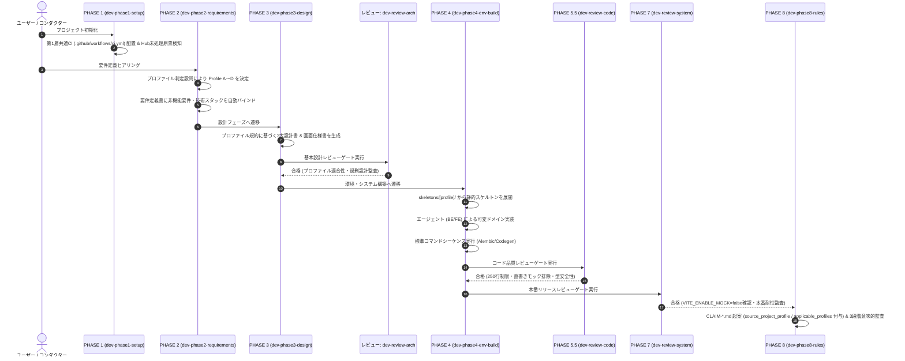
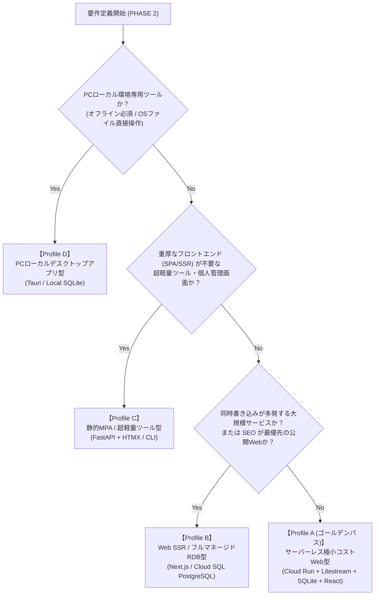

# V2.3 システムプロファイル構造設計書 (System Profile Architecture Specification V2.3)

文書バージョン: 2.3  
作成日: 2026-10-18  
対象バージョン: AI駆動システム開発ライフサイクルテンプレート V2.3  
ステータス: 正式設計書 (Approved Specification)  
関連文書:
- [V2.3改変計画書.md](./V2.3改変計画書.md)
- [V2.3新知見フィードバック機構設計書.md](./V2.3新知見フィードバック機構設計書.md)
- [ProfileA詳細設計書.md](./ProfileA詳細設計書.md)
- [ProfileD詳細設計書.md](./ProfileD詳細設計書.md)
- [システムプロファイル設計および事前組込アーキテクチャ検討レポート.md](../../検討課題/V2.2/システムプロファイル設計および事前組込アーキテクチャ検討レポート.md)
- [追加検討課題_モックアップ制御と画面デザイン標準化.md](../../検討課題/V2.2/追加検討課題_モックアップ制御と画面デザイン標準化.md)
- [グランドデザイン_他フレームワーク・デスクトップアプリ適用評価レポート.md](../../検討課題/V2.2/グランドデザイン_他フレームワーク・デスクトップアプリ適用評価レポート.md)
- [AI駆動開発テンプレート_事前組込推奨要件・設計・留意事項_総合レポート.md](../../検討課題/V2.2/AI駆動開発テンプレート_事前組込推奨要件・設計・留意事項_総合レポート.md)
- [レビューシステム設計書V2.3.md](./レビューシステム設計書V2.3.md)
- [AI駆動システム開発フェーズ定義書V2.3.md](./AI駆動システム開発フェーズ定義書V2.3.md)
- [エージェント設計書V2.3.md](./エージェント設計書V2.3.md)
- [01_グランドデザイン基本仕様書.md](../../../.agents/plugins/system-dev-pipeline/templates/グランドデザイン/01_グランドデザイン基本仕様書.md)
- [02_UIコンポーネントカタログ及び実装パターン.md](../../../.agents/plugins/system-dev-pipeline/templates/グランドデザイン/02_UIコンポーネントカタログ及び実装パターン.md)
- [03_画面仕様書テンプレート.md](../../../.agents/plugins/system-dev-pipeline/templates/グランドデザイン/03_画面仕様書テンプレート.md)

---

## 1. はじめに

### 1.1 背景と課題認識
AI駆動システム開発テンプレート V2.1 においては、3大レビューシステム（基本設計・コード品質・システム総合レビュー）、WikiSkill型永続ナレッジ自己進化ループ、および定量メトリクス測定機構により、高い自律性と品質統制を実現した。その際、[レビューシステム設計書V2.3.md](./レビューシステム設計書V2.3.md) において、システムの規模や展開環境に応じた「定常的観点（普遍的コア）」と「可変的観点（展開プロファイル別観点）」の二層モデルが提唱された。

しかしながら、V2.1 におけるシステムプロファイルは主に **「事後レビューゲート（PHASE 3, PHASE 5.5, PHASE 7）における合否判定基準」** として定義されており、要件定義書での宣言にとどまっていた。このため、初期スケルトン展開（PHASE 1）、要件定義（PHASE 2）、基本設計（PHASE 3）、環境・システム構築（PHASE 4）の実装フェーズにおいては、各AIエージェント（architect, backend-engineer, ui-designer）の自律的判断に委ねられる領域が広く、以下の深刻な問題が発生していた：

1. **後工程での指摘と大規模な手戻り修正（Reactive rework）**:
   事後レビューによって「God Component化（単一ファイル肥大化）」「Alembic未導入」「生SQL手動DDL」「IAP署名検証欠如」「型定義の二重管理」「直書きモックの残留」などが指摘されるが、これらはアーキテクチャの根幹に関わるため、修正工数が膨大化し、AIの局所修正による新たなデグレを引き起こしていた。
2. **プロジェクトごとの技術基盤のばらつき**:
   同一テンプレートから生成されたシステムであっても、ディレクトリ構造、起動シーケンス、マイグレーション手法、エラーハンドリング、UIデザインに差異が生じ、保守・運用の標準化が阻害されていた。

### 1.2 Shift-Left（設計・初期コードへの前倒し組み込み）と V2.3 プロファイル連動型知見フィードバック
V2.2〜V2.3 では、これらの技術的負債を事後レビューで検出して修正するのではなく、**「要件定義・基本設計・初期スケルトン展開の段階から、堅牢で検証済みの標準パターンをベースコードおよび設計規約として事前に組み込んでおく（Shift-Left：前倒し）」** 思想へ全面的に転換した。

さらに V2.3 では、2層プロファイル体系を PHASE 8 の知見フィードバック機構（[V2.3新知見フィードバック機構設計書.md](./V2.3新知見フィードバック機構設計書.md)）と直結させ、標準化知見原票（`CLAIM-*.md`）に `source_project_profile` および `applicable_profiles: ["ALL" | "Profile A" | "Profile B" | "Profile C" | "Profile D"]` を必須付与することで、**特定プロファイル固有の知見が他プロファイルの汎用ルールを汚染・破壊する意味的矛盾（Semantic Conflict）を機械的に防止する**。

本文書は、システムプロファイルを「単なるレビュー判定基準」から**「開発ライフサイクル全域（PHASE 1〜8）を統制し、初期スケルトン・設計書雛形・エージェント振る舞い・レビューゲート・知見昇格スコープを一気通貫で決定するアーキテクチャ機構」**として定義する。

---

## 2. V2.3 システムプロファイル体系の全体アーキテクチャ

システムプロファイル体系は、いかなるシステムでも普遍的に遵守すべき **「第1層: 定常的コア設計規範」** と、システムの実行基盤・規模・用途に応じて動的にバインドされる **「第2層: 可変的システム展開プロファイル」** の二層構造で構成される。

```
┌────────────────────────────────────────────────────────────────────────────────────────┐
│                          V2.3 システムプロファイル全体構造体系                         │
├────────────────────────────────────────────────────────────────────────────────────────┤
│                                                                                        │
│   【第1層: 定常的コア設計規範 (Universal Core Specifications)】                        │
│     対象: 全システム・全展開プロファイル共通（無条件で強制適用される普遍的規約）       │
│     ※ PHASE 8 知見原票における applicable_profiles: ["ALL"] に対応                    │
│                                                                                        │
│     1. フロントエンド責務分離構造 (Anti-God Component / 最大250行制限 / Hooks分離)     │
│     2. 型定義自動同期パイプライン (OpenAPI ➔ TypeScript Codegen / 型安全保証)          │
│     3. 環境変数・シークレット厳格バリデーション (起動時検知 / プレースホルダー即死)    │
│     4. 統一タイムゾーン・時刻運用規約 (DB・通信はAware UTC / UI表示層でのみJST変換)    │
│     5. 自動CIパイプライン標準 (GitHub Actions: Lint, TypeCheck, Unit/Smoke Test)       │
│     6. モックアップ制御ハイブリッド規範 (案C: 環境変数切替 ＋ 案A: 直書きモック排除)   │
│     7. 画面グランドデザイン基礎規範 (4px/8pxグリッド / HEX・px絶対値 / 形態選定基準)   │
│     8. 外部連携二重キャッシュ & 可観測性標準 (TTLインメモリ＋永続キャッシュ / 死活)   │
│                                                                                        │
│                                       ▼ 動的バインド                                   │
│                                                                                        │
│   【第2層: 可変的システム展開プロファイル (Deployment Profiles)】                      │
│     決定契機: PHASE 2 要件定義 / 影響範囲: PHASE 1〜8 スケルトン・設計・実装・監査・昇格│
│     ※ PHASE 8 知見原票における applicable_profiles: ["Profile X"] に対応              │
│                                                                                        │
│   ┌──────────────────┬──────────────────┬──────────────────┬─────────────────┐ │
│   │ Profile A        │ Profile B        │ Profile C        │ Profile D       │ │
│   │ サーバーレス     │ Web SSR /        │ 静的MPA /        │ PCローカル      │ │
│   │ 極小コストWeb型  │ フルマネージド型 │ 超軽量ツール型   │ デスクトップ型  │ │
│   │ (ゴールデンパス) │                  │                  │                 │ │
│   ├──────────────────┼──────────────────┼──────────────────┼─────────────────┤ │
│   │ Cloud Run        │ Cloud Run /      │ 単一プロセス     │ Tauri /         │ │
│   │ Litestream (GCS) │ Container / VM   │ (FastAPI+HTMX    │ Electron /      │ │
│   │ SQLite (WAL)     │ PostgreSQL (SQL) │  / CLIツール)    │ PyQt / Flutter  │ │
│   │ Alembic 確定統合 │ Alembic / ORM    │ SQLite / JSON    │ Local SQLite    │ │
│   │ IAP JWT 二重防御 │ OAuth2 / OIDC    │ 認証なし / Basic │ OSネイティブ    │ │
│   │ max-instances=1  │ 水平オートスケール│ ワンバイナリ     │ Multi-window    │ │
│   │ MSW (Web Service)│ MSW Node / DI    │ モックルーター/DI│ IPC / IAdapter  │ │
│   └──────────────────┴──────────────────┴──────────────────┴─────────────────┘ │
│                                                                                        │
└────────────────────────────────────────────────────────────────────────────────────────┘
```

---

## 3. 第1層: 定常的コア設計規範 (Universal Core Specifications)

第1層は、プロジェクトの規模、対象ユーザー、言語、実行環境に関わらず、現代的なAI駆動開発において技術的負債化を未然に防止するために**初期配置・強制適用される普遍的ルール**である。

### 3.1 フロントエンド責務分離構造（Anti-God Component）
AIエージェント（`ui-designer` 等）がコード生成を行う際、単一のファイルにJSX、UIレイアウト、ローカル状態（`useState`）、ビジネスロジック、API呼び出し（`fetch` / `axios`）、エラー処理を詰め込む「God Component（神コンポーネント）」化を機械的に防止する。

- **ディレクトリ物理分離**:
  ```
  src/
  ├── components/
  │   ├── ui/         # グランドデザイン準拠の純粋UI部品（Button, Modal, Input等）
  │   └── [domain]/   # ドメイン固有の描画コンポーネント（250行以内）
  ├── hooks/          # 状態管理・副作用・ビジネスロジックを集約するカスタムフック
  ├── services/       # バックエンドAPI通信・外部連携クライアント
  ├── types/          # 自動生成されたスキーマ型定義およびフロント固有型
  ├── utils/          # 純粋関数・フォーマッター（日付変換、数値計算等）
  └── mocks/          # MSWハンドラーおよび擬似データ定義
  ```
- **1ファイル最大250行制限**:
  コンポーネントの行数が250行を超過した場合、`dev-review-code`（PHASE 5.5）において即時REJECT対象とする。
- **UIとロジックの分離**:
  コンポーネント内での直接的な `useEffect` による複雑なデータフェッチ、複数の `useState` による状態追跡は禁止し、必ず `use[Domain].ts` カスタムフックとして抽出する。

### 3.2 型定義自動同期パイプライン（Schema Synchronization）
バックエンドとフロントエンドで手動により型定義を二重管理すること（PydanticモデルとTypeScriptインターフェースの個別記述）を禁止し、タイポやプロパティ変更漏れによるランタイムエラーを根絶する。

- **生成フロー**:
  FastAPI が出力する `openapi.json` をトリガーとして、`openapi-typescript` 等のツールにより TypeScript 型定義ファイル（`src/types/api.generated.ts`）をワンコマンドで自動生成する。
- **標準コマンド**:
  ```bash
  docker compose exec frontend npm run codegen:types
  ```
- **コミット前整合性検証**:
  CIパイプライン（GitHub Actions）において、バックエンドの最新Pydanticモデルとフロントエンドの型定義に不整合がないかを `type-check` ステップで機械的に検証する。

### 3.3 環境変数・シークレット厳格バリデーション
設定値の欠落、不適切なデフォルト値、プレースホルダー文字列の混入による運用事故を防止する。

- **Pydantic Settings の強制**:
  バックエンドではすべての環境変数を Pydantic Settings（`core/config.py`）経由で型安全にロードする。
- **プレースホルダー即死ガードレール**:
  `[YOUR_API_KEY]`, `changeme`, `secret`, `xxxxxx` などの初期テンプレート文字列が検出された場合、アプリケーション起動時（コンテナ起動時）に例外を発生させて安全に停止する。
- **モック制御環境変数**:
  `.env` においてモックの有効/無効を明示管理する（後述 3.6 参照）。

### 3.4 統一タイムゾーン・時刻運用規約
SQLite等のデータベースや各種外部APIにおいて、タイムゾーンの曖昧さ（JSTとUTCの混在）による集計不整合や表示狂いを排除する。

- **DB内部 & API通信規約**:
  データベース内部（SQLiteのTEXT型カラム等）およびAPIリクエスト/レスポンスのJSON内では、**必ず ISO8601 形式の Aware UTC 文字列（例: `2026-10-15T07:30:00Z`）** で保存・送受信する。
- **UI表示層規約**:
  JST（日本標準時）への変換は、フロントエンドの表示直前（フォーマッターユーティリティ `formatToJST(utcString)`）でのみ実施する。

### 3.5 自動CIパイプライン標準 (GitHub Actions)
すべてのプロファイルにおいて、Git Push および Pull Request を契機として実行される共通CIワークフロー（`.github/workflows/ci.yml`）を初期スケルトンとして標準配備する。

- **必須検証ジョブ**:
  1. `lint-and-typecheck-backend`: Ruff による構文チェック、mypy によるバックエンド型チェック。
  2. `test-backend`: pytest による単体テストおよびスモークテスト。
  3. `lint-and-typecheck-frontend`: ESLint による構文チェック、tsc による TypeScript 型チェック。
  4. `build-test`: コンテナビルドまたはフロントエンド本番ビルドの成功確認。

### 3.6 外部システム・APIモックアップ制御ハイブリッド規範
AIエージェントのコード生成における最大の課題である「コンポーネント内へのダミーデータ直書き」と「モックの誤リリース」を防止するため、**案C（環境変数による明示的切替）** をアーキテクチャの骨格とし、**案A（コンポーネント内直書きモックの原則禁止）** を開発規約として適用する。

- **環境変数値規約**:
  `.env` 内に `VITE_ENABLE_MOCK=true`（フロントエンド）または `ENABLE_MOCK=true`（バックエンド）を定義。
- **アーキテクチャ動作フロー**:
  1. `VITE_ENABLE_MOCK=true` 時: APIクライアントまたはモックハンドラー（MSW等）が通信をインターセプトし、擬似レスポンスを返却。
  2. `VITE_ENABLE_MOCK=false` 時（実結合時および本番環境）: 実APIエンドポイントへ直接通信。
  3. コンポーネント内部にはダミーデータ配列やローカル擬似ステートを一切ハードコードしない。
- **本番漏洩防止ガード**:
  本番環境設定（`.env.production`）において `VITE_ENABLE_MOCK` が `false`（または未定義）であることを、システム総合レビュー（PHASE 7）で機械的に検証する。

### 3.7 画面グランドデザイン基礎規範
プロジェクトごとのUIのばらつき、アクセシビリティの欠如を防止するため、`doc_samples/グランドデザイン/` に基づくデザインシステムを全プロファイルの基礎規範として標準採用する。

- **4px/8px 余白グリッド体系**:
  パディング、マージン、ギャップはすべて 4px / 8px の倍数（Tailwind の `p-1 (4px)`, `p-2 (8px)`, `p-4 (16px)`, `p-6 (24px)` 等）に厳格準拠する。
- **セマンティックカラーと絶対値併記**:
  デザイン仕様書およびコンポーネント設計において、Tailwind クラス名だけでなく、HEXコードおよびpx絶対値を必ず併記する（例: `Primary Blue (#2563eb)`, `Background Dark (#0f172a)`）。
- **ウィンドウ形態選定基準**:
  - 簡易確認・設定: **標準モーダル**（中央ポップアップ、最大幅制限）
  - 複合編集・詳細確認: **スライドインドロワー** または 独立フルページ
  - デスクトップ環境: **OSネイティブダイアログ**、**独立サブウィンドウ（Multi-window）**、**スプリットペイン**

### 3.8 外部連携二重キャッシュ & 可観測性標準
外部API連携におけるレートリミット超過や障害時のシステム全停止を防ぐため、二重キャッシュ機構を標準化する。

- **二重キャッシュ構造**:
  1. 第1キャッシュ: メモリ内 TTL キャッシュ（高速応答、数分〜数時間）。
  2. 第2キャッシュ: SQLite/DB 永続キャッシュ（オフライン復旧耐性、数日〜数ヶ月）。
- **標準内部死活監視エンドポイント**:
  - `/api/internal/health`: アプリケーションプロセスおよびDB接続の健全性。
  - レプリケーションやバックアップ機構が存在する場合は、同期ラグを監視する専用エンドポイント（例: `/api/internal/litestream/status`）を常設する。

---

## 4. 第2層: 可変的システム展開プロファイル (Deployment Profiles)

第2層は、PHASE 2（要件定義）においてシステムの目的、対象環境、インフラ制約に基づき選定される具象プロファイルである。選定されたプロファイルに基づき、初期スケルトン、基本設計パラメータ、コンテナ構成、レビュー観点、および PHASE 8 での知見原票スコープ（`applicable_profiles`）が決定される。

### 4.1 プロファイル一覧マトリクス

| 項目 | Profile A (最優先ゴールデンパス) | Profile B | Profile C | Profile D |
| :--- | :--- | :--- | :--- | :--- |
| **プロファイル名称** | **サーバーレス極小コストWeb型** | **Web SSR / フルマネージドRDB型** | **静的MPA / 超軽量ツール型** | **PCローカルデスクトップアプリ型** |
| **主要ターゲット** | 個人〜小規模サービス、社内Webツール、高コスパ運用 | 中〜大規模Web、SEO重視サイト、企業基幹Web | 管理画面、CLI拡張ツール、超軽量ユーティリティ | スタンドアロンPCツール、オフライン業務アプリ |
| **実行基盤・インフラ** | Google Cloud Run (単一コンテナ) | Cloud Run / Kubernetes / VM | 単一プロセス (ローカルまたは極小コンテナ) | OSネイティブ (Windows / macOS / Linux) |
| **フロントエンド** | React 18+ (SPA) + Vite + Tailwind | Next.js / Nuxt (SSR/SSG) | Jinja2 + HTMX / Alpine.js | Tauri (Rust+React) / Electron / PyQt |
| **バックエンド** | FastAPI (Python 3.11+) | FastAPI / Next.js API Routes / Go | FastAPI (軽量構成) / 単一スクリプト | バックエンドレス (Tauri Core) / ローカルFastAPI |
| **データベース** | **SQLite (WALモード) + Litestream** | **PostgreSQL (Cloud SQL)** | SQLite (ローカルファイル) / JSON | **ローカル SQLite** / ファイルシステム |
| **マイグレーション** | **Alembic (完全自動・確定シーケンス)** | Alembic / Prisma / Flyway | 手動スクリプト / 軽量DDL | SQLite組み込みマイグレーション / Alembic |
| **認可・セキュリティ** | **IAP JWT 二重防御** (署名検証必須) | OAuth2 / OIDC / セッションCookie | なし / Basic認証 / ローカル限定 | OS権限 / ローカル暗号化 |
| **スケーリング** | **`max-instances=1` (単一ライター保護)** | 水平オートスケール (N台) | 単一インスタンス (1台) | クライアントローカル完結 |
| **モックフレームワーク** | **MSW (Mock Service Worker)** | MSW Node / サービス層DI | モックAPIルーター / DI | **Tauri IPCモック / `IRepository`** |
| **詳細設計書リンク** | [ProfileA詳細設計書.md](./ProfileA詳細設計書.md) | (将来策定) | (将来策定) | [ProfileD詳細設計書.md](./ProfileD詳細設計書.md) |

---

### 4.2 各プロファイルの詳細概要

#### 4.2.1 Profile A: サーバーレス極小コストWeb型（最優先ゴールデンパス）
小規模Webシステムにおいて、月額数百円以下の極小コストと高い可用性・堅牢性を両立するリファレンススタック。
- **アーキテクチャの要諦**:
  - Cloud Run のマルチステージ単一コンテナ内で、React SPA 静的配信と FastAPI バックエンドを同居。
  - SQLite (WALモード) と Litestream による GCS への非同期ストリーミングレプリケーション。
  - Cloud Run の最大インスタンス数を `max-instances=1` に固定し、SQLite の単一ライター制約を完全保護。
  - `entrypoint.sh` による確定起動シーケンス（Litestream GCS リストア ➔ Alembic マイグレーション適用 ➔ Uvicorn/Litestream replicate 起動）。
  - Cloud Run 前段の IAP 認証に加え、FastAPI 内で `X-Goog-IAP-JWT-Assertion` ヘッダーの暗号署名を検証する二重防御。
- **完全仕様**:
  本プロファイルの詳細なスケルトンコード、起動シーケンス、マイグレーション規約、セキュリティ実装については [ProfileA詳細設計書.md](./ProfileA詳細設計書.md) を参照すること。

#### 4.2.2 Profile B: Web SSR / フルマネージドRDB型
ユーザー数が多く、SEO（検索エンジン最適化）が必須となる公開Webサービス、または同時書き込みトランザクションが多発する中規模以上のシステム向け。
- **アーキテクチャの要諦**:
  - フロントエンドに Next.js (App Router) または Nuxt 3 を採用し、サーバーサイドレンダリング（SSR）を実施。
  - データベースにはフルマネージド RDB（Cloud SQL for PostgreSQL 等）を採用し、水平オートスケールに対応。
  - 認証基盤には Firebase Authentication、Supabase Auth、または OIDC / NextAuth を統合。
  - モック制御にはクライアント側の MSW とサーバー（Node.js環境）側の `msw/node` または サービス層アダプターを併用。

#### 4.2.3 Profile C: 静的MPA / 超軽量ツール型
社内専用の管理画面、個人利用のスクリプトツール、または極小メモリフットプリントが求められる環境向け。
- **アーキテクチャの要諦**:
  - 重厚な SPA ビルド環境（Node.js / npm）を排除し、FastAPI + Jinja2 テンプレート + HTMX / Alpine.js によるサーバー主導レンダリング（MPA）を採用。
  - リアルタイムUI更新や非同期通信は HTMX の属性（`hx-get`, `hx-target`, `hx-swap`）により最小限のJSコードで実現。
  - データベースはローカル SQLite または設定ファイル（YAML/JSON）を用い、過剰な抽象化（リポジトリパターン等）を排除して可読性を最大化。

#### 4.2.4 Profile D: PCローカルデスクトップアプリ型
※詳細な技術仕様および実装コード規約は [ProfileD詳細設計書.md](./ProfileD詳細設計書.md) を参照。

PC環境（Windows, macOS, Linux）でローカル動作し、OSネイティブ機能やファイルシステムへ直接アクセスするデスクトップアプリケーション向け。
- **アーキテクチャの要諦**:
  - 基盤フレームワークとして **Tauri (Rust + React)** または Electron / PyQt を採用。
  - 画面グランドデザインの適応:
    - OS標準ウィンドウ枠を排した「Frameless カスタムタイトルバー」（ドラッグ移動、最小化・最大化・閉じるボタン、プラットフォーム固有のセーフエリア）。
    - 最小ウィンドウサイズ制約（例: `800x600px`）およびスプリットペイン（リサイズ可能境界）の導入。
    - OSネイティブファイルダイアログ、グローバルショートカットキー、マルチウィンドウ制御の標準化。
  - モック制御:
    - Tauri IPC コマンドのモックハンドラー、または `IStorageAdapter` / `IRepository` インターフェースによるデータアクセス層の透過的差し替え。

---

## 5. ライフサイクルフェーズとの連携機構 (Phase Integration)

システムプロファイルは、開発パイプラインの各フェーズにおいてエージェントの行動、生成ドキュメント、生成コード、レビューゲート、および PHASE 8 の知見フィードバックを直接統制する。



### 5.1 PHASE 1: 環境初期化におけるプロファイル準備
- スキル `dev-phase1-setup` が実行された段階で、全プロファイル共通の第1層スケルトン（`.github/workflows/ci.yml`、`.editorconfig` 等）を展開する。
- `PROJECT_STATE.md` に `SELECTED_PROFILE: UNSET` を初期記録する。

### 5.2 PHASE 2: 要件定義におけるプロファイル確定
- `templates/要件定義書.md` に新設された「システム展開プロファイル選定チェックリスト」に基づき、ユーザーの要望・制約（クラウド運用コスト、ユーザー規模、オフライン動作要件等）を判定する。
- プロファイル（例: `Profile A`）が確定した時点で、`PROJECT_STATE.md` の `SELECTED_PROFILE` を更新し、対応する非機能要件（Alembic前提、`max-instances=1`、IAP検証等）を要件定義書に自動バインドする。

### 5.3 PHASE 3: 基本設計におけるプロファイル規約の注入
- エージェント `architect` は、確定したプロファイルの設計規約に厳格に従って基本設計書を起草する：
  - **技術要件定義書**: プロファイル標準の技術スタック、タイムゾーン規約、ファイル行数制限（250行）、モック制御方式を明記。
  - **テーブルスキーマ定義書**: SQLite型規約（DateTime Aware UTC）、全テーブルへの `user_id` カラム配備、Alembicマイグレーション前提を明記。
  - **ビジネスロジック仕様書**: 外部API二重キャッシュ、モック制御アーキテクチャ、内部死活監視エンドポイントを明記。
  - **画面仕様書**: `doc_samples/グランドデザイン/03_画面仕様書テンプレート.md` を採用し、プロファイル別のウィンドウ形態（Webドロワー/モーダル vs デスクトップFrameless等）を定義。
- **基本設計レビュー (`dev-review-arch`)**:
  選定プロファイルの制約（例: Profile A での `max-instances=1` 指定、Alembic導入、IAP JWT設計）が設計書内に完全に盛り込まれているかを機械的に監査する。

### 5.4 PHASE 4: ハイブリッド方式による環境・システム構築
事故の起きやすいインフラ・基盤部分を「静的スケルトン」から展開し、ドメイン部分のみをエージェントに自律生成させる「ハイブリッド方式」を適用する。

- **スケルトン自動展開**:
  スキル `dev-phase4-env-build` は、確定プロファイルに対応する `skeletons/[profile]/` のボイラープレート（Alembic環境、`entrypoint.sh`、Pydantic Settings、IAP認証ミドルウェア、MSWモック基盤、共通フック）をワークスペースへ自動コピーする。
- **標準コマンドシーケンスの自動実行**:
  エージェントがマイグレーション生成や型生成で迷走しないよう、標準コマンドシーケンス（後述 6.2 参照）を自動順次実行する。

### 5.5 PHASE 5.5: コード品質レビューにおけるプロファイル監査
- スキル `dev-review-code` において、以下の定常コア項目を厳格に検査する：
  1. フロントエンドの1コンポーネント250行超過の有無。
  2. コンポーネント内部におけるダミーデータ配列やローカル擬似ステートの直書き（案A違反）の有無。
  3. 生SQL手動DDLや Alembic 管理外テーブルの有無。
  4. バックエンドにおける環境変数の直読み（`os.environ.get` 等の散乱）の有無。

### 5.6 PHASE 7: 本番リリースレビューにおける安全遮断
- スキル `dev-review-system` において、本番環境設定ファイル（`.env.production`）を監査：
  1. `VITE_ENABLE_MOCK=false`（または未定義）であることを検証し、モックアップの本番漏洩を二重防御。
  2. `DEBUG=False` であること、IAPバイパスが無効化されていることを確認。
  3. 平文シークレットやプレースホルダー文字列の残存がないことを検証。

### 5.7 PHASE 8: 知見昇格におけるプロファイルスコープ付与と条件分岐統合 (V2.3)
- スキル `wiki-proposer` が Tier 2 知見から標準化知見原票（`CLAIM-*.md`）を生成する際、`PROJECT_STATE.md` の `SELECTED_PROFILE` を `source_project_profile` に記録し、適用対象を `applicable_profiles: ["ALL"]`（第1層共通）または `["Profile A"]` 等（第2層固有）として明記する。
- `qa-engineer`（Semantic Auditor）は、プロファイル固有の知見が全プロファイル共通ルールと衝突する場合、新関門2において **分類③ `SCOPED_BRANCH`（前提条件の違い）** と判定し、`【Profile D の場合】` 等のプロファイル条件節を明示した上で安全にルール統合を行う。

---

## 6. ハイブリッドコード生成モデルとスケルトン構成

### 6.1 静的スケルトン層 vs 可変生成層の分離
AIの自由度を適切に制限し、高品質なコードベースを維持するため、プロジェクトコードを「静的スケルトン層」と「可変生成層」に物理的・論理的に分離する。

```
┌────────────────────────────────────────────────────────────────────────┐
│                        ハイブリッドコード生成モデル                    │
├────────────────────────────────────────────────────────────────────────┤
│                                                                        │
│   【静的スケルトン層 (Static Skeletons)】                              │
│     特徴: テンプレート側で事前検証済み。エージェントによる改変不要      │
│     ・コンテナ起動・初期化スクリプト (entrypoint.sh, Dockerfile)       │
│     ・マイグレーション基盤 (alembic.ini, env.py, script.py.mako)       │
│     ・設定・認証基盤 (config.py, auth.py: IAP JWT検証)                 │
│     ・死活監視・メトリクス (health.py, litestream_status.py)           │
│     ・フロント共通基盤 (apiClient.ts, useTheme.ts, useCompressor.ts)   │
│     ・モック制御基盤 (mocks/browser.ts, handlers.ts, env切替)          │
│     ・グランドデザインUIカタログ (Button.tsx, Modal.tsx, Drawer.tsx)   │
│                                                                        │
│                                   │                                    │
│                                   ▼ 安全な足場を提供                   │
│                                   │                                    │
│   【可変生成層 (Dynamic Agent Generation)】                            │
│     特徴: 業務仕様に基づき、エージェントが自律的に差分実装              │
│     ・architect: ドメイン要件定義、ERモデリング、API仕様設計           │
│     ・backend-engineer: SQLAlchemyモデル定義、CRUD業務ロジック、       │
│                         Alembicリビジョン自動生成、単体/スモークテスト │
│     ・ui-designer: 業務画面コンポーネント (250行以内)、ドメイン別フック│
│                                                                        │
└────────────────────────────────────────────────────────────────────────┘
```

### 6.2 標準コマンドシーケンス定義
エージェント（特に `backend-engineer`）がコンテナ内外の環境差異で迷走することを防止するため、各プロファイルで共通して使用するコマンドシーケンスを事前定義する。

```bash
# ==============================================================================
# 標準コマンドシーケンス (Profile A/B 共通)
# ==============================================================================

# 1. バックエンド Alembic マイグレーションファイルの自動生成 (モデル変更時)
docker compose exec backend alembic revision --autogenerate -m "<リビジョン説明>"

# 2. バックエンド Alembic マイグレーションの適用
docker compose exec backend alembic upgrade head

# 3. バックエンド FastAPI スキーマからフロントエンド TypeScript 型定義の自動生成
docker compose exec frontend npm run codegen:types

# 4. フロントエンド / バックエンド 静的解析・型チェック (コミット前ゲート)
docker compose exec backend ruff check .
docker compose exec backend mypy app/
docker compose exec frontend npm run lint
docker compose exec frontend npm run type-check

# 5. バックエンド 単体・スモークテスト実行
docker compose exec backend pytest
```

---

## 7. プロファイル選定ディシジョンツリー & チェックリスト

PHASE 2（要件定義）において、コンダクターおよび `architect` が適切なプロファイルを迷わず選定するための判定フローを定義する。

### 7.1 ディシジョンツリー



### 7.2 プロファイル選定チェックリスト
要件定義書（`templates/要件定義書.md`）に以下のチェック項目を配備し、選定理由を明文化する。

- [ ] **想定月額インフラ予算**:
  - [ ] 0円〜数百円未満 ➔ **Profile A / C / D**
  - [ ] 数千円〜数万円以上（マネージドDB許容） ➔ **Profile B**
- [ ] **想定同時書き込みトランザクション頻度**:
  - [ ] 秒間1回未満 / 単一ユーザー中心 ➔ **Profile A / C / D**
  - [ ] 秒間数十〜数百回以上（高並行書き込み） ➔ **Profile B**
- [ ] **稼働プラットフォーム**:
  - [ ] Webブラウザ（クラウド常駐） ➔ **Profile A / B**
  - [ ] Webブラウザ（軽量MPA / ローカル） ➔ **Profile C**
  - [ ] PCデスクトップ（Windows / macOS / Linux） ➔ **Profile D**
- [ ] **認証・認可要件**:
  - [ ] Google Cloud IAP（社内・個人Googleアカウント認可） ➔ **Profile A**
  - [ ] 一般会員登録（OAuth / メールパスワード） ➔ **Profile B**
  - [ ] 認証不要 / ローカル閉鎖環境 ➔ **Profile C / D**

---

## 8. 完了基準と今後のロードマップ

### 8.1 構造設計書の完了基準 (Definition of Done)
1. **2層構造の明確化**:
   全システム共通の「第1層: 定常的コア設計規範」と「第2層: 展開プロファイル（Profile A〜D）」の責務境界が完全に定義されていること。
2. **Shift-LeftとPHASE 8知見スコープ連動の達成**:
   事後レビューではなく、PHASE 1（スケルトン）、PHASE 2（要件定義）、PHASE 3（基本設計）、PHASE 4（構築）、および PHASE 8（プロファイルスコープ付き知見原票 `CLAIM-*.md` 昇格）の各フェーズへプロファイル仕様が組み込まれていること。
3. **詳細設計書との整合性**:
   Profile A（[ProfileA詳細設計書.md](./ProfileA詳細設計書.md)）および Profile D（[ProfileD詳細設計書.md](./ProfileD詳細設計書.md)）と100%整合していること。
4. **相対パス規約の遵守**:
   すべての内部リンクが環境依存のない相対パスで記述されていること。
