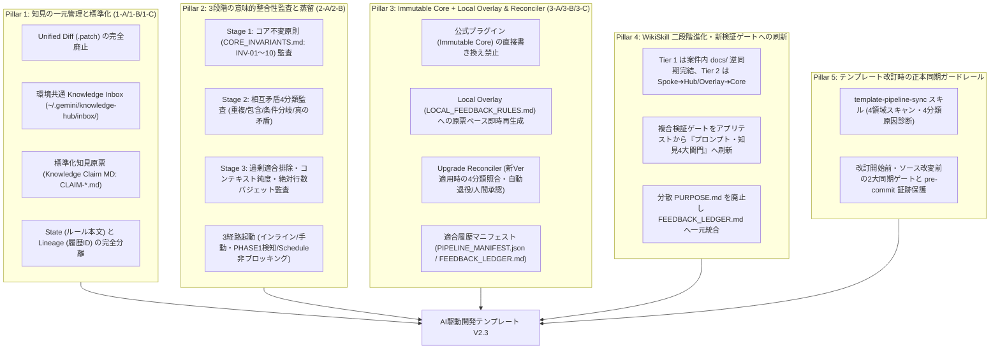
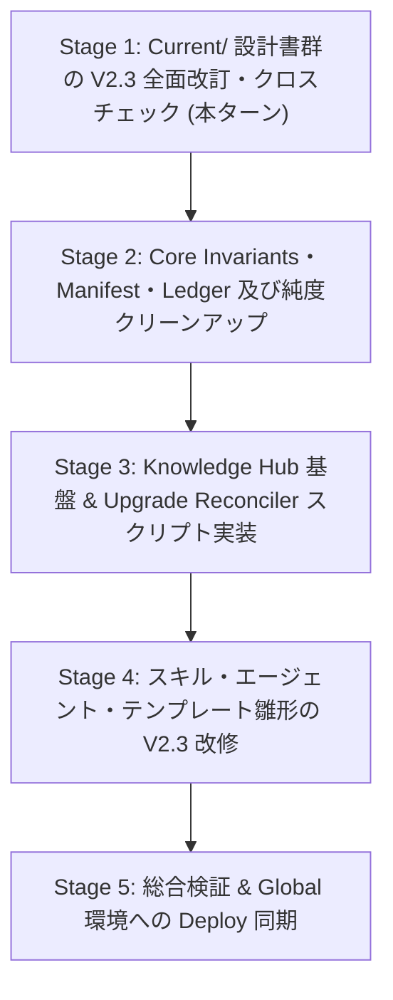

# V2.3 改変計画書 (AI駆動システム開発テンプレート V2.3)

文書バージョン: 1.0  
作成日: 2026-10-18  
対象バージョン: AI駆動システム開発ライフサイクルテンプレート V2.3  
ステータス: 正式計画書 (Approved Plan)  
関連文書:
- [V2.3新知見フィードバック機構設計書.md](./V2.3新知見フィードバック機構設計書.md)
- [パイプラインの改訂時におけるグローバルとワークスペースの同期について.md](./パイプラインの改訂時におけるグローバルとワークスペースの同期について.md)
- [知見フィードバック機構の高度化と一元管理・監査・配布に関する検討課題.md](../../検討課題/V2.3/知見フィードバック機構の高度化と一元管理・監査・配布に関する検討課題.md)
- [知見昇格時のテンプレート正本同期およびドリフト防止検討課題.md](../../検討課題/V2.3/知見昇格時のテンプレート正本同期およびドリフト防止検討課題.md)
- [WikiSkill統合設計書.md](./WikiSkill統合設計書.md)
- [テンプレート配置形態およびナレッジ境界設計書.md](./テンプレート配置形態およびナレッジ境界設計書.md)
- [エージェント間知見蓄積運用基準書V2.3.md](./エージェント間知見蓄積運用基準書V2.3.md)
- [AI駆動システム開発フェーズ定義書V2.3.md](./AI駆動システム開発フェーズ定義書V2.3.md)
- [エージェント設計書V2.3.md](./エージェント設計書V2.3.md)
- [状態管理機構設計書V2.3.md](./状態管理機構設計書V2.3.md)
- [エージェント・スキル・テンプレート再構成設計計画書V2.3.md](./エージェント・スキル・テンプレート再構成設計計画書V2.3.md)
- [パイプライン統合およびテンプレート再編集における配慮事項まとめV2.3.md](./パイプライン統合およびテンプレート再編集における配慮事項まとめV2.3.md)
- [定量測定・フィードバック設計書.md](./定量測定・フィードバック設計書.md)

---

## 1. はじめに

### 1.1 背景と位置づけ
AI駆動システム開発テンプレートは、V2.0 における協調体制と Single Writer 原則、V2.1 における3大レビューシステムと WikiSkill 型永続ナレッジ自己進化ループ、そして V2.2 における 2層構造システムプロファイル体系（定常コア8項目＋Profile A〜D）および Shift-Left（静的スケルトン事前組込・モック制御標準化・グランドデザイン全面採用）を経て、単一プロジェクトの開発自動化において極めて高い完成度に達した。

一方で、V2.1〜V2.2 の自己進化機構（PHASE 8 知見昇格）を複数の実稼働プロジェクト・複数の開発環境で継続運用した結果、以下の **4大構造課題および WikiSkill 統合上の摩擦** が顕在化した（詳細は [知見フィードバック機構の高度化と一元管理・監査・配布に関する検討課題.md](../../検討課題/V2.3/知見フィードバック機構の高度化と一元管理・監査・配布に関する検討課題.md) および [知見昇格時のテンプレート正本同期およびドリフト防止検討課題.md](../../検討課題/V2.3/知見昇格時のテンプレート正本同期およびドリフト防止検討課題.md) を参照）：

1. **複数プロジェクトからのフィードバック集約の破綻（パッチ競合）**:
   - 各案件が行番号依存の Unified Diff（`.patch`）を個別ワークスペース内の `./promotions/` に出力する方式では、知見が各所に散逸する上、1つのパッチを適用した時点で他案件のパッチがハンク不一致（Hunk Conflict）を起こして適用不能となる。
2. **GitHub 新バージョン配布時の他環境フィードバック消失**:
   - 各開発環境で獲得・適用されたフィードバックが公式プラグインファイルに直接書き込まれていると、GitHub から新バージョンを配布・更新した際にローカルの知見が上書き消失するか、深刻なマージコンフリクトを引き起こす。
3. **原本×フィードバック間、およびフィードバック同士の意味的矛盾（Semantic Conflict）**:
   - フィードバックが蓄積される過程で、パイプラインの「コア不変原則（Core Invariants）」を崩す例外ルールや、プロファイル前提条件の違いを無視した相反する指示が混在し、推論エージェントの判断を混乱させる。
4. **履歴追記によるコンテキスト肥大化と純度低下（Token Bloat & Context Dilution）**:
   - `SKILL.md` や `rules/AGENTS.md` の本文中に `（※ [PAT-SYS-001] 対策）` 等の履歴メタデータや個別エッジケースを追記（Append）し続けることで、常時読み込まれるプロンプトが肥大化し、重要原則の遵守率が希釈化される。
5. **WikiSkill 複合検証ゲートの形骸化と `PURPOSE.md` の分散ドリフト**:
   - PHASE 8 時点で既に開発・リリースが完了しているアプリケーションの Linter や E2E テストを再実行してもプロンプト変更の検証にならず、また各スキル直下の `PURPOSE.md` から個別案件 `./wiki/` への相対リンクが切れる構造的矛盾が生じていた。

### 1.2 V2.3 改変の目的
本文書は、承認された [V2.3新知見フィードバック機構設計書.md](./V2.3新知見フィードバック機構設計書.md) および [パイプラインの改訂時におけるグローバルとワークスペースの同期について.md](./パイプラインの改訂時におけるグローバルとワークスペースの同期について.md) に基づき、V2.2 の Shift-Left 開発基盤の上に **「マルチプロジェクト・マルチ環境対応の次世代ナレッジフィードバック・意味的監査・無停止マイグレーション機構」** を統合し、テンプレートシステム全体を V2.3 へアップグレードするための実行計画を規定するものである。

---

## 2. V2.3 改変基本方針（5大ピラー）



---

## 3. 新知見フィードバック機構のコア設計仕様（V2.3 統合アーキテクチャ）

### 3.1 3つの物理スコープ境界とディレクトリ構造
V2.3 では、データのライフサイクルと責務に応じて以下の3つの物理スコープを厳格に分離する。

1. **個別開発プロジェクト領域（Spoke Workspace: `<project-root>/`）**:
   - `./docs/` および `./PROJECT_STATE.md`: Tier 1（案件固有知見）の最終正本。
   - `./wiki/patterns/{local,universal}/`: 開発中の一次RCA記録領域。
   - `./promotions/`: PHASE 8 で生成された標準化知見原票（`CLAIM-*.md`）のプロジェクト内控え出力先（`.patch` は出力しない）。
2. **PC環境共通ナレッジハブ領域（Central Knowledge Hub: `~/.gemini/knowledge-hub/`）**:
   - `inbox/`: 全案件から投函された未処理の標準化知見原票（`CLAIM-*.md`）キュー。
   - `pending_approval/`: バックグラウンド（`/schedule`）監査時等の承認・裁定待ちステージング領域（`REVIEW-*.md`）。
   - `overlay/LOCAL_FEEDBACK_RULES.md`: Immutable Core を汚さず当該PC環境の次案件から即時有効化される拡張ルール層（絶対上限 80行）。
   - `active_claims/`: 現在 `overlay/` に反映中の有効原票の実体保管庫。
   - `archive/upstreamed/`: 公式 Core へ吸収完了し自動退役した原票。
   - `suspended/`: 新 Core 仕様と衝突し一時保留された原票。
   - `rejected/`: 意味的監査で棄却された原票と理由（再提案防止用）。
   - `LOCAL_HUB_STATE.json`: ベース Core バージョンと適用中 Claim ID の対応状態マニフェスト。
3. **公式プラグイン領域（Immutable Core: `~/.gemini/config/plugins/system-dev-pipeline/` および正本 `.agents/plugins/system-dev-pipeline/`）**:
   - `PIPELINE_MANIFEST.json`: バージョンおよび公式吸収済みパターン/原票ID（`absorbed_patterns`）の機械可読マニフェスト。
   - `FEEDBACK_LEDGER.md`: 人間可読なフィードバック適合履歴・因果追跡台帳（旧 `skills/*/PURPOSE.md` を完全統合）。
   - `rules/CORE_INVARIANTS.md`: Stage 1 監査用のコア不変原則カタログ（INV-01〜INV-10）。
   - `rules/AGENTS.md`, `agents/*.md`, `skills/*/SKILL.md`: 履歴ノイズ（`[PAT-xxx]` 等）を一切含まない純粋な実行規約・手順群。

### 3.2 標準化知見原票（Knowledge Claim MD）と State/Lineage 分離
- **Patch-Free 原票形式**: 知見の交換・集約単位を `CLAIM-{YYYYMMDD}-{PROJECT_SLUG}-{PAT_ID}.md` に統一する。YAML Frontmatter に `claim_id`, `pattern_id`, `source_project_profile`, `applicable_profiles`, `target_candidates`（ファイル名＋セクション見出しアンカー＋統合種別 `SUBSUMPTION` / `SCOPED_BRANCH` / `NEW_RULE`）を保持し、行番号ズレによる競合を根絶する。
- **State と Lineage の完全分離（1-C）**: `AGENTS.md`, `SKILL.md`, `LOCAL_FEEDBACK_RULES.md` の本文中には `[PAT-xxx]` や `[CLAIM-xxx]` 等の履歴識別子を一切記述せず、系譜はすべて `FEEDBACK_LEDGER.md` / `PIPELINE_MANIFEST.json` / `LOCAL_HUB_STATE.json` で管理する。

### 3.3 3段階の意味的整合性監査（Semantic Conflict Audit）と絶対行数バジェット
知見原票を Local Overlay または Immutable Core へ統合する際、🛡️ `qa-engineer`（`wiki-auditor` / 新複合検証ゲート）は以下の4関門（3段階監査）を実行する。

| 検証関門 (V2.3 新・複合検証ゲート) | 監査内容と合否判定基準 | 不合格・検出時の処置 |
| :--- | :--- | :--- |
| **New Gate 1 (Stage 1)**<br>原票スキーマ ＆ コア不変原則監査 | ・`CLAIM-*.md` 必須メタデータ検証<br>・`CORE_INVARIANTS.md`（INV-01〜10）への違反・弱体化が 0 件であること | 即座に自動棄却（`rejected/` へ移動・理由記録） |
| **New Gate 2 (Stage 2)**<br>既存ルール・他FBとの相互矛盾4分類監査 | 既存 Core / Overlay / 他原票との関係を4分類判定：<br>1. `EQUIVALENT`（同一・重複）➔ 本文変更なし、台帳紐付けのみ<br>2. `SUBSUMPTION`（補強・包含）➔ 既存文面へのインプレース統合<br>3. `SCOPED_BRANCH`（条件分岐）➔ `[Profile Aの場合]` 等の条件明示分岐<br>4. `TRUE_CONTRADICTION`（真の矛盾）➔ 自動適用ブロック | `TRUE_CONTRADICTION` 時は自動適用を停止し、`ask_question` モーダルでユーザー裁定を仰ぐ |
| **New Gate 3 (Stage 3-A)**<br>過剰適合排除 ＆ アンカー実在性検証 | ・案件固有パス・テーブル名・固有名詞の混入が 0 件であること<br>・統合先ファイルおよび `section_anchor` が実在すること | 汎用原則への再抽象化（Distillation Loop） |
| **New Gate 4 (Stage 3-B)**<br>コンテキスト純度 ＆ 絶対行数バジェット検証 | ・統合後テキストに `PAT-` / `CLAIM-` 等の履歴ID混入が 0 件であること<br>・絶対行数上限（`rules/AGENTS.md`: 220行、`agents/*.md`: 120行、`skills/*/SKILL.md`: 120行、`LOCAL_FEEDBACK_RULES.md`: 80行）以内であること | 既存文面の圧縮・スクリプト外出しによる再蒸留、またはロールバック |

### 3.4 起動タイミング3経路と `ask_question` 標準承認UI
1. **① フェーズ連動インライン起動（PHASE 8 / Upgrade Reconciler / `template-pipeline-sync`）**: 対話セッション中に即時監査を実行し、`ask_question` モーダルUIで承認・裁定・Overlay再生成まで完了させる。
2. **② 手動起動 ＆ PHASE 1 開始時自動検知**: `dev-phase1-setup` 実行時に `inbox/` または `pending_approval/` の未処理原票を検知してアラートし、その場で `ask_question` モーダル決裁を行う。
3. **③ スケジュール定期起動（`/schedule` バックグラウンド）**: **人間入力待ち（ブロッキング）を一切行わない**。事前監査と `pending_approval/REVIEW-*.md` 生成までを自動実行し、通知メッセージのみを出して即座にジョブを終了する。

### 3.5 Upgrade Reconciler（新バージョン適用時の4分類マイグレーション）
新バージョンの Immutable Core 配布時、`scripts/pipeline-reconciler.sh` が新 Core の `PIPELINE_MANIFEST.json` とローカルの `LOCAL_HUB_STATE.json`（および `active_claims/`）を照合する：
- **パターンA（ID完全一致）**: 新バージョンで文面が別表現に書き換わっていても、`pattern_id` / `claim_id` の一致により100%確実に「公式吸収済み」と判定し、`active_claims/` から `archive/upstreamed/` へ自動移動する。
- **パターンB（ID不一致・意味的重複/部分包含）**: AI判断のみで無言削除せず、必ず対比レポートと `ask_question`（①完全退役 / ②未カバー差分のみ再蒸留 / ③維持）を提示してユーザーの承認を得る。
- **パターンC（未吸収の独自知見）**: 新 Core に対して再監査の上、`active_claims/` に継続保持する。
- **パターンD（新Core仕様との真の矛盾）**: `suspended/` へ一時退避し、ユーザーへ改訂または破棄の選択を提示する。
- 最後に残存する `active_claims/` から `overlay/LOCAL_FEEDBACK_RULES.md` をクリーンに再生成する。

---

## 4. 改変対象資産とドキュメント体系アウトライン

```text
AI駆動システム開発テンプレート (V2.3)
├── docs/設計書/Current/ (正本設計書群のV2.3改訂・同期)
│   ├── V2.3改変計画書.md                        [新規作成 (本作・V2.2改変計画書を破棄して置換)]
│   ├── V2.3新知見フィードバック機構設計書.md    [承認済みコア設計書]
│   ├── パイプラインの改訂時におけるグローバルとワークスペースの同期について.md [確定・実装済]
│   ├── AI駆動システム開発フェーズ定義書V2.3.md  [V2.2 ➔ V2.3 改訂・改名]
│   ├── エージェント設計書V2.3.md                [V2.2 ➔ V2.3 改訂・改名]
│   ├── 状態管理機構設計書V2.3.md                [V2.2 ➔ V2.3 改訂・改名]
│   ├── エージェント間知見蓄積運用基準書V2.3.md  [V2.1 ➔ V2.3 改訂・改名]
│   ├── エージェント・スキル・テンプレート再構成設計計画書V2.3.md [V2.2 ➔ V2.3 改訂・改名]
│   ├── パイプライン統合およびテンプレート再編集における配慮事項まとめV2.3.md [V2.2 ➔ V2.3 改訂・改名]
│   ├── レビューシステム設計書V2.3.md            [V2.2 ➔ V2.3 改訂・改名]
│   ├── エージェント推論モデル仕様および運用基準書V2.3.md [V2.2 ➔ V2.3 改訂・改名]
│   ├── 動的登録フォールバック仕様書V2.3.md      [V2.1 ➔ V2.3 改訂・改名]
│   ├── システム開発パイプライン構成資産相互チェック報告書V2.3.md [V2.2 ➔ V2.3 改訂・改名]
│   ├── V2.3システムプロファイル構造設計書.md    [V2.2 ➔ V2.3 改訂・改名]
│   ├── WikiSkill統合設計書.md                   [V2.3 二段階進化・新4大関門へ全面改訂]
│   ├── テンプレート配置形態およびナレッジ境界設計書.md [V2.3 3スコープ・Overlayへ全面改訂]
│   ├── 定量測定・フィードバック設計書.md        [V2.3 知見原票・Hub連携へ改訂]
│   ├── ProfileA詳細設計書.md                    [関連文書リンクV2.3同期]
│   └── ProfileD詳細設計書.md                    [関連文書リンクV2.3同期]
│
├── .agents/skills/template-pipeline-sync/       [ワークスペース専用正本同期スキル]
│   ├── SKILL.md
│   └── scripts/sync_pipeline.sh
│
└── .agents/plugins/system-dev-pipeline/         [配布用パイプライン正本 (Immutable Core)]
    ├── PIPELINE_MANIFEST.json                   [新規導入: 適合履歴・バージョンマニフェスト]
    ├── FEEDBACK_LEDGER.md                       [新規導入: 人間可読な知見系譜台帳]
    ├── scripts/
    │   └── pipeline-reconciler.sh               [新規導入: Upgrade Reconciler & Hub管理CLI]
    ├── rules/
    │   ├── AGENTS.md                            [履歴ID排除・Local Overlay参照フック追加・220行以内]
    │   └── CORE_INVARIANTS.md                   [新規導入: コア不変原則カタログ INV-01〜10]
    ├── agents/
    │   ├── conductor.md                         [Hub連携・Overlay更新・Reconciler統括・120行以内]
    │   ├── qa-engineer.md                       [Semantic Auditor (3段階監査・新4大関門)・120行以内]
    │   └── (architect.md, backend-engineer.md, ui-designer.md) [120行以内純度維持]
    ├── skills/
    │   ├── wiki-maintainer/SKILL.md             [プロファイル・適用スコープ条件記録の拡張]
    │   ├── wiki-proposer/SKILL.md               [.patch/PURPOSE.md廃止、CLAIM-*.md生成＆Inbox投函]
    │   ├── wiki-compactor/SKILL.md              [Inbox原票事前クラスタリング・Overlay圧縮の拡張]
    │   ├── dev-phase1-setup/SKILL.md            [Knowledge Hub 初期化 ＆ 未処理原票検知フック追加]
    │   ├── dev-phase8-rules/SKILL.md            [Inbox投函 ➔ 3段階意味的監査 ➔ Overlay即時再生成]
    │   └── (他スキル群)                         [個別PURPOSE.md廃止・120行バジェット遵守]
    └── templates/
        ├── PROJECT_STATE.md.template            [V2.3 Knowledge Hub / Claim / Overlay 追跡欄反映]
        └── TEMPLATE_PROMOTIONS.md.template      [標準化知見原票 (CLAIM-*.md) 提示サマリ形式へ刷新]
```

---

## 5. 実装ロードマップとタスクブレークダウン



### Stage 1: `docs/設計書/Current/` 設計書群の V2.3 全面改訂・クロスチェック 【完了】
- [x] `V2.2改変計画書.md` の破棄と `V2.3改変計画書.md`（本作）の作成。
- [x] `Current/` 配下の設計書群に対する V2.3 新知見フィードバック機構（Central Knowledge Hub、標準化知見原票 `CLAIM-*.md`、3段階意味的監査、Immutable Core / Local Overlay、Upgrade Reconciler、`PIPELINE_MANIFEST.json` / `FEEDBACK_LEDGER.md`、新複合検証ゲート）の反映。
- [x] バージョン番号を冠する設計書タイトルおよびファイル名の `V2.3` への統一。
- [x] 全設計書間の相互リンク（相対パス）・用語・ゲート定義のクロスチェックと検証レポート作成。

### Stage 2: Core Invariants・Manifest・Ledger の新設と既存知見 (`PAT-SYS-001`) のクリーン移行（1-C / 3-C） 【完了】
- [x] `.agents/plugins/system-dev-pipeline/rules/CORE_INVARIANTS.md`（INV-01〜INV-10）の作成（`PAT-SYS-001` の非対話CLI・バックグラウンド保護を `INV-06` として昇格）。
- [x] `.agents/plugins/system-dev-pipeline/PIPELINE_MANIFEST.json` および `FEEDBACK_LEDGER.md` の作成（既存の `PAT-SYS-001` / `CLAIM-20261017-legacy-PAT-SYS-001` を第1号適合履歴として正式登録）。
- [x] `skills/dev-phase7-release/PURPOSE.md` の記載内容を `FEEDBACK_LEDGER.md` へ完全移管した上で物理削除。
- [x] `rules/AGENTS.md`（プラグイン内およびワークスペースルート）、`agents/conductor.md`、`skills/dev-phase7-release/SKILL.md` 本文から `(PAT-SYS-001)` の履歴ID注釈を除去し、ルール内容自体は100%保持したまま純粋な規範文へ整流化（絶対行数バジェット遵守）。
- [x] `rules/AGENTS.md` に `~/.gemini/knowledge-hub/overlay/LOCAL_FEEDBACK_RULES.md` の動的参照フックを追加。

### Stage 3: Knowledge Hub 基盤 & `pipeline-reconciler.sh` の構築（1-A / 3-A / 3-B） 【完了】
- [x] `~/.gemini/knowledge-hub/` の標準ディレクトリ構造（`inbox/`, `pending_approval/`, `overlay/`, `active_claims/`, `archive/upstreamed/`, `suspended/`, `rejected/`）と初期 `LOCAL_HUB_STATE.json` の自動生成機構の実装。
- [x] `.agents/plugins/system-dev-pipeline/scripts/pipeline-reconciler.sh`（`--init-hub`, `--status`, `--rebuild-overlay`, `--upgrade`, `--activate-claim`, `--reject-claim`, `--audit-budget`, `--export-claims`）の実装。
- [x] `.agents/skills/template-pipeline-sync/scripts/sync_pipeline.sh` との連携確認。

### Stage 4: スキル・エージェント・テンプレート雛形の V2.3 改修 【完了】
- [x] `skills/wiki-maintainer/SKILL.md`: Tier 2 パターン記録時のプロファイル・スコープ条件メタデータの拡充。
- [x] `skills/wiki-proposer/SKILL.md`: `.patch` 出力と `PURPOSE.md` 生成を廃止し、標準化知見原票 `CLAIM-*.md` の生成および `~/.gemini/knowledge-hub/inbox/` 投函へ刷新。
- [x] `skills/wiki-compactor/SKILL.md`: `inbox/` 原票の事前クラスタリング・重複集約および `overlay/` 圧縮手順の追加。
- [x] `agents/qa-engineer.md` & `skills/dev-phase8-rules/SKILL.md`: 3段階意味的整合性監査（新複合検証ゲート Gate 1〜4）、3経路起動（インライン `ask_question` 承認 / バックグラウンド `pending_approval/` 非ブロッキング）、および `LOCAL_FEEDBACK_RULES.md` 即時クリーン再生成フローの実装。
- [x] `skills/dev-phase1-setup/SKILL.md`: PHASE 1 開始時の Knowledge Hub 未処理原票検知フックの追加。
- [x] `templates/PROJECT_STATE.md.template` および `templates/TEMPLATE_PROMOTIONS.md.template` の V2.3 仕様への更新。

### Stage 5: 総合検証 & Global 環境への Deploy 同期 【完了】
- [x] 全構成資産の行数バジェット、コンテキスト純度（`PAT-` 混入ゼロ）、相対パスリンク切れゼロの機械的検証。
- [x] `template-pipeline-sync` スキルによる Global 環境（`~/.gemini/config/plugins/system-dev-pipeline/`）への安全な Deploy 同期と `LOCAL_HUB_STATE.json` の初期化確認。

---

## 6. 完了基準 (Definition of Done)

1. **設計書群の完全整合**:
   - `docs/設計書/Current/` 配下の全設計文書が V2.3 仕様（Central Knowledge Hub、標準原票MD、3段階監査、Immutable Core + Local Overlay、Upgrade Reconciler、新複合検証ゲート）で統一され、旧方式（`.patch` 出力、個別 `PURPOSE.md`、アプリテスト流用ゲート）との矛盾が 0 件であること。
   - すべての文書内リンクが相対パスで記述され、リンク切れが 0 件であること。
2. **コンテキスト純度とバジェット遵守**:
   - 推論エージェントが読み込む全ファイルに履歴ノイズ（`[PAT-...]` 等）が存在せず、各ファイルの絶対行数上限（Hard Line Budget）に収まっていること。
3. **非破壊的進化とマイグレーションの動作保証**:
   - 個別案件の PHASE 8 で公式プラグイン（Immutable Core）を1バイトも書き換えることなく `overlay/LOCAL_FEEDBACK_RULES.md` へ知見が即時反映され、次期バージョン適用時に `Upgrade Reconciler` で吸収済み原票の自動退役と独自知見の保護が正しく機能すること。
