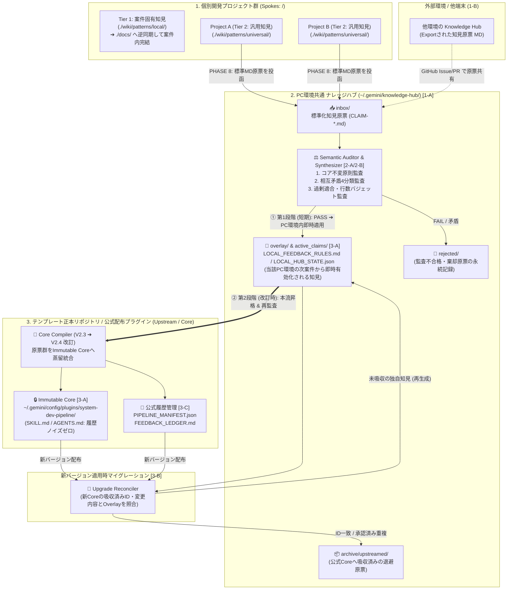
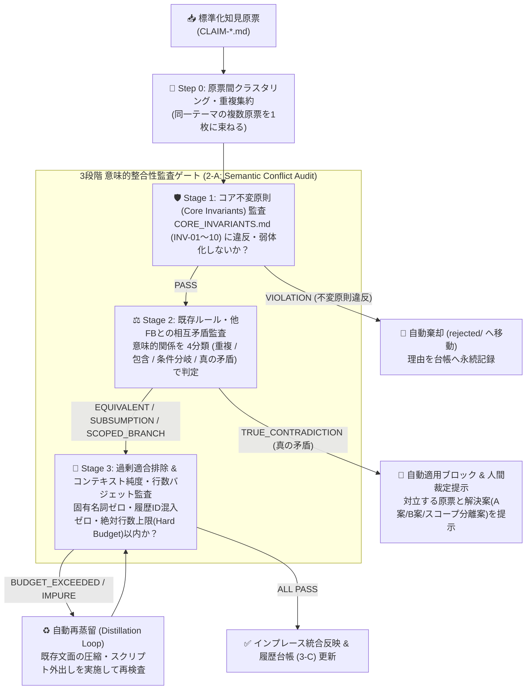
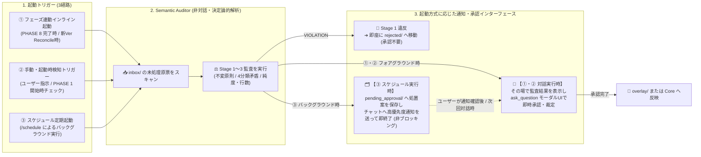
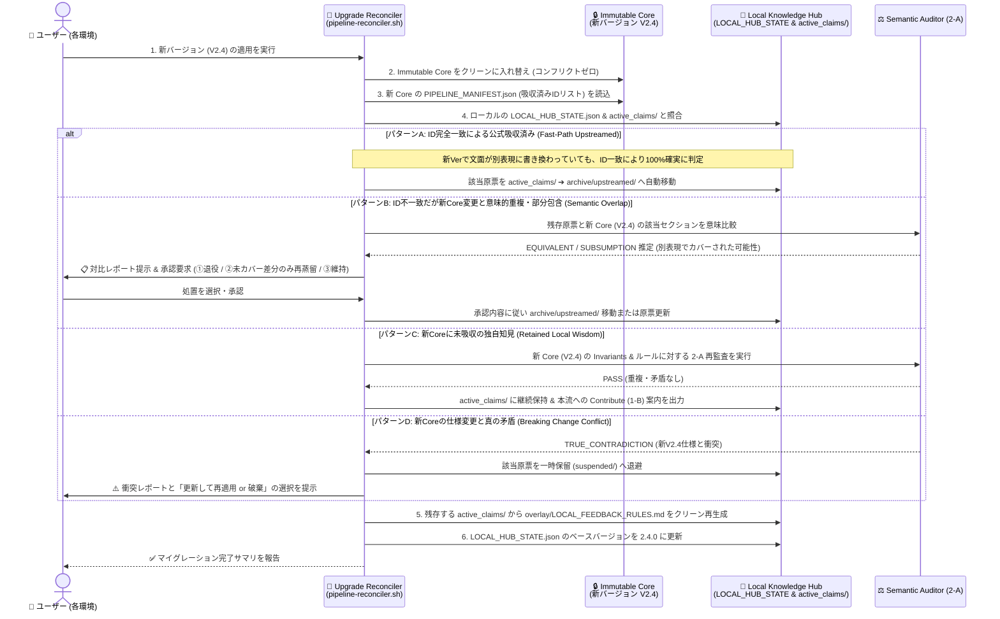
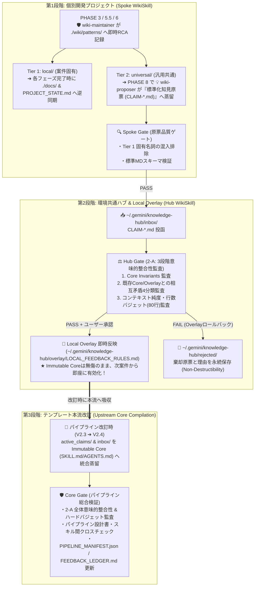

# V2.3 新知見フィードバック機構設計書
**（Central Knowledge Hub・3段階意味的監査・Immutable Core / Local Overlay・マイグレーション統合仕様）**

文書バージョン: 2.3.0  
作成日: 2026-10-17  
対象バージョン: AI駆動システム開発ライフサイクルテンプレート V2.3  
ステータス: 正式設計書 (Approved Specification)  
関連文書:
- [V2.3改変計画書.md](./V2.3改変計画書.md)
- [知見フィードバック機構の高度化と一元管理・監査・配布に関する検討課題.md](../../検討課題/V2.3/知見フィードバック機構の高度化と一元管理・監査・配布に関する検討課題.md)
- [知見昇格時のテンプレート正本同期およびドリフト防止検討課題.md](../../検討課題/V2.3/知見昇格時のテンプレート正本同期およびドリフト防止検討課題.md)
- [WikiSkill統合設計書.md](./WikiSkill統合設計書.md)
- [テンプレート配置形態およびナレッジ境界設計書.md](./テンプレート配置形態およびナレッジ境界設計書.md)
- [エージェント間知見蓄積運用基準書V2.3.md](./エージェント間知見蓄積運用基準書V2.3.md)
- [AI駆動システム開発フェーズ定義書V2.3.md](./AI駆動システム開発フェーズ定義書V2.3.md)

---

## 1. 背景と設計目的

### 1.1 V2.2 までの自己進化運用で顕在化した4大構造課題
V2.1〜V2.2 において導入された WikiSkill 型の知見昇格（PHASE 8）が実案件で稼働し始めた結果、単一プロジェクト内の知見蓄積を超えて、**複数プロジェクト・複数環境・長期運用における以下の4つの構造的課題**が明らかになった（詳細は [知見フィードバック機構の高度化と一元管理・監査・配布に関する検討課題.md](../../検討課題/V2.3/知見フィードバック機構の高度化と一元管理・監査・配布に関する検討課題.md) を参照）。

1. **複数プロジェクトからのフィードバック集約の破綻（N対1集約とパッチ競合）**:
   - 各プロジェクトが行番号依存の差分ファイル（`.patch`）を個別ワークスペース内の `./promotions/` に出力する方式では、知見が各所に散逸する上、1つのパッチを適用した時点で他プロジェクトのパッチがハンク不一致（Hunk Conflict）を起こして適用不能となる。
2. **GitHub 新バージョン配布時の他環境フィードバック消失（分散環境アップデートの破綻）**:
   - リリース済みの他環境（外部開発者環境やサブマシン）で独自に獲得・反映されたフィードバックがプラグイン本体ファイルに直接書き込まれていると、GitHub から新バージョン（V2.3 等）を配布・適用した際に上書き消失または深刻なマージコンフリクトを引き起こす。
3. **原本×フィードバック間、およびフィードバック同士の意味的矛盾（Semantic Conflict）**:
   - 多数のフィードバックが積み重なる過程で、パイプラインの「コア不変原則（Invariants）」を崩す例外ルールや、プロジェクトの前提条件（Profile 等）の違いを無視した相反する指示が混在し、AIエージェントの推論に混乱をもたらす。
4. **履歴追記によるコンテキスト肥大化と純度低下（Token Bloat & Context Dilution）**:
   - `SKILL.md` や `rules/AGENTS.md` の本文中に `（※ [PAT-SYS-001] 対策）` のような履歴メタデータや個別エッジケース対策を追記（Append）し続けることで、常時読み込まれるプロンプトが肥大化し、最重要原則の遵守率が希釈化される。

### 1.2 V2.3 における基本設計方針（採択アーキテクチャ）
上記の課題を根本から解決するため、V2.3 では以下の設計方針を採択する。

| 領域 | 採択方針 | 設計の骨子 |
| :--- | :--- | :--- |
| **① 知見の一元管理と標準化**<br>*(1-A + 1-B + 1-C)* | **Knowledge Inbox ＋ 標準化知見原票 (MD) ＋ State/Lineage分離** | ・`.patch` 出力を廃止。環境共通のスプール領域（`~/.gemini/knowledge-hub/inbox/`）へ集約する **1-A** を基本とする。<br>・他環境からの還流（**1-B**）にもそのまま利用できるよう、共通領域へポストされる知見原票を **単一・自己完結型の標準 Markdown フォーマット（Knowledge Claim MD）** として統一する。<br>・パイプライン文書（State）からパターンID等の履歴記述を完全排除し、系譜管理（Lineage）を分離する（**1-C**）。 |
| **② 適用時監査と蒸留**<br>*(2-A + 2-B)* | **3段階の意味的整合性監査 (Semantic Conflict Audit) ＋ 統合再編** | ・**2-A** を基本方針とし、①コア不変原則（Invariants）監査、②既存ルール・他FBとの相互矛盾監査（重複/包含/条件分岐/真の矛盾の4分類処置）、③過剰適合（Overfitting）＆コンテキスト純度監査の3段階ゲートを確立する。<br>・追記（Append）を禁止し、絶対行数バジェット内でのインプレース統合・抽象化（Synthesize）を強制する（**2-B**）。 |
| **③ 分散配布とマイグレーション**<br>*(3-A + 3-B)* | **Immutable Core ＋ Local Overlay 2層構成 ＆ Upgrade Reconciler** | ・公式プラグイン領域を読み取り専用の **Immutable Core** とし、各環境の昇格知見を **Local Overlay** に分離配置する **3-A** を採用する。<br>・新バージョン適用時に、新 Core と Local Overlay を自動照合して「公式吸収済み退避」「継続保持」「衝突警告」へ仕分けるマイグレーション機構（**3-B: Upgrade Reconciler**）を設ける。 |
| **④ 適合履歴の追跡管理**<br>*(3-C)* | **フィードバック適合履歴マニフェスト (`PIPELINE_MANIFEST.json` / `FEEDBACK_LEDGER.md`)** | ・**3-C** のアイデアを発展させ、どのバージョンで・どの知見原票が・どのスキル/ルールへ適合（統合・蒸留）されたかを一元追跡する履歴管理機構を導入する。 |
| **⑤ WikiSkill との統合再定義**<br>*(重要懸案事項)* | **2段階進化サイクル（Spoke ➔ Hub/Overlay ➔ Core）と検証ゲートの刷新** | ・個別プロジェクト内の `./wiki/`（Spoke）と中央ハブ（Hub）の責務を明確に分離し、PHASE 8 の複合検証ゲートを「アプリテスト」から「知見原票・パイプラインの意味的監査ゲート」へと再定義する（第6章にて詳述）。 |

---

## 2. 全体アーキテクチャ（Central Knowledge Hub & 2層プラグインモデル）

### 2.1 概念アーキテクチャ全体像



#### アーキテクチャ上の重要原則（スコープと時系列の整理）
1. **Tier 1 と Tier 2 の厳格な分離**:
   - **Tier 1（個別プロジェクト固有の仕様・設計変更）** は各開発プロジェクト（Spoke）内の `./docs/` および `./PROJECT_STATE.md` への逆同期で完結し、中央の Knowledge Hub には一切流入しない。
   - Knowledge Hub（`inbox/` ➔ `Auditor` ➔ `overlay/` ➔ `Core`）を流れる知見は、すべて **Tier 2（他案件でも再利用すべき汎用共通知見）のみ** である。
2. **「PC環境内（Hub）」と「個別案件（Spoke）」の区別**:
   - 本設計書における **「環境内即時適用」の「環境」とは、個別プロジェクトのフォルダではなく、開発者のPC（マシン）環境全体（`~/.gemini/` 配下）** を指す。
   - Project A の PHASE 8 で得られた Tier 2 知見が `~/.gemini/knowledge-hub/overlay/` に反映されることで、公式テンプレートの次期バージョンリリースを待たずとも、同一PC内で次に開発する Project B, C から即座に有効化される。
3. **Tier 2 知見の2段階進化ライフサイクル（同一知見の時系列遷移）**:
   - **第1段階（日々の案件完了時）**: `Auditor` を通過した知見はまず PC環境共通の `Overlay`（および `active_claims/`）へ即時反映される。この時点では公式プラグイン（`Immutable Core`）のファイルは1バイトも書き換えない。
   - **第2段階（パイプライン改訂・新バージョン作成時）**: `Overlay`（`active_claims/`）に蓄積された知見群が `Core Compiler` によって公式の `SKILL.md` / `AGENTS.md` 本体へ蒸留・統合（本流昇格）され、新バージョン配布時に `Upgrade Reconciler` を通じて `Overlay` から卒業（`archive/upstreamed/` へ退避）する。

### 2.2 物理ディレクトリ配置と3つのスコープ境界

V2.3 では、データを以下の3つの物理スコープに厳格に分離する。

```text
[1. 個別開発プロジェクト領域 (Spoke Workspace)]
<project-root>/
├── docs/                                         # Tier 1 正本 (要件定義・設計書群)
├── PROJECT_STATE.md                              # Single Writer 状態管理
└── wiki/                                         # プロジェクトローカル一次蓄積領域
    ├── patterns/
    │   ├── local/                                # Tier 1: プロジェクト固有RCA (docs/へ逆同期して完結)
    │   └── universal/                            # Tier 2: 汎用RCA一次原票 (PHASE 8でHubへExport)
    └── logs.md                                   # プロジェクト内RCA・ゲート記録

[2. 環境共通ナレッジハブ & ローカルオーバーレイ領域 (Central Knowledge Hub)]
~/.gemini/knowledge-hub/
├── inbox/                                        # [1-A] 全案件から投函された未処理の標準知見原票キュー
│   └── CLAIM-20261017-myproj-PAT-SYS-001.md      # [1-B] 他環境との交換単位でもある自己完結MD
├── pending_approval/                             # [2-A] スケジュール実行時等の承認・裁定待ちステージング領域
│   └── REVIEW-20261017-PAT-SYS-001.md            # 事前監査レポート＋統合プレビュー案 (対話時にUI提示)
├── overlay/                                      # [3-A] Immutable Coreを汚さず環境内で即時効かせる拡張層
│   ├── LOCAL_FEEDBACK_RULES.md                   # 環境内で有効な追加・補正ルール (蒸留済み・上限80行)
│   └── skills/                                   # スキル別の補足ガードレール (必要時のみ)
│       └── dev-phase7-release.overlay.md
├── active_claims/                                # 現在 overlay/ に反映されている知見原票の実体保管庫
├── archive/                                      # [3-B] 公式Coreへ吸収完了(Upstreamed)または陳腐化した原票
│   └── upstreamed/
├── suspended/                                    # [3-B] 新Core仕様と衝突し一時保留された原票
├── rejected/                                     # [2-A] 意味的監査で棄却された原票と棄却理由 (再提案防止用)
└── LOCAL_HUB_STATE.json                          # ローカルハブの状態・適用中Claim IDリスト

[3. 公式プラグイン領域 (Immutable Core & Lineage Manifest)]
~/.gemini/config/plugins/system-dev-pipeline/     # (※テンプレート開発時は .agents/plugins/system-dev-pipeline/)
├── PIPELINE_MANIFEST.json                        # [3-C] 機械可読なバージョン・適合済みフィードバックIDマニフェスト
├── FEEDBACK_LEDGER.md                            # [3-C] 人間可読なフィードバック適合履歴・因果追跡台帳
├── rules/
│   ├── AGENTS.md                                 # [1-C] 履歴ノイズゼロの純粋なコア規約
│   └── CORE_INVARIANTS.md                        # [2-A] 第1段階監査用の「コア不変原則カタログ」
├── agents/
│   └── *.md                                      # 履歴ノイズゼロのエージェント定義
└── skills/
    └── */SKILL.md                                # 履歴ノイズゼロのスキル定義 (個別PURPOSE.mdは廃止・LEDGERへ統合)
```

---

## 3. テーマ①：知見の一元管理と「標準化知見原票（Knowledge Claim MD）」仕様【1-A + 1-B + 1-C】

### 3.1 環境共通「Knowledge Inbox」への集約メカニズム（1-A）
1. **Unified Diff（`.patch`）出力の完全廃止**:
   - 個別プロジェクトの PHASE 8 において、`SKILL.md` や `AGENTS.md` の特定行番号に依存する `.patch` ファイルの生成を廃止する。
2. **環境共通 Inbox（`~/.gemini/knowledge-hub/inbox/`）への自動投函**:
   - 各プロジェクトの PHASE 8 で抽出された Tier 2 汎用知見は、次節で定義する **「標準化知見原票（Knowledge Claim MD）」** として生成され、`~/.gemini/knowledge-hub/inbox/` へ投函（コピー）される。
   - ファイル名は衝突を防ぐため `CLAIM-{YYYYMMDD}-{PROJECT_SLUG}-{PAT_ID}.md`（例: `CLAIM-20261017-bicycle-log-PAT-SYS-001.md`）とする。
   - これにより、Project A, B, C を並行・連続実行してもハンク競合（Hunk Failed）は原理的に一切発生せず、すべての知見が時系列で1箇所の Inbox に自動集約される。

### 3.2 共通領域・他環境還流対応「標準化知見原票（Knowledge Claim MD）」フォーマット（1-A × 1-B）
1-A（マシン内共通 Inbox への集約）と 1-B（他環境から GitHub Issue / PR 等を介したテンプレート本流への還流）をシームレスに結ぶため、知見原票を **外部ファイル参照に依存しない単一・自己完結型の Markdown フォーマット** として標準化する。

#### 標準化知見原票スキーマ定義 (`CLAIM-{YYYYMMDD}-{PROJECT_SLUG}-{PAT_ID}.md`)

```markdown
---
schema_version: "2.3.0"
claim_id: "CLAIM-20261017-bicycle-log-PAT-SYS-001"
pattern_id: "PAT-SYS-001"
title: "外部CLIの非対話実行強制とバックグラウンド待機タイムアウト保護"
created_at: "2026-10-17T16:00:00+09:00"
source_project_profile: "Profile A"       # 発生プロジェクトのプロファイル (Profile A/B/C/D または ALL)
applicable_profiles: ["ALL"]              # 本知見が適用されるべき対象プロファイル群
category: "SYS"                           # ARCH / CODE / TEST / ENV / SEC / SYS
severity: "HIGH"                          # CRITICAL / HIGH / MEDIUM / LOW
target_candidates:                        # 統合候補となるパイプライン資産とセマンティック・アンカー
  - file: "rules/AGENTS.md"
    section_anchor: "## 7. PHASE 4以降のシステム修正後のDockerコンテナ再構成徹底ルール"
    integration_type: "SUBSUMPTION"       # SUBSUMPTION (補強統合) / SCOPED_BRANCH (条件分岐) / NEW_RULE (新規原則)
  - file: "skills/dev-phase7-release/SKILL.md"
    section_anchor: "## 作業手順"
    integration_type: "SUBSUMPTION"
status: "INBOX_PENDING"                   # INBOX_PENDING / OVERLAY_ACTIVE / UPSTREAM_MERGED / REJECTED
consolidated_from: []                     # 複数原票を集約した場合の元claim_idリスト
---

# [PAT-SYS-001]: 外部CLIの非対話実行強制とバックグラウンド待機タイムアウト保護

## 1. 発生コンテキストと前提条件 (Context & Preconditions)
- **発生フェーズ**: PHASE 7（本番デプロイおよびクラウドCLI実行時）
- **技術環境・条件**: `gcloud`, `terraform`, `npm`, `alembic` 等の外部CLIツールを `run_command` 経由で実行する環境全般。
- **適用スコープ条件**: 対話的プロンプト（`[Y/n]` や認証ブラウザ起動）を出し得るすべての外部CLIコマンド実行時。

## 2. 事象と根本原因分析 (Problem & Root Cause Analysis)
- **発生事象**: バックグラウンドまたは非対話シェルで `gcloud run deploy` 等を実行した際、確認プロンプト待ちでプロセスが無限ハングアップし、エージェントのターンが停止した。
- **根本原因 (RCA)**: CLIのデフォルト挙動が対話モード（Interactive）となっており、明示的な非対話フラグ（`--quiet` 等）の指定およびハング時の強制タイムアウト保護が手順化されていなかったため。

## 3. 抽象化された処方箋・推奨ルール (Distilled Prescription)
> ※ 注意: ここにはパイプライン文書へそのまま統合可能な、プロジェクト固有名詞を含まない純粋・簡潔な規範文を記述する。

- 外部CLI（`gcloud`, `npm`, `apt` 等）を実行する際は、確認プロンプトによる無限待機を防ぐため、必ず非対話フラグ（`--quiet`, `--yes`, `CI=true` 等）を明示的に付与すること。
- 長時間実行または外部通信を伴うコマンドには、ハングアップ防止のため適切な待機タイムアウト上限を設定すること。

## 4. 既存ルールとの意味的関係・統合指針 (Semantic Integration Guide)
- **コア不変原則との整合性**: 自律実行の安全性・決定論性を高めるものであり、既存の全 Invariants に適合する。
- **既存文面への統合方法**: 新規セクションを乱立させるのではなく、既存のコマンド実行規約および PHASE 7 デプロイ手順の該当箇条書きへ1〜2文としてインプレース統合（Refactor）する。

## 5. 検証エビデンス (Verification Evidence)
- **再現・解消確認**: `--quiet` フラグ付与により PHASE 7 デプロイコマンドがハングせず完走することを確認済み。
```

#### この標準フォーマットがもたらす3つの効果
1. **行番号非依存（Patch-Free）**: `target_candidates` には行番号ではなく **セマンティック・アンカー（対象ファイル名＋セクション見出し＋統合種別）** を記述するため、対象ファイルが何度改訂されても競合しない。
2. **知見原票の事前集約（1-B Idea Integration）**: `consolidated_from` フィールドを備えており、Inbox 内に複数プロジェクトから類似の原票が集まった際、まず原票レベルで1枚の「集約知見原票（Consolidated Claim MD）」に束ねてから監査・反映にかけることができる。
3. **GitHub 越境還流の容易性（1-B）**: 他環境のユーザーは、`~/.gemini/knowledge-hub/inbox/`（または `active_claims/`）にある `.md` ファイルをそのまま GitHub Issue に貼り付けるか、`inbox/` フォルダへ PR を送るだけで本流へフィードバックを還元できる。

### 3.3 パイプライン文書（State）と変更履歴（Lineage）の完全分離（1-C）
- **鉄則**: `rules/AGENTS.md`、`agents/*.md`、`skills/*/SKILL.md`、および `overlay/LOCAL_FEEDBACK_RULES.md` の本文中には、**`[PAT-SYS-001]` や `[CLAIM-...]` といった識別子、「過去のプロジェクトで〜という障害が発生したため」といった経緯説明を一切記述してはならない**。
- **理由**: 推論エージェントにとって必要なのは「今、何を守るべきか（State）」のみであり、「なぜそのルールが作られたか（Lineage）」はアテンションを奪うノイズでしかないため。系譜情報はすべて第5章（3-C）の `FEEDBACK_LEDGER.md` および `PIPELINE_MANIFEST.json` に隔離して記録する。

---

## 4. テーマ②：3段階の「意味的整合性監査（Semantic Conflict Audit）」とコンテキスト蒸留【2-A + 2-B】

Inbox に集約された知見原票を Local Overlay（環境内適用）または Immutable Core（テンプレート正本改訂）へ反映する際、以下の **3段階の意味的整合性監査ゲート（2-A）** を必須とする。



### 4.1 Stage 1：コア不変原則（Core Invariants）との整合性監査
パイプラインの品質・セキュリティの根幹をなす「絶対不可侵の設計原則」を `rules/CORE_INVARIANTS.md` として明文化し、フィードバック原票がこれらを無効化・バイパス・緩和しようとしていないかを最優先で検査する。

#### コア不変原則カタログ（Invariants Catalog）
| ID | 原則名 | 絶対不可侵の制約内容（これに反するフィードバックは即座に `REJECTED`） |
| :--- | :--- | :--- |
| **INV-01** | **Single Writer 原則** | `PROJECT_STATE.md` の更新権限は `conductor` のみが持ち、サブエージェントによる直接編集は理由を問わず禁止する。 |
| **INV-02** | **責務分離とツール制限** | `architect` の `run_command` 実行禁止、`qa-engineer` のアプリコード直接改変禁止、サブエージェントの Git/デプロイ実行禁止を緩和してはならない。 |
| **INV-03** | **Anti-God Component 制限** | フロントエンド1コンポーネント最大250行制限、バックエンド1ファイル最大400行制限を撤廃・緩和してはならない。 |
| **INV-04** | **本番モックOFF・直書きモック禁止** | コンポーネント内のダミーデータ直書き禁止、および本番ビルド時の `VITE_ENABLE_MOCK=false` 二重防御をバイパスしてはならない。 |
| **INV-05** | **Alembic 厳格運用・生SQL禁止** | 手動DDL（生SQL）によるテーブル作成・変更を許可してはならない（Profile A/B/D）。 |
| **INV-06** | **IAP JWT 署名検証・平文排除** | 本番環境における認証検証のスキップや、シークレット・プレースホルダーの平文コミットを許容してはならない。 |
| **INV-07** | **3大レビューゲート必須通過** | 基本設計・コード品質・システム総合の3大レビューおよびテスト合格なしに次フェーズへ進むバイパス経路を作ってはならない。 |
| **INV-08** | **自律修復ループの上限保護** | テスト失敗や不整合の放置（スキップ合格化）を禁じるとともに、無限ループ防止のため自律修復は最大5回上限を維持する。 |
| **INV-09** | **Context Isolation とナレッジ境界** | Tier 1（案件固有仕様）をグローバル領域へ持ち出すこと、および推論プロンプトへ生の Wiki 履歴を注入することを禁じる。 |
| **INV-10** | **ドキュメント内相対パス強制** | Markdown 設計文書内のファイルリンクに絶対パス（`file:///` 等）を使用することを禁じる。 |

### 4.2 Stage 2：既存ルール・他フィードバック間の相互矛盾監査と4分類処置
Stage 1 を通過した知見原票に対し、既存の `SKILL.md` / `AGENTS.md` / `LOCAL_FEEDBACK_RULES.md` および同時に Inbox にある他の原票との意味的関係（Semantic Relation）を解析し、以下の **4分類** に従って決定論的に処置する。

| 判定分類 | 意味的関係の定義 | 具体的な統合・処置アクション |
| :--- | :--- | :--- |
| **1. `EQUIVALENT`**<br>（同一・重複） | 既存のルールまたは別原票と実質的に同じ内容・対策を述べている場合。 | **【本文変更なし】**<br>パイプライン文書の書き換えは行わず、当該原票を「既存ルールに包含済み」として処理し、`FEEDBACK_LEDGER.md` に原票IDのみを紐付けてアーカイブする。 |
| **2. `SUBSUMPTION`**<br>（補強・包含） | 既存ルールの意図と同じ方向性であり、より具体的・網羅的な条件や手段を補完している場合。 | **【インプレース書き換え（Synthesize）】**<br>新しい箇条書きを末尾に足す（Append）のではなく、**既存の該当箇条書き1文を「元の意図＋新しい知見」を包含する洗練された1文へ書き換える**（行数増加を最小化）。 |
| **3. `SCOPED_BRANCH`**<br>（条件付き分岐） | 一見すると既存ルールや他原票と異なる指示に見えるが、「対象プロファイル（Profile A vs D）」「対象コマンド種別（軽量API vs DBマイグレーション）」などの**適用前提条件（Scope）が異なる**場合。 | **【スコープ明示分岐化】**<br>無条件の全体ルールとして衝突させるのではなく、`[Profile A の場合]: ...` / `[マイグレーション実行時]: ...` のように**適用条件（Guard Condition）を明示した分岐記述**として構造化統合する。 |
| **4. `TRUE_CONTRADICTION`**<br>（真の矛盾） | 同一のスコープ・同一の前提条件に対して、既存ルール（または他原票）と正反対の行動を指示しており、両立が不可能な場合。 | **【自動適用ブロック ＆ 人間裁定】**<br>自動反映を即座に停止（`CONFLICT_BLOCKED`）し、コンダクターからユーザーへ「対立する2つのルール」「双方の背景原票（RCA）」「推奨裁定オプション（A採択 / B採択 / 条件分離）」を提示して判断を仰ぐ。 |

### 4.3 Stage 3：過剰適合（Overfitting）排除・コンテキスト純度・行数バジェット監査（2-A × 2-B）
1. **過剰適合（Overfitting）フィルタ**:
   - 特定案件のディレクトリ名、テーブル名、固有APIエンドポイント、または特定日時の外部サービス一時障害に対する場当たり的ワークアラウンドが含まれている場合は不合格とし、汎用原則への再抽象化を要求する。
2. **コンテキスト純度（Context Purity）検査**:
   - 統合後のテキスト内に `PAT-`、`CLAIM-`、日付、プロジェクト名などの履歴メタデータ文字列が1文字でも混入していれば機械的に FAIL とする（1-C の徹底）。
3. **絶対行数バジェット（Hard Line Budget）検査（2-B）**:
   - 従来の「1回あたり +20% 以内」という相対基準を廃止し、ファイル種別ごとの **絶対行数上限（Hard Budget）** を設ける。

| 対象ファイル種別 | 絶対行数上限 (Hard Line Budget) | 上限超過時の強制アクション（Distillation） |
| :--- | :---: | :--- |
| **`rules/AGENTS.md`** | **最大 220 行** | 複数の個別ルールの上位概念への統合・抽象化、冗長な修飾語の削除。 |
| **`agents/*.md`** | **最大 120 行** | エージェント基本責務以外の詳細手順を各フェーズの `SKILL.md` へ委譲。 |
| **`skills/*/SKILL.md`** | **最大 120 行** | 具体的なコマンド群やチェック処理を `scripts/` 配下のシェルスクリプト等へ外出しし、`SKILL.md` にはスクリプト呼び出しと要点のみを残す。 |
| **`overlay/LOCAL_FEEDBACK_RULES.md`** | **最大 80 行** | 環境内のローカルオーバーレイが肥大化した場合は、テンプレート本流への昇格コンパイル（Core統合）を促す。 |

### 4.4 `Semantic Auditor` の起動タイミング（3経路）と通知・承認入力インターフェース設計

`Semantic Auditor`（および Knowledge Hub）は個別の開発プロジェクトから独立した環境共通機構であるため、**「いつ・どのように起動されるか（トリガー経路）」**、および**「起動した瞬間にユーザーが対話画面の前にいるか否か（フォアグラウンド vs バックグラウンド）」**に応じて、通知と承認入力インターフェースを明確に分離・制御する。



#### (1) 3つの起動モードと通知・承認の動作仕様
最大の設計原則は、**「バックグラウンド（スケジュール）実行時には絶対に入力待ち（ブロッキング）を行わず、事前監査とステージング（`pending_approval/`）まででジョブを正常終了させる」** ことである。これにより、ユーザー不在時の無限待機ハングアップを完全に防止する。

| 起動モード | 動作タイミング（トリガー条件） | 通知および承認入力インターフェースの動き |
| :--- | :--- | :--- |
| **① フェーズ連動インライン起動**<br>*(標準・推奨メイン経路)* | ・個別案件の **PHASE 8** で `wiki-proposer` が `inbox/` に原票を投函した直後<br>・**新バージョン適用時**（`Upgrade Reconciler` 実行時）<br>・`template` 改訂前の **`template-pipeline-sync`** 実行時 | **【即時モーダル承認（Synchronous UI）】**<br>ユーザーが対話セッション中であるため、その場で `Semantic Auditor` を実行し、チャット画面に監査サマリを出力した上で **`ask_question` ツール（選択ボタン付きモーダルUI）** を表示し、リアルタイムに承認・裁定・反映まで完了させる。 |
| **② 手動起動 ＆ PHASE 1 自動検知起動**<br>*(オンデマンド経路)* | ・ユーザーが手動で監査コマンドを指示した時（他環境から原票MDを取り込んだ時など）<br>・新規案件の **PHASE 1 開始時** に `inbox/` または `pending_approval/` に未処理原票があることをコンダクターが自動検知した時 | **【起動時アラート ＋ 即時モーダル承認】**<br>PHASE 1 開始時に「Knowledge Hub に未反映の知見（または裁定待ち）が X 件あります。今確認して適用しますか？」と提示し、承認されればその場で `ask_question` モーダルを出して決裁・適用する。 |
| **③ スケジュール定期起動**<br>*(バックグラウンド経路)* | ・Antigravity の `/schedule`（`schedule` ツールの Cron モード）により、夜間や週末などに `~/.gemini/knowledge-hub/inbox/` を定期スキャンする時 | **【非ブロッキング事前監査 ＋ 非同期通知（Async Staging）】**<br>1. バックグラウンドでは**人間の入力待ちを一切行わない**。<br>2. Stage 1〜3 の監査判定と統合プレビュー案（`pending_approval/REVIEW-*.md`）の生成までを非対話で自動実行する（Stage 1 不変原則違反の `REJECTED` のみ自動確定）。<br>3. 承認や矛盾裁定が必要な原票がある場合は、スケジュール通知（Prompt Notification）で **「🔔 Knowledge Hub に承認・裁定待ちの知見が X 件あります」と通知メッセージだけを出してジョブを即座に終了**する。<br>4. ユーザーがその通知を開いて応答した時点（または次回 ② の起動時）に、`pending_approval/` を読み込んで `ask_question` モーダルを提示する。 |

#### (2) 標準化された入力インターフェース（`ask_question` モーダル仕様）
ユーザーが承認や競合裁定を行う際、自由記述のテキスト入力を強いるのではなく、Antigravity 標準の **`ask_question` ツール（選択式UIモーダル）** を標準インターフェースとして用いることで、どの起動経路から合流しても一貫した操作性で決裁できるようにする。

1. **通常の監査 PASS 時（`EQUIVALENT` / `SUBSUMPTION` / `SCOPED_BRANCH`）**:
   - **画面表示**: 対象ファイル・セクションへの統合プレビュー差分をチャット本文に表示。
   - **`ask_question` モーダル選択肢**:
     - `(Recommended) 承認して Local Overlay へ即時反映する`
     - `今回は反映を見送り、pending_approval に保留する`
     - `不要な知見として棄却（rejected へ移動）する`
2. **矛盾・重複裁定時（Stage 2 の `TRUE_CONTRADICTION` または新Ver適用時の `Semantic Overlap`）**:
   - **画面表示**: 「既存（または新Core）のルール文面」「ローカル知見原票の処方箋」「AIによる衝突・重複箇所の分析」を対比表としてチャット本文に表示。
   - **`ask_question` モーダル選択肢**:
     - `(Recommended) 適用スコープ条件（対象Profileや実行フェーズ等）を分岐させて両立させる`
     - `新しい知見（または新Coreの仕様）を優先し、もう一方を退役・上書きする`
     - `新バージョンで未カバーの差分のみを再蒸留して Local Overlay に残す`
     - `既存ルールを維持し、当該知見原票を棄却（または suspended に保留）する`

---

## 5. テーマ③：「Immutable Core ＋ Local Overlay」2層構成とマイグレーション・履歴管理【3-A + 3-B + 3-C】

### 5.1 「Immutable Core ＋ Local Overlay」の2層プラグイン構成（3-A）

他環境への配布時や複数案件の運用時におけるコンフリクトを根絶するため、プラグイン環境を以下の2層に分離する。

```
┌──────────────────────────────────────────────────────────────────────────────┐
│                 エージェント推論時の実効ルール・スキル空間                    │
│              (Effective Rules = Immutable Core + Local Overlay)              │
├──────────────────────────────────────┬───────────────────────────────────────┤
│   🔒 Layer 1: Immutable Core         │   🧩 Layer 2: Local Overlay           │
│   ~/.gemini/config/plugins/          │   ~/.gemini/knowledge-hub/overlay/    │
│     system-dev-pipeline/             │     ├── LOCAL_FEEDBACK_RULES.md       │
│     ├── rules/AGENTS.md              │     └── skills/*.overlay.md           │
│     ├── agents/*.md                  │                                       │
│     └── skills/*/SKILL.md            │   ・個別案件のPHASE 8で監査通過した   │
│                                      │     未本流化の知見のみを保持          │
│   ・GitHub公式配布の読み取り専用領域 │   ・公式Coreのファイルを一切書き換え  │
│   ・ローカルのPHASE 8では直接編集禁止│     ないため、Core更新と100%非干渉    │
└──────────────────────────────────────┴───────────────────────────────────────┘
```

1. **Immutable Core（読み取り専用の公式コア）**:
   - `~/.gemini/config/plugins/system-dev-pipeline/` に配置される公式ファイル群は、通常のアプリケーション開発プロジェクトの PHASE 8 においては **一切直接編集・パッチ適用しない**。
2. **Local Overlay（PC環境共通のオーバーレイ層）と原票ベースのクリーン再生成**:
   - 各環境の PHASE 8 で獲得され、第4章の「3段階意味的整合性監査」を通過した知見は、`~/.gemini/knowledge-hub/overlay/LOCAL_FEEDBACK_RULES.md`（および必要に応じたスキル別オーバーレイ）へ統合記述される。
   - **原票ベースの再生成原則（Claim-Driven Clean Regeneration）**: `LOCAL_FEEDBACK_RULES.md` に対して行単位の切り貼りや文字列置換を行ってはならない。必ず `~/.gemini/knowledge-hub/active_claims/` に保管されている有効原票（`CLAIM-*.md`）を正本とし、`LOCAL_HUB_STATE.json` で各ルール記述と原票ID（`claim_id`）の対応関係を保持した上で、原票の追加・退役時には残存する `active_claims/` から `LOCAL_FEEDBACK_RULES.md` をクリーンに再生成する。
   - `rules/AGENTS.md`（Core）の末尾セクションに「`~/.gemini/knowledge-hub/overlay/LOCAL_FEEDBACK_RULES.md` が存在する場合は、追加の環境オーバーレイ規約として併せて遵守すること」という1行の動的参照フックを標準搭載することで、Core ファイルを1バイトも書き換えることなく、全プロジェクトの推論エージェントへ最新フィードバックを即座に適用できる。

### 5.2 新バージョン適用時のマイグレーション・調停機構「Upgrade Reconciler」（3-B）

GitHub 等からパイプラインの新バージョン（例: V2.3 ➔ V2.4）が配布された際、新バージョンには「知見の吸収」だけでなく「知見以外の機能改訂や全面的な文面リライト」が含まれる場合がある。ローカル環境ですでに適用されていた知見と、新バージョン側の変更で**文章表現（文面）が異なる場合であっても正確に区分けし、誤削除や二重定義を防ぐ**ため、**Upgrade Reconciler（マイグレーション機構）** を以下の4分類ロジックで動作させる。



#### マイグレーション時の4分類照合ロジック（文面差異への耐性設計）
1. **パターンA：ID完全一致による自動退役（Fast-Path Upstreamed）**:
   - **判定方法**: 新バージョンの `PIPELINE_MANIFEST.json` 内の `absorbed_patterns`（`pattern_id` / `claim_ids`）に、ローカルの `active_claims/`（および `LOCAL_HUB_STATE.json`）と同一の ID が含まれているかを機械的に照合する。
   - **なぜ表現が異なっても確実に区分けできるか**: バージョンアップ時に他のパイプライン変更と統合され、**新 Core 内の文章表現がローカル Overlay の文面とどれほど異なっていようとも、文字列比較（`diff`）ではなく「原票ID」で照合するため、100%の精度で「公式吸収済み」と特定できる**。
   - **処置**: 該当原票を `active_claims/` から `archive/upstreamed/` へ自動移動し、残りの `active_claims/` から `LOCAL_FEEDBACK_RULES.md` をクリーンに再生成する。
2. **パターンB：ID不一致・意味的重複または部分包含における人間承認ゲート（Semantic Overlap with Human Gate）**:
   - **判定方法**: ローカルで独自に獲得された未提出の知見（`PIPELINE_MANIFEST.json` にID未記載）と、新バージョンで（知見以外の機能改訂や別環境由来の変更として）加えられた変更が、異なる表現で同じ（または類似の）課題を解決していると `Semantic Auditor` が推定した場合（Stage 2 の `EQUIVALENT` / `SUBSUMPTION`）。
   - **安全ガードレール（無言自動削除の禁止）**: IDが一致せず表現も異なる場合、AIの意味判定だけでは「新バージョンの変更で100%カバーされているか、あるいはローカル知見にしかない重要なニュアンス（残り半分の対策など）があるか」を完全自動で断定することはリスクを伴う。そのため、**AI判断のみによる無言の自動退役を禁止**し、必ずユーザーへ「新バージョンの該当箇所」と「ローカル原票の処方箋」を並べた対比レポートを提示して、以下の3択の承認を仰ぐ：
     - **① 完全退役**: 新バージョンの変更で十分カバーされていると認め、`archive/upstreamed/` へ移動する。
     - **② 差分のみ再蒸留して維持**: 新バージョンで解決された部分を除き、ローカル独自の未解決ポイントのみに原票をスリム化して `active_claims/` に残す。
     - **③ そのまま維持**: 別観点のルールとして引き続き `active_claims/` に保持する。
3. **パターンC：未吸収の独自知見の継続保持（Retained Local Wisdom）**:
   - 新バージョンにも含まれておらず、新 Core のルールとも重複・矛盾しない環境独自の有用な知見は、そのまま `active_claims/` に維持され、再生成される `LOCAL_FEEDBACK_RULES.md` に引き継がれる。
4. **パターンD：新 Core の仕様変更との真の矛盾（Breaking Change Conflict）**:
   - 新バージョンのアーキテクチャ変更等により、ローカル知見が新 Core と真っ向から衝突（`TRUE_CONTRADICTION`）した場合は、該当原票を `suspended/` へ一時退避した上でユーザーへ衝突レポートを提示し、新仕様に合わせた改訂または破棄を選択させる。

### 5.3 パイプライン適合フィードバックの履歴管理機構（3-C：公式Core側 ＆ ローカルHub側）

1-C によって `SKILL.md` や `AGENTS.md` 本文から履歴記述（`[PAT-xxx]` 等）を完全に排除する代わり、**「どのフィードバックが、いつ、どのバージョンの、どのスキル/ルールに、どのように適合（統合・蒸留）されたか」** を、**公式プラグイン（Immutable Core）側**と**ローカル環境（Knowledge Hub）側**の双方で追跡する履歴管理機構（3-C）を以下の3ファイルで構成する。

#### (1) 公式Core側・機械可読マニフェスト：`PIPELINE_MANIFEST.json`（プラグインルート配置）
GitHub 正本リポジトリで管理され、配布時に各環境の `~/.gemini/config/plugins/system-dev-pipeline/PIPELINE_MANIFEST.json` へ配置される。Upgrade Reconciler（3-B）やドリフト検知スクリプトが機械的にバージョンと吸収済みフィードバックIDを照合するための正本マニフェスト。

```json
{
  "pipeline_name": "system-dev-pipeline",
  "version": "2.3.0",
  "released_at": "2026-10-17T18:00:00+09:00",
  "invariants_version": "1.0.0",
  "absorbed_patterns": [
    {
      "pattern_id": "PAT-SYS-001",
      "claim_ids": ["CLAIM-20261017-bicycle-log-PAT-SYS-001"],
      "absorbed_in_version": "2.3.0",
      "integration_type": "SUBSUMPTION",
      "target_files": [
        "rules/AGENTS.md",
        "agents/conductor.md",
        "skills/dev-phase7-release/SKILL.md"
      ],
      "summary": "外部CLIの非対話実行強制(--quiet等)とバックグラウンド待機タイムアウト保護"
    }
  ]
}
```

#### (2) 公式Core側・人間監査用系譜台帳：`FEEDBACK_LEDGER.md`（プラグインルート配置）
従来各スキルのディレクトリ下に分散していた `PURPOSE.md` を一元的に統合・代替する正本台帳。推論エージェント（PHASE 1〜7）は本ファイルを読み込まない（Context Isolation の維持）。

```markdown
# パイプライン知見適合・進化履歴台帳 (FEEDBACK_LEDGER.md)

本台帳は、`system-dev-pipeline` の Immutable Core に対して適合（統合・蒸留）されたすべての Tier 2 知見フィードバックの系譜（Lineage）を記録する正本である。推論コンテキストの純度を保つため、`SKILL.md` や `AGENTS.md` 本文にはパターンIDを記載せず、本台帳にて因果関係を一元管理する。

## 適合済みフィードバック一覧 (Adapted Knowledge Lineage)

| 適合Ver | Pattern ID | 原票 Claim ID / 発生元 | 統合種別 | 反映先ファイル & セクション | 蒸留・統合されたルール要約と背景動機 |
| :--- | :--- | :--- | :--- | :--- | :--- |
| **V2.3.0** | `PAT-SYS-001` | `CLAIM-20261017-bicycle-log-PAT-SYS-001` | `SUBSUMPTION`<br>(補強統合) | ・`rules/AGENTS.md` (§7)<br>・`agents/conductor.md`<br>・`skills/dev-phase7-release/SKILL.md` | **【動機】** 外部CLIの確認プロンプトによるバックグラウンド無限ハング防止。<br>**【統合内容】** 非対話フラグ（`--quiet`等）の強制とタイムアウト保護を既存コマンド規約へ統合。 |
```

#### (3) ローカルHub側・環境状態＆Overlay履歴マニフェスト：`LOCAL_HUB_STATE.json`（`~/.gemini/knowledge-hub/` 配置）
各開発者のPC環境内（`~/.gemini/knowledge-hub/LOCAL_HUB_STATE.json`）に配置され、現在ベースとしている Immutable Core のバージョンと、`overlay/LOCAL_FEEDBACK_RULES.md` に反映されている未本流化の知見原票（`active_claims/`）の対応関係を保持する。Upgrade Reconciler は本ファイルと新 Core の `PIPELINE_MANIFEST.json` を突き合わせて同期・クリーン再生成を行う。

```json
{
  "base_core_version": "2.3.0",
  "last_reconciled_at": "2026-10-17T22:00:00+09:00",
  "active_overlay_claims": [
    {
      "claim_id": "CLAIM-20261018-sample-app-PAT-CODE-002",
      "pattern_id": "PAT-CODE-002",
      "applied_at": "2026-10-18T15:30:00+09:00",
      "overlay_target": "overlay/LOCAL_FEEDBACK_RULES.md",
      "target_candidates": [
        {
          "file": "skills/dev-review-code/SKILL.md",
          "section_anchor": "## 監査項目"
        }
      ],
      "distilled_rule_text": "非同期イベントハンドラ内の未捕捉例外を防止するため、トップレベル関数では共通エラーバウンダリラッパーを経由させること。"
    }
  ],
  "upstreamed_history": [
    {
      "claim_id": "CLAIM-20261017-bicycle-log-PAT-SYS-001",
      "pattern_id": "PAT-SYS-001",
      "retired_at_version": "2.3.0",
      "resolution": "FAST_PATH_ID_MATCH",
      "archived_path": "archive/upstreamed/CLAIM-20261017-bicycle-log-PAT-SYS-001.md"
    }
  ]
}
```

---

## 6. 【重要懸案事項への考察】WikiSkill からのフィードバックの扱いをどうするか？

[WikiSkill統合設計書.md](./WikiSkill統合設計書.md)（V2.1策定）で導入された WikiSkill 機構と、今回設計する V2.3 新知見フィードバック機構をどのように整合・統合させるかという懸案事項について、構造的な問題点を整理した上で解決アーキテクチャを定義する。

### 6.1 なぜ「WikiSkill からのフィードバックの扱い」が懸案となるのか？（3つの構造的摩擦）

従来の WikiSkill（V2.1/V2.2）の設計をそのまま V2.3 の新機構に当てはめようとすると、以下の **3つの構造的摩擦（ジレンマ）** が発生する。

#### 摩擦 ①：「案件完了時の即時自己進化」と「Immutable Core（3-A）・中央集約（1-A）」の摩擦
- **旧 WikiSkill の前提**: 各個別プロジェクトの PHASE 8 において、`wiki-proposer` が直接 `SKILL.md` の差分パッチを作り、その場で Skills 層を更新して「次の案件から賢くなる（自己進化する）」ことを目指していた。
- **V2.3 との摩擦**: 3-A（Immutable Core）により公式プラグインの直接書き換えを禁止し、1-A（Inbox集約）により原票投函方式へ変えた場合、もし「テンプレート本流の次期バージョン改訂まで知見が一切反映されない」とすれば、日々の複数案件開発において同じ失敗を防ぐ即時フィードバックループが機能しなくなる。

#### 摩擦 ②：WikiSkill「複合検証ゲート（Gating）」の検証対象ミスマッチ（形骸化問題）
- **旧 WikiSkill の前提**: [WikiSkill統合設計書.md](./WikiSkill統合設計書.md) 第6章では、`wiki-proposer` が生成した `SKILL.md` パッチを検証するために、Gate 1（アプリの `npm run lint`）、Gate 2（アプリの `dev-doc-reviewer`）、Gate 3（アプリのE2Eシナリオテスト）を実行し、不合格なら `SKILL.md` をロールバックすると定義していた。
- **本質的な矛盾**: PHASE 8 が実行される時点では、**対象アプリケーションのコード実装・テスト・本番リリース（PHASE 1〜7）はすべて完了している**。この状態でプロンプト文書である `SKILL.md` のテキストだけを書き換えても、すでに書かれたアプリコードの `npm run lint` や `pytest` の結果が変わるはずがなく、Gate 1〜3 は実質的に**常に PASS する形骸化したゲート**になっていた。本当に検証・ゲート制御すべき対象は「完成済みアプリのコード」ではなく、**「提案された知見原票と、統合後のパイプライン定義文書（プロンプト）の意味的整合性（2-A）およびコンテキスト予算（2-B）」**である。

#### 摩擦 ③：3つの Wiki 空間の混재と `PURPOSE.md` の分散ドリフト
- **旧 WikiSkill の前提**: 個別プロジェクトの `./wiki/` と、プラグイン内の各スキルフォルダ直下の `skills/*/PURPOSE.md` が直接リンクする構造になっていた。
- **V2.3 との摩擦**: 個別案件の `./wiki/` にしか原票がないのに、グローバルプラグインの `PURPOSE.md` から相対パスでリンクするとリンク切れを起こす（先行課題 [知見昇格時のテンプレート正本同期およびドリフト防止検討課題.md](../../検討課題/V2.3/知見昇格時のテンプレート正本同期およびドリフト防止検討課題.md) の要因3）。

---

### 6.2 V2.3 における解決策：WikiSkill フィードバックの「二段階進化・二層ゲート」への再定義

上記の3つの摩擦を完全に解消しつつ、WikiSkill の核心的価値である **「Context Isolation（推論とWikiの分離）」** と **「Knowledge Non-Destructibility（ロールバック時も失敗知見を失わない）」** を100%活かすため、WikiSkill からのフィードバックを以下のように再設計する。



#### 解決策 1：WikiSkill の役割分担の明確化（Tier 1 は案件内完結、Tier 2 は「原票投函＋Overlay即時反映」）
1. **Tier 1（プロジェクト固有知見）の扱い**:
   - 従来通り、開発中（PHASE 3, 5.5, 6）に `wiki-maintainer` が `./wiki/patterns/local/` に記録し、各フェーズ完了ゲートで当該プロジェクトの `./docs/`（基本設計書等）および `./PROJECT_STATE.md` へ逆同期して完結する。中央ハブ（`~/.gemini/knowledge-hub/`）へは一切持ち出さない。
2. **Tier 2（汎用共通知見）の扱い（`wiki-proposer` の役割変更）**:
   - PHASE 8 において、`wiki-proposer` は **`.patch` ファイルを生成しない**。また、**`skills/*/PURPOSE.md` も直接生成しない**。
   - 代わりに、`./wiki/patterns/universal/` の知見を抽象化・蒸留し、第3章で定義した **「標準化知見原票（`CLAIM-*.md`）」** を生成して `./promotions/` に出力するとともに、環境共通の `~/.gemini/knowledge-hub/inbox/` へ投函する。
3. **即時フィードバックと Immutable Core 保護の両立（Overlay 即時進化）**:
   - 投函された知見原票は、その場で第4章の **「3段階意味的整合性監査（2-A）」** にかけられる。
   - 監査に PASS しユーザーが承認した場合、公式プラグイン（Immutable Core）は一切書き換えず、`~/.gemini/knowledge-hub/overlay/LOCAL_FEEDBACK_RULES.md` へインプレース統合される。
   - これにより、**「公式プラグイン（Immutable Core）は1バイトも汚れない（3-A遵守）」にもかかわらず、「次のプロジェクトからは `LOCAL_FEEDBACK_RULES.md` を通じて即座に新しい知見が推論エージェントに効く（WikiSkill の即時自己進化）」** という完全な両立が達成される。

#### 解決策 2：WikiSkill「複合検証ゲート（Gating & Rollback）」の刷新
従来の形骸化していた PHASE 8 の複合検証ゲートを、対象に応じた **「プロンプト・ナレッジ専用検証ゲート」** へと刷新する。

| 旧ゲート定義 (V2.1/V2.2) | 旧定義の問題点 | **V2.3 新・複合検証ゲート定義 (Knowledge & Prompt Gating)** |
| :--- | :--- | :--- |
| **Gate 1: アプリの静的解析**<br>(`npm run lint` / `ruff`) | プロンプト変更に対してアプリのLinterを回しても無意味。 | **New Gate 1: 原票スキーマ ＆ コア不変原則（Invariants）監査**<br>・`CLAIM-*.md` の Frontmatter 構文・必須セクション検証。<br>・`CORE_INVARIANTS.md`（INV-01〜10）に対する違反・弱体化が 0 件であること。 |
| **Gate 2: アプリの設計書整合性**<br>(`dev-doc-reviewer`) | アプリの `docs/` を検査してもスキルの矛盾は分からない。 | **New Gate 2: 既存ルール・他FBとの意味的相互矛盾監査（2-A Stage 2）**<br>・既存の `AGENTS.md` / `SKILL.md` / `LOCAL_FEEDBACK_RULES.md` との突き合わせ。<br>・`TRUE_CONTRADICTION`（真の矛盾）が 0 件であること。 |
| **Gate 3: アプリのE2Eテスト**<br>(`dev-phase6-testing`) | PHASE 7 完了後にアプリのテストを再実行しても無意味。 | **New Gate 3: 過剰適合（Overfitting）排除 ＆ アンカー実在性検証**<br>・案件固有パス・固有名詞・一時的ワークアラウンドの混入が 0 件であること。<br>・統合先ファイルおよび `section_anchor` が実在し、リンク切れが 0 件であること。 |
| **Gate 4: トークン効率**<br>(1回あたり +20% 以内) | 相対比率のため、繰り返すと無限に肥大化する。 | **New Gate 4: コンテキスト純度 ＆ 絶対行数バジェット検証（1-C / 2-B）**<br>・統合後テキストに `[PAT-xxx]` 等の履歴ノイズが 0 件であること。<br>・対象ファイルの絶対行数上限（Hard Line Budget）以内であること。 |

- **WikiSkill の非破壊的ロールバック（Knowledge Non-Destructibility）の継承**:
  - 上記の New Gate 1〜4 のいずれかで FAIL した場合、`overlay/`（またはテンプレート改訂時の `skills/`）への変更は即座に破棄（Rollback）される。
  - しかし、**棄却された知見原票と「どのゲートでなぜ棄却されたか」の診断記録は `~/.gemini/knowledge-hub/rejected/`（および案件内の `./wiki/logs.md`）に永続保存され、決してロールバックされない**。これにより、将来のプロジェクトで同じ誤ったルール変更が再提案されることを恒久的に防ぐ。

#### 解決策 3：分散していた `skills/*/PURPOSE.md` の廃止と `FEEDBACK_LEDGER.md`（3-C）への一元化
- V2.1〜V2.2 では各スキルディレクトリ直下に `PURPOSE.md` を作成していたが、複数ファイルへの横断的なフィードバック（例: `AGENTS.md` と `conductor.md` と `dev-phase7-release/SKILL.md` の3箇所に関わる `PAT-SYS-001`）において管理が分散し、またプロジェクトローカルの `./wiki/` への相対リンクが切れる原因となっていた。
- V2.3 ではスキル個別の `PURPOSE.md` を廃止し、プラグインルートの **`FEEDBACK_LEDGER.md` および `PIPELINE_MANIFEST.json`（3-C）へ完全統合** する。原票の実体もテンプレート正本リポジトリの `wiki/patterns/universal/`（およびハブの `active_claims/`）に一元保管することで、リンク切れと管理分散を根絶する。

---

## 7. V2.3 におけるスキル・エージェント責務の変更マッピング

本設計書に基づき、V2.3 で改訂・拡張するスキルおよびスクリプトの責務分担を以下に定義する。

| コンポーネント / スキル | 担当アクター | V2.2 までの動作 | **V2.3 での変更・拡張内容** |
| :--- | :--- | :--- | :--- |
| **`wiki-maintainer`** | 🛡️ `qa-engineer` | エラー・手戻り時に `./wiki/patterns/{local,universal}/` へRCAを記録。 | ・基本動作は維持（ローカル・ファースト蓄積原則）。<br>・Tier 2 記録時、V2.3 標準原票へ変換しやすいよう「対象プロファイル」「適用スコープ条件」の記録項目を追加。 |
| **`wiki-proposer`** | 👑 `conductor` | `./promotions/*.patch` と `skills/*/PURPOSE.md` を生成。 | **【全面刷新】**<br>・`.patch` と個別 `PURPOSE.md` の生成を廃止。<br>・標準化知見原票 `CLAIM-{YYYYMMDD}-{SLUG}-{PAT_ID}.md` を生成し、`~/.gemini/knowledge-hub/inbox/`（および `./promotions/`）へ投函する。 |
| **`wiki-auditor`** *(または `qa-engineer` 監査モード拡張)* | 🛡️ `qa-engineer` | アプリのLinter/テストを回す旧複合検証ゲートを実行。 | **【全面刷新】**<br>・第4章の「3段階意味的整合性監査（Invariants / 4分類矛盾検査 / 過剰適合＆絶対行数バジェット検査）」を実行する新複合検証ゲートへ刷新。<br>・対話実行時は監査サマリ出力後にコンダクター経由で `ask_question` 承認モーダルへ接続し、スケジュール（バックグラウンド）実行時は非ブロッキングで `pending_approval/REVIEW-*.md` へステージングして通知終了する。 |
| **`wiki-compactor`** | 👑 `conductor` | 案件内の `./wiki/patterns/` の重複統合・アーカイブ。 | **【対象拡張】**<br>・案件内 `./wiki/` に加え、`~/.gemini/knowledge-hub/inbox/` 内の複数原票の事前クラスタリング・集約（1-B 原票集約）、および `overlay/` のコンテキスト圧縮を担当。 |
| **`dev-phase1-setup`** | 👑 `conductor` | 新規案件の初期ディレクトリ・スケルトン展開。 | **【Hub未処理検知フック追加】**<br>・PHASE 1 開始時に `~/.gemini/knowledge-hub/inbox/` および `pending_approval/` をチェックし、未反映・裁定待ち原票が存在する場合はユーザーへアラートと `ask_question` による即時決裁を案内する。 |
| **`dev-phase8-rules`** | 👑 `conductor` | メトリクス集計、パッチ出力案内、Gitリリース。 | ・`wiki-proposer` による Inbox 投函 ➔ `qa-engineer` による 2-A 意味的監査（インライン起動）➔ `ask_question` モーダル承認時の `overlay/LOCAL_FEEDBACK_RULES.md` への即時クリーン再生成反映へとワークフローを更新。 |
| **`scripts/pipeline-reconciler.sh`** *(新設ユーティリティ)* | 👑 `conductor` / 👤 ユーザー | なし（手動コピーによるドリフト発生）。 | **【新規導入 (3-B / 3-C)】**<br>・`--status`: Core の `PIPELINE_MANIFEST.json` と Hub の `inbox/` / `pending_approval/` / `overlay/` の状態・ドリフトを表示。<br>・`--upgrade`: 新バージョン Core 適用時に `absorbed_patterns` と `overlay/` を照合し、ID一致分の自動アーカイブ・意味的重複分の対話承認・未吸収知見のクリーン再生成を行う。<br>・`--export-claims`: 他環境還流（1-B）用に未吸収原票をバンドル出力する。 |

---

## 8. まとめ：4大懸案事項に対する V2.3 解決トレーサビリティ

| 検討課題の4大懸案事項 | V2.3 における解決メカニズム |
| :--- | :--- |
| **懸案 1: 複数プロジェクトからのフィードバックを一元化できない（パッチ競合）** | **【1-A + 1-B で解決】** `.patch` を全廃し、行番号に依存しないセマンティック・アンカー付きの「標準化知見原票（`CLAIM-*.md`）」を `~/.gemini/knowledge-hub/inbox/` へ集約。複数原票の事前集約と他環境からのGitHub還流も同一MDフォーマットで統一。 |
| **懸案 2: GitHub新バージョン公開時、他環境の既存フィードバックを保護できない** | **【3-A + 3-B で解決】** 公式プラグインを直接編集しない「Immutable Core ＋ Local Overlay」の2層構成（3-A）を採用。新バージョン適用時は「Upgrade Reconciler（3-B）」が新 Core のマニフェストと照合し、公式吸収済みを自動退避、独自知見を安全に継続保持。 |
| **懸案 3: 原本×FB間、およびFB×FB間の意味的矛盾が発生する** | **【2-A で解決】** `CORE_INVARIANTS.md`（不変原則10項目）による第1段階監査と、既存ルール・他原票との意味的関係を4分類（重複・包含・スコープ条件分岐・真の矛盾）して処置する第2段階監査を導入し、矛盾の混入をゲートで完全ブロック。 |
| **懸案 4: フィードバック履歴の追記により文書が肥大化し推論ノイズを生じる** | **【1-C + 2-B + 3-C で解決】** パイプライン文書本文への `[PAT-xxx]` 等の履歴記述と末尾追記（Append）を全面禁止（1-C）し、絶対行数バジェット内でのインプレース統合（2-B）を強制。適合されたフィードバックの履歴は `PIPELINE_MANIFEST.json` と `FEEDBACK_LEDGER.md`（3-C）へ完全分離。 |
| **懸案 5 (追加): WikiSkill からのフィードバックの扱いをどうするか** | **【第6章で解決】** Tier 1 は案件内 `docs/` 逆同期で完結させ、Tier 2 は「Spoke（原票生成）➔ Hub/Overlay（意味的監査＋環境内即時有効化）➔ Core（改訂時コンパイル）」の2段階進化モデルへ再定義。形骸化していた検証ゲートを「プロンプト・知見の意味的監査ゲート」へ刷新。 |
