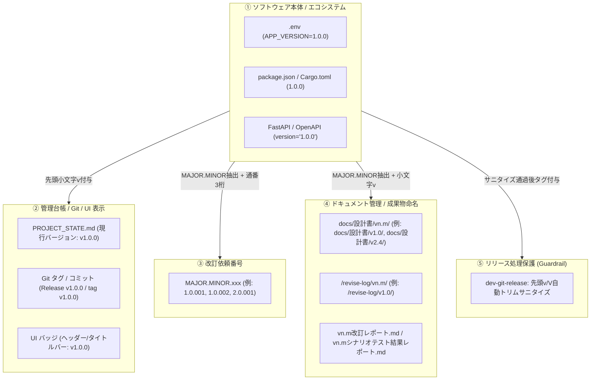
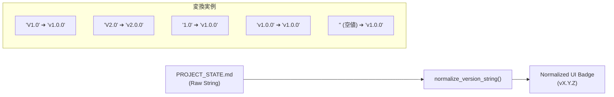

# V2.4 セマンティックバージョニング仕様書 (Semantic Versioning Specification V2.4)

文書バージョン: 1.0  
作成日: 2026-10-23  
対象バージョン: AI駆動システム開発ライフサイクルテンプレート V2.4.0  
ステータス: 正式設計書 (Approved Specification)  
関連文書:
- [V2.4改変計画書.md](./V2.4改変計画書.md)
- [20261022_セマンティックバージョニング乖離分析および統一整理検討報告書.md](../../検討課題/V2.4/20261022_セマンティックバージョニング乖離分析および統一整理検討報告書.md)
- [AI駆動システム開発フェーズ定義書V2.4.md](./AI駆動システム開発フェーズ定義書V2.4.md)
- [エージェント設計書V2.4.md](./エージェント設計書V2.4.md)
- [状態管理機構設計書V2.4.md](./状態管理機構設計書V2.4.md)
- [レビューシステム設計書V2.4.md](./レビューシステム設計書V2.4.md)
- [ProfileD詳細設計書.md](./ProfileD詳細設計書.md)
- [システム改訂ルール.md](../../../.agents/plugins/system-dev-pipeline/templates/システム改訂ルール.md)

---

## 1. はじめに

### 1.1 背景と課題
AI駆動システム開発テンプレート（`system-dev-pipeline`）は、V2.0〜V2.3 を通じて自律開発・監査・知見合流の仕組みを高度に確立してきた。しかし、実稼働プロジェクト（`bicycle-maintenance`, `gps-overlay`, `garden-log`, `movie-log`, `system-dev-dashboard` 等）の運用および LIDM（開発統合管理ダッシュボード）検証において、バージョン表記に以下の深刻な二重構造と表記揺れが観測された：

1. **表記揺れの混在**:
   - `bicycle-maintenance` や `gps-overlay`: **`v2.0.0`** や **`v1.0.0`**（SemVer 3桁）
   - `garden-log` や `movie-log`: **`V1.0`** や **`V2.0`**（2桁・大文字 `V`）
2. **エコシステムとドキュメント運用の断絶**:
   - パッケージマネージャー（npm, Cargo, pip等）やGitタグは業界標準として SemVer 3桁（`1.0.0`, `v1.0.0`）を要求する。
   - 一方で、旧パイプライン規約（`AGENTS.md` 第10項、`システム改訂ルール.md`）ではドキュメント管理フォルダや改訂依頼番号を `Vn.m`（2桁）と規定していたため、エージェントがプロジェクト台帳（`PROJECT_STATE.md`）や `.env` を 2桁に書き戻してしまう構造的誘因が存在した。
3. **二重プレフィックスのリスク**:
   - `skills/dev-git-release` が環境変数の先頭に機械的に `v` を付与して Git タグを生成していたため、`.env` に `APP_VERSION=V2.0` と記述されていた場合に **`vV2.0`** という不正な Git タグが生成される脆弱性を抱えていた。

### 1.2 目的と位置づけ
本文書は、[V2.4改変計画書.md](./V2.4改変計画書.md) における「Pillar 2: セマンティックバージョニング（SemVer 2.0.0）への完全準拠と表記揺れの解消」および [20261022_セマンティックバージョニング乖離分析および統一整理検討報告書.md](../../検討課題/V2.4/20261022_セマンティックバージョニング乖離分析および統一整理検討報告書.md) の提言に基づき、**システムソフトウェア、管理台帳、Gitタグ、改訂依頼番号、ドキュメント管理フォルダの全領域における統一バージョニング仕様を策定・規定すること**を目的とする。

---

## 2. 公式セマンティックバージョニング (SemVer 2.0.0) 基準原則

本パイプラインは、[Semantic Versioning 2.0.0](https://semver.org/lang/ja/) の基本原則を厳格に採用する。

### 2.1 基本構造
バージョン番号は **`MAJOR.MINOR.PATCH`** の形式をとる。

$$\text{Version} = \text{MAJOR} . \text{MINOR} . \text{PATCH}$$

- **MAJOR (メジャー)**: 後方互換性のない破壊的変更が行われた場合にインクリメント。
- **MINOR (マイナー)**: 後方互換性のある機能追加・仕様拡張が行われた場合にインクリメント。
- **PATCH (パッチ)**: 後方互換性のあるバグ修正・小規模改善が行われた場合にインクリメント。

### 2.2 数値の制約
- 各要素（MAJOR, MINOR, PATCH）は非負の整数（0以上の整数）でなければならない。
- 先頭に余分なゼロを配置してはならない（例: `1.0.0` は正常、`1.01.00` は不正）。
- プレリリース識別子（`-alpha.1`, `-beta.2` 等）やビルドメタデータ（`+build.20261023`）は、必要に応じて PATCH の後方にハイフンまたはプラス記号で付与可能とする。

### 2.3 プレフィックスの厳格な分離
- **ソフトウェア定義本体**: バージョン番号そのものには **プレフィックス（`v` や `V`）を一切含めない**（例: `1.0.0`）。
- **Git タグ / UI 表示**: 人間およびリビジョン管理ツールの視認性向上のため、**小文字 `v` をプレフィックスとして付与**する（例: `v1.0.0`）。大文字 `V` は全面廃止とする。

---

## 3. V2.4 バージョニング体系マッピング (5大領域)

本パイプラインでは、「コードエコシステムの厳格性」と「ドキュメント・改訂運用の簡潔性」を高度に両立させるため、以下の 5 大領域に整理・マッピングする。



### 3.1 領域①: ソフトウェア本体・エコシステム (`MAJOR.MINOR.PATCH`)
- **フォーマット**: **`MAJOR.MINOR.PATCH`**（数値3桁、先頭 `v` なし）
- **対象ファイル**:
  - `.env`: `APP_VERSION=1.0.0`
  - `frontend/package.json`: `"version": "1.0.0"`
  - `src-tauri/Cargo.toml` / `backend/Cargo.toml`: `version = "1.0.0"`
  - `backend/app/main.py`: `app = FastAPI(title="...", version="1.0.0")`
  - `pyproject.toml`: `version = "1.0.0"`
- **規約**:
  - 先頭に `v` や `V` を記述してはならない。
  - 数値3桁を厳守し、2桁（`1.0`）に丸めてはならない。

### 3.2 領域②: 管理台帳・Git・UI表示 (`vMAJOR.MINOR.PATCH`)
- **フォーマット**: **`vMAJOR.MINOR.PATCH`**（小文字 `v` ＋ 数値3桁）
- **対象領域**:
  - `PROJECT_STATE.md`: `- **現行バージョン**: v1.0.0`
  - Git コミットメッセージ: `Release v1.0.0`
  - Git タグ: `git tag -a v1.0.0 -m "Release v1.0.0"`
  - UI バッジ（ヘッダー、デスクトップアプリタイトルバー、設定画面等）: `v1.0.0`
- **規約**:
  - 必ず小文字の `v` を使用し、大文字 `V`（`V1.0.0`）を使用してはならない。
  - パッチバージョンが `0` であっても省略せず、常に 3 桁（`v1.0.0`）で表記する。

### 3.3 領域③: 改訂依頼番号 (`MAJOR.MINOR.xxx`)
- **フォーマット**: **`MAJOR.MINOR.xxx`**（例: `1.0.001`, `1.0.002`, `2.0.001`）
- **採番ルール**:
  - `MAJOR.MINOR`: 対象システムのメジャー・マイナーバージョン系列。
  - `xxx`: 当該系列内における通し番号（3桁ゼロ埋め連番）。
- **設計根拠**:
  - システムが SemVer 3桁（`1.0.0`）だからといって改訂番号を `1.0.0.001` と4階層に拡張すると、識別子として過度に冗長となり視認性・口頭伝達性が低下する。
  - 一方で、パッチ修正もメジャー・マイナーのリリースライン（`1.0` 系）配下の改訂作業として位置づけられるため、`MAJOR.MINOR.xxx` 形式とすることで、整然としたソート性とファイルパスの簡潔性を両立する。

### 3.4 領域④: ドキュメント管理・ログ・レポート命名 (`vn.m`)
- **フォーマット**: **`vn.m`**（小文字 `v` ＋ メジャー.マイナー 2桁）
- **対象パス・ファイル**:
  - 設計書アーカイブディレクトリ: `docs/設計書/v1.0/`, `docs/設計書/v2.0/`, `docs/設計書/v2.4/`
  - 改訂作業ログディレクトリ: `/revise-log/v1.0/`, `/revise-log/v2.0/`
  - 改訂作業ログファイル: `/revise-log/v1.0/v1.0_revise-review_001.md`
  - シナリオテストレポート: `docs/plans/scenario-test/v1.0シナリオテスト結果レポート.md`
  - 改訂完了レポート: `docs/v1.0改訂レポート.md`
- **規約**:
  - 従来の `V1.0`, `V2.0`（大文字 `V`）を全面廃止し、すべて小文字 **`v`** に統一する。
  - ドキュメント管理単位は、パッチ単位で乱立させずメジャー・マイナー単位で集約・保持する。

### 3.5 領域⑤: リリース処理サニタイズ防御（二重プレフィックス防止ガード）
- **対象スキル**: `skills/dev-git-release/SKILL.md`
- **防御メカニズム**:
  環境変数 `.env` に開発者の誤認や手動入力ミスで `APP_VERSION=V2.0` や `APP_VERSION=v1.0.0` が混入していた場合でも、リリース処理時に先頭の `v` / `V` を正規表現で完全に剥離（サニタイズ）してから、安全に `v` を付与してコミットおよびタグ付けを行う。
- **実装コマンド**:
  ```bash
  RAW_VERSION=$(grep -E '^(APP_)?VERSION=' .env | cut -d '=' -f2 | tr -d '"' | tr -d "'")
  # 先頭の連続する 'v' または 'V' をすべて除去
  CLEAN_VERSION=$(echo "$RAW_VERSION" | sed -E 's/^[vV]+//')
  
  # 欠損時フォールバック
  if [ -z "$CLEAN_VERSION" ]; then
      CLEAN_VERSION="1.0.0"
  fi
  
  RELEASE_TAG="v${CLEAN_VERSION}"
  git commit -m "Release ${RELEASE_TAG}"
  git tag -a "${RELEASE_TAG}" -m "Release ${RELEASE_TAG}"
  ```
- **効果**:
  `vV2.0` や `vv1.0.0` のような不正プレフィックスの混入を機械的・決定論的に 100% 遮断する。

---

## 4. ダッシュボード (LIDM) 正規化パーサー仕様 (過渡期吸収)

過去に旧テンプレート（V2.0〜V2.3）で作成された既存プロジェクト（`garden-log` の `V1.0`、`movie-log` の `V2.0` 等）の元ファイルを破壊・強制書き換えすることなく、LIDM ダッシュボード上で SemVer 準拠の統一表示を行うため、LIDM のコアパーサーに正規化フィルタを配備する。

### 4.1 正規化アーキテクチャ


### 4.2 Rust 実装仕様 (`src-tauri/src/core/parser.rs`)
```rust
/// PROJECT_STATE.md 等から抽出した生バージョン文字列を
/// 公式 SemVer 準拠の表示形式（vX.Y.Z）へ正規化する
pub fn normalize_version_string(raw: &str) -> String {
    let trimmed = raw.trim();
    if trimmed.is_empty() {
        return "v1.0.0".to_string();
    }

    // 1. 先頭の連続する 'v' または 'V' を除去して純粋な数値部分を抽出
    let mut clean = trimmed;
    while clean.starts_with('v') || clean.starts_with('V') {
        clean = &clean[1..];
    }
    clean = clean.trim();

    if clean.is_empty() {
        return "v1.0.0".to_string();
    }

    // 2. ドット分割による桁数判定
    let parts: Vec<&str> = clean.split('.').collect();
    match parts.len() {
        1 => {
            // 例: "1" -> "v1.0.0"
            format!("v{}.0.0", parts[0])
        }
        2 => {
            // 例: "1.0" -> "v1.0.0", "2.1" -> "v2.1.0"
            format!("v{}.{}.0", parts[0], parts[1])
        }
        _ => {
            // 例: "1.0.0" -> "v1.0.0", "2.4.1" -> "v2.4.1"
            format!("v{}", clean)
        }
    }
}

#[cfg(test)]
mod tests {
    use super::*;

    #[test]
    fn test_normalize_version_string() {
        assert_eq!(normalize_version_string("V1.0"), "v1.0.0");
        assert_eq!(normalize_version_string("v2.0"), "v2.0.0");
        assert_eq!(normalize_version_string("1.0"), "v1.0.0");
        assert_eq!(normalize_version_string("v1.0.0"), "v1.0.0");
        assert_eq!(normalize_version_string("1.0.0"), "v1.0.0");
        assert_eq!(normalize_version_string("vV2.0"), "v2.0.0");
        assert_eq!(normalize_version_string(""), "v1.0.0");
        assert_eq!(normalize_version_string("   "), "v1.0.0");
    }
}
```

---

## 5. 各エージェントおよびスキルの責務・バリデーション規約

V2.4 において、各エージェントは以下のバージョニング責務を厳格に履行する。

### 5.1 👑 プロジェクトコンダクター (`conductor`)
1. **Single Writer 原則の徹底**:
   `PROJECT_STATE.md` のバージョン情報更新権限を排他的に保持し、`- **現行バージョン**: vX.Y.Z`（小文字 `v` ＋ 3桁）を常に維持する。
2. **リリース操作の実行**:
   `dev-git-release` を実行し、サニタイズ処理を経由してタグ（`vX.Y.Z`）を打鍵する。
3. **改訂番号の厳格採番**:
   改訂指示および `/revise-log/` の作成において、`MAJOR.MINOR.xxx` 形式を厳守する。

### 5.2 💻 バックエンドエンジニア (`backend-engineer`)
1. **エコシステム数値厳格性**:
   `.env` の `APP_VERSION`、FastAPI の `version`、Cargo.toml の `version` 等を、プレフィックスなしの純粋数値3桁（`X.Y.Z`）で定義・保守する。
2. **直書きの禁止**:
   コード内にバージョン番号を生文字列としてハードコードせず、`.env` または設定クラス（`settings.py` / `config.rs`）から読み出す。

### 5.3 🎨 UI/UXデザイナー (`ui-designer`)
1. **UI バッジ規格準拠**:
   画面ヘッダー、タイトルバー、アバウトダイアログ等のシステムバージョン表示は、一律 `vX.Y.Z` 形式とする。
2. **型定義同期の活用**:
   バージョン文字列は OpenAPI Codegen や Tauri IPC 定義を通じてバックエンドと自動同期し、フロントエンド側での手動ハードコードを排除する。

### 5.4 🛡️ 品質監査スペシャリスト (`qa-engineer`)
以下の 3 大レビューゲートにおいて、バージョン整合性を機械的・意味的に監査する。

1. **基本設計レビュー (`dev-review-arch`) [PHASE 3 完了ゲート]**:
   - 画面仕様書、API仕様書、テーブル定義書の改定履歴およびバージョン表記が `vX.Y.Z` / `MAJOR.MINOR.xxx` 規約に準拠しているか検証。
2. **コード品質レビュー (`dev-review-code`) [PHASE 5.5 完了ゲート]**:
   - `.env`、`package.json`、`Cargo.toml`、`main.py` 内のバージョン値にプレフィックス（`v` や `V`）が混入していないかを静的解析。
   - 大文字 `V` 表記の残存を指摘し、Unified Diff で是正。
3. **システム総合レビュー (`dev-review-system`) [PHASE 7 リリース直前ゲート]**:
   - Git リリースコマンドのサニタイズ保護が有効であること、リリース予定タグが `vX.Y.Z` であることを検証。

---

## 6. テンプレート資産および既存プロジェクト移行ガイドライン

### 6.1 パイプラインテンプレート資産の同期点
次期 V2.4 テンプレート（`system-dev-pipeline`）において、以下のファイル群が本仕様書に準拠して改訂される。

| 対象ファイル | 主な改訂内容 |
| :--- | :--- |
| **`templates/PROJECT_STATE.md.template`** | `- **現行バージョン**: v{{APP_VERSION}}`（デフォルト `v1.0.0`）に統一。 |
| **`templates/.env.template`** | `APP_VERSION=1.0.0`（数値3桁）を明記。 |
| **`templates/システム改訂ルール.md`** | §1 バージョン定義、§2.3.2 採番（`MAJOR.MINOR.xxx`）、フォルダ命名（`vn.m`）を全面改訂。 |
| **`templates/画面仕様書.md`** | システムバージョンバッジ例示を `v1.0` から `v1.0.0` へ更新。 |
| **`rules/AGENTS.md` (第10項)** | バージョン別フォルダ分離を `docs/設計書/v1.0/`, `docs/設計書/v2.0/`（小文字）へ改訂。 |
| **`skills/dev-git-release/SKILL.md`** | 先頭 `v` / `V` サニタイズ処理を追加。 |

### 6.2 新規プロジェクト初期化時 (PHASE 1) の標準挙動
1. `dev-phase1-setup` 実行時に生成される `.env` には `APP_VERSION=1.0.0` が設定される。
2. `PROJECT_STATE.md` には `- **現行バージョン**: v1.0.0` が展開される。
3. `package.json` および `Cargo.toml` には `"1.0.0"` が設定される。
4. ドキュメントフォルダは `docs/設計書/Current/` のみが生成され、初期状態での過去バージョンフォルダの静的配置は禁止される（規約第10項）。

### 6.3 既存プロジェクトの改訂時 (PHASE 8 / システム改訂) における段階的移行
既存の 2桁運用プロジェクト（`garden-log` 等）が次期改訂フェーズに入る際は、以下の手順で段階的・安全に SemVer 3桁へ移行する：

1. **改訂計画時**:
   改訂依頼番号を `2.0.001` 等の `MAJOR.MINOR.xxx` 形式で起票。
2. **環境変数更新**:
   `.env` の `APP_VERSION` を `2.0` ➔ `2.0.0` へ更新。
3. **管理台帳更新**:
   Conductor が `PROJECT_STATE.md` の現行バージョンを `v2.0.0` へ更新。
4. **パッケージ定義更新**:
   `package.json` や `Cargo.toml` のバージョンを `2.0.0` へ同期。
5. **Git リリース**:
   `dev-git-release` を実行し、タグ `v2.0.0` を打鍵。

---

## 7. まとめと完了基準

本文書により、AI駆動システム開発パイプラインにおけるセマンティックバージョニングの二重構造は完全に解消され、エコシステムの機械的バリデーションと人間・エージェントの運用性が高度に調和した。

### 完了基準 (Definition of Done)
1. **仕様の完全性**:
   ソフトウェア（3桁数値）、台帳・Git・UI（`v3桁`）、改訂番号（`MAJOR.MINOR.xxx`）、ドキュメント・ログ（`vn.m`）の棲み分けが明確に定義されていること。
2. **ガードレールの配備**:
   `dev-git-release` における二重プレフィックス防止サニタイズ処理が明記されていること。
3. **過渡期互換性の確保**:
   LIDM における過去プロジェクトの安全な正規化パーサー仕様が提供されていること。
4. **相互リンクの健全性**:
   関連設計書および検討報告書へのリンクがすべて環境非依存の相対パスで記述されていること。
