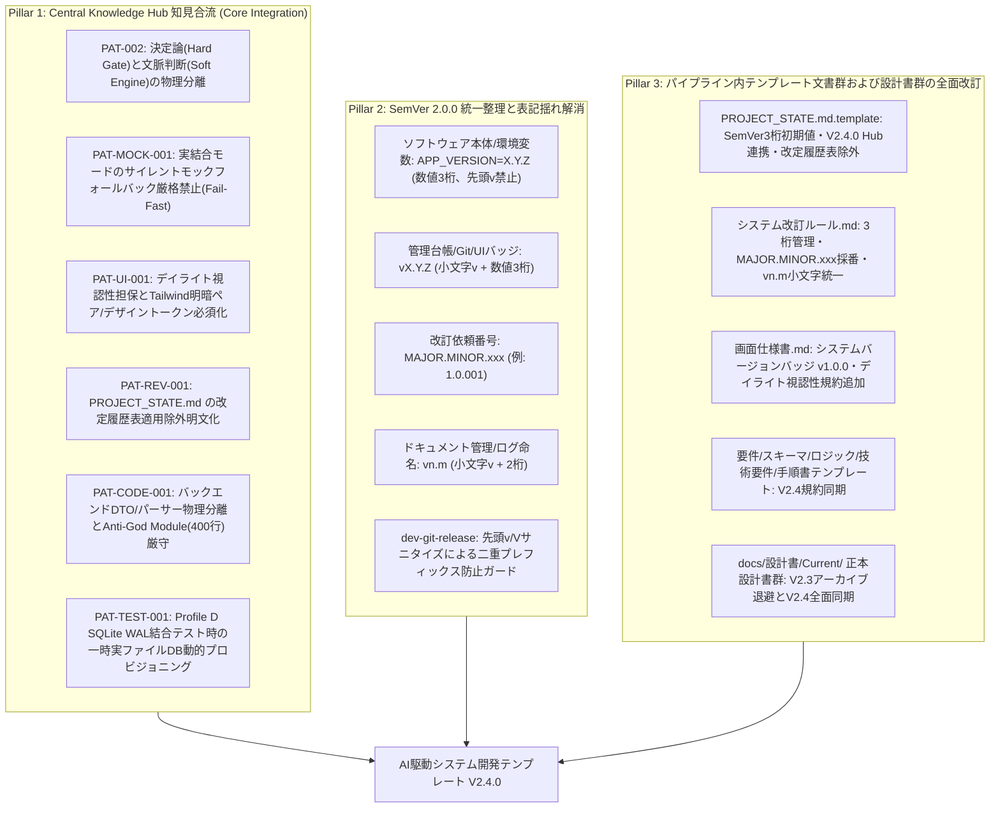
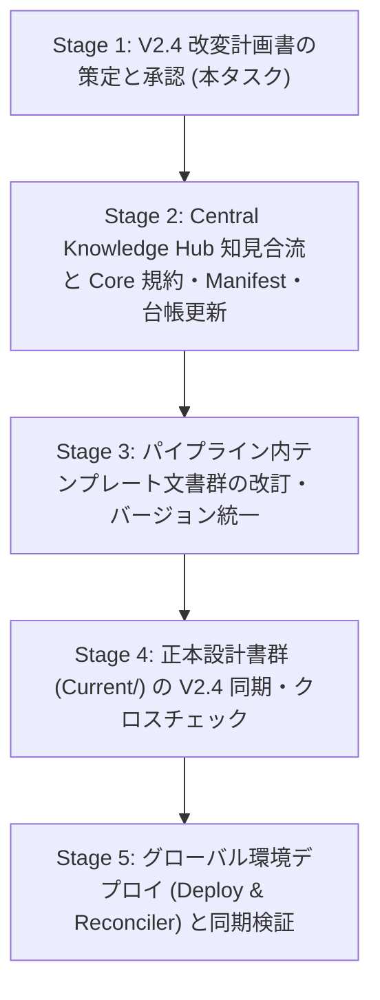

# V2.4 改変計画書 (AI駆動システム開発テンプレート V2.4)

文書バージョン: 1.0  
作成日: 2026-10-22  
対象バージョン: AI駆動システム開発ライフサイクルテンプレート V2.4.0  
ステータス: 正式計画書 (Approved Plan)  
関連文書:
- [V2.4セマンティックバージョニング仕様書.md](./V2.4セマンティックバージョニング仕様書.md)
- [AI駆動システム開発フェーズ定義書V2.4.md](./AI駆動システム開発フェーズ定義書V2.4.md)
- [AI駆動システム開発手順書V2.4.md](./AI駆動システム開発手順書V2.4.md)
- [エージェント設計書V2.4.md](./エージェント設計書V2.4.md)
- [状態管理機構設計書V2.4.md](./状態管理機構設計書V2.4.md)
- [レビューシステム設計書V2.4.md](./レビューシステム設計書V2.4.md)
- [ProfileD詳細設計書.md](./ProfileD詳細設計書.md)
- [20261022_セマンティックバージョニング乖離分析および統一整理検討報告書.md](../../検討課題/V2.4/20261022_セマンティックバージョニング乖離分析および統一整理検討報告書.md)

---

## 1. はじめに

### 1.1 背景と位置づけ
AI駆動システム開発テンプレートは、V2.0 における 5大エージェント協調モデルと Single Writer 原則、V2.1 における 3大レビューシステムと永続 Wiki ナレッジ自己進化ループ、V2.2 における 2層構造システムプロファイル体系（定常コア8項目＋Profile A〜E）および Shift-Left（スケルトン事前組込・モック制御・グランドデザイン）、そして V2.3 における「マルチプロジェクト・マルチ環境対応の Central Knowledge Hub・3段階意味的整合性監査・Immutable Core / Local Overlay」を経て、自律開発基盤として高度な進化を遂げた。

実稼働プロジェクト（`system-dev-dashboard`、`obsidian` 等）での運用と LIDM（開発統合管理ダッシュボード）検証を通じて、以下の **3つの主要な改訂要件** が明確となった：

1. **Central Knowledge Hub 蓄積知見の公式本流統合 (Core Integration)**:
   - `~/.gemini/knowledge-hub/active_claims/` に蓄積され、Local Overlay で先行運用されてきた 6 件の高品質な汎用知見原票（Fail-Fastモック制御、デイライトUI視認性、DTO/パーサー物理分離、Tauri実ファイルDB動的プロビジョニング、決定論/文脈判断の2系統分離、改定履歴表適用除外）を、公式パイプライン本体（Immutable Core）へ本流統合し、Overlay バジェット（上限80行）を解放する。
2. **セマンティックバージョニング（SemVer 2.0.0）への完全準拠と二重基準の解消**:
   - `docs/検討課題/V2.4/20261022_セマンティックバージョニング乖離分析および統一整理検討報告書.md` で分析された通り、コードエコシステム（SemVer 3桁 `1.0.0`）とドキュメント・改訂規則（`Vn.m` 2桁）の二重構造を解消し、「システム・Git は厳格 SemVer（`vX.Y.Z`）、改訂通番は `MAJOR.MINOR.xxx`、ドキュメント・ログは小文字 `vn.m`」に統一し、Git タグ二重プレフィックス脆弱性（`vV2.0`）を根絶する。
3. **上記改変に伴うパイプライン内テンプレート文書群および設計書群の全面改訂**:
   - プロジェクト初期化（PHASE 1）で展開される `templates/` 配下の各種文書（`PROJECT_STATE.md.template`, `システム改訂ルール.md`, `画面仕様書.md`, `フェーズ定義書`, `技術要件定義書`, `テーブルスキーマ定義書`, `ビジネスロジック仕様書`, `本番適用作業手順書` 等）および `docs/設計書/Current/` の設計書群に、V2.4 仕様（SemVer 3桁・小文字小フォルダ・知見原則・最新プロファイル）を完全同期・反映する。

### 1.2 V2.4 改変の目的
本文書は、上記3大要請に基づき、AI駆動システム開発ライフサイクルテンプレートを **「V2.4.0」** へ正式アップグレードするための基本方針、詳細仕様マッピング、テンプレート改訂計画、および移行ロードマップを策定・規定するものである。

---

## 2. V2.4 改変基本方針（3大ピラー）



---

## 3. Pillar 1: 本流統合する 6 大知見の詳細仕様

| Pattern ID | 原票 Claim ID | カテゴリ | 統合種別 | 反映先ファイル | 蒸留・統合仕様 |
| :--- | :--- | :---: | :---: | :--- | :--- |
| **`PAT-002`** | `CLAIM-20261018-obsidian-PAT-002` | `SYS` | `SUBSUMPTION` | ・`rules/AGENTS.md` (§6.3)<br>・`wiki-maintainer`<br>・`wiki-proposer` | **2系統物理分離原則**: 構文不正・絶対パス混入等の決定論的バグ（系統A）はプロンプトに書かず Linter やテストコード（Executable Specs）へ直接吸収。意図や設計判断（系統B）は30日以内 $N \ge 3$ 回反復観測時のみ Wiki 起票する。 |
| **`PAT-MOCK-001`** | `CLAIM-20261020-system-dev-dashboard-PAT-MOCK-001` | `ARCH` | `SUBSUMPTION` | ・`rules/AGENTS.md` (§4.1 定常コア7)<br>・`dev-phase5-walkthrough`<br>・`dev-review-system` | **サイレントモックフォールバック厳格禁止 (Fail-Fast原則)**: 実結合モード（`VITE_ENABLE_MOCK=false`）において、APIやIPCのエラー発生時にモックデータへサイレントフォールバックすることを禁止。エラー時は即座に例外をスローしてUI/ログに顕在化させる。 |
| **`PAT-UI-001`** | `CLAIM-20261020-system-dev-dashboard-PAT-UI-001` | `UI` | `SUBSUMPTION` | ・`rules/AGENTS.md` (§4.1 定常コア8)<br>・`templates/画面仕様書.md`<br>・`ui-designer`<br>・`dev-review-code` | **デイライト視認性担保と明暗ペア指定必須化**: ダーク前提の淡色・透過カラー（`text-blue-200`, `bg-blue-950/40` 等）の単独直書きを禁止。セマンティックデザイントークンまたはTailwindの明暗ペア（`bg-blue-50 text-blue-800 dark:bg-blue-950/40 dark:text-blue-300`）を必須指定とする。 |
| **`PAT-REV-001`** | `CLAIM-20261022-021248` | `SYS` | `SCOPED_BRANCH` | ・`templates/システム改訂ルール.md` (§2.3.3)<br>・`agents/conductor.md` (§1.5) | **PROJECT_STATE.md の改定履歴表適用除外**: 現在状態のインジケータである `PROJECT_STATE.md` をシステム改訂ルール §2.3.3（全ドキュメント共通の改定履歴表）の対象外とする。改訂ターンごとの履歴追記は `/revise-log/` および改訂レポートで一元管理する。 |
| **`PAT-CODE-001`** | `CLAIM-20261022-system-dev-dashboard-PAT-CODE-001` | `ARCH` | `SUBSUMPTION` | ・`rules/AGENTS.md` (§4.1 定常コア1)<br>・`agents/backend-engineer.md`<br>・`skills/dev-review-code` | **バックエンド DTO・パーサー分離と Anti-God Module (400行制限)**: DTO構造体およびパーサーを独立モジュール（`schemas/`, `*_dto.rs` 等）へ物理分離し、Controller層はリクエスト受付とオーケストレーションに専念させ、直書きモックを排除してDBアクセス層やヘルパーへ委譲する。 |
| **`PAT-TEST-001`** | `CLAIM-20261022-system-dev-dashboard-PAT-TEST-001` | `TEST` | `SCOPED_BRANCH` | ・`rules/AGENTS.md` (§4.2 Profile D)<br>・`skills/dev-phase6-testing`<br>・`docs/設計書/Current/ProfileD詳細設計書.md` | **Profile D 結合テスト時の一時実ファイルDB動的プロビジョニング**: SQLite WAL 結合テストではインメモリDBではなく一時ディレクトリ配下に UUID 付き実ファイルDBを動的プロビジョニングし、マイグレーションとWAL並行性を本番同等に検証後アトミッククリーンアップする。 |

---

## 4. Pillar 2: セマンティックバージョニング (SemVer 2.0.0) 統一標準仕様

| 区分 | 適用対象ファイル・領域 | フォーマット規約 | 具体例 | 制定動機と効果 |
| :--- | :--- | :--- | :--- | :--- |
| **① ソフトウェア本体** | `.env`<br>`package.json`<br>`Cargo.toml`<br>`main.py` | **`MAJOR.MINOR.PATCH`**<br>(数値3桁、先頭 `v` なし) | `APP_VERSION=1.0.0`<br>`"version": "1.0.0"`<br>`version = "1.0.0"` | 言語エコシステム・パッケージマネージャーのバリデーション準拠。 |
| **② 管理台帳・Git・UI** | `PROJECT_STATE.md`<br>Git コミット / タグ<br>UI バッジ（ヘッダー等） | **`vMAJOR.MINOR.PATCH`**<br>(小文字 `v` ＋ 数値3桁) | `- **現行バージョン**: v1.0.0`<br>`Release v1.0.0`<br>`git tag v1.0.0`<br>バッジ: `v1.0.0` | 業界標準 (De facto Standard) の Git タグ運用および UI 表示の統一。 |
| **③ 改訂依頼番号** | 改訂依頼・管理票<br>`/revise-log/` 文書 | **`MAJOR.MINOR.xxx`**<br>(通番3桁連番) | `1.0.001`, `1.0.002`<br>`2.0.001` | パッチ改訂でも番号肥大化（`1.0.0.001`）を防ぎつつ整然としたソート性を確保。 |
| **④ ドキュメント管理** | `docs/設計書/vn.m/`<br>`/revise-log/vn.m/`<br>改訂レポート/テストレポート | **`vn.m`**<br>(小文字 `v` ＋ 2桁) | `docs/設計書/v2.4/`<br>`/revise-log/v1.0/`<br>`docs/v1.0改訂レポート.md` | 大文字 `V` を廃止し小文字 `v` に統一。ドキュメント管理の簡便性を両立。 |
| **⑤ リリース処理保護** | `skills/dev-git-release` | サニタイズ処理 | `CLEAN=$(echo $RAW \| sed -E 's/^[vV]+//')`<br>`git tag "v${CLEAN}"` | `.env` に `V2.0` や `v1.0.0` が記載されていても二重プレフィックス（`vV2.0`）を完全防御。 |

---

## 5. Pillar 3: パイプライン内テンプレート文書群および設計書群の改訂仕様

### 5.1 テンプレート文書改訂マトリクス (`templates/` 配下)

| テンプレートファイル名 | 改訂区分 | 主な改訂内容 |
| :--- | :---: | :--- |
| **`PROJECT_STATE.md.template`** | 改訂 | ・現行バージョン初期値を SemVer 3桁 `v{{APP_VERSION}}`（`v1.0.0`）に統一<br>・Knowledge Hub 連携状態を `v2.4.0` へ更新<br>・改定履歴表の適用除外（インジケータ専任化） |
| **`システム改訂ルール.md`** | 改訂 | ・§1: `APP_VERSION` を SemVer 3桁（`X.Y.Z`）管理へ明記<br>・§2.3.2: 改訂依頼番号を `MAJOR.MINOR.xxx` へ統一、フォルダ名を `/revise-log/vn.m/`（小文字）へ変更<br>・§2.3.3: `PROJECT_STATE.md` の改定履歴表適用除外を明文化<br>・§2.4, §2.5: `vn.mシナリオテスト結果レポート.md`, `vn.m改訂レポート.md` の小文字統一 |
| **`画面仕様書.md`** | 改訂 | ・§5.2: システムバージョンバッジ例示を `v1.0` から `v1.0.0` へ改訂<br>・§5.4: カラーパレット＆デイライトモード視認性規約（Tailwind明暗ペアまたはセマンティックデザイントークン必須化、淡色単独直書き禁止）を追加 |
| **`AI駆動システム開発フェーズ定義書V2.2.md`** | 改編・改名 | ・ファイル名を `AI駆動システム開発フェーズ定義書V2.4.md` へ更新<br>・PHASE 5 モック透過切替検証に Fail-Fast 原則を明記<br>・PHASE 5.5 コード品質レビューに DTO・パーサー分離およびデイライト視認性検査を追加<br>・PHASE 6 に Profile D 実ファイルDB動的プロビジョニングを追加<br>・PHASE 8 に Central Knowledge Hub V2.4 連携手順を同期 |
| **`AI駆動システム開発手順書V2.2.md`** | 改編・改名 | ・ファイル名を `AI駆動システム開発手順書V2.4.md` へ更新<br>・2層プロファイル体系、新・複合検証ゲート、SemVer統一ルールを反映 |
| **`技術要件定義書.md`** | 点検・改訂 | ・定常コア8項目の最新規約（DTO・パーサー分離、Fail-Fastモック、デイライト視認性）を反映<br>・バージョン表記例を `v1.0.0` 形式へ統一 |
| **`テーブルスキーマ定義書.md`** | 点検・改訂 | ・Alembic前提、Aware UTC、`user_id` 規約の再徹底<br>・改定履歴表の SemVer 準拠フォーマット適用 |
| **`ビジネスロジック仕様書.md`** | 点検・改訂 | ・外部API二重キャッシュ仕様、内部監視エンドポイント仕様の整合性維持 |
| **`シナリオテスト計画書.md`** | 点検・改訂 | ・Profile D 実ファイルDB動的プロビジョニング手順の記載枠を追加<br>・モック有効/無効両モード検証要件を更新 |
| **`本番適用作業手順書.md`** | 点検・改訂 | ・本番モック排除二重防御（Fail-Fast含む）の監査手順を明記 |

### 5.2 正本設計書群（`docs/設計書/Current/`）の V2.4 化とライフサイクル管理
- **V2.3 設計書のアーカイブ退避**:
  - `docs/設計書/Current/` に存在していた V2.3 関連文書を `docs/設計書/V2.3/` 配下へ退避・保存完了。
- **Current/ 配下の V2.4 正本化**:
  - `V2.4改変計画書.md`（本作）を Current の基本計画正本として配備。
  - `ProfileD詳細設計書.md` に PAT-TEST-001, PAT-CODE-001, PAT-UI-001 を反映済み。
  - 残るフェーズ定義書・エージェント設計書等のバージョン名・規約記述を V2.4 に同期。

---

## 6. 改変対象資産全体一覧と物理マッピング

```text
.agents/plugins/system-dev-pipeline/ (Immutable Core 正本)
├── PIPELINE_MANIFEST.json                   [Version 2.4.0 / absorbed_patterns 6件登録済]
├── FEEDBACK_LEDGER.md                       [Lineage 6件追記済]
├── scripts/
│   └── pipeline-reconciler.sh               [Upgrade Reconciler / Hub自動退役]
├── rules/
│   ├── AGENTS.md                            [V2.4 規約正本: DTO分離・Fail-Fast・デイライト視認性]
│   └── CORE_INVARIANTS.md                   [コア不変原則 INV-01〜INV-10 堅持]
├── agents/
│   ├── backend-engineer.md                  [V2.4: DTO・パーサー分離、400行制限]
│   ├── conductor.md                         [V2.4: PROJECT_STATE改定履歴表適用除外、SemVer厳守]
│   ├── qa-engineer.md                       [V2.4: コードレビューDTO/デイライト視認性検査]
│   └── ui-designer.md                       [V2.4: デイライト視認性担保、Tailwind明暗ペア]
├── skills/
│   ├── dev-git-release/SKILL.md             [先頭v/Vサニタイズ処理・二重プレフィックス防止]
│   ├── dev-phase5-walkthrough/SKILL.md      [実結合時サイレントモックフォールバック禁止]
│   ├── dev-phase6-testing/SKILL.md          [Profile D 一時実ファイルDB動的プロビジョニング]
│   ├── dev-review-code/SKILL.md             [DTO分離・400行制限検査、デイライト視認性検査]
│   └── dev-review-system/SKILL.md           [本番モックOFF & Fail-Fast 監査]
└── templates/
    ├── PROJECT_STATE.md.template            [SemVer 3桁・Hub v2.4.0・改定履歴表除外]
    ├── システム改訂ルール.md                [SemVer 3桁管理・MAJOR.MINOR.xxx採番・vn.m小文字統一]
    ├── 画面仕様書.md                        [バージョンバッジ v1.0.0・デイライト視認性規約]
    ├── AI駆動システム開発フェーズ定義書V2.4.md [改編・更新]
    └── AI駆動システム開発手順書V2.4.md      [改編・更新]

docs/設計書/Current/ (開発・改訂正本)
├── V2.4改変計画書.md                        [本作: 正式計画書]
├── ProfileD詳細設計書.md                    [PAT-TEST-001, PAT-CODE-001 反映済]
└── (各設計書のV2.4同期)

rules/AGENTS.md (ワークスペースルート)        [第1〜10節同期 + 第11節同期規約維持]
```

---

## 7. 段階的実装ロードマップとタスクブレークダウン



### Stage 1: V2.4 改変計画書の策定と承認 【完了】
- [x] 3大改訂目的（知見合流・SemVer統一・テンプレート文書改訂）を網羅した `docs/設計書/Current/V2.4改変計画書.md` の策定と文書化。
- [x] 旧 Current 文書群の `docs/設計書/V2.3/` へのアーカイブ退避。

### Stage 2: Central Knowledge Hub 知見合流と Core 規約・Manifest・台帳更新 【完了】
- [x] 6件の知見原票（PAT-002, PAT-MOCK-001, PAT-UI-001, PAT-REV-001, PAT-CODE-001, PAT-TEST-001）の Core 規約（`rules/AGENTS.md`）への統合。
- [x] `PIPELINE_MANIFEST.json`（Version `2.4.0`、absorbed_patterns 6件登録）の更新。
- [x] `FEEDBACK_LEDGER.md` への因果・系譜（Lineage）追記。
- [x] エージェントプロンプト（`backend-engineer`, `conductor`, `qa-engineer`, `ui-designer`）の更新。
- [x] スキル定義（`dev-git-release`, `dev-phase5-walkthrough`, `dev-phase6-testing`, `dev-review-code`, `dev-review-system`）の更新。

### Stage 3: パイプライン内テンプレート文書群の改訂・バージョン統一 【完了】
- [x] `templates/PROJECT_STATE.md.template` の更新（SemVer 3桁、Hub v2.4.0、改定履歴表除外）。
- [x] `templates/システム改訂ルール.md` の更新（3桁管理、`MAJOR.MINOR.xxx` 採番、`vn.m` 小文字統一、除外明文化）。
- [x] `templates/画面仕様書.md` の更新（バッジ `v1.0.0`、デイライト視認性規約追加）。
- [x] `templates/AI駆動システム開発フェーズ定義書V2.4.md` への最新設計文書のリリース・同期。
- [x] `templates/AI駆動システム開発手順書V2.4.md` への最新設計文書のリリース・同期。
- [x] その他の設計文書テンプレート（要件定義書、テーブルスキーマ定義書、技術要件定義書、シナリオテスト計画書、本番適用作業手順書等）のフォーマット点検・改定履歴・SemVer同期。

### Stage 4: 正本設計書群 (Current/) の V2.4 同期・クロスチェック 【完了】
- [x] `docs/設計書/Current/ProfileD詳細設計書.md` の更新。
- [x] `docs/設計書/Current/V2.4セマンティックバージョニング仕様書.md` の策定。
- [x] `docs/設計書/Current/AI駆動システム開発手順書V2.4.md` の再編・策定。
- [x] `docs/設計書/Current/AI駆動システム開発フェーズ定義書V2.4.md` の再編・策定。
- [x] `docs/設計書/Current/エージェント設計書V2.4.md` の策定（DTO分離・デイライト視認性・SemVer3桁統合）。
- [x] `docs/設計書/Current/レビューシステム設計書V2.4.md` の策定（コード品質DTO/明暗ペア検査・システム総合Fail-Fast検査統合）。
- [x] `docs/設計書/Current/状態管理機構設計書V2.4.md` の策定（SemVer3桁統一・改定履歴表除外明文化）。
- [x] `docs/設計書/Current/` 配下の各設計書のバージョン名および内部参照リンクの V2.4 整合チェック・更新。

### Stage 5: グローバル環境デプロイ (Deploy & Reconciler) と同期検証 【完了・継続検証】
- [x] `sync_pipeline.sh --deploy` によるグローバル環境（`~/.gemini/config/plugins/system-dev-pipeline/`）へのデプロイ。
- [x] `pipeline-reconciler.sh --upgrade` による 6 件の原票の `archive/upstreamed/` への自動退役（`FAST_PATH_ID_MATCH`）。
- [x] `LOCAL_FEEDBACK_RULES.md` のクリーン再生成（5行、追加規約なし）とバジェット全解放。
- [x] `sync_pipeline.sh --status` の実行による `🎉 [SYNCED]` 判定の確認。

---

## 8. 完了基準 (Definition of Done)

1. **知見原票の完全退役と Overlay 解放**:
   - Central Knowledge Hub（`~/.gemini/knowledge-hub/active_claims/`）の未本流化原票が 0 件となり、すべて `archive/upstreamed/` へ正常退役していること。
   - `LOCAL_FEEDBACK_RULES.md` が純化され、Local Overlay の行数バジェットが完全に回復していること。
2. **SemVer 2.0.0 統一と二重プレフィックス防止の完全性**:
   - パイプライン内すべての規約・スキル・テンプレートにおいて、システムバージョンが 3桁（`X.Y.Z`）、Git/UI が `vX.Y.Z`、改訂通番が `MAJOR.MINOR.xxx`、ドキュメント・ログが `vn.m`（小文字）で一貫していること。
   - `dev-git-release` により `vV2.0` のような二重 `v` 付与が発生しないこと。
3. **テンプレート文書および設計書の完全整合**:
   - `templates/` 配下の全テンプレート文書および `docs/設計書/Current/` 配下の全設計書が V2.4 仕様に改訂され、V2.2 や旧仕様の残存が 0 件であること。
   - すべての文書内リンクが環境非依存の相対パスで記述され、リンク切れが 0 件であること。
4. **グローバル環境との完全一致保証**:
   - `sync_pipeline.sh --status` の結果が常に `🎉 判定結果: [SYNCED]` であり、ハッシュ値が完全一致していること。
