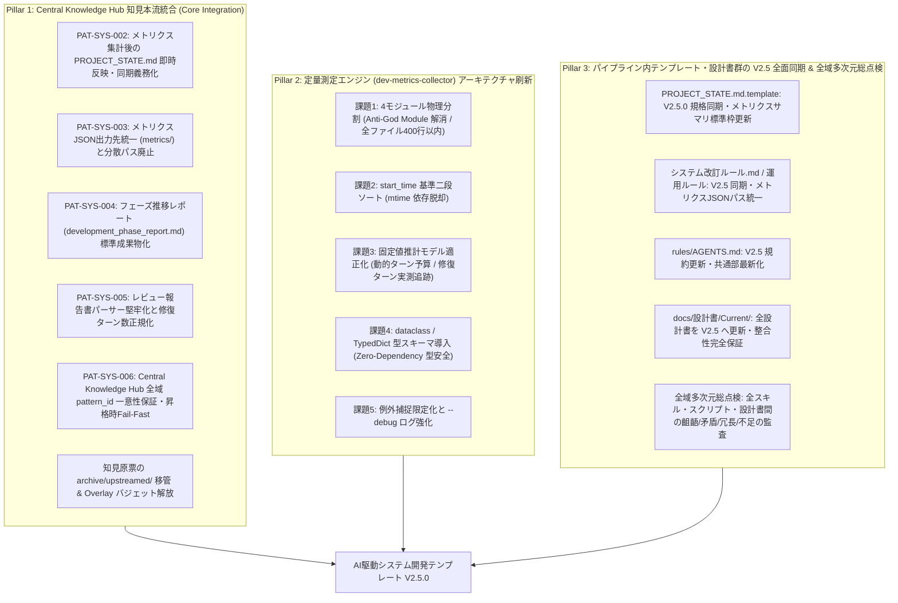
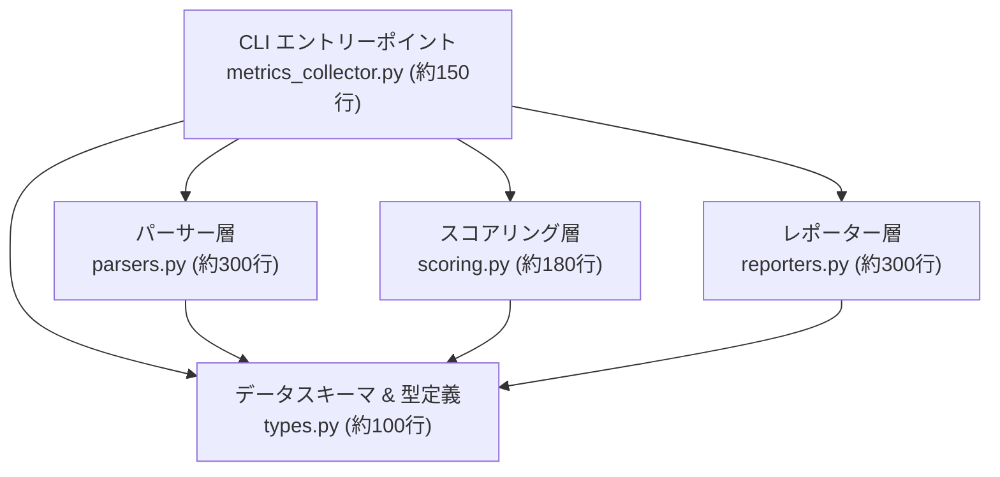

# V2.5 改変計画書 (AI駆動システム開発テンプレート V2.5)

- **文書バージョン**: 1.0  
- **作成日**: 2026-10-25  
- **対象バージョン**: AI駆動システム開発ライフサイクルテンプレート V2.5.0  
- **ステータス**: 改訂完了・リリース済 (Completed)  
- **関連文書**:
  - [20261024_metrics_collectorコードレビューおよび残余課題改善計画書.md](../../検討課題/v2.5/20261024_metrics_collectorコードレビューおよび残余課題改善計画書.md)
  - [20261025_パイプライン全コード総合レビューおよび残余課題改善計画書.md](../../検討課題/v2.5/20261025_パイプライン全コード総合レビューおよび残余課題改善計画書.md)
  - [V2.4改変計画書.md](../v2.4/V2.4改変計画書.md)
  - [AI駆動システム開発フェーズ定義書V2.4.md](../v2.4/AI駆動システム開発フェーズ定義書V2.4.md)
  - [AI駆動システム開発手順書V2.4.md](../v2.4/AI駆動システム開発手順書V2.4.md)
  - [定量測定・フィードバック設計書V2.4.md](../v2.4/定量測定・フィードバック設計書V2.4.md)

---

## 1. はじめに

### 1.1 背景と位置づけ
AI駆動システム開発テンプレートは、V2.0 における 5大エージェント協調モデル、V2.1 における 3大レビューシステムと永続 Wiki ナレッジ自己進化ループ、V2.2 における 2層構造システムプロファイル体系（定常コア8項目＋Profile A〜E）、V2.3 における Central Knowledge Hub・Immutable Core / Local Overlay 二重運用体制、そして V2.4 における SemVer 2.0.0 統一整理を経て、高信頼・自律型の開発基盤として確立された。

実稼働プロジェクト（`movielog`、`system-dev-dashboard` 等）における開発・保守フェーズの推進を通じて、以下の **2つの重大な進化要件** が明確となった：

1. **Central Knowledge Hub 蓄積知見（PAT-SYS-002〜006）の公式本流統合 (Core Integration)**:
   - `~/.gemini/knowledge-hub/active_claims/` に蓄積され、`LOCAL_FEEDBACK_RULES.md`（Local Overlay）で先行運用されてきた 5 件の知見原票（メトリクス即時反映、JSON出力パス統一、フェーズ推移レポート生成、レビューパーサー正規表現堅牢化、グローバル pattern_id 一意性保証）を公式パイプライン本体（Immutable Core）へ本流統合し、Local Overlay の容量バジェット（上限80行）を解放する。
2. **定量測定エンジン (`dev-metrics-collector`) および基盤・スケルトンコードのアーキテクチャ刷新**:
   - `metrics_collector.py` は機能追加に伴い 972 行に達し、パイプライン規約第4項（バックエンド1ファイル最大400行制限）を超過（Anti-God Module 化）。
   - コードレビュー報告書（`REPORT-20261024-METRICS-001` および `REPORT-20261025-PIPELINE-CODE-001`）で抽出された残余課題（単一ファイル肥大化、`mtime` 依存ソート、固定推計モデル、`dataclass` 未導入による型安全性不足、広範例外握りつぶし、`pipeline-reconciler.sh` の Python ロジック分離、Profile D `conftest.py` の `temp_db` 実装、Profile A `entrypoint.sh` の `litestream run` 移行）を抜本的に解消し、Profile E（Zero-Dependency Python 3）に準拠した高保守性・高精度のパイプライン基盤を再構築する。

### 1.2 V2.5 改変の目的
本文書は、上記要請に基づき、AI駆動システム開発ライフサイクルテンプレートを **「V2.5.0」** へアップグレードするための基本方針、詳細仕様マッピング、アーキテクチャ刷新計画、および改訂ロードマップを策定・規定するものである。

---

## 2. V2.5 改変基本方針（3大ピラー）

---

## 3. Pillar 1: 本流統合する 5 大知見の詳細仕様

| Pattern ID | 原票 Claim ID | カテゴリ | 統合種別 | 反映先ファイル | 蒸留・統合仕様 |
| :--- | :--- | :---: | :---: | :--- | :--- |
| **`PAT-SYS-002`** | `CLAIM-20261024-movielog-PAT-SYS-002` | `SYS` | `SUBSUMPTION` | ・`agents/conductor.md` ・`skills/dev-metrics-collector/SKILL.md` ・`docs/設計書/Current/定量測定・フィードバック設計書V2.5.md` | **PROJECT_STATE.md 定量メトリクス同期義務化**: `dev-metrics-collector` 実行後、コンダクターはレポート確認と不可分な一連処理として、`metrics/system_health_report.md` の主要指標（総合スコア、グレード、各カテゴリスコア、トークン数、ツール呼出数）を `PROJECT_STATE.md` へ即時同期し、ヘッダー更新日時を更新する。 |
| **`PAT-SYS-003`** | `CLAIM-20261024-movielog-PAT-SYS-003` | `SYS` | `SUBSUMPTION` | ・`skills/dev-metrics-collector/SKILL.md` ・`skills/dev-phase8-rules/SKILL.md` ・`templates/システム改訂ルール.md` ・全設計書 | **メトリクスJSONデフォルト出力先統一**: 集計サマリJSONの出力を `metrics/development-metrics-summary.json` に統一。旧来の `docs/plans/metrics/` への分散出力を完全廃止し、ドキュメント・規約・スキルの参照パスを一元化する。 |
| **`PAT-SYS-004`** | `CLAIM-20261024-system-dev-dashboard-PAT-SYS-004` | `SYS` | `SUBSUMPTION` | ・`skills/dev-metrics-collector/SKILL.md` ・`reporters.py` ・`docs/設計書/Current/定量測定・フィードバック設計書V2.5.md` | **フェーズ推移レポートの標準成果物化**: 全セッション通算の健全性スコアに加え、PHASE 1〜8 および改訂ターン別の所要時間・エラー数・会話ターン数の推移を自動集計し、`metrics/development_phase_report.md` を標準成果物として自動生成・配備する。 |
| **`PAT-SYS-005`** | `CLAIM-20261024-movielog-PAT-SYS-005` | `SYS` | `SUBSUMPTION` | ・`parsers.py` ・`scoring.py` ・`skills/dev-review-code/SKILL.md` | **レビューパーサー堅牢化と修復ターン数正規化**: レビュー報告書解析において Markdown 太字記号（`**`）、表記揺れ（`総合判定`/`総合合否判定`/`判定結果`/`合否判定`）、各種括弧を包括許容する。また、通算集計時の自律修復ターン数はセッション数で正規化した平均値を算出する。 |
| **`PAT-SYS-006`** | `CLAIM-20261024-system-dev-dashboard-PAT-SYS-006` | `SYS` | `SUBSUMPTION` | ・`skills/wiki-proposer/SKILL.md` ・`scripts/pipeline-reconciler.sh` ・`rules/AGENTS.md` (§6.2, §2.5) | **Central Knowledge Hub pattern_id 一意性保証**: 起票時（`wiki-proposer`）に Knowledge Hub 全域を走査して未使用最新連番を採番。昇格時（`pipeline-reconciler.sh`）および Semantic Auditor（Gate 3）において重複衝突を Fail-Fast 検出しリナンバリングを強制する。 |

### 本流化後の Central Knowledge Hub クリーンアップ処理
- ワークスペース正本への反映完了後、`~/.gemini/knowledge-hub/active_claims/` 内の上記 5 原票を `~/.gemini/knowledge-hub/archive/upstreamed/` へ移動。
- `pipeline-reconciler.sh --rebuild-overlay` を実行し、`LOCAL_FEEDBACK_RULES.md` をクリーン再生成（空または残余知見のみとなり、80行バジェットが全量回復）。

---

## 4. Pillar 2: 定量測定エンジン (`dev-metrics-collector`) アーキテクチャ刷新仕様

### 4.1 4モジュール物理分割構成 (Anti-God Module 解消)
単一の `metrics_collector.py`（972行）を、Profile E（Zero-Dependency Python 3）制約を維持したまま、以下の4つの責務別モジュールへ物理分割する。全モジュールは最大400行制限を厳守する。

| モジュール名 | 主要責務 | 行数目標 | 主なクラス / 関数 |
| :--- | :--- | :---: | :--- |
| `types.py` | データクラス型スキーマ定義（Zero-Dependency `dataclasses`） | 約100行 | `TranscriptSummary`, `ArtifactMetrics`, `ScoringResult`, `PhaseMetrics` |
| `metrics_collector.py` | CLI 引数解析、オーケストレーション、実行エントリーポイント | 約150行 | `main()`, `run_collection()` |
| `parsers.py` | トランスクリプト探索・パース、Git全履歴LOC、レビュー・Wiki成果物パース | 約300行 | `find_project_transcripts()`, `parse_transcript()`, `parse_review_verdict()`, `collect_artifact_metrics()` |
| `scoring.py` | 12指標算出（4カテゴリ）、スコアリング、グレード判定、動的ターン予算算出 | 約180行 | `calculate_12_metrics()`, `compute_category_scores()`, `assign_grade()` |
| `reporters.py` | Markdown 総合診断レポート、フェーズ推移レポート、集計JSON生成 | 約300行 | `generate_markdown_report()`, `generate_development_phase_report()`, `save_metrics_json()` |

### 4.2 残余課題の是正仕様

1. **セッション時系列ソートにおける `mtime` 依存脱却 (課題 2)**:
   - ファイル走査時（`os.scandir`）の `mtime` は初期フィルタリングのみに使用。
   - トランスクリプトのパース時にログ内最初のイベント時刻（`start_time`: ISO 8601）を抽出し、セッションリストを `start_time` 昇順で二段ソートする。
2. **固定値推計モデルの適正化 (課題 3)**:
   - **`M-GOV-03` (フェーズ所要ターン超過率)**: 固定 20 ターンではなく、「セッション数 × 25ターン」またはフェーズ標準予算（PHASE 1〜3: 15ターン、PHASE 4: 30ターン、PHASE 5〜8: 20ターン）に基づく動的予算に対する比率を算出。
   - **`M-QLT-04` (自律修復収束ターン数)**: 固定係数推計（エラー数 × 0.5）を廃止し、トランスクリプト内の `status: ERROR` またはコマンド失敗ステップから、次回成功（`status: DONE`）までのステップ差分を追跡し、実測平均値として算出。
3. **`dataclass` スキーマ導入による型安全性向上 (課題 4)**:
   - Python 3.7+ 標準ライブラリ `dataclasses` を使用し、全内部データ構造を厳格に型定義。
   - 辞書キーのタイプミスを静的検査で完全防止。
4. **例外握りつぶしの限定化 (課題 5)**:
   - `except Exception: pass` を全廃。
   - 捕捉例外を `(FileNotFoundError, subprocess.SubprocessError, json.JSONDecodeError, UnicodeDecodeError)` に限定。
   - `--debug` 引数指定時には、握りつぶさずに `sys.stderr` へ警告トレースを出力。

### 4.3 基盤運用スクリプトおよび展開初期スケルトンの強化仕様 (全コードレビュー反映)
1. **`pipeline-reconciler.sh` のロジック分離 (課題 1)**:
   - 8箇所にわたるインライン Python を独立モジュール `scripts/reconciler_core.py`（Profile E 準拠）へ抽出。
   - `pipeline-reconciler.sh` は 50 行以内の軽量な CLI ラッパーとし、Linter・型検査の適用を可能にする。
2. **`sync_pipeline.sh` の OS 可搬性向上 (課題 2)**:
   - ハッシュ計算コマンドを `sha256sum 2>/dev/null || shasum -a 256` のフォールバック構成に改修。
3. **Profile D 結合テストの一時実ファイルDB動的プロビジョニング実装 (課題 3 / PAT-TEST-001)**:
   - `skeletons/profile-d/backend/tests/conftest.py` に `temp_db` フィクスチャを実装。テスト時の実ファイル汚染を排除し、UUID付き一時DBでのWAL並行性・マイグレーション検証・アトミック破棄を保証。
4. **`stream_pipe.py` のコンテキストマネージャー化 (課題 4)**:
   - `__enter__` / `__exit__` による安全なリソース解放とブロッキング防止制御を追加。
5. **Profile A `entrypoint.sh` の `litestream run` スーパーバイザー化 (課題 5)**:
   - `litestream run` 方式へ改修し、Cloud Run のスケールイン時における SIGTERM シグナル伝播と最終 WAL フラッシュ同期を完全保証。

---

## 5. Pillar 3: パイプライン内テンプレート・設計書群の改訂仕様

### 5.1 テンプレート文書改訂マトリクス (`templates/` 配下)
- `PROJECT_STATE.md.template`:
  - パイプラインバージョンを `V2.5.0` へ更新。
  - プロジェクト定量メトリクスサマリの標準枠を最新化（総合健全性スコア、フェーズ推移レポートリンク、`metrics/development-metrics-summary.json` 参照）。
- `システム改訂ルール.md`:
  - メトリクスJSONの出力先を `metrics/` に統一。
  - パイプライン V2.5 規格との完全同期。

### 5.2 設計書群改訂マトリクス (`docs/設計書/Current/` 配下)
- `AI駆動システム開発フェーズ定義書V2.5.md`: PHASE 8 におけるメトリクス同期、フェーズ推移レポート生成、Knowledge Hub 原票一意性保証を正式規約化。
- `AI駆動システム開発手順書V2.5.md`: V2.5 標準コマンドシーケンスおよびメトリクス集計・PROJECT_STATE 同期手順を明記。
- `エージェント設計書V2.5.md`: コンダクターのメトリクス即時同期責務、QA Engineer (Semantic Auditor) の pattern_id 一意性監査ゲートを更新。
- `定量測定・フィードバック設計書V2.5.md`: dev-metrics-collector 4モジュール構成、動的予算モデル、自律修復ターン実測アルゴリズム、フェーズ推移レポート仕様を完全規定。
- `状態管理機構設計書V2.5.md` / `レビューシステム設計書V2.5.md`: 最新の規約・パス仕様を反映。

### 5.3 パイプライン全域多次元総点検仕様 (Step 5 監査ゲート)
数多くの知見を取り入れて進化してきたパイプライン資産全域について、テンプレート・設計書の同期完了後、統合検証に入る前の関門として、以下の4大監査軸に基づく徹底的な総点検を実施する。

1. **齟齬・相互矛盾の検知と解消 (Inconsistency & Contradiction)**:
   - 設計書、各スキル（`skills/*/SKILL.md`）、エージェント仕様（`agents/*.md`）、運用スクリプト（`scripts/`, `skeletons/`）間で、コマンドオプション、参照パス（例: `metrics/` 出力統一、旧パス `docs/plans/metrics/` 残存）、およびフェーズ責務境界の記述に矛盾がないかを機械的・論理的に精査。
2. **冗長な処理・重複定義の排除 (Redundancy & Duplication)**:
   - 過去のバージョン改訂で暫定的に追加された二重バリデーション、不要なフォールバック処理、廃止されたファイルや関数の参照残骸を検出し、スリム化。
3. **不足・カバレッジ欠落の補完 (Deficiency & Coverage Gaps)**:
   - 設計書に規定されているがスキル手順書やスクリプトで未実装の項目（またはその逆）を抽出し、抜け漏れを完全に解消。
4. **純度・行数バジェットの厳格検査 (Budget & Lineage Impurity)**:
   - `pipeline-reconciler.sh --audit-budget` を実行し、全スキル（上限120行）、全エージェント（上限120行）、`rules/AGENTS.md`（上限220行）、`LOCAL_FEEDBACK_RULES.md`（上限80行）の行数遵守および履歴ID混入ゼロ（Context Isolation）を保証。

---

## 6. 実装ロードマップと改訂手順

```mermaid
flowchart LR
    Step0["Step 0: 改訂準備<br/>(docs退避・計画書策定)"] --> Step1["Step 1: 知見本流統合<br/>(Core反映 & Hub整理)"]
    Step1 --> Step2["Step 2: エンジン・基盤刷新<br/>(モジュール分割 & 堅牢化)"]
    Step2 --> Step3["Step 3: 設計書群 V2.5 化<br/>(Current 正本更新)"]
    Step3 --> Step4["Step 4: テンプレート・規約同期<br/>(templates/ & rules/)"]
    Step4 --> Step5["Step 5: パイプライン全域総点検<br/>(齟齬/矛盾/冗長/不足の監査)"]
    Step5 --> Gate5["🛡️ 【承認ゲート】<br/>総点検結果・是正内容のユーザー承認"]
    Gate5 --> Step6["Step 6: 統合検証 & テスト<br/>(集計自己診断 & Linter)"]
    Step6 --> Step7["Step 7: グローバル反映 & リリース<br/>(template-pipeline-sync)"]
```

| フェーズ | 主な作業項目 | 対象ファイル / コマンド | 判定基準 | 状態 |
| :--- | :--- | :--- | :--- | :---: |
| **Step 0: 改訂準備** | ・`docs/設計書/v2.4/` へのアーカイブ退避 ・`V2.5改変計画書.md` 策定 | `docs/設計書/v2.4/` `docs/設計書/Current/V2.5改変計画書.md` | 本計画書の策定とユーザー承認 | **完了** |
| **Step 1: 知見本流統合** | ・PAT-SYS-002〜006 の正本反映確認・補完 ・Knowledge Hub 原票を `archive/upstreamed/` へ移管 ・Overlay クリーン再生成 | `pipeline-reconciler.sh` `~/.gemini/knowledge-hub/` | `sync_pipeline.sh --status` で未吸収原票が 0 件となること | **完了** |
| **Step 2: エンジン・基盤刷新** | ・`metrics_collector.py` を 4モジュール（`metrics_types.py`, `parsers.py`, `scoring.py`, `reporters.py`）へ分割・型付け・精度向上 ・`pipeline-reconciler.sh` の Python ロジックを `reconciler_core.py` へ分離 ・`sync_pipeline.sh` の OS 可搬性向上 ・Profile D `conftest.py` に `temp_db` 実装 ・Profile A `entrypoint.sh` を `litestream run` 方式へ移行 | `dev-metrics-collector/scripts/` `scripts/` `skeletons/` | 全ファイル400行以内 静的構文チェック合格 | **完了** |
| **Step 3: 設計書群 V2.5 化** | ・Current 配下の設計書群を V2.5 仕様へ改訂 ・文書内相互リンクおよび章立ての完全整合 | `docs/設計書/Current/*.md` | `dev-doc-reviewer` 相当の整合性確認 | **完了** |
| **Step 4: テンプレート・規約同期** | ・`templates/` 配下および `rules/AGENTS.md` の V2.5 更新 ・共通部(第1〜10節)同期 | `templates/*` `rules/AGENTS.md` | `sync_pipeline.sh` ルート規約整合性 PASS | **完了** |
| **Step 5: パイプライン全域多次元総点検** | ・全スキル、運用スクリプト、設計書間の相互整合性クロスチェック ・齟齬・矛盾・冗長な処理・不足事項の洗い出しと是正 ・行数バジェットおよび履歴ID純度監査の実行 | `skills/**` `scripts/**` `docs/設計書/Current/**` `pipeline-reconciler.sh --audit-budget` | 相互矛盾ゼロ、冗長処理排除、不足解消、バジェット全ファイル PASS | **完了** |
| **Gate 5: 総点検結果 承認ゲート** | ・Step 5 の総点検結果レポートおよび是正内容のユーザー提示 ・検出された課題への対処方針に対する明示的合意取得 | `docs/検討課題/v2.5/` 総点検レポート | **ユーザーによる明示的な承認** | **承認済** |
| **Step 6: 統合検証 & テスト** | ・リファクタリング後の `metrics_collector.py` 自己集計テスト ・レポートおよび JSON の完全出力確認 ・構文チェック (`py_compile`, `bash -n`) および純度監査実行 | `python3 metrics_collector.py --all` `pipeline-reconciler.sh --audit-budget` | エラーなく2レポート＋1JSONが `metrics/` に生成され、構文・純度全件合格 | **完了** |
| **Step 7: ユーザー最終確認・承認 (Gate 7)** | ・改訂完了レポートおよび変更差分サマリの提示 ・グローバル同期デプロイに対する明示的合意取得 | 本改訂サマリ | **ユーザーによる明示的な承認** | **承認済** |
| **Step 8: グローバル反映 & リリース** | ・`template-pipeline-sync --deploy` ・Git コミットおよびタグ作成準備 | `sync_pipeline.sh --deploy` | グローバルとワークスペースの `[SYNCED]` 達成 | **完了** |

---

## 7. 承認ゲートと検証方針

本改訂の完了判定は、以下の厳格な基準に基づく：
1. **総点検結果のユーザー承認 (Gate 5)**: Step 5 で抽出された全知見・仕様の点検結果と是正内容について、ユーザーの明示的な承認を得ていること。
2. **全域多次元総点検合格 (Step 5 監査)**: スキル・スクリプト・設計書間の相互矛盾ゼロ、冗長処理の完全排除、規定機能の不足ゼロを達成していること。
3. **行数制限 (Anti-God Module ガード)**: `dev-metrics-collector/scripts/` 配下の全モジュールが 400 行以内、各スキル・エージェントが 120 行以内であることを機械的に確認する。
4. **ゼロ外部依存 (Profile E 準拠)**: Python 標準ライブラリのみで動作し、追加パッケージのインストールなしで実行可能であること。
5. **レポート生成完全性**: 自己診断実行により、`system_health_report.md`、`development_phase_report.md`、`development-metrics-summary.json` の3成果物が欠落なく生成されること。
6. **Knowledge Hub バジェット回復**: `LOCAL_FEEDBACK_RULES.md` から本流統合された知見が除去され、Overlay の行数バジェットがクリーンに回復していること。
7. **パイプライン同期**: `sync_pipeline.sh --status` が `[SYNCED]` となり、差分・環境汚染が皆無であること。
