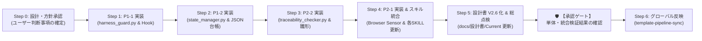

# V2.6 改変・実装計画書（AIハーネス P1〜P2 施策群 導入ロードマップ）

- **文書バージョン**: 1.0
- **作成日**: 2026-10-26
- **対象バージョン**: AI駆動システム開発ライフサイクルテンプレート V2.6.0
- **ステータス**: 計画承認済・確定 (Approved)
- **関連文書**:
  - [20261026_system-dev-pipelineとAIハーネス比較分析レポート.md](../../検討課題/v2.6/20261026_system-dev-pipelineとAIハーネス比較分析レポート.md)
  - [V2.6_次世代AIハーネス強化_設計書.md](./V2.6_次世代AIハーネス強化_設計書.md)
  - [V2.5改変計画書.md](../v2.5/V2.5改変計画書.md)
  - [AI駆動システム開発フェーズ定義書V2.5.md](./AI駆動システム開発フェーズ定義書V2.5.md)

---

## 1. 本計画書の目的とスコープ

本計画書は、[20261026_system-dev-pipelineとAIハーネス比較分析レポート.md](../../検討課題/v2.6/20261026_system-dev-pipelineとAIハーネス比較分析レポート.md) の「推奨アクションプラン」で提言された **優先度 P1（高）および P2（中）の4大施策テーマ** を、[V2.6_次世代AIハーネス強化_設計書.md](./V2.6_次世代AIハーネス強化_設計書.md) に基づき `system-dev-pipeline`（V2.6.0）として実装・統合するための作業工程、変更対象ファイル、検証計画、および承認ゲートを規定するものである。

### 対象施策テーマ一覧（P1〜P2）

| 優先度 | 施策ID | 施策テーマ | 実装コアコンポーネント | 主な導入効果 |
| :---: | :---: | :--- | :--- | :--- |
| **高 (P1)** | **P1-1** | **Hard Gate スクリプトの前倒し (Pre-Commit / CLI Guard & AST Fitness)** | `scripts/harness_guard.py` `skeletons/common/.githooks/pre-commit` | 250行/400行制限、直書きモック、絶対パス、生SQL、AST依存違反を PHASE 4 コミット前に機械的遮断し、PHASE 5.5 の手戻りを激減させる。 |
| **高 (P1)** | **P1-2** | **構造化状態台帳 (`project_state.json`) と決定論的状態管理 CLI** | `scripts/state_manager.py` `templates/project_state.schema.json` | JSON正本から `PROJECT_STATE.md` を自動生成し、Single Writer原則の物理保証・表記揺れ根絶・メトリクス即時同期の完全自動化を実現する。 |
| **中 (P2)** | **P2-1** | **ブラウザ感覚センサー（Chrome DevTools MCP / A11y）の標準統合** | `skills/dev-phase5-walkthrough/SKILL.md` `skills/dev-phase6-testing/SKILL.md` | 実ブラウザ上のコンソールエラー、DOM/A11yツリー、デイライト/ダーク実測コントラスト比を AI 自身が自動計測・自己検証する。 |
| **中 (P2)** | **P2-2** | **要件〜設計〜テストの ID トレーサビリティ機械検証** | `scripts/traceability_checker.py` `templates/要件定義書.md` 等 | `REQ-Fxx` / `REQ-NFxx` の設計・テストコードへの 100% カバレッジと異常系テスト比率を機械検証し、未検証での完了宣言を防止する。 |

---

## 2. 全体実装ロードマップ（Step 0 〜 Step 7）

---

## 3. フェーズ別詳細作業計画と変更対象マトリクス

### Step 0: 設計仕様のレビューと意思決定（完了: 2026-10-26）
- **作業内容**:
  - `template-pipeline-sync` によるワークスペース・グローバル同期状態の確認。
  - 本計画書および [V2.6_次世代AIハーネス強化_設計書.md](./V2.6_次世代AIハーネス強化_設計書.md) の策定。
  - **設計上の判断事項（7項目）の確定結果**:
    1. **`project_state.json` 配置**: プロジェクトルート直下（`./project_state.json`）に配置し、`PROJECT_STATE.md` とともに Git 管理対象とする。
    2. **`PROJECT_STATE.md` 手動編集時の扱い**: 双方向リコンサイル許容（Checksum 検知＋「未決事項」「決定事項」セクションの手動追記分を JSON 側へ逆取り込みマージ）。
    3. **`harness_guard.py` 遮断レベル**: 段階的エンフォースメント（`HG-001`〜`HG-005`, `HG-007` は常時 `BLOCK (exit 1)`、`HG-006` Tailwind デイライト視認性の静的検査は `WARN` とし PHASE 5 実ブラウザコントラスト計測で最終 `BLOCK` 判定）。
    4. **異常系テスト比率の閾値**: `traceability_checker.py` において、異常系・境界値テスト比率 **20%以上** を `BLOCK` 基準、**30%以上** を推奨目標とする。
    5. **ブラウザ感覚センサーのフォールバック**: UIなし（Profile E等）は自動スキップ、UIあり（Profile A/B/C/D）で Chrome DevTools MCP 未接続時は Playwright ヘッドレス検査へ自動フォールバックする。
    6. **Profile D（Tauri）におけるブラウザ感覚センサー運用**: 開発初期からの常時ネイティブ WebView（`tauri dev`）起動を抑制し、PHASE 4〜5 はブラウザモード（Vite dev サーバー）で Chrome DevTools MCP 検査を完了させた後、PHASE 6〜7 で実機ネイティブモードへ切り替える二段階運用を義務付け（矯正）する。
    7. **開発完了後の改訂ライフサイクル標準化**: 初期リリース後の機能追加・Hotfix においても、改訂起票（`start-revision`）➔ 差分要件/設計（`REQ-*` ＆ RTM）➔ 差分実装（Hard Gate）➔ 回帰/感覚センサー検証 ➔ 改訂完了（`complete-revision`）の 5段階改訂サイクルと使用ツールを明確化する。

### Step 1: 【P1-1】Hard Gate エンジン (`harness_guard.py`) の実装とスケルトン配備
- **新規作成・改訂ファイル**:
  1. `.agents/plugins/system-dev-pipeline/scripts/harness_guard.py` (新規作成 / Profile E 準拠 / 350行以内)
     - `HG-001` (FE 250行 / BE 400行制限)、`HG-002` (直書きモック・サイレントフォールバック検出)、`HG-003` (Markdown絶対パス検出)、`HG-004` (生SQL DDL検出)、`HG-005` (Python `ast` によるレイヤーバイパス・DTO同居・`except Exception: pass` 検出)、`HG-006` (Tailwind デイライト淡色単独直書き検出)、`HG-007` (平文シークレット・プレースホルダー検出) の実装。
  2. `.agents/plugins/system-dev-pipeline/skeletons/common/.githooks/pre-commit` (新規作成)
     - コミット時に `python3 scripts/harness_guard.py --staged` を自動実行するフック。
  3. `.agents/plugins/system-dev-pipeline/skills/dev-git-init/SKILL.md` (改訂)
     - Git 初期化時に `git config core.hooksPath .githooks` を設定する手順を追加。
  4. `.agents/plugins/system-dev-pipeline/skills/dev-phase4-env-build/SKILL.md` & `skills/dev-review-code/SKILL.md` (改訂)
     - PHASE 4 標準コマンドシーケンスおよび PHASE 5.5 レビュー冒頭に `python3 scripts/harness_guard.py --all` の実行を組み込む。

### Step 2: 【P1-2】ハイブリッド状態台帳 (`state_manager.py` & `project_state.json`) の実装
- **新規作成・改訂ファイル**:
  1. `.agents/plugins/system-dev-pipeline/scripts/state_manager.py` (新規作成 / Profile E 準拠 / 400行以内)
     - サブコマンド `init`, `set-phase`, `complete-task`, `record-review`, `record-approval`, `sync-metrics`, `verify-integrity`, `migrate`, `start-revision`, `complete-revision` の実装。
     - `project_state.json` から `PROJECT_STATE.md` への決定論的 Markdown レンダラーの実装。
     - 改訂ライフサイクル（`start-revision` ➔ `revisions.current_revision_status="ACTIVE"` / ブランチ作成、`complete-revision` ➔ `history` 記録 / ステータス `IDLE` 復帰）の実装。
  2. `.agents/plugins/system-dev-pipeline/templates/project_state.schema.json` (新規作成)
     - 初期状態定義テンプレート（`revisions` スキーマ拡張を含む）。
  3. `.agents/plugins/system-dev-pipeline/skills/dev-metrics-collector/scripts/` (改訂)
     - `parsers.py` で `project_state.json` が存在する場合はレビュー合否・ガバナンス違反数を JSON から直接読み取るロジックを追加。
     - `metrics_collector.py` に `--sync-state` オプションを追加し、`state_manager.py sync-metrics` との自動連携を実装。

### Step 3: 【P2-2】要件トレーサビリティ検証エンジン (`traceability_checker.py`) とテンプレート改訂
- **新規作成・改訂ファイル**:
  1. `.agents/plugins/system-dev-pipeline/scripts/traceability_checker.py` (新規作成 / Profile E 準拠 / 300行以内)
     - `docs/設計書/Current/要件定義書.md` から `REQ-F\d+` / `REQ-NF\d+` を抽出。
     - `--mode design`: 4大基本設計書での参照カバレッジ 100% を検証。
     - `--mode full`: `シナリオテスト計画書.md` および `tests/` 実テストコード内の `@req` / `[REQ-*]` タグとのマッピング 100%、および異常系テスト比率（20%以上ハードブロック基準 / 30%以上推奨目標）を検証し、`docs/plans/要件トレーサビリティマトリクス(RTM).md` を出力。
  2. `.agents/plugins/system-dev-pipeline/templates/要件定義書.md` (改訂)
     - 機能要件・非機能要件の各見出し/項目に `[REQ-F01]` 等の標準IDフォーマットを組み込む。
  3. `.agents/plugins/system-dev-pipeline/templates/ビジネスロジック仕様書.md`, `画面仕様書.md`, `バックエンドAPI仕様書.md`, `シナリオテスト計画書.md` (改訂)
     - 対応要件ID（`REQ-Fxx`）カラムおよびテストコードへの `@req` タグ付与規約を追加。

### Step 4: 【P2-1】ブラウザ感覚センサー（Chrome DevTools MCP）のスキル統合と規約更新
- **改訂対象ファイル**:
  1. `.agents/plugins/system-dev-pipeline/skills/dev-phase5-walkthrough/SKILL.md` (改訂)
     - ユーザーウォークスルー提示前に、Chrome DevTools MCP（`navigate_page`, `list_console_messages`, `take_snapshot`, `evaluate_script`）を用いてコンソールエラーゼロ・デイライト/ダーク実測コントラスト比（WCAG AA 4.5:1）・A11yツリーを検証する「自動ブラウザ感覚センサー検証」ステップを追加。
     - **Profile D 二段階ハイブリッド規約の反映**: PHASE 4〜5 は Vite Dev サーバー（ブラウザモード `npm run dev`）で Chrome DevTools MCP 検証を実行し、PHASE 6 で実機ネイティブモード（`cargo tauri dev` / WebDriver）へ切り替える旨の手順・チェックリストを明記。
  2. `.agents/plugins/system-dev-pipeline/skills/dev-phase6-testing/SKILL.md` & `skills/dev-review-system/SKILL.md` (改訂)
     - E2E テスト時のブラウザセンサー連携、および `traceability_checker.py --mode full` の実行必須化を追加。
  3. `.agents/plugins/system-dev-pipeline/agents/*.md` & `rules/AGENTS.md` (改訂)
     - 全ファイルの行数バジェット（AGENTS 220行、agents/skills 120行）を厳守しつつ、V2.6 の Hard Gate / Hybrid State Ledger / Browser Sensor / RTM 検証規約、および改訂ライフサイクル（Revision Lifecycle）規約を反映。

### Step 5: 設計書正本群（`docs/設計書/Current/`）の V2.6 アップグレードと全域総点検
- **作業内容**:
  1. 現行の `docs/設計書/Current/` 配下の V2.5 文書群を `docs/設計書/v2.5/` へアーカイブ退避。
  2. `docs/設計書/Current/` の各設計書（フェーズ定義書、手順書、エージェント設計書、レビューシステム設計書、状態管理機構設計書、定量測定・フィードバック設計書、V2.6改変計画書）を V2.6.0 へ更新。
  3. `pipeline-reconciler.sh --audit-budget` による全スキル・エージェント・ルールファイルの行数上限および履歴ID純度監査（Gate 4）の実行。

### Step 6: 統合テスト・自己診断検証
- **検証項目**:
  1. **構文・型チェック**: 新規 Python スクリプト群（`harness_guard.py`, `state_manager.py`, `traceability_checker.py`）に対する `python3 -m py_compile` および単体テストスイートの実行。
  2. **擬似違反データによる Hard Gate 作動テスト**:
     - 251行のダミー `.tsx`、直書きモック、`except Exception: pass`、未カバーの `REQ-F99` を一時生成し、`harness_guard.py` と `traceability_checker.py` が確実に `exit 1` でブロックすることを確認。
  3. **`state_manager.py` ラウンドトリップ検証**:
     - `init` ➔ `set-phase` ➔ `record-review` ➔ `sync-metrics` ➔ `verify-integrity` の一連の CLI 操作を行い、`project_state.json` と `PROJECT_STATE.md` が破損なく完全同期されることを確認。

---

## 4. リスク管理と後方互換性（Migration Strategy）

| リスク事象 | 影響度 | 回避・緩和策 |
| :--- | :---: | :--- |
| **スキル・ルールファイルの行数バジェット超過** (`AGENTS.md` 220行 / `SKILL.md` 120行) | 高 | プロンプト内に検査ロジックの詳細を記述せず、`python3 scripts/harness_guard.py --all` 等の CLI 呼び出し1行に集約（Executable Specs へのオフロード）することで行数を圧縮する。 |
| **既存プロジェクト（V2.5以前）での `project_state.json` 不在エラー** | 中 | `state_manager.py migrate` コマンドを実装し、既存の `PROJECT_STATE.md` から初期 `project_state.json` を自動抽出・生成するフォールバック機構を組み込む。 |
| **ユーザーが VSCode で `PROJECT_STATE.md` を直接手動編集した場合の先祖返り** | 中 | `PROJECT_STATE.md` 末尾（またはコメントメタデータ）に SHA-256 ハッシュを記録。手動編集検知時は上書きせず差分警告を出し、`state_manager.py --reconcile` で手動追記分（Open Questions等）を JSON へマージする。 |
| **Chrome DevTools MCP が未起動または非Webプロファイル（Profile C/E）でのエラー** | 低 | スキル定義において「Profile A/B/D（UIあり）かつ MCP 利用可能時は Chrome DevTools MCP を使用し、利用不可時は Playwright ヘッドレス検査へフォールバック、Profile E はスキップ」と条件分岐を明記する。 |
| **Profile D で最初から `tauri dev` を起動しブラウザ感覚センサーが機能不全となるリスク** | 中 | PHASE 4〜5 はブラウザモード（`npm run dev` ＋ Webモック）での起動を義務付け、PHASE 6〜7 で実機ネイティブモード（`cargo tauri dev`）へ切り替える二段階運用チェックリストを強制する。 |
| **改訂作業時に Hard Gate や RTM 検証がスキップされデグレードが発生するリスク** | 中 | 改訂専用の CLI（`state_manager.py start-revision` / `complete-revision`）を導入し、改訂完了時にも `traceability_checker.py --mode full` および `harness_guard.py` の通過を必須化する。 |

---

## 5. 完了判定基準（Definition of Done）

1. 新規3大スクリプト（`harness_guard.py`, `state_manager.py`, `traceability_checker.py`）がすべて Zero-Dependency Python 3（標準ライブラリのみ）かつ **1ファイル400行以内** で実装され、単体検証を PASS していること。
2. `pipeline-reconciler.sh --audit-budget` が全ファイル **PASS**（行数上限超過ゼロ、履歴ID混入ゼロ）であること。
3. ドキュメント内の全リンクが相対パス（INV-10準拠）で記述され、リンク切れが 0 件であること。
4. ユーザーの明示的承認を経て、`sync_pipeline.sh --deploy` によりグローバル環境とワークスペースが `[SYNCED]` 状態になっていること。
