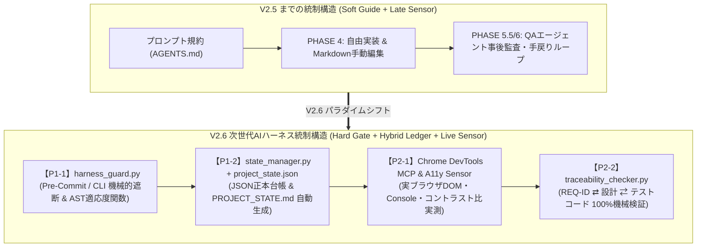
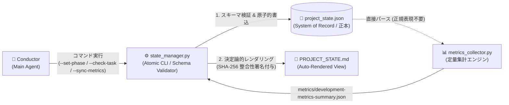
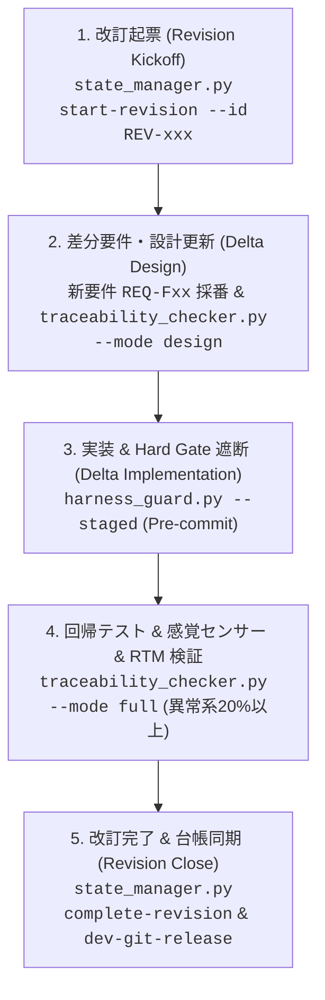
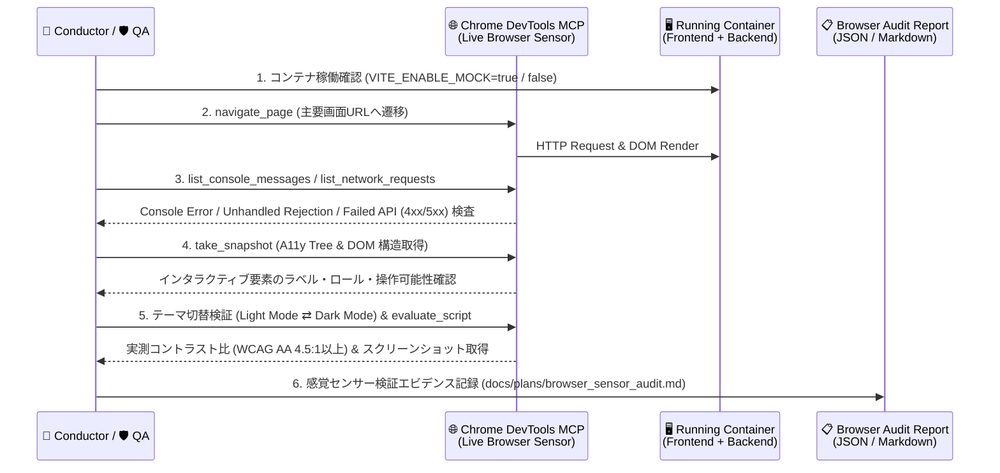
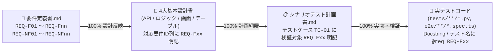

# V2.6 次世代AIハーネス強化 設計仕様書（P1〜P2 施策群詳細設計）

- **文書バージョン**: 1.0
- **作成日**: 2026-10-26
- **対象バージョン**: AI駆動システム開発ライフサイクルテンプレート V2.6.0
- **ステータス**: 設計承認済・確定 (Approved)
- **関連文書**:
  - [20261026_system-dev-pipelineとAIハーネス比較分析レポート.md](../../検討課題/v2.6/20261026_system-dev-pipelineとAIハーネス比較分析レポート.md)
  - [V2.6_P1_P2施策実装計画書.md](./V2.6_P1_P2施策実装計画書.md)
  - [AI駆動システム開発フェーズ定義書V2.5.md](./AI駆動システム開発フェーズ定義書V2.5.md)
  - [状態管理機構設計書V2.5.md](./状態管理機構設計書V2.5.md)
  - [レビューシステム設計書V2.5.md](./レビューシステム設計書V2.5.md)
  - [定量測定・フィードバック設計書V2.5.md](./定量測定・フィードバック設計書V2.5.md)
  - [AGENTS.md](../../../.agents/plugins/system-dev-pipeline/rules/AGENTS.md)
  - [CORE_INVARIANTS.md](../../../.agents/plugins/system-dev-pipeline/rules/CORE_INVARIANTS.md)

---

## 1. 概要と設計思想（Soft Governance から Hard Enforcement へ）

### 1.1 背景
[20261026_system-dev-pipelineとAIハーネス比較分析レポート.md](../../検討課題/v2.6/20261026_system-dev-pipelineとAIハーネス比較分析レポート.md) における分析の結果、`system-dev-pipeline` (V2.5.0) はフルSDLC統制、5大エージェントの責務分離、2層プロファイル体系、Central Knowledge Hub による自己進化（Meta-Harness）、および4モジュール定量メトリクス評価において業界最高水準の完成度を誇ることが確認された。

一方で、最新のAIハーネス工学（OpenAI / Anthropic / ThoughtworksのGuides & Sensorsパラダイム）に照らし合わせると、以下の4領域において「プロンプトによる行動規律（Soft Guides）」や「事後レビューによる手戻り検知」への依存が残存している：

1. **決定論的規約違反の事後発覚**: ファイル行数超過（FE 250行 / BE 400行）、直書きモック、絶対パス混入、レイヤー間不正importなどが PHASE 5.5（コード品質レビュー）まで機械的に遮断されない。
2. **自然言語Markdownへの状態依存**: `PROJECT_STATE.md` を直接テキスト編集するため、表記揺れや構造破損のリスクがあり、Single Writer原則の担保もプロンプト規律に依存している。
3. **実ブラウザ感覚フィードバックの欠如**: PHASE 5（ウォークスルー）および PHASE 6（シナリオテスト）において、実レンダリング画面のDOM・コンソールエラー・A11y・デイライトコントラスト比をAI自身が直接計測するSensorループが未統合。
4. **要件からテストまでのトレーサビリティ未検証**: 要件定義書の機能ID（`REQ-Fxx`）とテストコードの対応関係が機械的に検証されておらず、「未検証機能の完了宣言（Premature Victory）」や「形式的テスト合格（Tautological Tests）」を許す隙がある。

### 1.2 V2.6 の核心的アーキテクチャ転換
V2.6 では、これら優先度 P1〜P2 の4大施策テーマを具現化し、**「推論モデルの良心に委ねる事後監査から、ランタイム・スキーマ・センサーによる事前物理遮断（Shift-Left Hard Enforcement）への完全移行」** を達成する。



---

## 2. 【施策 P1-1】Hard Gate スクリプトの前倒し (`harness_guard.py` & Pre-Commit Hook)

### 2.1 目的と位置づけ
これまで PHASE 5.5（`dev-review-code`）で `qa-engineer` が検査していた決定論的規約（系統A）を、Profile E（Zero-Dependency Python 3 標準ライブラリのみ）で実装された高速・軽量な静的検証エンジン `harness_guard.py` へ集約し、**PHASE 4（実装フェーズ）の標準コマンドシーケンスおよび Git `pre-commit` フックとして前倒し配備**する。違反が存在する場合は `exit 1` でコミットおよびフェーズ進行を物理的に遮断（Fail-Fast Block）する。

### 2.2 配備場所と動作モード
- **プラグイン正本パス**: `.agents/plugins/system-dev-pipeline/scripts/harness_guard.py`
- **プロジェクト展開パス**: `skeletons/common/scripts/harness_guard.py` および `.githooks/pre-commit`（`dev-git-init` 実行時に `git config core.hooksPath .githooks` で自動有効化）
- **実行インターフェース**:
  ```bash
  # ワークスペース全域検査（PHASE 4 標準コマンドシーケンス / PHASE 5.5 事前ゲート）
  python3 scripts/harness_guard.py --all

  # Git ステージング差分のみ高速検査（pre-commit フック連動）
  python3 scripts/harness_guard.py --staged

  # JSON形式での違反レポート出力（dev-metrics-collector / M-GOV-02 連携用）
  python3 scripts/harness_guard.py --all --json-out metrics/guard_violations.json
  ```

### 2.3 機械的検査ルール一覧（Guard Rules: `HG-001` 〜 `HG-007`）

| ルールID | 検査項目 | 対象ファイル | 検出アルゴリズム（Zero-Dependency Python 3） | 違反時の挙動 |
| :---: | :--- | :--- | :--- | :---: |
| **`HG-001`** | **Anti-God File 行数制限** (INV-03) | FE: `src/**/*.{tsx,ts,jsx,js}`<br>BE: `backend/**/*.py`, `src-tauri/**/*.rs` | 行数カウント（自動生成ファイル `*.generated.ts`, `migrations/`, テストコードは除外設定可）。<br>・FE上限: **250行**<br>・BE上限: **400行** | `BLOCK (exit 1)` |
| **`HG-002`** | **直書きモック混入検出** (INV-04) | `src/components/**`, `src/pages/**`, `src/hooks/**`, `backend/app/routers/**` | `src/mocks/` 以外の実装ファイルにおける `mockUsers`, `dummyData`, `MOCK_`, `VITE_ENABLE_MOCK` 分岐のハードコード、およびサイレントフォールバック（`catch { return mock... }`）を正規表現＋トークン解析で検出。 | `BLOCK (exit 1)` |
| **`HG-003`** | **ドキュメント内絶対パス混入** (INV-10) | `docs/**/*.md`, `README.md` | Markdownリンク `\[.*?\]\((file:///|/Users/|/home/|C:\\).*?\)` の正規表現スキャン。 | `BLOCK (exit 1)` |
| **`HG-004`** | **生SQL手動DDL混入検出** (INV-05) | `backend/app/**/*.py` (`alembic/` 除外) | `CREATE TABLE`, `ALTER TABLE`, `DROP TABLE` 等の生DDL実行文字列を検出し、Alembicマイグレーション経由を強制。 | `BLOCK (exit 1)` |
| **`HG-005`** | **AST アーキテクチャ適応度関数** (Architectural Fitness) | `backend/app/**/*.py` | Python 標準 `ast` モジュールで `Import` / `ImportFrom` ノードを解析：<br>1. **レイヤーバイパス禁止**: `routers/`（Controller層）から `models/`（DB層）の直接importまたは `Session.query` 直接実行の禁止（`services/` 経由の強制）。<br>2. **DTO分離強制**: `routers/` 内で `class *(BaseModel):` を3個以上直書き定義することを禁止（`schemas/` への分離強制）。<br>3. **例外握りつぶし禁止**: `except Exception: pass` または素の `except: pass` のAST検出。 | `BLOCK (exit 1)` |
| **`HG-006`** | **UIデイライト視認性違反検出** (PAT-UI-001) | `src/**/*.{tsx,jsx}` | `className` 内の Tailwind クラスを走査し、`dark:` プレフィックスなしでダーク前提の淡色文字（`text-slate-200`, `text-blue-200`, `text-gray-300` 等）や暗色透過背景（`bg-slate-900/`, `bg-blue-950/` 等）が明暗ペアなしで単独使用されている箇所を検出。<br>※CSS変数経由等の誤検知を防ぐため、静的ガード時は **`WARN`（警告表示）** とし、PHASE 5 の実ブラウザコントラスト実測センサー（P2-1）で最終合否判定（`BLOCK`）を行う段階的エンフォースメントを採用。 | `WARN (Phase 5で実測BLOCK)` |
| **`HG-007`** | **平文シークレット・プレースホルダー混入** (INV-06) | 全ステージングファイル (`.env.example` 除外) | APIキー形式（`AIza...`, `sk-...`, `ghp_...`）および本番設定ファイル内の未置換プレースホルダー（`YOUR_API_KEY_HERE`, `CHANGE_ME`）を検出。 | `BLOCK (exit 1)` |

### 2.4 エージェント出力フォーマット（自己修復誘導メッセージ）
`harness_guard.py` が違反を検出した際は、単なるエラーではなく、**サブエージェント（`backend-engineer` / `ui-designer`）が即座に自己修正できる構造化ヒント** を標準エラー出力（`stderr`）へ返す。

```text
🚨 [HARNESS GUARD BLOCKED] 2 件のアーキテクチャ規約違反が検出されました。
--------------------------------------------------------------------------------
[HG-001] Anti-God Component 違反 (上限 250 行)
  - ファイル: frontend/src/components/DashboardView.tsx (現在 284 行)
  - 対処指示: カスタムフック (src/hooks/useDashboard.ts) またはサブコンポーネントへ物理分割してください。

[HG-005] AST アーキテクチャ境界違反 (Exception Swallowing)
  - ファイル: backend/app/services/sync_service.py:42
  - 検出構文: except Exception: pass
  - 対処指示: 捕捉する例外型を限定し、ロガー出力または適切な例外再送出を行ってください。
--------------------------------------------------------------------------------
```

---

## 3. 【施策 P1-2】構造化状態台帳 (`project_state.json`) と決定論的状態管理CLI (`state_manager.py`)

### 3.1 目的とハイブリッド台帳アーキテクチャ (Hybrid State Ledger)
Anthropic の Long-Running Agent Harness パラダイムを取り入れ、**「機械が読み書きする正本（System of Record: `project_state.json`）」** と **「人間が閲覧するビュー（Human View: `PROJECT_STATE.md`）」** を分離・同期するハイブリッド構造を導入する。

1. **JSON正本化**: フェーズ進行状態、プロファイル設定、タスクチェックリスト、3大レビュー合否判定、定量メトリクス数値、改訂履歴を厳格な JSON スキーマで保持する。
2. **決定論的レンダリング**: `state_manager.py` を実行するたびに、`project_state.json` から `./PROJECT_STATE.md` を 100% 決定論的に自動生成する。これにより、Markdown の見出し揺れや書式崩壊を根絶し、`dev-metrics-collector` が正規表現ではなく JSON を直接参照できるようになる。
3. **Single Writer 原則 (INV-01) の物理的ロック**: 更新 CLI 実行時に呼び出し元コンテキスト（環境変数またはトークン/ロール宣言）を検証し、サブエージェントによる不正な直接編集や `PROJECT_STATE.md` の直接書き換え（ハッシュ不一致）を検知・遮断する。



### 3.2 `project_state.json` スキーマ仕様
配置パスは **プロジェクトルート直下（`./project_state.json`）** とし、`./PROJECT_STATE.md` とともに Git 管理対象（1対1同期）とする。また、ユーザーが `./PROJECT_STATE.md` の「未決事項 (Open Questions)」「決定事項 (Decisions)」セクションを手動編集した場合には、チェックサム検知により無条件上書きを防ぎ、手動追記分を `./project_state.json` 側へ安全に逆取り込み（双方向リコンサイル）してから再レンダリングする仕様とする。

```json
{
  "schema_version": "2.6.0",
  "project_metadata": {
    "project_name": "sample-app",
    "app_version": "1.0.0",
    "deployment_profile": "Profile A",
    "mock_mode": "ENABLED",
    "execution_mode": "GLOBAL_PLUGIN",
    "template_source": "~/.gemini/config/plugins/system-dev-pipeline",
    "knowledge_hub_status": "SYNCED (Immutable Core v2.6.0 + Local Overlay)",
    "current_branch": "feature",
    "updated_at": "2026-10-26T12:30:00+09:00",
    "updated_by": "conductor",
    "md_checksum": "sha256:e3b0c44298fc1c149afbf4c8996fb92427ae41e4649b934ca495991b7852b855"
  },
  "current_status": "PHASE_4_IMPLEMENTATION",
  "phases": {
    "PHASE_1": {
      "status": "COMPLETED",
      "completed_at": "2026-10-26T10:00:00+09:00",
      "tasks": [
        {"id": "P1-T01", "title": "ディレクトリ・環境設定展開 (dev-phase1-setup)", "done": true},
        {"id": "P1-T02", "title": "Central Knowledge Hub 初期化 & 未処理原票確認", "done": true}
      ]
    },
    "PHASE_2": {
      "status": "COMPLETED",
      "approval_gate": {
        "required": true,
        "approved": true,
        "approved_at": "2026-10-26T10:30:00+09:00",
        "approver": "user"
      },
      "tasks": [
        {"id": "P2-T01", "title": "要件定義書作成・精査", "done": true}
      ]
    }
  },
  "review_gates": {
    "arch_review": {"verdict": "PASS", "critical": 0, "high": 0, "medium": 1, "low": 2, "report_path": "docs/plans/基本設計レビュー報告書.md", "updated_at": "2026-10-26T11:15:00+09:00"},
    "code_review": {"verdict": "PENDING", "critical": 0, "high": 0, "medium": 0, "low": 0, "report_path": ""},
    "system_review": {"verdict": "PENDING", "critical": 0, "high": 0, "medium": 0, "low": 0, "report_path": ""}
  },
  "metrics_summary": {
    "total_score": 94.5,
    "grade": "S (Excellent)",
    "category_scores": {
      "resource": 23.0,
      "quality": 33.5,
      "evolution": 14.0,
      "governance": 24.0
    },
    "total_tokens": 145200,
    "total_tool_calls": 84,
    "net_loc": 1820,
    "last_collected_at": "2026-10-26T12:25:00+09:00"
  },
  "revisions": {
    "current_revision_status": "IDLE",
    "active_revision_id": null,
    "current_turn": null,
    "history": []
  },
  "open_questions": [],
  "decisions": [
    {"id": "DEC-001", "date": "2026-10-26", "summary": "Profile A (Cloud Run + Litestream) を採用"}
  ],
  "infrastructure": {
    "git_commit": "a1b2c3d",
    "remote_url": "git@github.com:user/sample-app.git",
    "container_status": "RUNNING",
    "last_build_at": "2026-10-26T12:10:00+09:00",
    "production_url": "-"
  }
}
```

### 3.3 `state_manager.py` の主要CLIコマンド仕様
Profile E（Zero-Dependency Python 3）で実装し、アトミックファイル書き込み（一時ファイル生成 ➔ `os.replace`）を徹底する。

| サブコマンド | 用途・動作内容 | 実行例 |
| :--- | :--- | :--- |
| `init` | `project_state.json` と `PROJECT_STATE.md` の初期プロビジョニング | `python3 scripts/state_manager.py init --name "my-app" --profile "Profile A"` |
| `set-phase` | フェーズ遷移の記録（前フェーズの必須レビューゲートや承認ゲートが未完了の場合は `exit 1` で遷移を拒否する **Gate Interlock 機構** 付き） | `python3 scripts/state_manager.py set-phase PHASE_4_IMPLEMENTATION` |
| `complete-task` | タスクIDまたはキーワード指定でタスクを `[x]` に更新 | `python3 scripts/state_manager.py complete-task --id P4-T02` |
| `record-review` | 3大レビューの合否判定と指摘件数を構造化登録 | `python3 scripts/state_manager.py record-review --type code --verdict CLEAN --critical 0 --high 0` |
| `record-approval` | ユーザー承認ゲートの通過日時を記録 | `python3 scripts/state_manager.py record-approval --phase PHASE_3` |
| `sync-metrics` | `metrics/development-metrics-summary.json` を読み込み、`project_state.json` と `PROJECT_STATE.md` の定量サマリ枠へ即時同期（PAT-SYS-002 の完全自動化） | `python3 scripts/state_manager.py sync-metrics` |
| `verify-integrity` | `PROJECT_STATE.md` が CLI 以外で手動・不正改ざんされていないかチェックサム検証（手動追記された Open Questions 等があれば JSON 側へ安全に逆取り込みする `--reconcile` オプションも提供） | `python3 scripts/state_manager.py verify-integrity` |
| `start-revision` | 改訂作業の開始。改訂IDの発行、台帳の改訂ステータス遷移（`ACTIVE`）、および改訂ブランチ（`revision/<id>`）の作成 | `python3 scripts/state_manager.py start-revision --id REV-001 --title "検索機能の拡張"` |
| `complete-revision` | 改訂作業の完了。全テスト・RTM・Gate検証合格を確認後、台帳の改訂ステータスを `IDLE` に戻し、改訂履歴（`history`）へ記録 | `python3 scripts/state_manager.py complete-revision --id REV-001` |

### 3.4 開発完了後の改訂ライフサイクル（Revision Lifecycle）と運用フロー
初期開発（PHASE 1〜8）完了後の機能追加・仕様変更・Hotfixにおいて、品質劣化やデグレード、台帳破損を防止するため、以下の5段階改訂サイクルと使用ツールを標準化する。



1. **改訂起票 (Revision Kickoff)**:
   - コマンド: `python3 scripts/state_manager.py start-revision --id REV-xxx --title "..."`
   - 動作: `project_state.json` の `revisions.current_revision_status` を `ACTIVE` に更新し、Git 改訂ブランチ `revision/REV-xxx` を作成。
2. **差分要件・設計更新 (Delta Design)**:
   - コマンド: `python3 scripts/traceability_checker.py --mode design`
   - 動作: `docs/設計書/Current/要件定義書.md` に追加・変更要件（`REQ-Fxx`）を採番し、4大基本設計書を差分更新。トレーサビリティ検証で全要件の設計反映を機械検証（未反映時は `exit 1`）。
3. **差分実装 & コミット前遮断 (Delta Implementation)**:
   - コマンド: `git commit`（内部で `python3 scripts/harness_guard.py --staged` を自動実行）
   - 動作: 改訂コードにおける 250行/400行制限超過、直書きモック、生SQL、Markdown絶対パスをコミット時に物理遮断。
4. **回帰テスト・感覚センサー・RTM検証 (Regression Verification)**:
   - コマンド:
     - UI変更時: Chrome DevTools MCP（`navigate_page`, `take_snapshot` 等）によるコンソールエラー 0件・視認性・A11y実測検証。
     - 実テスト: `pytest` / E2E 回帰テストスイートの実行。
     - トレーサビリティ: `python3 scripts/traceability_checker.py --mode full`（全要件テストカバー 100% ＆ 異常系テスト比率 20%以上）。
5. **改訂完了・リリース (Revision Close)**:
   - コマンド:
     - `python3 scripts/state_manager.py complete-revision --id REV-xxx`（履歴記録とステータス `IDLE` 復帰）
     - `python3 metrics_collector.py --all --sync-state`（メトリクス自動集計・同期）
     - `dev-git-release`（main ブランチへの squash merge & バージョンタグ付与）

---

## 4. 【施策 P2-1】ブラウザ感覚センサー（Chrome DevTools MCP / A11y）の標準統合

### 4.1 目的と位置づけ
CUI上のビルド成功（`npm run build`）や単体テスト合格だけでは検知できない **「実ブラウザ描画時のコンソールエラー」「レイアウト崩れ・要素重なり」「デイライトモードでのコントラスト比不足」「アクセシビリティ（ARIA/フォーカス）欠落」** を、AIエージェント自身が Chrome DevTools MCP サーバー（`chrome-devtools`, `a11y-debugging` スキル）を Sensor として駆動し、自動計測・自己検証するループを PHASE 5 および PHASE 6 に標準統合する。

### 4.2 統合アーキテクチャと検証フロー



### 4.3 標準検査チェックリスト（Visual & DOM Sensor Gate）
PHASE 5（`dev-phase5-walkthrough`）でユーザーにウォークスルー確認を依頼する**前**、および PHASE 6（`dev-phase6-testing`）のシナリオテスト実行時に、以下の5項目を必須センサーゲートとして検証する。

1. **Runtime Console & Network Cleanliness**:
   - 初期ロードおよび主要画面遷移時に、`console.error`、未捕捉の `Promise Rejection`、React Hydration Error、CSP違反が **0件** であること。
   - 実結合モード（`VITE_ENABLE_MOCK=false`）において、全APIリクエストが正常ステータス（2xx）で応答し、MSWワーカーが完全に非アクティブであること。
2. **Daylight & Dark Mode Contrastの実測検証 (PAT-UI-001 強化)**:
   - ライトモード（Daylight）とダークモードの双方へ DOM クラス（またはテーマ切替UI）を切り替え、実際に計算されたスタイル（`window.getComputedStyle`）において文字色と背景色のコントラスト比が WCAG 2.1 AA 基準（通常テキスト 4.5:1 以上、大文字 3.0:1 以上）を満たしていること。
3. **A11y Tree & セマンティックDOM検証 (`a11y-debugging` 連携)**:
   - 全アイコンボタン（ミニマルアイコン仕様）に `title` 属性または `aria-label` が付与され、アクセシビリティツリー上で名前解決できること。
   - モーダル/ドロワー開閉時にフォーカストラップと背面スクロール抑制が機能し、要素の重なり（z-index 破綻によるクリック不能）がないこと。
4. **レスポンシブ Viewport 検証**:
   - デスクトップ幅（`1440x900`）とモバイル幅（`390x844`）へ `resize_page` を実行し、横スクロールバーの意図しない発生（Overflow）やテーブル⇄カード表示の切替破綻がないこと。
5. **環境フォールバック設計（Graceful Degradation）**:
   - Profile C（CLIツール）、Profile E（Pythonスキル）、またはヘッドレス環境等で Chrome DevTools MCP が利用不可の場合は、Playwright ヘッドレススクリプトによるコンソール/A11y自動アサーションへ自動フォールバックする。
6. **Profile D（デスクトップアプリ型）における二段階ハイブリッド運用規約**:
   - Profile D（Tauri v2）において、開発初期から `cargo tauri dev`（OSネイティブWebView）を常時起動してしまうと、リモートデバッグ接続の複雑化や環境依存により、Chrome DevTools MCP による自律的ブラウザ感覚センサー検証が機能しなくなる。
   - このため、**フェーズに応じた起動形態の分離（二段階運用）を標準規約として義務付け（矯正）** する：
     - **PHASE 4（UI構築）〜 PHASE 5（ウォークスルー・感覚センサー検証）**: フロントエンドは Vite Dev サーバー（ブラウザモード `npm run dev`）で起動し、`IStorageAdapter` / MSW モックのもとで Chrome DevTools MCP によるコンソールエラーゼロ・視認性・A11y自動検証を実施する。
     - **PHASE 6（シナリオテスト）〜 PHASE 7（リリース前）**: `VITE_ENABLE_MOCK=false` かつ実機ネイティブモード（`cargo tauri dev` またはビルドバイナリ ＋ Tauri WebDriver / E2E テストスイート）へ切り替え、Rust IPC 実結合・ローカル SQLite (WAL) 永続化・OS ウィンドウ動作を検証する。

---

## 5. 【施策 P2-2】要件〜設計〜テストの ID トレーサビリティ機械検証 (`traceability_checker.py`)

### 5.1 目的と位置づけ
AIハーネスにおける「早期の勝利宣言（Premature Victory：一部機能を実装・テストし忘れたまま全テストPASSとして完了報告する現象）」および「形式的テスト合格（Tautological Tests：正常系の浅いテストのみ書いて異常系・境界値を検証しない現象）」を根絶するため、**要件定義から基本設計、シナリオテスト計画、実テストコードまでを一貫した要件ID（`REQ-Fxx` / `REQ-NFxx`）で紐付け、100% カバレッジを機械的にクロスチェックする機構** を導入する。

### 5.2 トレーサビリティ ID 体系と埋込規約



1. **PHASE 2（`要件定義書.md` テンプレート改訂）**:
   - 第2章「システムの機能要件」および第3章「非機能要件」の各項目に、一意の要件ID（例: `[REQ-F01] ダッシュボード表示機能`, `[REQ-F02] リアルタイム横断検索機能`, `[REQ-NF01] IAP JWT二重検証`）を付与する。
2. **PHASE 3（4大基本設計書テンプレート改訂）**:
   - `ビジネスロジック仕様書.md`、`画面仕様書.md`、`バックエンドAPI仕様書.md` の各機能・エンドポイント一覧表に「対応要件ID（`REQ-Fxx`）」カラムを設ける。
3. **PHASE 6（`シナリオテスト計画書.md` & 実テストコード規約）**:
   - シナリオテスト計画書の各テストシナリオに「検証対象要件ID」を明記する。
   - `pytest`（バックエンド）および `Playwright`（E2E）のテストコード内に、デコレータ・コメント・テスト名のいずれかで `@req(REQ-F01)` または `[REQ-F01]` タグを記述することを必須化する。
   - **異常系・境界値テスト比率ガード（Adversarial Check）**: 全テストケースのうち、異常系（4xx/5xx、バリデーションエラー、権限エラー、境界値）を検証するテスト（`@test_type: negative` または `abnormal / error / invalid` を含むテスト）が **最低 20% 以上（ハードブロック基準 / 推奨目標 30% 以上）** 含まれていることを検査する。

### 5.3 `traceability_checker.py` の仕様
- **配置パス**: `.agents/plugins/system-dev-pipeline/scripts/traceability_checker.py`（Profile E: Zero-Dependency Python 3）
- **実行タイミング**:
  - **PHASE 3 (`dev-doc-reviewer` / `dev-review-arch`)**: `--mode design`（`要件定義書.md` の全 `REQ-*` が基本設計書群に 100% 登場しているか検証）
  - **PHASE 6 / 7 (`dev-phase6-testing` / `dev-review-system`)**: `--mode full`（`要件定義書.md` の全 `REQ-*` が `シナリオテスト計画書.md` および `tests/` 配下の実テストコードに 100% マッピングされているか、かつ異常系テスト比率が基準以上かを検証）
- **出力成果物**:
  - `docs/plans/要件トレーサビリティマトリクス(RTM).md` を自動生成。
  - 未カバーの要件ID（Orphan Requirements）が 1件でも存在する場合は `exit 1` を返し、PHASE 6 完了および PHASE 7 リリース承認（`RELEASE APPROVED`）を機械的にブロックする。

---

## 6. 定量メトリクスエンジン (`dev-metrics-collector`) との連携拡張

上記 P1〜P2 施策の導入に伴い、PHASE 8 の `dev-metrics-collector`（`parsers.py` / `scoring.py`）を以下のようにアップグレードする：

1. **`project_state.json` からの直接高速読み取り**:
   - レビュー結果やフェーズ状態の抽出において、Markdown 正規表現パースに加えて `project_state.json` が存在する場合は JSON を優先参照し、パース精度を 100% に引き上げる。
2. **ガバナンス指標 (`M-GOV-01`, `M-GOV-02`) の精緻化**:
   - `M-GOV-01 (Single Writer 違反数)`: `state_manager.py verify-integrity` のチェックサム不一致検出履歴をカウント。
   - `M-GOV-02 (不変則・規約逸脱件数)`: `harness_guard.py` の検出ログおよび `traceability_checker.py` の未カバー要件数を統合反映。
3. **自動同期のワンコマンド化**:
   - `python3 metrics_collector.py --all --sync-state` オプションを追加し、メトリクス集計完了と同時に内部で `state_manager.py sync-metrics` を呼び出して `project_state.json` と `PROJECT_STATE.md` を自動更新する（コンダクターの手動転記ミス・同期忘れを物理的にゼロ化）。

---

## 7. 不変原則カタログ (`CORE_INVARIANTS.md`) および行数バジェットへの影響

1. **行数バジェットの厳守 (Gate 4 準拠)**:
   - 新規ロジック（`harness_guard.py`, `state_manager.py`, `traceability_checker.py`）はすべて `scripts/` 配下の独立 Python モジュール（各 400行以内）として実装する。
   - `rules/AGENTS.md`（上限220行）、`agents/*.md`（上限120行）、`skills/*/SKILL.md`（上限120行）には、長大なルール説明を追記するのではなく、**「スクリプトの呼び出しコマンド1行」への置き換え（系統A: Executable Specs への吸収）** を行うことで、むしろプロンプト行数を削減・スリム化する。
2. **既存プロジェクト（V2.5以前）への後方互換性**:
   - `project_state.json` が存在しない既存プロジェクトで `dev-metrics-collector` や改訂プロセスを実行した場合は、従来の `PROJECT_STATE.md` パーサーへ安全にフォールバック、または `state_manager.py migrate` により既存の `PROJECT_STATE.md` から `project_state.json` を自動生成するマイグレーションパスを提供する。
