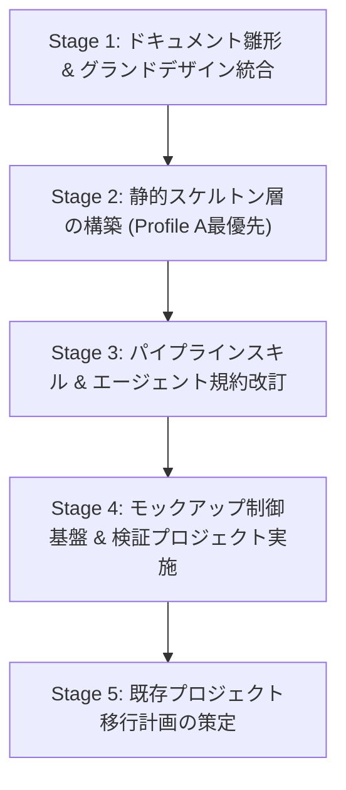

# エージェント・スキル・テンプレート再構成設計計画書 V2.2

文書バージョン: 2.2  
作成日: 2026-10-15  
対象バージョン: AI駆動システム開発ライフサイクルテンプレート V2.2  
ステータス: 正式改訂版 (Shift-Left & 静的スケルトン・モック制御統合版)  
関連文書:
- [V2.2改変計画書.md](./V2.2改変計画書.md)
- [V2.2システムプロファイル構造設計書.md](./V2.2システムプロファイル構造設計書.md)
- [ProfileA詳細設計書.md](./ProfileA詳細設計書.md)
- [AI駆動システム開発フェーズ定義書V2.2.md](./AI駆動システム開発フェーズ定義書V2.2.md)
- [レビューシステム設計書V2.2.md](./レビューシステム設計書V2.2.md)
- [エージェント設計書V2.2.md](./エージェント設計書V2.2.md)
- [状態管理機構設計書V2.2.md](./状態管理機構設計書V2.2.md)

---

## 1. はじめに

### 1.1 目的と背景
AI駆動システム開発テンプレートは、V2.0における協調体制・ガードレール確立、V2.1における3大レビューシステム、WikiSkill型自己進化ループ、定量測定・フィードバック機構の導入を経て、高い自律性を獲得した。

一方、本テンプレートを用いて実稼働に至った4つの小規模Webシステム（`bicycle-log`、`Movie Log`、`Gardening Log`、`bicycle-maintenance`）の知見分析レポート（[AI駆動開発テンプレート_事前組込推奨要件・設計・留意事項_総合レポート.md](../../検討課題/V2.2/AI駆動開発テンプレート_事前組込推奨要件・設計・留意事項_総合レポート.md)）により、以下の共通課題が浮き彫りとなった：
1. フロントエンドの「God Component」化（単一ファイルへのUI・ステート・通信の密集）
2. データベース運用の脆弱性（Alembic未導入、手動ALTER TABLE、SQLite競合）
3. セキュリティ・認可層の形骸化（前段プロキシ前提によるJWT署名検証欠如、モック放置）
4. 型安全性・スキーマ同期の断片化（手動二重定義によるタイポ・ランタイムエラー）
5. 画面UI/UXのばらつきと野良直書きモックの残存

本文書は、これらを「事後レビューでの検知・手戻り修正」ではなく**「初期スケルトン展開・設計・実装の初期段階から堅牢な標準パターンを前倒し組み込む（Shift-Left）」**ために、サブエージェント体系、スキル群、ドキュメント雛形、および新設する静的スケルトン（`skeletons/`）を再構成するための全体計画を規定する。

### 1.2 本計画書のスコープ
1. **エージェント体制の行動規範再定義**: 2層プロファイル適応、Anti-God Component（250行制限）、生SQL禁止・Alembic運用、直書きモック禁止、Zero Tolerance監査の徹底。
2. **静的スケルトン層（`skeletons/`）の新設設計**: Profile A（ゴールデンパス）を最優先とした検証済みボイラープレートの配置。
3. **スキル群の再構成設計**: スケルトン自動展開、2層プロファイル選定、標準コマンドシーケンス自動実行、3大レビューの監査項目アップデート。
4. **テンプレートおよびルールの再構成設計**: `templates/` のドキュメント雛形刷新（グランドデザイン新規格画面仕様書の昇格等）および `PROJECT_STATE.md` の更新。
5. **段階的改変作業ロードマップ**: 各資産の安全な更新手順。

---

## 2. エージェント体制の再構成設計 (Agent Restructuring V2.2)

```
                          ┌────────────────────────────────────────┐
                          │ 👑 1. プロジェクトコンダクター           │
                          │    (conductor / 専用プロンプト独立化)   │
                          │    [Model: pro / Workspace: main]      │
                          └──────────────────┬─────────────────────┘
                                             │
      ┌──────────────────┬───────────────────┼───────────────────┬──────────────────┐
      │ 委譲             │ 委譲              │ 委譲              │ 委譲             │ 委譲
      ▼                  ▼                   ▼                   ▼                  ▼
┌──────────────┐   ┌──────────────┐   ┌──────────────┐   ┌──────────────┐   ┌──────────────┐
│ 📐 2. 設計・立案│   │ 💻 3. BE     │   │ 🎨 4. UI/UX  │   │ 🛡️ 5. QA・監査│   │ 🔍 リサーチ  │
│ スペシャリスト│   │ エンジニア   │   │ デザイナー   │   │ & レビュアー │   │ (必要時)     │
│ (architect)  │   │(backend-eng) │   │ (ui-designer)│   │ (qa-engineer)│   │ (research)   │
│ [Model: pro] │   │ [Model: pro] │   │ [Model:flash]│   │ [Model: pro] │   │ [Model:flash]│
└──────┬───────┘   └──────┬───────┘   └──────┬───────┘   └──────┬───────┘   └──────────────┘
       │                  │                  │                  │
       │                  │                  │                  ├─ 3大レビュー (定常コア+プロファイル)
       │                  │                  │                  ├─ Wiki Maintainer (RCA記録)
       │                  │                  │                  └─ Gating & Rollback (検証)
       └──────────────────┴──────────────────┴──────────────────┘
                                      │
                                      ▼
                        ┌──────────────────────────┐
                        │ ⚙️ 決定論的ツール / スキル │
                        │ ・スケルトン展開 (setup) │
                        │ ・Git管理 (dev-git-*)    │
                        │ ・標準コマンド (Alembic) │
                        │ ・定量メトリクス集計     │
                        └──────────────────────────┘
```

### 2.1 各エージェントのV2.2変更点一覧

| エージェント名 | 推奨モデル | 主な責務・V2.2変更点 |
| :--- | :---: | :--- |
| 👑 **`conductor`** | `pro` / `inherit` | ・初期スケルトン（`skeletons/`）の展開統括および `.env` モック環境変数設定。<br>・標準コマンドシーケンス（Alembic autogenerate/upgrade, codegen:types, CI同等検証）の統括実行。<br>・`PROJECT_STATE.md` での「2層プロファイル」および「モック動作モード」の一元管理（Single Writer）。 |
| 📐 **`architect`** | `pro` | ・**2層プロファイル体系の設計義務化**（ディシジョンツリー・チェックリストによる選定）。<br>・外部API二重キャッシュ戦略（TTLメモリ＋DBキャッシュ）およびモック制御仕様の設計。<br>・Alembicマイグレーション前提スキーマ設計（生SQL禁止、Aware UTC ISO8601、`user_id` 拡張性）。<br>・`run_command` 禁止の徹底。 |
| 💻 **`backend-engineer`** | `pro` | ・**生SQL手動DDLの絶対禁止**、SQLAlchemy ORMによるモデル定義。<br>・**Alembicマイグレーション厳格運用**（標準コマンドシーケンス遵守）。<br>・**IAP JWT署名二重検証ミドルウェア**の実装（`auth.py`、ローカルモック切替）。<br>・内部監視エンドポイント（`/api/internal/health`, `/api/internal/litestream/status`）の実装。<br>・Pydantic Settings バリデーション（プレースホルダー即死ガードレール）。 |
| 🎨 **`ui-designer`** | `flash` / `pro` | ・**画面グランドデザインの完全準拠**（4px/8pxグリッド、HEX/px絶対値併記、ウィンドウ形態選定基準）。<br>・**Anti-God Component の徹底**: **1ファイル最大250行制限**、Custom Hooks/Services分離。<br>・**コンポーネント内直書きモックの原則禁止**: MSWハンドラー構築と環境変数切替。<br>・OpenAPI型定義自動生成（`codegen:types`）の完全利用。 |
| 🛡️ **`qa-engineer`** | `pro` | ・**2層構造 3大レビューの厳格監査**: 基本設計（定常コア8項目＋プロファイル別）、コード品質（**1ファイル最大250行制限**、**直書きモック排除**、型同期）、システム総合（**本番モックOFF**、**IAP JWT署名検証有効化**、**Alembic起動時マイグレーション保証**）。<br>・コード直接改変の禁止（提案書とDiff作成に留める）。 |

---

## 3. 静的スケルトン層の新設設計 (`skeletons/`)

事故が起きやすい基盤コードを「静的スケルトン」として初期配置し、エージェントは業務ドメインの自律生成に専念させる（ハイブリッド方式）。

```
skeletons/
├── common/
│   ├── .github/workflows/ci.yml   # Ruff, Pytest, ESLint, TypeScript型チェック
│   └── .editorconfig              # 文字コード、改行、インデント規約
├── profile-a/                     # Cloud Run + Litestream + SQLite + FastAPI + React
│   ├── backend/
│   │   ├── alembic/               # env.py, script.py.mako
│   │   ├── alembic.ini            # SQLite WAL対応設定
│   │   ├── core/                  # config.py (Pydantic Settings), auth.py (IAP JWT), cache.py
│   │   ├── db/                    # session.py (WAL, timeout=5000, foreign_keys=ON), base.py
│   │   ├── api/internal/          # health.py, litestream.py
│   │   └── tests/                 # test_smoke.py
│   ├── frontend/
│   │   ├── src/components/ui/     # グランドデザイン準拠UIベース (Button, Modal, Drawer, Table等)
│   │   ├── src/hooks/             # useTheme.ts, useImageCompressor.ts
│   │   ├── src/services/          # apiClient.ts
│   │   ├── src/mocks/             # browser.ts, handlers.ts (MSWモック)
│   │   └── package.json           # openapi-typescript設定同梱
│   └── docker/
│       ├── Dockerfile             # マルチステージビルド
│       ├── docker-compose.yml     # ローカル開発環境
│       └── entrypoint.sh          # 確定シーケンス (Litestream ➔ Alembic ➔ Uvicorn)
└── profile-d/                     # PCローカルデスクトップアプリ用雛形
    └── (Tauri / Frameless TitleBar / IStorageAdapter / SQLite)
```

---

## 4. スキル群の再構成設計 (Skills Restructuring V2.2)

### 4.1 スキル改修内容一覧

| スキル名 | V2.2改修ポイント |
| :--- | :--- |
| `dev-phase1-setup` | 静的スケルトン（`skeletons/`）の自動展開、`.env` 初期化（`VITE_ENABLE_MOCK=true` 含む）ロジックの追加。 |
| `dev-phase2-requirements` | 2層プロファイル体系の選定ディシジョンツリー、チェックリスト、非機能要件自動バインドの追加。 |
| `dev-phase3-design` | グランドデザイン新規格画面仕様書、Alembic前提テーブル設計、外部API二重キャッシュ、モック制御仕様の反映。 |
| `dev-review-arch` | 定常的コア設計規範8項目および展開プロファイル別適合監査の判定ロジック強化。 |
| `dev-phase4-env-build` | 標準コマンドシーケンス（Alembic autogenerate/upgrade, codegen:types）の自動実行フロー組み込み。 |
| `dev-phase5-walkthrough` | モック透過切替検証（`VITE_ENABLE_MOCK=true/false`）手順の組み込み。 |
| `dev-review-code` | **1ファイル最大250行制限**の機械的検査、**コンポーネント内直書きモック検出・排除**、型同期検証の追加。 |
| `dev-phase6-testing` | モック有効/無効双方での結合テストシナリオ、自動テスト実行・自律修復ループの強化。 |
| `dev-review-system` | **本番用 `VITE_ENABLE_MOCK=false` 二重防御**、**IAP JWT署名検証有効化**、**Alembic起動自動実行保証**、Litestream同期監視確認。 |
| `dev-phase7-release` | 本番適用作業手順書へのロールバック手順、Litestream同期ラグ確認手順の追加。 |

---

## 5. テンプレート雛形の再構成設計 (`templates/`)

1. **`templates/要件定義書.md`**: プロファイル選定設問・チェックリスト、定常コア8項目の非機能要件欄を追加。
2. **`templates/技術要件定義書.md`**: Profile A/D標準構成、フロント責務分離、型同期、UTC/JST規約を明文化。
3. **`templates/テーブルスキーマ定義書.md`**: Alembicマイグレーション前提、生SQL禁止、UTC ISO8601規約、`user_id` 拡張性を明記。
4. **`templates/ビジネスロジック仕様書.md`**: 外部API二重キャッシュ戦略、モック制御仕様、内部監視エンドポイントを明文化。
5. **`templates/画面仕様書.md`**: `doc_samples/グランドデザイン/03_画面仕様書テンプレート.md` を正式昇格・配置。
6. **`templates/PROJECT_STATE.md.template`**: 2層プロファイル、`MOCK_MODE`、250行制限・モック排除監査欄を追加。

---

## 6. 改変作業ロードマップ



### 改変対象ファイル一覧
1. **設計書群 (`docs/設計書/Current/`)**:
   - `V2.2改変計画書.md` (策定済み)
   - `V2.2システムプロファイル構造設計書.md` (策定済み)
   - `ProfileA詳細設計書.md` (策定済み)
   - `AI駆動システム開発フェーズ定義書V2.2.md` (改訂完了)
   - `レビューシステム設計書V2.2.md` (改訂完了)
   - `エージェント設計書V2.2.md` (改訂完了)
   - `状態管理機構設計書V2.2.md` (改訂完了)
   - `エージェント・スキル・テンプレート再構成設計計画書V2.2.md` (本作)
   - `パイプライン統合およびテンプレート再編集における配慮事項まとめV2.2.md` (次作業)
   - `エージェント推論モデル仕様および運用基準書V2.2.md` (次作業)
2. **静的スケルトン (`skeletons/`)**:
   - `skeletons/common/`, `skeletons/profile-a/`
3. **ドキュメント雛形 (`templates/`)**:
   - 要件定義書、技術要件定義書、テーブルスキーマ定義書、ビジネスロジック仕様書、画面仕様書
4. **エージェント定義 (`agents/`) & スキル定義 (`skills/`)**:
   - 各定義ファイルの改修
