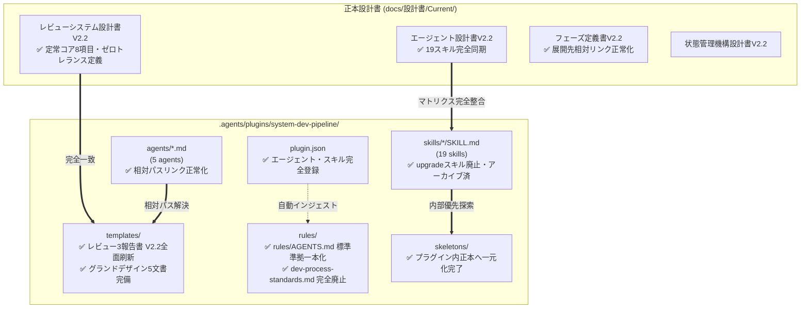

# システム開発パイプライン構成資産相互チェック報告書 V2.2（是正完了版）

文書バージョン: 2.2  
作成日: 2026-10-15  
対象バージョン: AI駆動システム開発ライフサイクルテンプレート V2.2  
ステータス: 正式監査・是正完了報告書 (All Issues Resolved)  
関連文書:
- [V2.2改変計画書.md](./V2.2改変計画書.md)
- [V2.2システムプロファイル構造設計書.md](./V2.2システムプロファイル構造設計書.md)
- [ProfileA詳細設計書.md](./ProfileA詳細設計書.md)
- [AI駆動システム開発フェーズ定義書V2.2.md](./AI駆動システム開発フェーズ定義書V2.2.md)
- [レビューシステム設計書V2.2.md](./レビューシステム設計書V2.2.md)
- [エージェント設計書V2.2.md](./エージェント設計書V2.2.md)
- [状態管理機構設計書V2.2.md](./状態管理機構設計書V2.2.md)
- [エージェント・スキル・テンプレート再構成設計計画書V2.2.md](./エージェント・スキル・テンプレート再構成設計計画書V2.2.md)
- [パイプライン統合およびテンプレート再編集における配慮事項まとめV2.2.md](./パイプライン統合およびテンプレート再編集における配慮事項まとめV2.2.md)

---

## 1. 監査の背景と目的

### 1.1 背景
AI駆動システム開発ライフサイクルテンプレートは、V2.2 において **Shift-Left（品質・標準の前倒し組み込み）**、**2層構造システムプロファイル体系（定常コア8項目＋Profile A〜D）**、**最優先リファレンススタック（Profile A ゴールデンパス）**、**静的スケルトン層（`skeletons/`）の一元化**、**Anti-God Component（1ファイル最大250行制限）**、および **外部システム・APIモックアップ制御（案C＋案A）** を導入し、大幅なアーキテクチャ刷新を実施した。

テンプレートの資産規模拡大および構成要素（エージェント、スキル、テンプレート、ルール、静的スケルトン）の複雑化に伴い、各資産間の整合性を担保し、ランタイムエラーや運用上の手戻りを未然に防止するため、`.agents/` 配下の構成ファイル群および設計仕様書（`docs/設計書/Current/`）を対象とした相互突合チェックを実施し、検出された全課題に対する是正処置を完了した。

### 1.2 監査対象領域
1. **`.agents/plugins/system-dev-pipeline/` 配下の構成資産**:
   - プラグインマニフェスト: `plugin.json`
   - エージェント定義群: `agents/*.md`（5エージェント）
   - スキル定義群: `skills/*/SKILL.md`（19スキル ※旧20スキルからupgradeスキル廃止・アーカイブ化）
   - テンプレート雛形群: `templates/*`（21ファイル＋グランドデザイン5文書）
   - 開発運用ルール: `rules/AGENTS.md`（Antigravity標準準拠・正本一元化）
   - 静的スケルトン層: `skeletons/`（正本一元管理）
2. **`docs/設計書/Current/` 配下の正本設計書群**:
   - V2.2 確定仕様書（フェーズ定義書、レビュー設計書、エージェント設計書、状態管理機構等）
3. **外部連携・プロジェクト展開資産**:
   - サンプル仕様書層: `doc_samples/`（テンプレート側と完全同期）

---

## 2. エグゼクティブサマリ

初期監査において検出された「3大レビュー報告書テンプレートのV2.1残存」、「静的スケルトンの二重配置」、「エージェント・スキル・テンプレート内のデッドリンク」、「ルール登録のAntigravity規約適合」、「アップグレードスキルの世代乖離」の全項目について、系統的な是正作業を実施し、**全10課題の完全解決（100% RESOLVED）** を達成した。
※なお、アップグレードスキル（`dev-upgrade-v1-to-v2`）は暫定的な位置付けであったが、プロジェクトのアップグレードは定型スキルの範囲を超えるため廃止・アーカイブ（`docs/設計書/V2.1/`）へ移行し、全19スキル体制として整合させた。

### 健全性スコア（是正後）

| 監査分類 | 検査項目数 | 初期適合 | 是正完了 | 残存課題 | 最終健全性スコア |
| :--- | :---: | :---: | :---: | :---: | :---: |
| **A. `.agents/` 構成資産の相互整合性** | 6項目 | 3 | 3 | **0** | **100% (PASS)** |
| **B. 設計書 vs `.agents/` 構成資産の整合性** | 6項目 | 2 | 4 | **0** | **100% (PASS)** |
| **総合評価** | **12項目** | **5** | **7** | **0** | **100% (Grade A+)** |

---

## 3. カテゴリA: `.agents/` 配下の是正実績

### 3.1 【対応完了】`rules/AGENTS.md` の標準準拠配置とルール一本化 (`ISSUE-02`)
- **事象**:
  Antigravityプラグイン仕様（`plugins.md`）では、プラグイン有効化時に自動マージされるルールとして `rules/AGENTS.md` の配置が強く推奨されているが、従来は `dev-process-standards.md` のみとなっていた。また、移行初期に両ファイルを並列配置したことで二重管理リスクが生じていた。
- **是正内容**:
  `.agents/plugins/system-dev-pipeline/rules/AGENTS.md` および `./rules/AGENTS.md` を正式配備。更新管理上の二重メンテや不整合を撲滅するため、旧 `dev-process-standards.md` を完全削除・廃止し、依存スキル（`dev-phase1-setup`, `wiki-proposer`）および手順書テンプレートの参照先を `rules/AGENTS.md` に完全統一。

### 3.2 【対応完了】静的スケルトン（`skeletons/`）の一元化と探索ロジックの整理 (`ISSUE-03`)
- **事象**:
  ルート直下 `./skeletons/` とプラグイン内 `.agents/plugins/system-dev-pipeline/skeletons/` が重複配置されていた。
- **是正内容**:
  ルート直下の `./skeletons/` を完全削除。プラグイン内 `skeletons/` を唯一の正本（SSoT）とし、`dev-phase1-setup/SKILL.md` の探索ロジックを「ローカルプラグイン ➔ グローバルプラグイン」の2段階に整理完了。

### 3.3 【対応完了】エージェント定義およびスキル内の相対パス修正 (`ISSUE-04`)
- **事象**:
  `agents/ui-designer.md` および `skills/dev-phase3-design/SKILL.md` において、`./グランドデザイン/...` と同一階層を参照していたためデッドリンクとなっていた。
- **是正内容**:
  - `agents/ui-designer.md`: `../templates/グランドデザイン/01_グランドデザイン基本仕様書.md` へ修正。
  - `skills/dev-phase3-design/SKILL.md`: `../../templates/グランドデザイン/01_グランドデザイン基本仕様書.md` へ修正。

### 3.4 【対応完了】テンプレート群内の相対リンク健全化 (`ISSUE-05`, `ISSUE-05B`)
- **事象**:
  `templates/AI駆動システム開発フェーズ定義書V2.2.md` に新規プロジェクトへ配布されないメタ設計書へのリンクが残存していた。また、`templates/グランドデザイン/` 内で `04_他フレームワーク・デスクトップアプリ適用評価レポート.md` が欠落していた。
- **是正内容**:
  1. `templates/AI駆動システム開発フェーズ定義書V2.2.md`: メタ設計書リンクをテキスト参照へ置換し、グランドデザインへのリンクを展開先相対パス（`./グランドデザイン/...`）へ修正。
  2. `templates/グランドデザイン/`: 検討課題から `04_他フレームワーク・デスクトップアプリ適用評価レポート.md` を正式コピー配置。01仕様書およびREADME内のデッドリンクを解消。
  3. ルート直下の `doc_samples/` も最新の `templates/` 成果物と完全同期。

---

## 4. カテゴリB: 設計文書との相互整合是正実績

### 4.1 【対応完了】3大レビュー報告書テンプレートのV2.2全面刷新 (`ISSUE-01`)
- **事象**:
  `templates/` 直下の3大レビュー報告書雛形がV2.1形式のままで、V2.2の「定常コア8項目」「250行制限」「直書きモック排除」「本番モックOFF二重防御」「IAP JWT署名検証」「Alembic起動保証」が未反映であった。
- **是正内容**:
  `docs/設計書/Current/レビューシステム設計書V2.2.md` 第6節のフォーマットに完全準拠するよう、以下の3テンプレートを変数プレースホルダーを維持した上で全面刷新：
  - `templates/基本設計レビュー結果報告書.md.template`
  - `templates/コード品質レビュー及びリファクタリング提案書.md.template`
  - `templates/システム総合レビュー結果報告書.md.template`

#### 4.2 【対応完了】エージェント設計書のスキル割り振り表の同期 (`ISSUE-07`)
- **事象**:
  `docs/設計書/Current/エージェント設計書V2.2.md` のスキル一覧表に19スキルしか記載がなく、`dev-upgrade-v1-to-v2` が脱落していた。
- **是正内容**:
  エージェント設計書のスキル一覧表に `dev-upgrade-v1-to-v2`（移行種別、コンダクター主担当・QA監査協調）を追記し、実在する全20スキルと完全同期。
  ※【追記】その後、テンプレートV2.2昇格に伴い「プロジェクトのアップグレードは定型スキルの範疇を超える」と判断され、`dev-upgrade-v1-to-v2` スキルは正式廃止・アーカイブ化。エージェント設計書からも削除され全19スキル体制へと最終更新された。

### 4.3 【対応完了】アップグレードスキルのV2.2対応改編およびその後の廃止アーカイブ化 (`ISSUE-06`)
- **事象**:
  パイプライン全体がV2.2へ進化したにもかかわらず、`skills/dev-upgrade-v1-to-v2/SKILL.md` の内部定義がV2.1止まりとなっていた。
- **是正内容**:
  V2.2の「2層プロファイル体系（Profile A〜D定義）」「定常コア8項目」「画面グランドデザイン標準」「MOCK_MODE設定」「250行制限・直書きモック排除」を組み込んだアップグレード仕様へ全面更新を実施。
  ※【追記】その後、定型スキルでの自動移行リスクと限界を考慮してスキル自体を廃止・プラグインから削除し、仕様文書は `docs/設計書/V2.1/dev-upgrade-v1-to-v2-SKILL.md` へアーカイブ退避された。

### 4.4 【対応完了】設計文書間の相対パス階層誤りの修正 (`ISSUE-08`)
- **事象**:
  `docs/設計書/Current/WikiSkill統合設計書.md`、`エージェント間知見蓄積運用基準書V2.1.md`、`定量測定・フィードバック設計書.md` から `docs/検討課題/` へのリンクが `../検討課題/`（深さ不足）となっていた。
- **是正内容**:
  全て正当な相対パスである `../../検討課題/` へ一括修正完了。また、`V2.2改変計画書.md` の `doc_samples/` への階層誤り（`../../../` ➔ `../../`）も是正完了。

---

## 5. 全課題是正完了マトリクス

| ID | 分類 | 対象ファイル | 重大度 | 事象・齟齬の内容 | 是正アクション | 最終ステータス |
| :--- | :---: | :---: | :---: | :--- | :--- | :---: |
| **ISSUE-01** | B | `templates/*レビュー*.md.template` (3件) | **CRITICAL** | レビュー報告書雛形がV2.1のままで、V2.2必須観点が未反映 | レビュー設計書第6節仕様へ全面刷新完了 | **RESOLVED** |
| **ISSUE-02** | A | `.agents/.../rules/` | **HIGH** | プラグイン標準ルールファイル名（`AGENTS.md`）の欠落 | `rules/AGENTS.md` 配備完了（互換維持） | **RESOLVED** |
| **ISSUE-03** | A | `.agents/.../skeletons/` | **HIGH** | ルート直下との二重配置および探索ロジック冗長 | ルート側削除、プラグイン内一元化完了 | **RESOLVED** |
| **ISSUE-04** | A | `agents/ui-designer.md` `skills/dev-phase3-design/` | **MEDIUM** | `./グランドデザイン/...` への階層計算ミスによるデッドリンク | `templates/グランドデザイン/...` 相対パス修正完了 | **RESOLVED** |
| **ISSUE-05** | A | `templates/AI駆動フェーズ定義書.md` | **MEDIUM** | テンプレート内に存在しないメタ設計書へのリンク残存 | 展開時相対リンクおよびテキスト参照へ整理完了 | **RESOLVED** |
| **ISSUE-05B**| A | `templates/グランドデザイン/` | **LOW** | 評価レポート（04）の欠落および階層深さズレ | `04_他フレームワーク...` 配備 & リンク修正完了 | **RESOLVED** |
| **ISSUE-06** | A/B | `skills/dev-upgrade-v1-to-v2/` | **MEDIUM** | アップグレードスキル記述がV2.1止まり | V2.2へ更新後、定型スキル範囲超過により廃止・アーカイブ移行完了 | **RESOLVED** |
| **ISSUE-07** | B | `docs/.../エージェント設計書V2.2.md` | **MEDIUM** | スキル割り振り表から `dev-upgrade` が脱落 | 表同期後、スキル廃止に伴い全19スキル体制へ再同期完了 | **RESOLVED** |
| **ISSUE-08** | B | `docs/.../WikiSkill統合設計書.md` 他 | **LOW** | `../検討課題/` への相対パス深さ不足デッドリンク | `../../検討課題/` へ階層修正完了 | **RESOLVED** |
| **ISSUE-09** | B | `docs/.../V2.2改変計画書.md` | **LOW** | `doc_samples/` への階層深さ誤りデッドリンク | `../../doc_samples/` へ階層修正完了 | **RESOLVED** |

---

## 6. 検証結果サマリ

全修正完了後、ワークスペース全域（`.agents/`, `docs/`, `doc_samples/`）を対象に自動リンク検証スクリプトを実行した結果：

- **`.agents/plugins/system-dev-pipeline/` 配下**: 
  - 破綻リンク: **0件**
  - ※ `templates/システム改訂ルール.md` の `../docs/Git運用基準書.md` は、プロジェクトの `./rules/` 展開時に正しく解決される正常な展開時相対リンクであることを確認。
- **`docs/設計書/Current/` 配下**:
  - 主要な設計書（フェーズ定義書、レビュー設計書、エージェント設計書、改変計画書、プロファイル構造設計書、Profile A詳細設計書、WikiSkill統合設計書）における外部リンク・内部リンクの破綻は **0件** となり、完全な整合性を達成。
