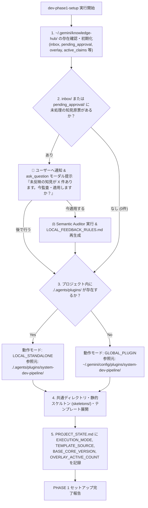

# テンプレート配置形態およびナレッジ境界設計書 (Template Distribution & Knowledge Boundary Specification)

文書バージョン: 2.3  
作成日: 2026-10-11  
改訂日: 2026-10-18  
対象バージョン: AI駆動システム開発ライフサイクルテンプレート V2.3  
ステータス: 正式改訂版 (V2.3 3スコープ境界・Central Knowledge Hub・Immutable Core + Local Overlay 統合版)  
関連文書:
- [V2.3新知見フィードバック機構設計書.md](./V2.3新知見フィードバック機構設計書.md)
- [V2.3改変計画書.md](./V2.3改変計画書.md)
- [パイプラインの改訂時におけるグローバルとワークスペースの同期について.md](./パイプラインの改訂時におけるグローバルとワークスペースの同期について.md)
- [WikiSkill統合設計書.md](./WikiSkill統合設計書.md)
- [エージェント間知見蓄積運用基準書V2.3.md](./エージェント間知見蓄積運用基準書V2.3.md)
- [AI駆動システム開発フェーズ定義書V2.3.md](./AI駆動システム開発フェーズ定義書V2.3.md)
- [エージェント設計書V2.3.md](./エージェント設計書V2.3.md)
- [状態管理機構設計書V2.3.md](./状態管理機構設計書V2.3.md)

---

## 1. はじめに

### 1.1 背景と問題意識
AI駆動システム開発ライフサイクルテンプレートにおいては、5大エージェント協調モデル（`conductor`, `architect`, `backend-engineer`, `ui-designer`, `qa-engineer`）、3大レビューゲート、2層構造システムプロファイル体系、および WikiSkill アーキテクチャを統合して開発を推進する。

V2.1〜V2.2 では、「個別プロジェクト領域（Workspace）」と「グローバルプラグイン領域（`~/.gemini/config/plugins/system-dev-pipeline/`）」の2スコープ境界を定義し、`GLOBAL_PLUGIN` モード時は `.patch` ファイルを出力する方式を採用していた。しかし、複数プロジェクト・複数環境での実運用において以下の課題が浮上した：
1. **複数案件からの `.patch` 競合と散逸**: 個別プロジェクトの `./promotions/*.patch` は行番号に強く依存するため、1つのパッチを適用すると他プロジェクトのパッチがハンク不一致で適用不能となり、また知見が各プロジェクトフォルダに散逸する。
2. **公式プラグイン直接編集によるアップデート競合**: グローバルプラグイン領域（`~/.gemini/config/plugins/system-dev-pipeline/`）のファイルを直接書き換えると、GitHub から新バージョンが配布された際にローカルの昇格知見が上書き消失するかコンフリクトを起こす。
3. **`PURPOSE.md` の相対リンク切れ**: 個別案件の `./wiki/` とグローバルプラグイン内の `skills/*/PURPOSE.md` の間で相対リンクが成立しない。

### 1.2 目的（V2.3 における3スコープ・2層プラグイン構成への進化）
本文書は、[V2.3新知見フィードバック機構設計書.md](./V2.3新知見フィードバック機構設計書.md) に基づき、物理境界を **「① 個別開発プロジェクト領域（Spoke）」「② PC環境共通ナレッジハブ＆ローカルオーバーレイ領域（Central Knowledge Hub）」「③ 公式配布プラグイン領域（Immutable Core）」の3スコープ** へ拡張し、PHASE 1 セットアップでの受皿構築・未処理知見検知、および PHASE 8 / 新バージョン適用時の安全なルーティング仕様を定義する。

---

## 2. ナレッジ境界（Tier 1 / Tier 2）と3スコープ物理配置アーキテクチャ

### 2.1 3つの物理スコープとナレッジ境界の基本原則

```
┌─────────────────────────────────────────────────────────────────────────────────────────────────┐
│                             V2.3 3スコープ物理配置・ナレッジ境界全体像                           │
├───────────────────────────────┬─────────────────────────────────┬───────────────────────────────┤
│ 【1. 個別プロジェクト (Spoke)】│ 【2. 環境共通ハブ (Central Hub)】│ 【3. 公式コア (Immutable Core)】│
│  <project-root>/              │  ~/.gemini/knowledge-hub/       │  ~/.gemini/config/plugins/    │
│  ・案件ごとにGit管理・完結    │  ・PC環境内の全案件で共通利用   │    system-dev-pipeline/       │
├───────────────────────────────┼─────────────────────────────────┼───────────────────────────────┤
│                               │                                 │                               │
│ [Tier 1: 案件固有知見 (Local)]│  (※ Tier 1 の流入は絶対厳禁)    │  (※ Tier 1 の流入は絶対厳禁)  │
│  ・一次記録:                  │                                 │                               │
│    ./wiki/patterns/local/     │                                 │                               │
│  ・正本還元 (案件内完結):     │                                 │                               │
│    ./docs/ & PROJECT_STATE.md │                                 │                               │
│                               │                                 │                               │
│ [Tier 2: 汎用知見 (Universal)]│ [第1段階進化: 環境内即時有効化] │ [第2段階進化: 本流統合リリース]│
│  ・一次記録:                  │  ・inbox/CLAIM-*.md (原票集約)  │  ・Core Compiler で蒸留統合   │
│    ./wiki/patterns/universal/ │  ・3段階意味的整合性監査 (2-A)  │  ・rules/AGENTS.md (上限220行)│
│  ・PHASE 8 で標準原票化:      │  ・active_claims/ (有効原票)    │  ・skills/*/SKILL.md(上限120行)│
│    ./promotions/CLAIM-*.md ───┼─►・overlay/                     │  ・PIPELINE_MANIFEST.json     │
│                               │    LOCAL_FEEDBACK_RULES.md ─────┼─►・FEEDBACK_LEDGER.md         │
│                               │    (次案件から即時有効・80行内) │  (※個別案件から直接編集禁止)  │
└───────────────────────────────┴─────────────────────────────────┴───────────────────────────────┘
```

#### 原則 1: ローカル・ファースト一次蓄積 (Local-First Accumulation)
開発タスクの実行中に発生するすべての試行錯誤、エラーログ、および RCA（根本原因分析）パターンは、**プラグインの配置形態に関わらず、必ず当該プロジェクト配下の `./wiki/patterns/{local,universal}/` に一次記録する**。

#### 原則 2: Tier 1 のプロジェクト完全閉塞性 (Tier 1 Project Containment)
Tier 1（顧客業務ロジック、個別画面遷移、特定外部API仕様、特定DBスキーマなど）は、各フェーズ完了ゲートで当該プロジェクト内の `./docs/`（基本設計書等）および `./PROJECT_STATE.md` へ逆同期して正本化する。**いかなる場合も `~/.gemini/knowledge-hub/` や公式プラグイン配下へ持ち出してはならない（INV-09）**。

#### 原則 3: Tier 2 の「Immutable Core ＋ Local Overlay」二段階昇格 (Two-Stage Evolution)
Tier 2（汎用共通知見）は、通常のアプリケーション開発プロジェクトの PHASE 8 において **公式プラグイン（Immutable Core）を直接書き換えない（3-A）**。
1. **第1段階（Spoke ➔ Hub/Overlay）**: PHASE 8 で行番号非依存の「標準化知見原票（`CLAIM-*.md`）」として `~/.gemini/knowledge-hub/inbox/` へ投函され、3段階意味的整合性監査とユーザー承認（`ask_question`）を通過すると、`~/.gemini/knowledge-hub/overlay/LOCAL_FEEDBACK_RULES.md` がクリーン再生成される。これにより、公式 Core を汚さず同一PC環境の次案件から即座に知見が有効化される。
2. **第2段階（Hub/Overlay ➔ Immutable Core）**: パイプライン自体の改訂作業（`template` ワークスペース）において、`active_claims/` や `inbox/` の原票群が公式の `SKILL.md` / `AGENTS.md` 本体へ蒸留統合され、`PIPELINE_MANIFEST.json` および `FEEDBACK_LEDGER.md` に記録されてリリースされる。新バージョン適用時は `Upgrade Reconciler` が吸収済み原票を `archive/upstreamed/` へ自動退役させる。

---

## 3. ディレクトリ構造仕様（PHASE 1 で確保する受皿）

PHASE 1（`dev-phase1-setup`）において、プロジェクトルート直下のディレクトリ確保と併せて、PC環境共通の `~/.gemini/knowledge-hub/` が未初期化であれば自動作成する。

### 3.1 個別開発プロジェクト領域 (`<project-root>/`)
```text
<project-root>/
├── docs/                                    # [Tier 1 正本] 各種設計書・仕様書
│   ├── plans/                               # レビュー報告書・テストログ・メトリクス統合サマリ
│   ├── 要件定義書.md
│   ├── 技術要件定義書.md
│   ├── テーブルスキーマ定義書.md
│   ├── ビジネスロジック仕様書.md
│   └── 画面仕様書.md
├── wiki/                                    # 【必須受皿】Spoke WikiSkill 一次蓄積層
│   ├── patterns/
│   │   ├── local/                           # Tier 1 パターン (PAT-LOC-xxx.md ➔ docs/へ逆同期)
│   │   ├── universal/                       # Tier 2 パターン (PAT-{CAT}-xxx.md ➔ CLAIM原票化)
│   │   └── rejected/                        # 案件内棄却履歴
│   ├── archive/                             # Compactor 退避先
│   ├── logs.md                              # RCA・ゲート採否履歴
│   └── skill-impact.md                      # パターンと原票の因果マップ
├── promotions/                              # PHASE 8 で生成した標準化知見原票 (CLAIM-*.md) の控え格納先
├── metrics/                                 # 定量メトリクス集計領域 (turns/ は .gitignore 登録)
├── rules/
│   └── AGENTS.md                            # プロジェクト適用開発標準規約 (Local Overlay 参照フック含む)
├── .env                                     # 環境変数定義 (VITE_ENABLE_MOCK=true 等)
├── .gitignore                               # Git除外設定 (wiki/, metrics/, promotions/ 等を除外)
├── PROJECT_STATE.md                         # 状態管理・進行ゲート・プロファイル・モード記録
└── TEMPLATE_PROMOTIONS.md                   # Tier 2 知見昇格(原票化)提示サマリ
```

### 3.2 PC環境共通ナレッジハブ領域 (`~/.gemini/knowledge-hub/`)
```text
~/.gemini/knowledge-hub/
├── inbox/                                   # 全案件から投函された未処理の標準化知見原票 (CLAIM-*.md)
├── pending_approval/                        # スケジュール実行時等の承認・裁定待ちステージング (REVIEW-*.md)
├── overlay/
│   ├── LOCAL_FEEDBACK_RULES.md              # 環境内で即時有効な追加・補正ルール (上限 80行)
│   └── skills/*.overlay.md                  # スキル別補足ガードレール
├── active_claims/                           # 現在 overlay/ に反映されている有効原票の実体保管庫
├── archive/upstreamed/                      # 公式Coreへ吸収完了(Upstreamed)した原票の退避先
├── suspended/                               # 新Core仕様と衝突し一時保留された原票
├── rejected/                                # 3段階意味的監査で棄却された原票と棄却理由
└── LOCAL_HUB_STATE.json                     # ベースCoreバージョンと適用中Claim IDの状態マニフェスト
```

---

## 4. テンプレート配置形態とセットアップ適応メカニズム

### 4.1 2つの配置形態（動作モード）の定義

| 項目 | モード A: グローバルプラグイン運用 (`GLOBAL_PLUGIN`) | モード B: ローカル同梱・パイプライン改訂運用 (`LOCAL_STANDALONE`) |
| :--- | :--- | :--- |
| **プラグイン実体** | `~/.gemini/config/plugins/system-dev-pipeline/` (Immutable Core) | `<project-root>/.agents/plugins/system-dev-pipeline/` |
| **環境拡張層 (Overlay)** | `~/.gemini/knowledge-hub/overlay/LOCAL_FEEDBACK_RULES.md` | `~/.gemini/knowledge-hub/overlay/LOCAL_FEEDBACK_RULES.md` |
| **主な用途** | **通常のアプリケーション開発案件の標準モード**。空ディレクトリから `dev-phase1-setup` で開始。 | **本 `template` プロジェクトでパイプライン自体を改訂・開発する場合**、またはローカル同梱で検証する場合。 |
| **PHASE 8 での昇格先** | `CLAIM-*.md` を `~/.gemini/knowledge-hub/inbox/` へ投函 ➔ 3段階意味的監査 ➔ **`overlay/LOCAL_FEEDBACK_RULES.md` を即時クリーン再生成**（Immutable Core は一切変更しない）。 | 通常のアプリ検証時はモードAと同様に Hub / Overlay へ反映。パイプライン改訂（Core Compiler）時は `.agents/plugins/...` 本体へ蒸留統合し `PIPELINE_MANIFEST.json` / `FEEDBACK_LEDGER.md` を更新。 |

---

### 4.2 ハイブリッド適応型セットアップ機構と Hub 未処理検知フック (PHASE 1)

`dev-phase1-setup` スキルおよびコンダクター（`conductor`）は、PHASE 1 開始時に以下のフローを実行する。



---

## 5. 知見昇格（PHASE 8）および新バージョン適用時のルーティング仕様

### 5.1 個別開発案件の PHASE 8 における標準ルーティング（Patch-Free / Overlay 即時進化）
1. **標準化知見原票の起案・投函**:
   - 👑 `conductor`（`wiki-proposer`）が `./wiki/patterns/universal/` から固有名詞や履歴ノイズを除去し、`CLAIM-{YYYYMMDD}-{SLUG}-{PAT_ID}.md` を生成して `./promotions/` に保存するとともに、`~/.gemini/knowledge-hub/inbox/` へ投函する（`.patch` ファイルや個別 `PURPOSE.md` は生成しない）。
2. **3段階意味的整合性監査（インライン起動）**:
   - 🛡️ `qa-engineer` が投函された原票に対し、New Gate 1（`CORE_INVARIANTS.md` 監査）、New Gate 2（既存 Core / Overlay との4分類矛盾監査）、New Gate 3（過剰適合・アンカー実在性）、New Gate 4（履歴IDゼロ・絶対行数バジェット80行以内）を実行する。
3. **`ask_question` モーダルによる決裁と Overlay クリーン再生成**:
   - 監査 PASS 時、コンダクターが `ask_question` モーダルでユーザー承認を仰ぎ、承認されれば原票を `active_claims/` へ移動し、`pipeline-reconciler.sh --rebuild-overlay` により `overlay/LOCAL_FEEDBACK_RULES.md` をクリーン再生成する。
   - これにより、公式プラグイン（Immutable Core）を1バイトも変更することなく、同一PC環境の次回案件から新ルールが即座に有効化される。
4. **他環境から本流への還流（1-B）**:
   - 外部環境のユーザーは、`active_claims/` または `./promotions/` 内の `CLAIM-*.md` を GitHub Issue / PR としてテンプレート正本リポジトリへ共有するだけで、パッチ競合なしに知見を還元できる。

### 5.2 パイプライン正本改訂時（`template` ワークスペース）の同期ガードレール
本 `template` リポジトリでパイプライン自体の改訂作業を行う際は、[パイプラインの改訂時におけるグローバルとワークスペースの同期について.md](./パイプラインの改訂時におけるグローバルとワークスペースの同期について.md) に規定された専用スキル **`template-pipeline-sync`** を「① 新規改訂開始前」および「② ワークスペースのソース改変前」に必ず実行し、グローバル環境および `~/.gemini/knowledge-hub/` の未吸収原票とのドリフトを解消してから作業を行う。

---

## 6. エージェント設計およびスキル群への反映マッピング（V2.3）

| 対象コンポーネント | 影響箇所 | V2.3 改訂内容 |
| :--- | :--- | :--- |
| **`rules/AGENTS.md`** | 第6節・末尾 | ・二層分離と Central Knowledge Hub（`~/.gemini/knowledge-hub/`）の3スコープ境界を明記。<br>・`~/.gemini/knowledge-hub/overlay/LOCAL_FEEDBACK_RULES.md` が存在する場合は追加規約として遵守する動的参照フックを明記。<br>・本文内の `[PAT-xxx]` 表記を排除し `FEEDBACK_LEDGER.md` へ分離。 |
| **`rules/CORE_INVARIANTS.md`** | 新規作成 | ・Stage 1 監査用の絶対不可侵原則カタログ（INV-01〜INV-10）を定義。 |
| **`PIPELINE_MANIFEST.json`**<br>**`FEEDBACK_LEDGER.md`** | プラグインルート新設 | ・個別 `skills/*/PURPOSE.md` を廃止し、バージョン管理と吸収済みフィードバック系譜を一元管理。 |
| **`conductor.md`** | システムプロンプト | ・PHASE 1 での Hub 未処理原票検知、PHASE 8 での `CLAIM-*.md` 投函と `ask_question` 承認モーダル提示、`LOCAL_FEEDBACK_RULES.md` 再生成統括を追加。 |
| **`qa-engineer.md`** | システムプロンプト | ・PHASE 8 の複合検証ゲートを「3段階意味的整合性監査（New Gate 1〜4）」へ刷新。スケジュール実行時の非ブロッキング `pending_approval/` ステージング規約を追加。 |
| **`dev-phase1-setup`** | `SKILL.md` | ・`~/.gemini/knowledge-hub/` 初期化および `inbox/`・`pending_approval/` の未処理原票検知ステップを追加。 |
| **`wiki-proposer`** | `SKILL.md` | ・`.patch` と個別 `PURPOSE.md` 生成を廃止し、標準化知見原票 `CLAIM-*.md` 生成＆ `inbox/` 投函へ全面刷新。 |
| **`dev-phase8-rules`** | `SKILL.md` | ・Inbox 投函 ➔ 3段階意味的監査 ➔ `ask_question` 承認 ➔ `LOCAL_FEEDBACK_RULES.md` 即時再生成フローへ刷新。 |

---

## 7. 関連ドキュメント
- [V2.3新知見フィードバック機構設計書.md](./V2.3新知見フィードバック機構設計書.md)
- [V2.3改変計画書.md](./V2.3改変計画書.md)
- [パイプラインの改訂時におけるグローバルとワークスペースの同期について.md](./パイプラインの改訂時におけるグローバルとワークスペースの同期について.md)
- [WikiSkill統合設計書.md](./WikiSkill統合設計書.md)
- [エージェント間知見蓄積運用基準書V2.3.md](./エージェント間知見蓄積運用基準書V2.3.md)
- [状態管理機構設計書V2.3.md](./状態管理機構設計書V2.3.md)
- [エージェント設計書V2.3.md](./エージェント設計書V2.3.md)
