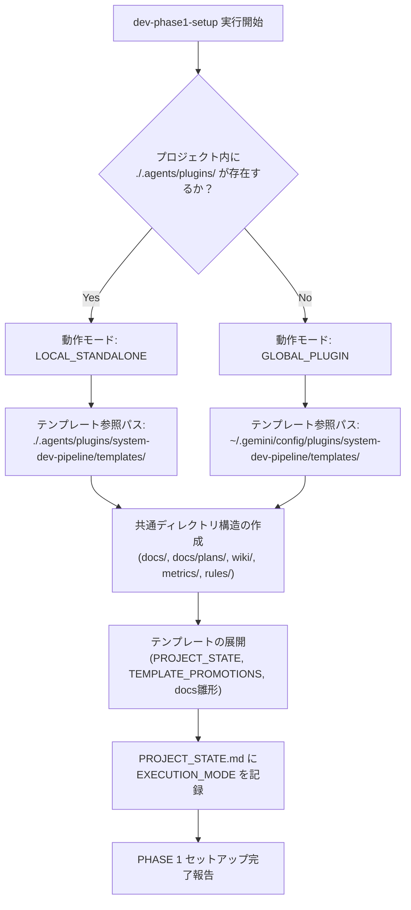

# テンプレート配置形態およびナレッジ境界設計書 (Template Distribution & Knowledge Boundary Specification)

文書バージョン: 1.0  
作成日: 2026-10-11  
対象バージョン: AI駆動システム開発ライフサイクルテンプレート V2.1  
ステータス: 策定完了  

---

## 1. はじめに

### 1.1 背景と問題意識
AI駆動システム開発ライフサイクルテンプレート V2.1 においては、5大エージェント協調モデル（`conductor`, `architect`, `backend-engineer`, `ui-designer`, `qa-engineer`）、3大レビューゲート、および WikiSkill アーキテクチャ（3層ストレージ：Raw / Wiki / Skills）の統合を進めている。

本テンプレートの実装資産（スキル群、サブエージェント定義群、テンプレート群、ルール群）は、`.agents/plugins/system-dev-pipeline/` 配下に集約されている。しかし、本テンプレートを実際の開発現場へ展開するにあたり、以下の**構造的・運用的な懸念点**が浮上した：

1. **プラグイン配置形態（グローバル vs ローカル）によるナレッジの置き場所の混同**:
   - テンプレート（`.agents/`）をユーザーの環境全体（例: `~/.gemini/config/plugins/system-dev-pipeline/`）にグローバル配置して複数プロジェクトで共有する場合、蓄積される知見（ナレッジ）をどこに配置すべきかが曖昧になる。
   - プロジェクト固有の知見（Tier 1）がグローバル領域に記録された場合、別プロジェクトへの**知見の越境汚染（Cross-Project Knowledge Contamination）**を引き起こす。
2. **PHASE 1 セットアップにおけるナレッジ受け皿ディレクトリの欠落**:
   - プロジェクト配下でナレッジ（WikiLayer）を運用する場合、PHASE 1（初期化）時点で適切なディレクトリ構造が自動構築されなければ、エージェントは知見の記録先を見失うか、存在しないパスへのアクセスエラーを起こす。
3. **テンプレート配置形態に応じたセットアップ手順の適応性の不足**:
   - 「グローバルプラグインから空フォルダへ初期展開する方式」と「テンプレートリポジトリをそのまま clone して開発する方式（Self-Contained）」とで、テンプレートファイルの探索パスや知見昇格（PHASE 8）時のフィードバック先が異なる。

### 1.2 目的
本文書は、テンプレート配置形態（グローバル適用 vs ローカルプロジェクト適用）を明確に類型化し、**「Tier 1 / Tier 2 ナレッジの厳格な格納境界」**、**「PHASE 1 で確保すべきディレクトリ構造」**、および**「実行環境に応じた適応型セットアップ機構」**の仕様を定義することを目的とする。

---

## 2. ナレッジ境界（Tier 1 / Tier 2）と物理配置アーキテクチャ

### 2.1 ナレッジ境界の基本原則

プラグイン本体がグローバルにインストールされているか、プロジェクトローカルに同梱されているかにかかわらず、以下の原則を絶対的制約として規定する。

```
┌───────────────────────────────────────────────────────────────────────────────────────┐
│                                    全体アーキテクチャ境界                              │
├─────────────────────────────────────────────────┬─────────────────────────────────────┤
│   【個別プロジェクト領域 (Project Workspace)】    │   【グローバル共有領域 (Global)】     │
│   ・リポジトリ単位でGit管理・チーム共有される     │   ・環境全体 (~/.gemini/) で共有      │
├─────────────────────────────────────────────────┼─────────────────────────────────────┤
│                                                 │                                     │
│  [Tier 1: プロジェクト固有知見 (Local)]         │                                     │
│   ・一次記録: ./wiki/patterns/local/            │  (※ Tier 1 のグローバル配置は厳禁)   │
│   ・正本還元: ./docs/ (要件定義書・設計書)      │     (越境汚染防止・セキュリティ保護)  │
│              ./PROJECT_STATE.md                 │                                     │
│                                                 │                                     │
│  [Tier 2: 全体共通知見 (Universal) - 開発中]    │                                     │
│   ・一次記録: ./wiki/patterns/universal/        │                                     │
│   ・昇格バッファ: ./TEMPLATE_PROMOTIONS.md      │                                     │
│                         │                       │                                     │
│                         │ (PHASE 8 ゲート合格)   │                                     │
│                         └───────────────────────┼──► [Tier 2: 確定共通知見]           │
│                                                 │     ・~/.gemini/config/plugins/...  │
│                                                 │       ├ skills/SKILL.md             │
│                                                 │       └ rules/                      │
└─────────────────────────────────────────────────┴─────────────────────────────────────┘
```

#### 原則 1: ローカル・ファースト蓄積 (Local-First Accumulation)
開発タスクの実行中に発生するすべての試行錯誤、エラーログ、および RCA（根本原因分析）パターンは、**プラグインの配置場所に関わらず、必ず当該プロジェクト配下の `./wiki/` ディレクトリに一次記録（バッファリング）する**。
- **理由**: 開発中の未検証知見やワークアラウンドを直ちにグローバル領域へ書き込むと、他の並行プロジェクトや将来の別プロジェクトの動作を不安定化させるため。

#### 原則 2: Tier 1 のプロジェクト閉塞性 (Tier 1 Project Containment)
Tier 1（顧客業務ロジック、個別画面遷移、特定外部API仕様、特定DBスキーマの癖など）は、**いかなる場合もグローバルプラグイン配下へ昇格・保存してはならない**。
- **正本到達先**: `./docs/` 配下の各仕様書・設計書、および `./PROJECT_STATE.md`。
- **効果**: プロジェクト間の完全なコンテキスト分離を保証し、AIが別案件の機密仕様や個別ルールを誤適用するリスクをゼロにする。

#### 原則 3: Tier 2 の二段階昇格 (Two-Stage Promotion for Tier 2)
Tier 2（フレームワークの挙動、Docker/コンテナの落とし穴、言語バージョン固有の型エラー、汎用リファクタリング知見など）は、プロジェクト配下の `./wiki/patterns/universal/` にバッファリングされ、**PHASE 8 において複合検証ゲート（Gating）を通過し、ユーザー承認を得た場合のみグローバル資産へ反映（自己進化）**される。

---

## 3. ディレクトリ構造仕様（PHASE 1 で確保する受皿）

PHASE 1（プロジェクト初期化）において、プロジェクトルート直下に以下の標準ディレクトリおよびファイルを自動展開・確保する。

```text
<project-root>/
├── docs/                                    # [Tier 1 正本] 各種設計書・仕様書
│   ├── plans/                               # 計画書・レビュー報告書格納領域
│   │   ├── scenario-test/                   # シナリオテスト結果ログ
│   │   └── metrics/                         # 統合メトリクスサマリ
│   ├── 要件定義書.md
│   ├── 技術要件定義書.md
│   ├── テーブルスキーマ定義書.md
│   ├── ビジネスロジック仕様書.md
│   └── 画面仕様書.md
│
├── wiki/                                    # 【必須受皿】WikiSkill 永続ナレッジ層
│   ├── patterns/                            # パターン別構造化知見（非破壊永続）
│   │   ├── local/                           # Tier 1 パターン (PAT-LOC-xxx.md)
│   │   ├── universal/                       # Tier 2 パターン (PAT-{CAT}-xxx.md)
│   │   └── rejected/                        # 検証ゲート不合格・失敗履歴
│   ├── archive/                             # Compactor による陳腐化パターン退避先
│   ├── logs.md                              # スキルパッチ採否・検証スコア全履歴
│   └── skill-impact.md                      # パターンとスキル改定の因果マップ
│
├── metrics/                                 # 定量メトリクス集計領域
│   └── turns/                               # ターン別一次集計JSON (dev-phase1-setup / dev-git-init で .gitignore 自動追加)
│
├── rules/                                   # プロジェクト固有ルール・上書き規約
│   └── AGENTS.md                            # プロジェクト適用開発標準規約
│
├── .env                                     # 環境変数定義
├── .gitignore                               # Git除外設定 (metrics/turns/ 等を自動登録)
├── PROJECT_STATE.md                         # 状態管理・進行ゲート・決定事項
└── TEMPLATE_PROMOTIONS.md                   # Tier 2 知見昇格申請バッファ
```

---

## 4. テンプレート配置形態とセットアップ適応メカニズム

### 4.1 2つの配置形態（動作モード）の定義

| 項目 | モード A: グローバルプラグイン運用 (`GLOBAL_PLUGIN`) | モード B: ローカル同梱運用 (`LOCAL_STANDALONE`) |
| :--- | :--- | :--- |
| **プラグイン実体** | `~/.gemini/config/plugins/system-dev-pipeline/` | `<project-root>/.agents/plugins/system-dev-pipeline/` |
| **プロジェクト開始方法** | 任意の空ディレクトリで Antigravity を起動し、グローバルスキル `dev-phase1-setup` を実行。 | 本テンプレートリポジトリを `git clone` またはテンプレート複製して開始。 |
| **プロジェクト内 `.agents`** | **原則不要**（スキル・エージェントはグローバルから供給）。 | **必須**（プロジェクト内にプラグインが内包されている）。 |
| **主な用途** | 複数案件を効率的に開発する標準運用。ツールの最新化を一元管理したい場合。 | プラグイン自体を開発・改訂する場合、または特定案件専用にスキル定義をカスタマイズしたい場合。 |

---

### 4.2 ハイブリッド適応型セットアップ機構 (Adaptive Setup Mechanism)

`dev-phase1-setup` スキルおよびコンダクター（`conductor`）は、現在の実行環境を自動識別し、動作モードに応じて動的に処理を切り替える。



#### ① テンプレート参照パスの動的フォールバック解決 (Template Path Fallback)
ファイルを展開する際、以下の優先順位で探索する：
1. **ローカル優先探索**: `./.agents/plugins/system-dev-pipeline/templates/<ファイル名>` が存在すればそれを優先採用。
2. **グローバルフォールバック**: 存在しない場合、プラグイン自身の配信元パス（`~/.gemini/config/plugins/system-dev-pipeline/templates/<ファイル名>`）を参照。

#### ② 状態ファイルへのモード記録
初期化時、`PROJECT_STATE.md` の Frontmatter / メタデータ領域に以下のキーを自動記録する：
```markdown
- **EXECUTION_MODE**: GLOBAL_PLUGIN (または LOCAL_STANDALONE)
- **TEMPLATE_SOURCE**: ~/.gemini/config/plugins/system-dev-pipeline (または ./.agents/plugins/system-dev-pipeline)
```
これにより、後続のフェーズ（特に PHASE 8）において、エージェントが昇格先を自律判定可能とする。

---

## 5. 知見昇格（PHASE 8）におけるモード別ルーティング仕様

PHASE 8 において Tier 2 共通知見を昇格・確定する際、`EXECUTION_MODE` に応じて出力先を安全に切り替える。

### 5.1 モード A: `GLOBAL_PLUGIN` での知見昇格
- **課題**: プロジェクト実行環境（サンドボックス設定）によっては、プロジェクト外の `~/.gemini/...` への直接書き込みが制限される場合がある。また、ユーザーの意図しないグローバル変更を防ぐ必要がある。
- **昇格手順**:
  1. 🛡️ `qa-engineer` がプロジェクトローカルの `./wiki/patterns/universal/` を対象に複合検証ゲートを実行。
  2. 👑 `conductor` が合格したパッチを `./TEMPLATE_PROMOTIONS.md` に集約。
  3. **パッチファイルのエクスポート**:
     - エクスポート先ディレクトリ（`./promotions/`）が存在しない場合は自動生成（`mkdir -p ./promotions`）した上で、プロジェクトルートに `./promotions/v2.1_universal_patterns.patch`（または Markdown 形式の昇格差分ファイル）を生成。
  4. **ユーザー案内**:
     - ユーザーに対し、「グローバルプラグイン（`~/.gemini/...`）またはテンプレート本流リポジトリへ本パッチを適用するか」を確認し、手動適用コマンドまたは適用承認を求める。

### 5.2 モード B: `LOCAL_STANDALONE` での知見昇格
- **昇格手順**:
  1. 🛡️ `qa-engineer` が複合検証ゲートを実行。
  2. 👑 `conductor` がプロジェクト配下の `./.agents/plugins/system-dev-pipeline/skills/` および `rules/` を直接更新。
  3. `dev-git-release` により、テンプレート変更を含むコミットとしてリポジトリへ反映。

---

## 6. エージェント設計およびスキル群への影響と改訂方針

本設計に基づき、各エージェントおよびスキルへ以下の仕様変更を反映する。

| 対象コンポーネント | 影響箇所 | 改訂内容 |
| :--- | :--- | :--- |
| **`conductor.md`** | システムプロンプト | ・プロジェクト初期化時の `EXECUTION_MODE` 判定責務の追加。<br>・PHASE 8 における知見昇格先ルーティング（グローバルパッチ出力 vs ローカル更新）の制御ロジック追加。 |
| **`qa-engineer.md`** | システムプロンプト | ・Wiki Maintainer 実行時、一次記録先を常に `./wiki/patterns/{local,universal}/` とし、プロジェクト外へ逸脱しない安全ガードレールの追加。 |
| **`dev-phase1-setup`** | `SKILL.md` | ・`./wiki/patterns/{local,universal,rejected}` および `./wiki/archive` の作成ステップの追加。<br>・テンプレート探索パスのフォールバック仕様の明記。<br>・`PROJECT_STATE.md` への `EXECUTION_MODE` 記録指示。 |
| **`wiki-maintainer`** | `SKILL.md` | ・パス解決の基準を `./wiki/` 配下に厳格統一。 |
| **`wiki-proposer`** | `SKILL.md` | ・入力対象を `./wiki/patterns/universal/` に固定し、出力時に `EXECUTION_MODE` を参照してパッチ適用先を判定。 |
| **`dev-phase8-rules`** | `SKILL.md` | ・知見昇格の提示・反映フローにモード分岐（パッチファイル出力 vs 直接更新）を組み込む。 |
| **`PROJECT_STATE.md.template`** | テンプレート | ・`EXECUTION_MODE` メタデータ欄の追加。 |

---

## 7. まとめ

以上の設計により：
1. **Tier 1 知見の完全なローカル閉塞**が担保され、プロジェクト間での機密漏洩・越境汚染が防止される。
2. **Tier 2 知見の安全なローカルバッファリングと検証後昇格**が実現され、グローバル環境の安定性が保たれる。
3. **PHASE 1 初期化で必要なディレクトリ群が網羅**され、WikiSkill アーキテクチャが初回実行時から破綻なく機能する。
4. **グローバルプラグイン運用とローカル同梱運用の双方がシームレスにサポート**され、開発者の利用環境に応じた最適なライフサイクルが提供される。

---

## 関連ドキュメント
- [WikiSkill統合設計書.md](./WikiSkill統合設計書.md)
- [エージェント間知見蓄積運用基準書V2.1.md](./エージェント間知見蓄積運用基準書V2.1.md)
- [状態管理機構設計書V2.1.md](./状態管理機構設計書V2.1.md)
- [エージェント設計書V2.1.md](./エージェント設計書V2.1.md)
- [V2.1実装詳細計画書.md](./V2.1実装詳細計画書.md)
