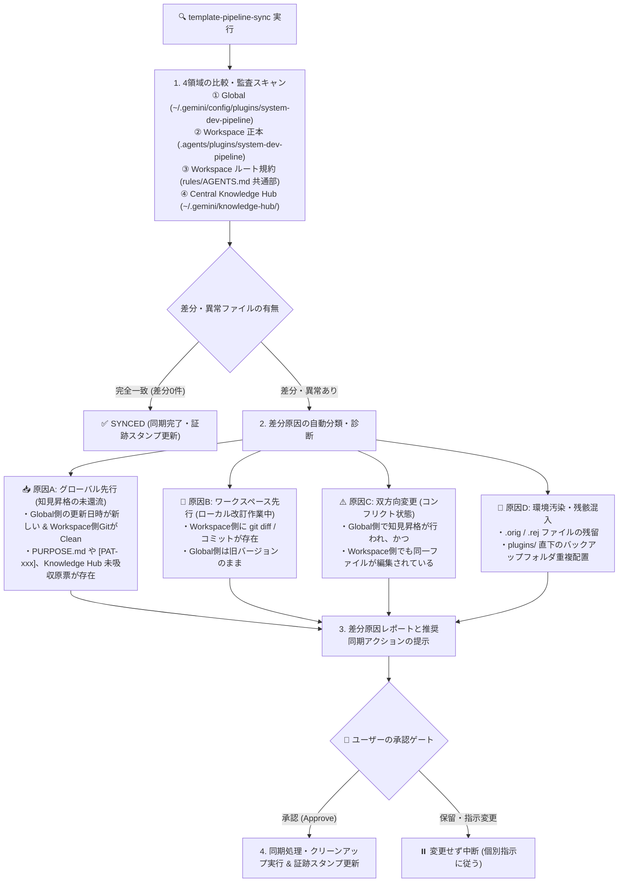
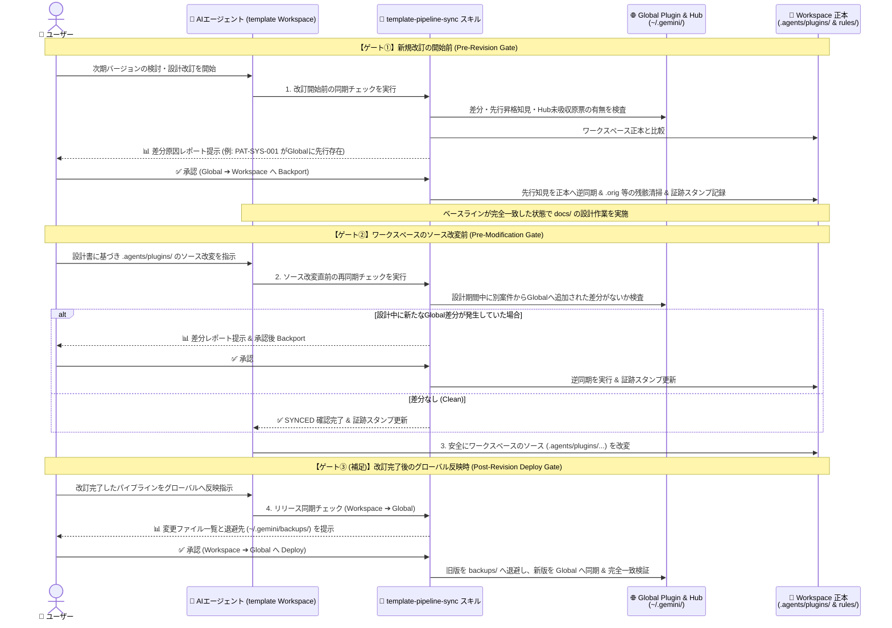

# パイプラインの改訂時におけるグローバルとワークスペースの同期について

文書バージョン: 1.0  
作成日: 2026-10-17  
対象スコープ: `template` プロジェクト（パイプライン開発・改訂用ローカルワークスペース）  
ステータス: 確定・実装済  
関連文書:
- [知見昇格時のテンプレート正本同期およびドリフト防止検討課題.md](../../検討課題/V2.3/知見昇格時のテンプレート正本同期およびドリフト防止検討課題.md)
- [知見フィードバック機構の高度化と一元管理・監査・配布に関する検討課題.md](../../検討課題/V2.3/知見フィードバック機構の高度化と一元管理・監査・配布に関する検討課題.md)
- [V2.3新知見フィードバック機構設計書.md](./V2.3新知見フィードバック機構設計書.md)
- [テンプレート配置形態およびナレッジ境界設計書.md](./テンプレート配置形態およびナレッジ境界設計書.md)

---

## 1. 背景と課題の位置づけ

### 1.1 問題の本質と発生スコープの特定
`system-dev-pipeline` を用いた日々のシステム開発（個別アプリケーション開発プロジェクト）と、パイプライン自体を改良・バージョンアップする開発（本 `template` プロジェクト）を同一のローカル環境で並行運用する場合、以下の2つの領域間にファイル差分の乖離（ドリフト）が発生する。

1. **グローバル環境（稼働系）**: `~/.gemini/config/plugins/system-dev-pipeline/`
2. **ワークスペース環境（開発正本系）**: 本 `template` リポジトリ内の `.agents/plugins/system-dev-pipeline/`（およびワークスペースルートの `rules/AGENTS.md`）

このドリフト問題は、**「パイプライン自身の改訂作業を行う開発者のローカル環境」でのみ発生する固有の問題**であり、本テンプレートを利用して一般的なアプリケーションを開発するプロジェクトの実行環境では発生しない。したがって、配布されるパイプライン本体（全案件共通の進行フェーズ定義）を複雑化させるのではなく、**`template` プロジェクト内の開発運用仕組み（ワークスペース固有のスキルおよび規約）として局所化・解決する**のが最も合理的である。

### 1.2 確定した基本方針
本プロジェクトにおけるドリフト防止・解消の基本方針を以下の2点とする。

1. **同期専用スキルの設置**:
   - グローバル環境とワークスペース（`template`）のパイプライン構成資産を比較し、差分があれば**その発生原因を分析・報告した上で、ユーザーの承認に基づく同期処理を行う専用スキル**を `template` プロジェクト内に設ける。
2. **同期タイミング（2大ゲート）の義務化**:
   - **「新規改訂の開始前」** および **「ワークスペースのソース（プラグイン構成資産）の改変前」** に、必ず上記スキルを実行してパイプラインの同期を行う。

---

## 2. 同期スキル（`template-pipeline-sync`）の詳細設計

### 2.1 スキルの配置場所（配布資産との明確な分離）
本スキルは `template` プロジェクトでの改訂作業専用であるため、他プロジェクトへ配布されるプラグインディレクトリ（`.agents/plugins/system-dev-pipeline/skills/`）には配置せず、**`template` ワークスペース直下のローカルスキル領域**に配置する。

```text
template/ (本プロジェクトルート)
├── .agents/
│   ├── skills/
│   │   └── template-pipeline-sync/          # ★ ワークスペース専用スキル（一般案件には配布・露出しない）
│   │       ├── SKILL.md                     # 差分比較・原因診断・承認後同期の実行手順定義
│   │       └── scripts/
│   │           └── sync_pipeline.sh         # 差分検出・原因分類・安全同期・クリーンアップ用スクリプト
│   └── plugins/
│       └── system-dev-pipeline/             # ★ パイプライン正本（グローバルへ配布される対象資産）
├── rules/
│   └── AGENTS.md                            # template ワークスペース自身の行動規約（第11節に同期規約を明記）
└── docs/
```

> **【メリット】**  
> `.agents/skills/` 直下に配置することで、Antigravity で `template` ワークスペースを開いている時のみ本スキルが認識・有効化され、他プロジェクト開発時に不要なスキルがロードされるコンテキスト汚染（Context Pollution）を完全に防ぐことができる。

---

### 2.2 比較対象と差分原因の自動診断ロジック

スキル実行時、単なるファイルの不一致リストを出すだけでなく、**「なぜその差分が生じたのか」をタイムスタンプ・Git管理状態・ファイル内容から自動診断**してユーザーへ報告する。



#### 差分原因の4分類と推奨同期アクション

| 診断分類 | 判定基準（シグナル） | 推定される原因 | ユーザーへ提案する同期処理（承認後実行） |
| :--- | :--- | :--- | :--- |
| **原因 A：<br>グローバル先行**<br>*(Global Ahead)* | ・Workspace 側の該当ファイルに未コミット変更がない（または Global 側の mtime が新しい）<br>・Global 側にのみ `PURPOSE.md` や `[PAT-xxx]`、または `~/.gemini/knowledge-hub/` に未吸収原票が存在する | 別プロジェクトの開発（PHASE 8 等）で昇格・適用された知見が、まだ `template` 正本へ還流（Backport）されていない。 | **【Backport（Global ➔ Workspace 逆同期）】**<br>Global 側の変更を Workspace 正本（`.agents/plugins/...` および `rules/AGENTS.md` 共通部）へ取り込み、`git diff` で確認可能な状態にする。 |
| **原因 B：<br>ワークスペース先行**<br>*(Workspace Ahead)* | ・Workspace 側の `git status` に変更がある、または Workspace 側のコミット・mtime が新しい<br>・Global 側に固有の追加記述がない | 本 `template` プロジェクト内で進行中の改訂作業による変更であり、Global 側にはまだリリース反映されていない。 | **【タイミングに応じた処置】**<br>・**改変作業中**: 正常な先行状態として維持（上書きしない）。<br>・**改訂完了・リリース時**: **【Deploy（Workspace ➔ Global 順同期）】** を実行。 |
| **原因 C：<br>双方向変更**<br>*(Diverged / Conflict)* | ・Global 側に固有の追加行（昇格知見等）があり、かつ Workspace 側でも別箇所または同一箇所が編集されている | Global 側での知見昇格と、Workspace 側での改訂作業が並行して発生した。 | **【Semantic Merge（3-way 統合）】**<br>双方の Unified Diff を提示し、Global 側の知見と Workspace 側の改訂内容を両方活かしたマージ案を生成して適用する。 |
| **原因 D：<br>環境汚染・残骸**<br>*(Environment Artifacts)* | ・`*.orig`, `*.rej`, `.DS_Store` 等の存在<br>・`~/.gemini/config/plugins/` 直下に `*_backup_*` フォルダが存在 | `patch` コマンド実行時のバックアップ残骸、またはプラグインローダーの二重スキャンを引き起こす不適切なバックアップ配置。 | **【Cleanup（清掃・退避）】**<br>`.orig` / `.rej` の削除、およびバックアップフォルダの `~/.gemini/backups/system-dev-pipeline/`（ローダー走査対象外）への移動。 |

---

### 2.3 同期実行時の安全ガードレール
ユーザーの承認を得て同期処理を実行する際、本スキルは以下の安全措置を必ず適用する。

1. **盲目的な `cp -r` / `rsync --delete` の禁止**:
   - 必ず上記の差分診断レポートを出力し、どのファイルがどの方向（Global ➔ Workspace または Workspace ➔ Global）へ更新されるかを明示してユーザー承認を得る。
2. **バックアップ退避先の厳格化**:
   - Workspace ➔ Global へ反映する際、更新前の Global プラグインは `~/.gemini/config/plugins/` 直下ではなく、必ずプラグインローダーの走査対象外である **`~/.gemini/backups/system-dev-pipeline/backup_YYYYMMDD_HHMMSS/`** へ退避する。
3. **ワークスペース内 `rules/AGENTS.md` の役割分離と共通部連動更新（提案 2-B 採用仕様）**:
   - `.agents/plugins/system-dev-pipeline/rules/AGENTS.md` は「配布されるシステム開発パイプライン規約」の正本とする。
   - ワークスペースルートの [`rules/AGENTS.md`](../../../rules/AGENTS.md) には、共通規約に加えて**「第11節：パイプライン改訂作業におけるグローバル・ワークスペース同期規約（本プロジェクト固有ルール）」**を保持し、同期スキルは第11節（ワークスペース固有部）を保護しつつ共通部（第1〜10節等）を完全一致させる。
4. **事後の一致検証と同期証跡スタンプの記録（提案 1 採用仕様）**:
   - 同期完了後、直ちに再検証を実行し、意図した通りに差分が解消されていることを確認した上で、`.git/pipeline_sync_stamp` に同期証跡を記録する。

---

## 3. 同期スキルの実行タイミング（運用フローへの組み込み）

以下の **2つの必須ゲート（＋リリース時の1ゲート）** を `template` プロジェクトの開発フローとして規定する。



1. **ゲート①：新規改訂の開始前（Pre-Revision Gate）**
   - **目的**: 新バージョンの検討課題整理や基本設計（`docs/設計書/Current/` の作成・改訂）に着手する前に、直近の実案件開発でグローバル環境に蓄積された知見をワークスペース正本へ取り込み、**「最新の稼働実態」をベースラインとして設計を開始する**ため。
2. **ゲート②：ワークスペースのソース改変前（Pre-Modification Gate）**
   - **目的**: 設計が完了し、実際に `.agents/plugins/system-dev-pipeline/` 配下のファイル（`agents/`, `rules/`, `skills/`, `skeletons/`, `templates/`）を編集する直前に再度チェックを行い、設計作業中に別ウィンドウの案件で追加されたグローバル変更を誤って上書き消去することを防ぐため。
3. **ゲート③（補足）：改訂完了後のグローバル環境への反映時（Post-Revision Deploy Gate）**
   - **目的**: ワークスペースでのソース改変・相互整合性チェックが完了し、その成果をグローバル環境（`~/.gemini/config/plugins/system-dev-pipeline/`）へ適用する際に、安全なバックアップ退避と反映後の完全一致確認を担保するため。

---

## 4. 別途方法・補強アイデアの提案と採否決定

検討した5つの補強・代替アイデアと、その採否決定は以下の通りである。

### 提案 1：【採用】同期状態のタイムスタンプ証跡（`.git/pipeline_sync_stamp`）と Git `pre-commit` ガードの併用
- **判定**: **✅ 採用**
- **仕様内容**:
  1. `template-pipeline-sync` スキルが正常に同期（または差分確認）を完了した際、ワークスペース内の `.git/pipeline_sync_stamp`（Git管理外の一時ファイル）に**最終同期確認時刻とグローバル側のツリーハッシュ値**を記録する。
  2. 軽量な Git フック（`.git/hooks/pre-commit`）を設置し、`.agents/plugins/` 配下の変更をコミットしようとした際、**「グローバル側に未取り込みの先行変更（Global 側のファイル更新時刻が新しく内容が異なるもの）が存在しないか」**および**「同期スタンプが有効か」**を自動チェックする。未同期のグローバル先行差分があればコミットをブロックし、`template-pipeline-sync` の実行を促す。
- **効果**: AIの自律ルール遵守（ソフト対策）と、Gitフックによる機械的ブロック（ハード対策）の二重防御を実現する。

### 提案 2：【2-B を採用】ワークスペース内 `rules/AGENTS.md` の役割分離と共通部同期
- **判定**: **✅ 案 2-B を採用**（案 2-A の Symlink 化は不採用）
- **仕様内容**:
  - [`.agents/plugins/system-dev-pipeline/rules/AGENTS.md`](../../../.agents/plugins/system-dev-pipeline/rules/AGENTS.md) は「配布されるシステム開発パイプライン規約」の正本とし、`template` 固有の内部事情を持ち込まない。
  - ワークスペースルートの [`rules/AGENTS.md`](../../../rules/AGENTS.md) には、共通規約に加えて**「第11節：パイプライン改訂作業におけるグローバル・ワークスペース同期規約（本プロジェクト固有ルール）」**を明記する。
  - `sync_pipeline.sh` スクリプトは、第11節の境界マーカー（`## 11. パイプライン改訂作業におけるグローバル・ワークスペース同期規約`）より前の共通セクションについて、プラグイン正本とワークスペースルート規約の同一性を自動検証・同期する。

### 提案 3：【却下】グローバル環境のシンボリックリンク直結方式（Symlink Mode）
- **判定**: **❌ 却下**
- **理由**: `template` ワークスペースでの改訂作業中（未完成状態）の変更がリアルタイムにグローバル環境へ露出し、他案件の稼働に悪影響を及ぼすため、物理分離＋スキルによるゲート同期を維持する。

### 提案 4：【却下】スラッシュコマンド / ワークフロー化のショートカット提供
- **判定**: **❌ 却下**
- **理由**: 専用スキル（`template-pipeline-sync`）および `rules/AGENTS.md` 第11節のトリガー規約で十分に機能するため、不要なコマンド定義の増加を避ける。

### 提案 5：【採用】V2.3 Central Knowledge Hub（`~/.gemini/knowledge-hub/`）への監査対象拡張
- **判定**: **✅ 採用**
- **仕様内容**:
  - `template-pipeline-sync` スキルおよび `sync_pipeline.sh` に、以下の2つのチェック機能を実装する：
    1. **Core ドリフトチェック（現行＆V2.3共通）**: `~/.gemini/config/plugins/system-dev-pipeline/` と `.agents/plugins/system-dev-pipeline/` のファイル差分・残骸チェック。
    2. **Knowledge Hub 未吸収原票チェック（V2.3対応）**: `~/.gemini/knowledge-hub/inbox/` や `active_claims/` に、まだ `template` 正本（`PIPELINE_MANIFEST.json` 等）へ本流統合（Upstream Merge）されていない知見原票（`CLAIM-*.md`）が存在しないかを検出し、改訂開始時に取り込みを提案する機能。

---

## 5. 実装構成（初期ステップの適用内容）

採択された仕様に基づき、`template` プロジェクト内に以下の構成を整備・適用する。

| ステップ | 作業内容 | 対象パス（`template` プロジェクト内） |
| :---: | :--- | :--- |
| **Step 1** | **同期スキル＆診断・同期スクリプトの作成（提案1・2-B・5 統合）**<br>・差分比較、4分類原因診断、Knowledge Hub 原票監査、共通ルール連動、バックアップ退避（`~/.gemini/backups/`）、同期証跡スタンプ（`.git/pipeline_sync_stamp`）出力を行うスクリプトとスキル定義を作成する。<br>・併せて `.git/hooks/pre-commit` に未同期コミット防止ガードを設置する。 | ・`.agents/skills/template-pipeline-sync/SKILL.md`<br>・`.agents/skills/template-pipeline-sync/scripts/sync_pipeline.sh`<br>・`.git/hooks/pre-commit` |
| **Step 2** | **ワークスペース規約への同期ルール追記（提案 2-B）**<br>・ワークスペースルートの `rules/AGENTS.md` に第11節（新規改訂開始前・ソース改変前の `template-pipeline-sync` 実行義務）を新設する（配布用プラグイン側の `AGENTS.md` には含めない）。 | ・[`rules/AGENTS.md`](../../../rules/AGENTS.md)（第11節の新設） |
| **Step 3** | **初回同期の実行（現在発生しているドリフトの解消）**<br>・作成したスキルを実行し、現在グローバル環境にある `[PAT-SYS-001]` の変更（4ファイル）のワークスペースへの逆同期（Backport）、`AGENTS.md.orig` の削除、および `plugins/` 直下の旧バックアップの `~/.gemini/backups/` への退避を完了させる。 | ・Global ⇔ Workspace 全域（全ファイル完全一致の確認） |
