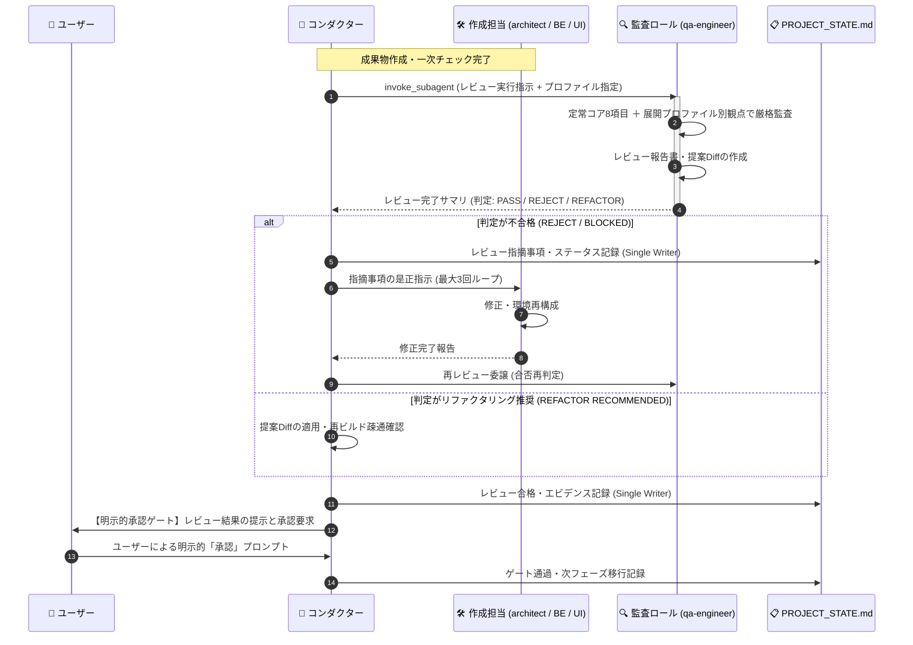

# レビューシステム設計書 V2.3 (Review System Architecture Specification V2.3)

文書バージョン: 2.3  
作成日: 2026-10-18  
対象バージョン: AI駆動システム開発ライフサイクルテンプレート V2.3  
ステータス: 正式改訂版 (2層プロファイル・Shift-Left監査・3段階意味的整合性監査統合版)  
関連文書:
- [V2.3改変計画書.md](./V2.3改変計画書.md)
- [V2.3新知見フィードバック機構設計書.md](./V2.3新知見フィードバック機構設計書.md)
- [V2.3システムプロファイル構造設計書.md](./V2.3システムプロファイル構造設計書.md)
- [ProfileA詳細設計書.md](./ProfileA詳細設計書.md)
- [ProfileD詳細設計書.md](./ProfileD詳細設計書.md)
- [AI駆動システム開発フェーズ定義書V2.3.md](./AI駆動システム開発フェーズ定義書V2.3.md)
- [エージェント設計書V2.3.md](./エージェント設計書V2.3.md)
- [状態管理機構設計書V2.3.md](./状態管理機構設計書V2.3.md)
- [01_グランドデザイン基本仕様書.md](../../../.agents/plugins/system-dev-pipeline/templates/グランドデザイン/01_グランドデザイン基本仕様書.md)
- [02_UIコンポーネントカタログ及び実装パターン.md](../../../.agents/plugins/system-dev-pipeline/templates/グランドデザイン/02_UIコンポーネントカタログ及び実装パターン.md)
- [03_画面仕様書テンプレート.md](../../../.agents/plugins/system-dev-pipeline/templates/グランドデザイン/03_画面仕様書テンプレート.md)

---

## 1. はじめに

### 1.1 背景と課題認識
AI駆動システム開発テンプレート V2.1〜V2.2 においては、3大レビューシステム（基本設計・コード品質・システム総合レビュー）、2層プロファイル体系、Shift-Left規約、およびWikiSkill型永続ナレッジ自己進化ループにより、アプリケーション開発における高い自律性と品質統制を実現した。

実稼働プロジェクト（`bicycle-log`、`Movie Log`、`Gardening Log`、`bicycle-maintenance`、`gps-overlay`）の知見分析（[AI駆動開発テンプレート_事前組込推奨要件・設計・留意事項_総合レポート.md](../../検討課題/V2.2/AI駆動開発テンプレート_事前組込推奨要件・設計・留意事項_総合レポート.md)）と、長期自己進化の運用課題分析（[知見フィードバック機構の高度化と一元管理・監査・配布に関する検討課題.md](../../検討課題/V2.3/知見フィードバック機構の高度化と一元管理・監査・配布に関する検討課題.md)）により、レビュー・監査システムには以下の2軸の統制が求められることが確立された：
1. **アプリケーション開発における Shift-Left 3大レビューの徹底（PHASE 3, 5.5, 7）**:
   「God Component化（単一ファイル肥大化）」「Alembic未導入による手動ALTER TABLE」「IAP署名検証欠如」「型定義の二重管理」「野良直書きモックの残留」を要件定義・基本設計・初期スケルトン展開段階から組み込まれた標準規範（Shift-Left）に照らして機械的・網羅的に検査する。
2. **パイプライン自己進化における 3段階意味的整合性監査の確立（PHASE 8 新複合検証ゲート）**:
   個別プロジェクトから昇格する知見原票（`CLAIM-*.md`）がパイプラインの「コア不変原則（`CORE_INVARIANTS.md`）」を破壊したり、他プロファイルのルールと意味的矛盾（Semantic Conflict）を起こしたり、履歴ID（`[PAT-xxx]` 等）の追記でコンテキスト純度を低下させたりすることを防ぐため、PHASE 8 において3段階の意味的整合性監査（新4大関門）を実施する。

### 1.2 V2.3の思想：アプリ品質のShift-Left監査とパイプライン進化の意味的監査の統合
V2.3 では、開発対象システムの品質を保証する **「3大レビューゲート（基本設計・コード品質・システム総合）」** と、開発パイプライン自身の健全な進化を保証する **「PHASE 8 新複合検証ゲート（3段階意味的整合性監査）」** を統合的に定義する。

---

## 2. レビューシステムの全体アーキテクチャ

### 2.1 3大レビューおよびPHASE 8意味的監査ゲートの配置マップ

```
┌───────────────────────────────────────────────────────────────────────────────┐
│               AI駆動開発ライフサイクル レビュー・監査ゲート体系 (V2.3)        │
├───────────────────────────────────────────────────────────────────────────────┤
│                                                                               │
│  [PHASE 1: 準備] ────► スケルトン展開 (skeletons/) ＆ Hub未処理原票検知フック │
│        │                                                                      │
│        ▼                                                                      │
│  [PHASE 2: 要件定義] ──► 2層プロファイル体系 (Profile A〜D) を確定・バインド   │
│        │                                                                      │
│        ▼                                                                      │
│  [PHASE 3: 基本設計] ──────────────────────────┐                              │
│        │                                      ▼                              │
│        │                     【1. 基本設計レビュー (PHASE 3完了ゲート)】       │
│        │                       ・定常コア8項目: 責務分離、型同期、Alembic、   │
│        │                         モック制御、グランドデザイン、二重キャッシュ│
│        │                       ・展開プロファイル別観点監査 (Profile A〜D)    │
│        ▼                                                                      │
│  [PHASE 4: 責務分離実装] ──► 標準コマンドシーケンス順守 (Alembic/Codegen)     │
│        │                                                                      │
│        ▼                                                                      │
│  [PHASE 5: ウォークスルー] ──► モック透過切替検証 (VITE_ENABLE_MOCK=true/false)│
│        │                                                                      │
│        ▼                                                                      │
│  [PHASE 5.5: コード品質] ─────────────────────┐                              │
│        │                                      ▼                              │
│        │                     【2. コードクオリティ・整合性レビュー】           │
│        │                       ・Anti-God Component: 1ファイル最大250行制限   │
│        │                       ・直書きモック排除: コンポーネント内スタブ皆無 │
│        │                       ・型同期検証、DRY原則、SRP、デッドコード排除   │
│        ▼                                                                      │
│  [PHASE 6: スルーテスト] ──► シナリオテスト100%パス & 自律修復ループ          │
│        │                                                                      │
│        ▼                                                                      │
│  [PHASE 7: 本番リリース] ─────────────────────┐                              │
│        │                                      ▼                              │
│        │                     【3. システム総合レビュー (リリース直前ゲート)】 │
│        │                       ・本番モック無効化二重防御 (VITE_ENABLE_MOCK)  │
│        │                       ・IAP JWT署名検証、Alembic自動適用、同期ラグ   │
│        ▼                       ・平文シークレット完全排除、ロールバック計画   │
│  [PHASE 8: 保守改訂運用] ─────────────────────┐                              │
│                                               ▼                              │
│                              【4. パイプライン自己進化 3段階意味的監査ゲート】│
│                                ・新関門1: コア不変原則 (INV-01〜10) 整合性   │
│                                ・新関門2: 既存ルール/他FB 4分類矛盾監査      │
│                                ・新関門3: 過剰適合排除 & セクション構造整合  │
│                                ・新関門4: コンテキスト純度 (履歴IDゼロ) ＆   │
│                                           絶対行数バジェット監査              │
│                                                                               │
└───────────────────────────────────────────────────────────────────────────────┘
```

---

## 3. 2層構造レビュー観点詳細設計

```
┌────────────────────────────────────────────────────────────────────────────────────────┐
│                              V2.3 レビュー観点の二層構造体系                           │
├────────────────────────────────────────────────────────────────────────────────────────┤
│                                                                                        │
│   【第1層: 定常的コア設計規範 (Universal Core Specifications)】                        │
│     全システム・全プロファイル共通で妥協なく機械的検査される8大普遍的規約               │
│     1. フロントエンド責務分離構造 (Anti-God Component / 1ファイル最大250行制限)         │
│     2. 型定義自動同期パイプライン (OpenAPI ➔ TypeScript Codegen / 型二重管理排除)      │
│     3. 環境変数・シークレット厳格バリデーション (Pydantic Settings / プレースホルダー即死)│
│     4. 統一タイムゾーン・時刻運用規約 (DB・通信はAware UTC / UI表示層でのみJST変換)    │
│     5. 自動CIパイプライン標準 (GitHub Actions: Lint, TypeCheck, Unit/Smoke Test)       │
│     6. モックアップ制御ハイブリッド規範 (案C: 環境変数切替 ＋ 案A: 直書きモック排除)   │
│     7. 画面グランドデザイン基礎規範 (4px/8pxグリッド / HEX・px絶対値併記 / 形態選定)   │
│     8. 外部連携二重キャッシュ & 可観測性標準 (TTLメモリ＋DBキャッシュ / 内部死活監視) │
│                                                                                        │
│                                       ▼ 動的合成                                       │
│                                                                                        │
│   【第2層: 可変的システム展開プロファイル (Deployment Profiles)】                      │
│     PHASE 2 要件定義書で選定されたプロファイルに基づき合否基準を動的適用               │
│                                                                                        │
│   ┌──────────────────┬──────────────────┬──────────────────┬─────────────────┐ │
│   │ Profile A        │ Profile B        │ Profile C        │ Profile D       │ │
│   │ サーバーレス     │ Web SSR /        │ 静的MPA /        │ PCローカル      │ │
│   │ 極小コストWeb型  │ フルマネージド型 │ 超軽量ツール型   │ デスクトップ型  │ │
│   │ (ゴールデンパス) │                  │                  │                 │ │
│   ├──────────────────┼──────────────────┼──────────────────┼─────────────────┤ │
│   │ ・Cloud Run max=1│ ・水平オートスケ │ ・単一プロセス   │ ・Tauri/OSネイ  │ │
│   │ ・Litestream+GCS │   ール & N+1排除 │ ・外部ミドルウェ │   ティブ統合    │ │
│   │ ・SQLite(WAL/FK) │ ・Cloud SQL RDB  │   ア依存ゼロ     │ ・Local SQLite  │ │
│   │ ・Alembic確定統合│ ・OAuth2/OIDC    │ ・HTMX / CLI     │ ・TitleBar制御  │ │
│   │ ・IAP JWT二重防御│ ・MSW Node       │ ・スタブ/DI      │ ・IPCモック     │ │
│   │ ・MSW (Web)      │                  │                  │ ・IStorageAdapt │ │
│   └──────────────────┴──────────────────┴──────────────────┴─────────────────┘ │
│                                                                                        │
└────────────────────────────────────────────────────────────────────────────────────────┘
```

---

## 4. 3大レビューおよびPHASE 8意味的監査ゲート詳細仕様

---

### 4.1 レビュー 1: 基本設計レビュー (Basic Design Review)

#### 1. レビュー対象
- `docs/要件定義書.md`（特に「システム展開プロファイル（Profile A〜D）」）
- `docs/技術要件定義書.md`
- `docs/テーブルスキーマ定義書.md`
- `docs/ビジネスロジック仕様書.md`
- `docs/画面仕様書.md`（グランドデザイン新規格準拠）

#### 2. レビュー観点（二層構造）

##### 【第1層: 定常的コア設計規範の監査】
| 観点 | 具体的なチェック内容 | 違反時の判定 |
| :--- | :--- | :---: |
| **フロント責務分離構造** | `components/ui/`, `components/[domain]/`, `hooks/`, `services/`, `types/` のディレクトリ分離および1ファイル250行以内設計が定義されているか | MAJOR |
| **型定義自動同期** | FastAPI OpenAPI からの TypeScript 型自動生成（`codegen:types`）パイプラインが設計に組み込まれているか | MAJOR |
| **環境変数バリデーション** | Pydantic Settings による起動時検証およびプレースホルダー検知即死ガードレールが明記されているか | CRITICAL |
| **統一タイムゾーン運用** | DB保存およびAPI送受信が Aware UTC ISO8601 で統一され、JST変換が表示直前層に限定されているか | MAJOR |
| **自動CIパイプライン** | GitHub Actions による Lint, TypeCheck, 単体テストワークフローが定義されているか | MAJOR |
| **モック制御ハイブリッド** | `.env` の `VITE_ENABLE_MOCK` による切替方式と、コンポーネント内直書きモック禁止方針が明記されているか | CRITICAL |
| **画面グランドデザイン** | `doc_samples/グランドデザイン/` に準拠し、4px/8pxグリッド、HEX/px絶対値、ウィンドウ形態選定基準が満たされているか | MAJOR |
| **二重キャッシュ＆可観測性** | 外部API呼び出しに対するTTLインメモリ＋永続キャッシュ戦略、および内部監視エンドポイントが定義されているか | MAJOR |

##### 【第2層: 展開プロファイル別の監査（Profile A ゴールデンパス重点）】
- **Profile A（サーバーレス極小コストWeb型）**:
  - [ ] **Cloud Run 設定**: 単一ライター制約保護のため `max-instances=1` が明記されているか。
  - [ ] **データ永続化 & レプリケーション**: SQLite WALモード、`timeout=5000`、`PRAGMA foreign_keys=ON`、Litestream による GCS への非同期レプリケーションが定義されているか。
  - [ ] **Alembic マイグレーション**: 手動ALTER TABLEが完全排除され、Alembic によるバージョン管理・初期構成が設計されているか。
  - [ ] **起動シーケンス**: `entrypoint.sh` において Litestream リストア ➔ Alembic upgrade ➔ アプリ起動の順序が確定しているか。
  - [ ] **IAP JWT 二重防御**: バックエンド側で Google 公開鍵による JWT 署名検証ミドルウェア（`auth.py`）が設計されているか（ローカル時モック切替を含む）。
  - [ ] **モックフレームワーク**: Web SPA 向けに MSW（Mock Service Worker）が指定されているか。

#### 3. 実施ロールと権限
- **実施ロール**: 🏛️ **システムアーキテクチャ監査役 (`system-architect-auditor` / `qa-engineer`)**
- **モデル**: `pro`（多角的論理推論・潜在リスク検知）
- **操作権限**: 読み取り専用。直接の設計書修正は禁止し、指摘事項は `docs/plans/基本設計レビュー結果報告書.md` へ出力。

#### 4. 合否判定ゲート
| 判定 | 条件 | アクション |
| :--- | :--- | :--- |
| **PASS (合格)** | CRITICAL: 0件 かつ MAJOR: 0件 | ユーザーへ基本設計完了承認ゲートを提示。 |
| **CONDITIONAL PASS (条件付き合格)** | CRITICAL: 0件 かつ MAJOR: 1〜2件（回避策・簡略化案明記） | ユーザーへリスクを開示し、承認を得られれば進行可。 |
| **REJECT (不合格)** | CRITICAL >= 1件 または MAJOR >= 3件 | PHASE 3設計手戻り。`architect` / `ui-designer` に是正指示。 |

---

### 4.2 レビュー 2: コードクオリティ・整合性レビュー (Code Quality Review)

#### 1. レビュー対象
- バックエンド実装ソースコード（API、モデル、マイグレーション、認証、キャッシュ）
- フロントエンド実装ソースコード（コンポーネント、フック、サービス、型定義、モック）
- 設定ファイル、Dockerfile、CIワークフロー定義

#### 2. レビュー観点（Anti-God Component & モック排除）

| 監査分類 | 重点チェック項目 | 許容基準 (Threshold) | 判定 |
| :--- | :--- | :--- | :---: |
| **Anti-God Component** | フロントエンド画面・UIコンポーネントの行数 | **1ファイル最大250行以内** | 超過時即時REJECT |
| **責務分離 (SRP)** | コンポーネント内の直接的な `useEffect` フェッチや複雑なステート追跡 | カスタムフック（`hooks/`）へ抽出 | 違反時REJECT |
| **直書きモック排除** | コンポーネント内部のダミーデータハードコード、インラインスタブ | **0件（完全排除）** | 検出時即時REJECT |
| **モック適合性** | モック通信が `src/mocks/`（MSWハンドラー）および `VITE_ENABLE_MOCK` で管理されているか | 100%準拠 | 違反時REJECT |
| **型定義自動同期** | 手動TypeScript型定義の残存、`any` 型の乱用 | `codegen:types` による生成型への置換 | 違反時REJECT |
| **データベース規約** | 生SQL手動DDLの有無、SQLAlchemyモデルとAlembicリビジョンの整合性 | 生SQL DDL: 0件 | 検出時即時REJECT |
| **DRY原則** | 類似ロジックの多重実装、定数・エラーコードの重複定義 | 重複ブロック: 0件 | 共通化提案 |
| **デッドコード排除** | 未使用import、デバッグ用 `console.log` / `print` の残存 | **0件** | 即時削除 |

#### 3. 実施ロールと権限
- **実施ロール**: 🧹 **コード品質・リファクタリング監査役 (`code-quality-auditor` / `qa-engineer`)**
- **モデル**: `pro`
- **操作権限**: 静的解析・Diff作成。コード直接置換は禁止し、`docs/plans/コード品質レビュー及びリファクタリング提案書.md` と Unified Diff を作成してコンダクターに反映を委ねる。

#### 4. 合否判定ゲート
| 判定 | 条件 | アクション |
| :--- | :--- | :--- |
| **CLEAN (合格)** | 250行超過0件、直書きモック0件、指摘0件 | PHASE 6（テスト構築）へ即時進行。 |
| **REFACTOR RECOMMENDED (提案あり)** | 重複排除、デッドコード削除等の安全なDiffが存在 | コンダクターが提案Diffを適用し、コンテナ再ビルド・疎通確認の上で進行。 |
| **BLOCKED (要修正)** | 250行超過コンポーネント残存、直書きモック残存、型破壊 | リファクタリング是正完了まで PHASE 6 への移行をブロック。 |

---

### 4.3 レビュー 3: システム総合レビュー (System Comprehensive Review)

#### 1. レビュー対象
- 本番環境定義ファイル（`.env.production`, Cloud Run設定, Dockerfile）
- 起動スクリプト（`entrypoint.sh`）、Alembicマイグレーションスクリプト
- 内部監視エンドポイント実装、Litestream設定（`litestream.yml`）
- テスト結果エビデンス（`docs/plans/シナリオテスト計画書.md`、実行ログ）
- 手順書（`docs/plans/本番適用作業手順書.md`、ロールバック手順）

#### 2. レビュー観点（Zero Tolerance Items）

##### 必須検証チェックリスト
- [ ] **1. 本番モック無効化の二重防御**:
  - `.env.production` において `VITE_ENABLE_MOCK=false`（または未定義）となっていること。
  - フロントエンド本番ビルド成果物にモックService Workerが混入・初期化されないこと。
- [ ] **2. IAP JWT署名検証の有効化**:
  - 本番環境で `DEBUG=False` となり、認証バイパス用モックが無効化されていること。
  - FastAPI の依存関係として IAP JWT 署名検証ミドルウェアが全業務APIに適用されていること。
- [ ] **3. Alembic 起動時マイグレーション自動実行**:
  - `entrypoint.sh` において `alembic upgrade head` が実行され、マイグレーション失敗時に安全にコンテナ起動が停止すること。
- [ ] **4. Litestream 同期可観測性**:
  - `/api/internal/litestream/status` が正常にWALレプリケーションラグを返却すること。
- [ ] **5. 平文シークレットの完全排除**:
  - ソースコード、環境設定、ビルド成果物内に平文のAPIキー、パスワード、秘密鍵が存在しないこと。
- [ ] **6. スルーテスト100%パス**:
  - PHASE 6 のシナリオテスト成功率が100%であり、未解決の重大不具合が0件であること。
- [ ] **7. ロールバック手順の実証**:
  - 障害発生時の直前リビジョンロールバックおよびDBバックアップ復元コマンドが手順書に明記されていること。

#### 3. 実施ロールと権限
- **実施ロール**: 🛡️ **本番リリース統括監査役 (`release-governance-auditor` / `qa-engineer`)**
- **モデル**: `pro`
- **操作権限**: 全成果物の読み取り、判定書（`docs/plans/システム総合レビュー結果報告書.md`）の作成。リリース認可（Approval / Block）のみを宣告。

#### 4. 合否判定ゲート
| 判定 | 条件 | アクション |
| :--- | :--- | :--- |
| **RELEASE APPROVED (承認)** | 必須検証チェックリスト全件適合 かつ 残存リスクなし | ユーザーへ「本番リリース実行承認ゲート」を提示。コンダクターがデプロイ実行。 |
| **RELEASE BLOCKED (凍結)** | 必須検証チェックリストに1件でも不適合あり | リリース中止。設定・セキュリティを修正し、再監査を実施。 |

---

### 4.4 PHASE 8 パイプライン自己進化ゲート: 3段階の意味的整合性監査 (Semantic Conflict Audit)

V2.3 において新設・刷新された、`wiki-proposer` が起案した標準化知見原票（`CLAIM-*.md`）および統合ルール文案に対する品質監査ゲートである（詳細は [V2.3新知見フィードバック機構設計書.md](./V2.3新知見フィードバック機構設計書.md) 第4章・第6章を参照）。

#### 1. 監査対象
- `~/.gemini/knowledge-hub/inbox/CLAIM-*.md`（およびプロジェクト内 `./promotions/CLAIM-*.md`）
- 比較対象: `rules/CORE_INVARIANTS.md`、`rules/AGENTS.md`、`agents/*.md`、`skills/*/SKILL.md`、および `~/.gemini/knowledge-hub/active_claims/CLAIM-*.md`

#### 2. 4大関門（3段階意味的整合性監査）
| 関門 | 監査ステージ | 検査内容 | 不合格時の処置 |
| :--- | :--- | :--- | :--- |
| **新関門 1** | **Stage 1: コア不変原則監査** | `rules/CORE_INVARIANTS.md` に定義された10大絶対原則（Single Writer、250行制限、直書きモック禁止、生SQL禁止、本番モックOFF、非対話CLI強制、相対パス強制、State/Lineage分離、Immutable Core保護等）に違反していないか。 | 即座に `REJECTED`（`rejected_claims/` へ退避） |
| **新関門 2** | **Stage 2: 既存ルール・他FBとの4分類相互矛盾監査** | 既存 Core ルールおよび `active_claims/` と比較し、①同義・重複 (`EQUIVALENT`)、②包含・上位互換 (`SUBSUMPTION`)、③前提条件の違い (`SCOPED_BRANCH`)、④真の矛盾 (`TRUE_CONTRADICTION`) の4分類で判定・処置する。 | ①破棄、②統合昇華 (`SUPERSEDED`)、③プロファイル条件明示、④ユーザー裁定 (`ask_question`) |
| **新関門 3** | **Stage 3 (前半): 過剰適合排除 & セクション構造整合性** | 特定プロジェクト固有のドメイン名・テーブル名・ポート番号が混入していないか。また `target_files` の `target_section` アンカーが実在し YAML 構文が正常か。 | 汎化書き換え指示（または Tier 1 へ差し戻し） |
| **新関門 4** | **Stage 3 (後半): コンテキスト純度 & 行数バジェット監査** | 統合後のルール文案に `[PAT-xxx]` や `[CLAIM-xxx]` 等の履歴IDが含まれていないか（**履歴メタデータ混入ゼロ**）。また各ファイルの絶対行数上限（`rules/AGENTS.md` 220行、`agents/*.md` 120行、`SKILL.md` 120行、`LOCAL_FEEDBACK_RULES.md` 80行）を超過していないか。 | 履歴IDの完全削除・インプレース統合圧縮（Synthesize）の強制 |

#### 3. 実施ロールとトリガー方式
- **実施ロール**: 🛡️ **意味的整合性監査役 (`Semantic Auditor` / `qa-engineer`)**（モデル: `pro`）
- **3つの起動トリガー**:
  1. **① インライン自動起動（標準）**: PHASE 8 完了直後、`pipeline-reconciler.sh --upgrade` 実行時、および `template-pipeline-sync` 実行時に同期実行し、問題なければ `ask_question` で即時承認を得て `active_claims/` へ移行・`LOCAL_FEEDBACK_RULES.md` を再生成する。
  2. **② オンデマンド手動起動 & PHASE 1 起動時検知フック**: `dev-phase1-setup` 実行時に `inbox/` または `pending_approval/` の未処理原票を検知して通知する。
  3. **③ `/schedule` バックグラウンド定期監査（補助）**: 深夜等に `inbox/` を非対話監査し、`pending_approval/REVIEW-*.md` にレポートと統合案をステージングする。

---

## 5. レビュー実行フローと不合格収束保証



- **修正ループ上限**: 同一レビューにおける自動修正・再レビューのループ上限は **最大3回** とする。3回以内に合格基準に達しない場合は `PROJECT_STATE.md` の「未決事項（Open Questions）」へエスカレーションし、ユーザーに判断を仰ぐ。

---

## 6. レビュー成果物の標準フォーマット (V2.3)

### 6.1 基本設計レビュー結果報告書 (`docs/plans/基本設計レビュー結果報告書.md`)

```markdown
# 基本設計レビュー結果報告書 (V2.3)

- **レビュー実施日**: YYYY-MM-DD HH:MM
- **実施ロール**: 🏛️ システムアーキテクチャ監査役 (qa-engineer)
- **対象プロファイル**: [Profile A: サーバーレス極小コストWeb型 / Profile B / Profile C / Profile D]
- **対象ドキュメント**: 要件定義書、技術要件定義書、テーブルスキーマ定義書、ビジネスロジック仕様書、画面仕様書
- **総合判定**: [PASS / CONDITIONAL PASS / REJECT]

## 1. 総合評価サマリ
[定常コア8項目（責務分離、型同期、Alembic、モック制御、グランドデザイン等）および選択プロファイル適合性に関する総評]

## 2. 指摘事項一覧
| ID | 観点分類 (定常コア/プロファイル) | 重大度 | 対象設計書 / 項目 | 指摘内容・潜在リスク | 推奨対策・改善案 |
| :--- | :---: | :---: | :--- | :--- | :--- |
| ARCH-001 | 定常コア (DB運用) | CRITICAL | スキーマ | 手動ALTER TABLE前提となっておりAlembic未定義 | Alembicマイグレーション環境の初期統合を義務化 |
| ARCH-002 | 定常コア (モック制御) | CRITICAL | 技術要件 | コンポーネント内直書きモックが許容されている | .envのVITE_ENABLE_MOCK制御およびMSW利用へ是正 |
| ARCH-003 | Profile A (可用性) | MAJOR | 技術要件 | Cloud Runのmax-instances制約未明記 | max-instances=1 を明記し単一ライター保護を徹底 |

## 3. 次のアクション
- [ ] 📐 architect / 🎨 ui-designer による指摘事項の修正反映
- [ ] 👑 コンダクターによる整合性再確認
```

### 6.2 コード品質レビュー及びリファクタリング提案書 (`docs/plans/コード品質レビュー及びリファクタリング提案書.md`)

```markdown
# コード品質レビュー及びリファクタリング提案書 (V2.3)

- **レビュー実施日**: YYYY-MM-DD HH:MM
- **実施ロール**: 🧹 コード品質・リファクタリング監査役 (qa-engineer)
- **対象ソース**: フロントエンド / バックエンド全域
- **総合判定**: [CLEAN / REFACTOR RECOMMENDED / BLOCKED]

## 1. 静的解析・健全性メトリクス
- 最大コンポーネント行数: XXX 行 (`src/components/...`) [許容: 250行以内]
- コンポーネント内直書きモック残存数: X 件 [許容: 0件]
- 手動型定義残存数: X 件 [許容: 0件]
- デッドコード・一時的デバッグログ残存数: X 件 [許容: 0件]

## 2. リファクタリング提案とDiff
### 改善 1: [God Componentの解体とカスタムフック抽出]
- **対象ファイル**: `src/components/domain/UserList.tsx` (超過: 320行)
- **改善概要**: データフェッチとステート管理を `src/hooks/useUserList.ts` へ抽出し、180行へ整流化
- **Unified Diff**:
```diff
...
```

## 3. 適用判断
- [ ] 👑 コンダクターによるDiff適用確認
- [ ] コンテナ再ビルドおよび疎通確認
```

### 6.3 システム総合レビュー結果報告書 (`docs/plans/システム総合レビュー結果報告書.md`)

```markdown
# システム総合レビュー結果報告書 (V2.3)

- **レビュー実施日**: YYYY-MM-DD HH:MM
- **実施ロール**: 🛡️ 本番リリース統括監査役 (qa-engineer)
- **対象プロファイル**: [Profile A / B / C / D]
- **対象バージョン**: vX.Y.Z
- **総合判定**: [RELEASE APPROVED / RELEASE BLOCKED]

## 1. 必須検証チェックリスト (Zero Tolerance)
- [x] 1. 本番用 .env.production で VITE_ENABLE_MOCK=false (モック無効化確認)
- [x] 2. 本番環境で DEBUG=False かつ IAP JWT署名検証が有効化
- [x] 3. entrypoint.sh による起動時 Alembic マイグレーション自動実行保証
- [x] 4. Litestream 同期ラグ監視エンドポイント (/api/internal/litestream/status) 正常稼働
- [x] 5. 平文パスワード・APIキーの完全排除
- [x] 6. スルーテスト成功率100% (未解決不具合 0件)
- [x] 7. 直前リビジョンへのロールバック手順実証

## 2. 最終リリース可否判定
- **判定結果**: RELEASE APPROVED
- **リリース条件**: ユーザーの明示的最終承認を経て本番デプロイを実行すること。
```
