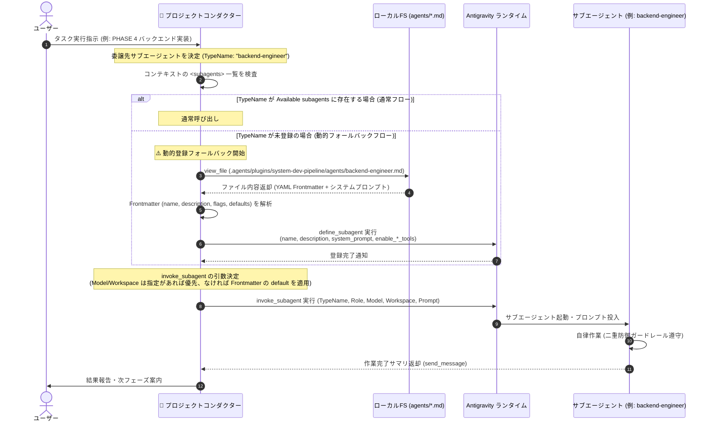

# コンダクターによるサブエージェント動的登録フォールバック（Dynamic Fallback）仕様書 V2.3

文書バージョン: 2.3  
作成日: 2026-10-10  
改定日: 2026-10-18  
対象バージョン: AI駆動システム開発ライフサイクルテンプレート V2.3  
ステータス: 正式改訂版  

---

## 1. 背景と目的

Antigravity プラグイン（`system-dev-pipeline`）では、マニフェスト（`plugin.json`）の `agents` フィールドにサブエージェント（`architect`, `backend-engineer`, `ui-designer`, `qa-engineer`）を宣言し、`.agents/plugins/system-dev-pipeline/agents/*.md`（または `~/.gemini/config/plugins/system-dev-pipeline/agents/*.md`）に定義を配置する。

しかし、以下の要因によりランタイムのシステムプロンプト内 `<subagents>`（利用可能サブエージェント一覧）に未登録となる状況が想定される：
1. プラグインのインストール直後やキャッシュ未更新状態でのセッション開始
2. サブエージェントの定義ファイルを更新したが、セッションに動的反映されていない場合
3. プラグインの自動ロードが無効化または限定されている環境での実行

このような状況下でも開発パイプラインの停止を防ぎ、司令塔であるプロジェクトコンダクターが自律的に状況を判定して `define_subagent` を呼び出し、正常にサブエージェント委譲へ移行できる耐障害性（レジリエンス）の高い動的登録フォールバック機構を定義する。

---

## 2. 動的登録フォールバックの全体シーケンス



---

## 3. 詳細判定ロジックと実行手順

### Step 1: 委譲前のアクティブ確認（Discovery Check）
コンダクターはタスクをサブエージェントに委譲する直前に、自身のシステムプロンプト内 `<subagents>` ブロックを参照し、対象となる `TypeName`（`architect`, `backend-engineer`, `ui-designer`, `qa-engineer` 等）が存在するかを確認する。

- **存在する場合**: Step 4（`invoke_subagent`）へ直行する。
- **存在しない場合**: Step 2（エージェント定義ファイルの取得）へ進む。

### Step 2: 静的定義ファイルの取得とパース
コンダクターは `view_file` ツールを用いて、対象エージェントの Markdown 定義ファイルを読み込む。

- **参照パス**:
  - 第一優先（`LOCAL_STANDALONE` モード時）: `.agents/plugins/system-dev-pipeline/agents/<TypeName>.md`
  - フォールバック（`GLOBAL_PLUGIN` モード時）: `~/.gemini/config/plugins/system-dev-pipeline/agents/<TypeName>.md`

ファイル取得後、YAML Frontmatter と本文（Markdown）をパースする：
1. **Frontmatter の抽出**:
  - `name`: エージェント識別名（`TypeName` と一致）
  - `description`: エージェントの役割・利用目的サマリ
  - `enable_write_tools`: Write系ツールおよび `run_command` の物理付与フラグ
  - `enable_subagent_tools`: サブエージェント管理ツールの許可フラグ
  - `enable_mcp_tools`: MCPツールの許可フラグ
  - `default_model`: 省略時の既定推論モデル（例: `pro`）
  - `default_workspace`: 省略時の既定ワークスペース（例: `inherit`）
2. **システムプロンプトの抽出**:
  - YAML Frontmatter（`--- ... ---`）以降の全テキストを `system_prompt` とする。

### Step 3: `define_subagent` による動的登録の実行
抽出したメタデータに基づき、Antigravity の `define_subagent` ツールを実行する。

#### 対象エージェント別の定義例 (V2.3)

##### 1. `architect`
```json
{
  "name": "architect",
  "description": "要件定義、2層プロファイル体系、DBスキーマ（ER図）、バックエンドAPI、ビジネスロジック設計を担当する設計立案スペシャリスト",
  "system_prompt": "# システムプロンプト...\n\n## 【禁止事項 (Prohibited Actions)】\nいかなる場合も run_command を呼び出してはならない。\n...",
  "enable_write_tools": true,
  "enable_subagent_tools": false,
  "enable_mcp_tools": false
}
```

##### 2. `backend-engineer`
```json
{
  "name": "backend-engineer",
  "description": "バックエンドAPI、SQLAlchemyモデル、Alembicマイグレーション、IAP認可、ビジネスロジック実装を担当するバックエンド実装スペシャリスト",
  "system_prompt": "# システムプロンプト...\n\n## 【コマンド実行範囲および禁止事項】\n構文チェック・単体テスト（uv run, pytest, ruff check 等）、および検証用コンテナ実行（docker compose exec 等）に限定。コンテナ起動停止はコンダクター専任。Git・デプロイ・DB上書きは厳禁。\n...",
  "enable_write_tools": true,
  "enable_subagent_tools": false,
  "enable_mcp_tools": false
}
```

##### 3. `ui-designer`
```json
{
  "name": "ui-designer",
  "description": "画面グランドデザイン準拠画面仕様書作成、モダンUI/UXデザイン、Anti-God Component (250行制限)、MSWモック制御、フロントエンド実装を担当するデザイナー兼フロントエンドエンジニア",
  "system_prompt": "# システムプロンプト...\n\n## 【コマンド実行範囲および禁止事項】\nUIビルド・パッケージ導入（npm install, npm run build 等）に限定。Git・デプロイは厳禁。\n...",
  "enable_write_tools": true,
  "enable_subagent_tools": false,
  "enable_mcp_tools": false
}
```

##### 4. `qa-engineer`
```json
{
  "name": "qa-engineer",
  "description": "2層構造3大レビュー（250行制限・直書きモック排除・本番モックOFF監査）、ドキュメント相互整合性チェック・自動修復、シナリオテスト計画・自動実行、Wiki Maintainer (RCA)、および3段階意味的整合性監査 (Semantic Auditor) を担当する品質監査スペシャリスト",
  "system_prompt": "# システムプロンプト...\n\n## 【重要規約・禁止事項】\nテスト・静的解析コマンドに限定。プログラムコードおよびImmutable Coreの直接改変禁止（提案書・Diff・監査判定を出力）。Git・デプロイは厳禁。\n...",
  "enable_write_tools": true,
  "enable_subagent_tools": false,
  "enable_mcp_tools": false
}
```

> **注意**: `default_model` および `default_workspace` は `define_subagent` の引数には渡さない（`invoke_subagent` の引数解決時にコンダクターが使用する）。

### Step 4: `invoke_subagent` の呼び出し（引数解決ルールの適用）
登録が完了した（またはすでに存在していた）サブエージェントに対し、`invoke_subagent` を実行する。

#### 引数解決ルール（Model / Workspace）
1. **コンダクターが意図的に上書き指定する場合**:
   - 例: 「UI試行錯誤のため一時的に `Model: flash` を使う」「特定調査のため `Workspace: branch` に隔離する」等の明示的指定がある場合は、**その指定を最優先**する。
2. **上書き指定がない場合（通常時）**:
   - 定義ファイルの Frontmatter に記載されている `default_model`（例: `pro`）および `default_workspace`（例: `inherit`）の値をコンダクターが読み取り、`invoke_subagent` の引数（`Model`, `Workspace`）に明示的にセットして呼び出す（ランタイムの引数省略時既定値 `'inherit'` への意図しないフォールバックを防止する）。

```json
{
  "Subagents": [
    {
      "TypeName": "backend-engineer",
      "Role": "バックエンドエンジニア",
      "Model": "pro",
      "Workspace": "inherit",
      "Prompt": "【依頼フェーズ】: PHASE 4 バックエンド実装\n【前提ドキュメント】: docs/テーブルスキーマ定義書.md, docs/ビジネスロジック仕様書.md\n..."
    }
  ]
}
```

---

## 4. エラーハンドリングと安全性ガードレール

| 発生事象 | 原因 | コンダクターの対処手順 |
| :--- | :--- | :--- |
| **定義ファイルが存在しない** | パス誤り、未配置 | ユーザーに「エージェント定義ファイル `agents/<TypeName>.md` が見つかりません」と報告し、コンダクター単独でタスクを実行するか確認する。 |
| **`define_subagent` の登録失敗** | 構文エラー、引数不正 | エラーメッセージを解析し、パラメータを補正して1回リトライする。解消しない場合はユーザーへエラー内容を提示する。 |
| **ツールグループ権限の漏洩防止** | `enable_write_tools: true` による `run_command` 物理付与 | 二重防御ガードレールに基づき、`system_prompt` に厳格な禁止事項（破壊的コマンドの禁止、直接コード改変禁止、Immutable Core直接改変禁止）が含まれていることを確認した上で登録する。 |

---

## 5. 関連ドキュメント・リンク

- [テンプレート配置形態およびナレッジ境界設計書.md](./テンプレート配置形態およびナレッジ境界設計書.md)
- [エージェント設計書V2.3.md](./エージェント設計書V2.3.md)
- [エージェント推論モデル仕様および運用基準書V2.3.md](./エージェント推論モデル仕様および運用基準書V2.3.md)
- [パイプライン統合およびテンプレート再編集における配慮事項まとめV2.3.md](./パイプライン統合およびテンプレート再編集における配慮事項まとめV2.3.md)
- [状態管理機構設計書V2.3.md](./状態管理機構設計書V2.3.md)
