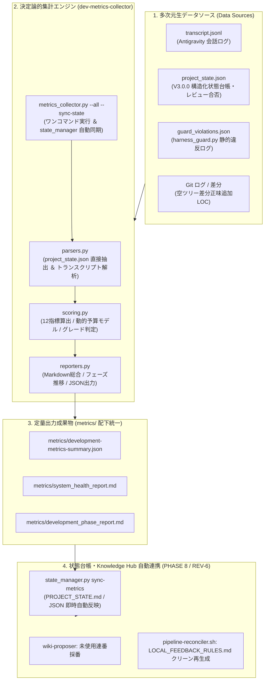

# 定量測定・フィードバック設計書（軽量・実行契約駆動・6段階改訂パイプライン準拠版）

文書バージョン: 3.0.1  
作成日: 2026-10-26  
改定日: 2026-11-10  
対象バージョン: AI駆動システム開発ライフサイクルテンプレート V3.0.1 (`APP_VERSION=3.0.1`)  
ステータス: 正式改訂版 (Current 正本 / 署名付き証跡自動生成 & 不在素通り防止対応版)  
関連文書:
- [AI駆動システム開発フェーズ定義書.md](./AI駆動システム開発フェーズ定義書.md)
- [AI駆動システム開発手順書.md](./AI駆動システム開発手順書.md)
- [レビューシステム設計書.md](./レビューシステム設計書.md)
- [エージェント設計書.md](./エージェント設計書.md)
- [状態管理機構設計書.md](./状態管理機構設計書.md)

---

## 1. はじめに

### 1.1 背景と課題認識
AI駆動システム開発ライフサイクルにおいては、5大エージェント協調体制、Single Writer 状態管理、3大レビューゲート、2.5層構造システムプロファイル体系（Core Profiles + Capability Traits）、および Central Knowledge Hub 永続ナレッジ自己進化ループにより、極めて高い品質統制を実現している。

V3.0.1 においては、品質証跡 `metrics/qa_runtime_evidence.json` のエージェントによる手動作成・手書きを全面廃止し、`traceability_checker.py --mode full` 成功時にツール署名（Gitコミットハッシュ、タイムスタンプ、SHA-256署名）付きで決定論的に自動生成する仕組みへと刷新した。また、`state_manager.py` における証跡不在時の素通りバグを根本修正し、改訂ID一致およびチェックサム再計算による改ざん検出（`[INV-QA-01]`）を導入することで、品質証跡の完全性と客観性を物理的に担保する。

---

## 2. 定量メトリクス集計アーキテクチャ (V3.0.0)

---

## 2. 定量測定メトリクス体系（4大カテゴリ・12指標）

| コード | 指標名 | カテゴリ | 配点比重 | 算出ロジック・改善仕様 (V2.5) | 目標基準 |
| :---: | :--- | :---: | :---: | :--- | :--- |
| `M-RES-01` | 最大コンテキスト消費率 | リソース効率 | 8点 | `last_context_tokens / max_context_tokens * 100` | 50%以下満点 |
| `M-RES-02` | サブエージェント委譲率 | リソース効率 | 9点 | `subagent_delegation_count / total_turns * 100` | 40〜60%満点 |
| `M-RES-03` | 成果物トークン効率 | リソース効率 | 8点 | `net_loc_added (空ツリー通算差分) / (tokens_consumed / 1000)` | 2.0 LOC/kTok以上満点 |
| `M-QLT-01` | 初回レビュー合格率 | 品質・堅牢性 | 12点 | `(passed_reviews / total_reviews) * 100` (太字・揺れ許容) | 100%満点 |
| `M-QLT-02` | 重大欠陥発生数 | 品質・堅牢性 | 10点 | `Critical + High` 指摘件数 | 0件満点 |
| `M-QLT-03` | 重複ツール呼出率 | 品質・堅牢性 | 6点 | `duplicated_tool_calls / total_tools * 100` | 0%満点 |
| `M-QLT-04` | 自律修復収束ターン数 | 品質・堅牢性 | 7点 | **実測ステップ差分追跡**（エラー開始〜DONE完了までの平均ステップ） | 1〜2ターン満点 |
| `M-EVO-01` | プロジェクト固有知見数 | ナレッジ進化 | 8点 | `wiki/patterns/local/` 登録知見数 | 4件以上満点 |
| `M-EVO-02` | 全体共通知見昇格数 | ナレッジ進化 | 7点 | `wiki/patterns/universal/` 昇格知見数 | 3件以上満点 |
| `M-GOV-01` | Single Writer 違反数 | ガバナンス | 10点 | `PROJECT_STATE.md` 不正更新件数 | 0件満点 |
| `M-GOV-02` | 不変則・規約逸脱件数 | ガバナンス | 8点 | 生SQL、直書きモック、絶対パス等の規約逸脱数 | 0件満点 |
| `M-GOV-03` | 動的ターン予算超過率 | ガバナンス | 7点 | `total_turns / max(session_count * 25, 20)`（動的予算モデル） | 1.0倍以下満点 |

---

## 3. 集計エンジン アーキテクチャ仕様 (V2.5 4モジュール構成)

| モジュール | 役割 | 行数制限 | 依存関係 |
| :--- | :--- | :---: | :--- |
| `metrics_types.py` | `dataclass` 型スキーマ定義 (`MergedTranscriptData`, `ArtifactMetrics`, `ScoringResult`) | 400行以内 (実測114行) | 標準ライブラリのみ |
| `parsers.py` | トランスクリプト探索・パース、Git空ツリーLOC取得、`start_time` 二段時系列ソート | 400行以内 (実測386行) | `metrics_types` |
| `scoring.py` | 12指標スコアリング、動的予算モデル、自律修復実測反映、グレード判定 | 400行以内 (実測174行) | `metrics_types` |
| `reporters.py` | Markdown 総合健全性レポート、フェーズ推移レポート（パイプ文字エスケープ）、集計JSON出力 | 400行以内 (実測230行) | `metrics_types` |
| `metrics_collector.py` | CLI 引数解析 (`--all`, `--retroactive`, `--debug`)、オーケストレーション | 400行以内 (実測136行) | 全モジュール統括 |

---

## 4. PHASE 8 連携および成果物パス規約

### 4.1 成果物出力パスの統一 (PAT-SYS-003)
- 旧来の `docs/plans/metrics/` への分散出力を完全廃止し、すべての成果物を `metrics/` ディレクトリ直下へ統一する。
- `metrics/system_health_report.md` (総合健全性診断レポート)
- `metrics/development_phase_report.md` (フェーズ別推移レポート)
- `metrics/development-metrics-summary.json` (定量集計JSON)

### 4.2 PROJECT_STATE.md 定量サマリ即時同期 (PAT-SYS-002)
- コンダクターは `dev-metrics-collector` 実行後、診断レポートの主要数値（総合スコア、グレード、各カテゴリスコア、消費トークン、LOC等）を `PROJECT_STATE.md` の「プロジェクト定量メトリクスサマリ」へ即時反映し、ヘッダーの最終更新日時を更新する。

### 4.3 Central Knowledge Hub パターンID一意性保証 (PAT-SYS-006)
- 新規起票時（`wiki-proposer`）に Knowledge Hub 全域（`active_claims/`, `archive/upstreamed/`）を走査して未使用最新連番を採番する。
- 昇格時（`pipeline-reconciler.sh`）および Semantic Auditor（Gate 3）において重複衝突を Fail-Fast 検出しリナンバリングを強制する。

### 4.4 署名付き動的証跡 JSON 仕様 (`metrics/qa_runtime_evidence.json`)
- **決定論的自動生成規約 (`[REQ-F-301-02]`)**:
  - `metrics/qa_runtime_evidence.json` のエージェント（`qa-engineer` を含む）による手動作成・手書きを全面禁止する。
  - `traceability_checker.py --mode full` が全テストおよび要件トレース合格（カバレッジ100%、異常系20%以上）を確認した際のみ、ツール署名付きで決定論的に物理出力する。
- **記録必須ペイロード構造**:
  - `schema_version`: "1.0.0"
  - `revision_id`: 現在アクティブな改訂ID（`project_state.json` の `active_revision_id` と厳格一致）
  - `timestamp`: 生成日時 (ISO 8601 UTC)
  - `git_commit`: 現在のHEADコミットハッシュ
  - `traceability_summary`: 全要件数、検証済み要件数、カバレッジ率、異常系比率
  - `test_results`: 実行テストスイート、合格数、スキップ数、失敗数
  - `signature_sha256`: ペイロード本文（署名フィールド除く）から算出された SHA-256 ハッシュ値
- **改ざんおよび不在検証インターロック (`[INV-QA-01]`)**:
  - `state_manager.py verify-review-readiness` および `complete-revision` において、`metrics/qa_runtime_evidence.json` の物理的実在を必須とする。ファイルが存在しない場合は素通りせずエラー（ブロック）とする。
  - 記録された `revision_id` が現在の改訂IDと一致することを検証する。
  - `signature_sha256` を再計算し、ファイル内容の改ざんや手動捏造が検知された場合は即座に実行を遮断する。

---

## 5. ドキュメント改定履歴

| 対象バージョン | 改定日 | 改訂依頼番号 | 改定内容 |
| :--- | :--- | :--- | :--- |
| 3.0.0 | 2026-11-10 | PLAN-V300-001 | 定量測定メトリクス・状態台帳自動同期アーキテクチャ策定 |
| 3.0.1 | 2026-11-10 | PLAN-V301-001 | 署名付き動的証跡自動生成(REQ-F-301-02)、証跡不在素通りバグ修正・改ざん検証インターロック(INV-QA-01) |
