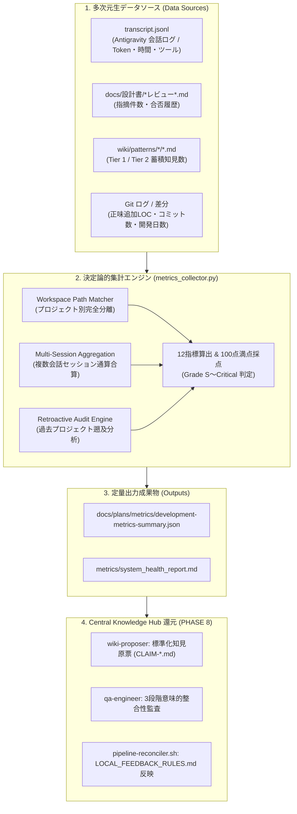

# 定量測定・フィードバック設計書 V2.4 (Quantitative Measurement & Pipeline Feedback Specification)

文書バージョン: 2.4  
作成日: 2026-10-24  
対象バージョン: AI駆動システム開発ライフサイクルテンプレート V2.4.0  
ステータス: 正式改訂版 (Current 正本 / 決定論的自動集計エンジン & 複数セッション合算・遡及分析完全連動版)  
関連文書:
- [AI駆動システム開発フェーズ定義書V2.4.md](./AI駆動システム開発フェーズ定義書V2.4.md)
- [AI駆動システム開発手順書V2.4.md](./AI駆動システム開発手順書V2.4.md)
- [V2.4セマンティックバージョニング仕様書.md](./V2.4セマンティックバージョニング仕様書.md)
- [V2.4改変計画書.md](./V2.4改変計画書.md)
- [レビューシステム設計書V2.4.md](./レビューシステム設計書V2.4.md)
- [エージェント設計書V2.4.md](./エージェント設計書V2.4.md)
- [状態管理機構設計書V2.4.md](./状態管理機構設計書V2.4.md)
- [20261024_定量測定・メトリクス集計スキルのデータ収集ロジック調査報告書.md](../../reports/20261024_定量測定・メトリクス集計スキルのデータ収集ロジック調査報告書.md)
- [20261024_Phase1_定量測定収集スクリプトプロトタイプ実装及び単体検証報告書.md](../../reports/20261024_Phase1_定量測定収集スクリプトプロトタイプ実装及び単体検証報告書.md)

---

## 1. はじめに

### 1.1 背景と課題認識
AI駆動システム開発ライフサイクルにおいては、5大エージェント協調体制、Single Writer 状態管理、3大レビューゲート、2層構造システムプロファイル、および WikiSkill 永続ナレッジ自己進化ループにより、極めて高い品質統制を実現している。

しかし、開発支援システム（テンプレート・プロンプト・スキル群）そのものの健全性や開発効率を客観的に評価するにあたり、以前のバージョンでは以下の課題が存在していた：
1. **スクリプトの不在と推測依存**: 集計スクリプトが存在せず、LLM がコンテキストから推測・捏造（ハルシネーション）した架空の数値を記録していた。
2. **プロジェクト分離と複数セッション合算の欠落**: 直近の会話1件のみを参照していたため、他プロジェクトのログ混入や、複数セッションに分かれた開発の通算集計ができなかった。
3. **過去プロジェクトの分析不能**: 統計機能が定義される前の過去プロジェクト（V2.0〜V2.2 等）に対する客観評価手法が確立されていなかった。

### 1.2 本設計書の目的と位置づけ
本文書は、これらすべての課題を解決し、**Antigravity の実行ログ（`transcript.jsonl`）およびワークスペース成果物（Git、レビュー報告書、Wiki）から 100% 決定論的かつ機械的にデータを自動集計し、Central Knowledge Hub およびテンプレート正本へ客観的知見を還元するフィードバック機構** を定義する。



---

## 2. 定量測定メトリクス体系（3大軸・12指標）

```text
┌────────────────────────────────────────────────────────────────────────┐
│                  開発支援システム 定量測定メトリクス体系 (3大軸)       │
├────────────────────────────────────────────────────────────────────────┤
│                                                                        │
│  【1. リソース＆コンテキスト効率】 (Resource & Context Efficiency)     │
│    ・M-RES-01: メインコンテキスト消費率 / セッション寿命               │
│    ・M-RES-02: サブエージェント委譲率 (Delegation Ratio)               │
│    ・M-RES-03: 成果物トークン効率 (Tokens per Artifact LOC)            │
│    ・M-RES-04: ツール呼び出し重複率 (Tool Call Duplicate Rate)         │
│                                                                        │
│  【2. 開発品質＆手戻り】 (Quality & Rework Metrics)                    │
│    ・M-QLT-01: レビュー初回合格率 (First-Pass Review Rate)             │
│    ・M-QLT-02: レビュー指摘密度 (Defect Density per 100 LOC)           │
│    ・M-QLT-03: スルーテスト初回合格率 & リグレッション率              │
│    ・M-QLT-04: 自律修復ループ収束ターン数 (Auto-Healing Convergence)    │
│                                                                        │
│  【3. プロセス健全性＆ガバナンス】 (Process Health & Governance)       │
│    ・M-GOV-01: Single Writer原則遵守度 (State Mutation Violations)     │
│    ・M-GOV-02: 不変原則・純度違反件数 (Invariants & Budget Violations) │
│    ・M-GOV-03: フェーズ所要ターン超過率 (Phase Turn Overrun Ratio)     │
│    ・M-GOV-04: ドキュメント相互整合性スコア (Doc Consistency Score)    │
│                                                                        │
└────────────────────────────────────────────────────────────────────────┘
```

### 2.1 軸1: リソース＆コンテキスト効率指標

| 指標ID | 指標名称 | 定義・算出式 | 目標基準値 | 判定基準 (Warning / Critical) |
| :--- | :--- | :--- | :--- | :--- |
| **M-RES-01** | **メインコンテキスト消費率** | `(最新ターンのメインコンテキストToken数) / (モデル最大コンテキスト長) * 100` | **< 60%** | Warning: ≥ 70%<br>Critical: ≥ 85% |
| **M-RES-02** | **サブエージェント委譲率** | `(サブエージェント呼出・実行ターン数) / (総実行ターン数) * 100` | **≥ 50%** | Warning: < 40%<br>Critical: < 25% |
| **M-RES-03** | **成果物トークン効率** | `(正味追加コード・ドキュメント行数 LOC) / (総消費Token数 / 1,000)` | **≥ 1.5 LOC / kTokens** | Warning: < 1.0<br>Critical: < 0.5 |
| **M-RES-04** | **ツール呼出重複率** | `(同一ツール・同一引数の連続実行回数) / (総ツール呼出数) * 100` | **< 5%** | Warning: ≥ 10%<br>Critical: ≥ 20% |

### 2.2 軸2: 開発品質＆手戻り指標

| 指標ID | 指標名称 | 定義・算出式 | 目標基準値 | 判定基準 (Warning / Critical) |
| :--- | :--- | :--- | :--- | :--- |
| **M-QLT-01** | **レビュー初回合格率** | `(初回合格となったレビュー数) / (実施総レビュー数) * 100` | **≥ 70%** | Warning: < 60%<br>Critical: < 40% |
| **M-QLT-02** | **レビュー指摘密度** | `(総指摘件数[Critical+High+Med+Low]) / (正味LOC / 100)` | **< 2.0 件 / 100 LOC** | Warning: ≥ 3.0<br>Critical: ≥ 5.0 |
| **M-QLT-03** | **スルーテスト初回合格率** | `(初回実行でパスしたテスト数) / (全シナリオテスト数) * 100` | **≥ 80%** | Warning: < 70%<br>Critical: < 50% |
| **M-QLT-04** | **自律修復ループ収束ターン数** | `(エラー検知から修復完了までに要したターン数の平均)` | **≤ 2.0 ターン** | Warning: ≥ 3.0 ターン<br>Critical: ≥ 4.0 ターン |

### 2.3 軸3: プロセス健全性＆ガバナンス指標

| 指標ID | 指標名称 | 定義・算出式 | 目標基準値 | 判定基準 (Warning / Critical) |
| :--- | :--- | :--- | :--- | :--- |
| **M-GOV-01** | **Single Writer原則違反件数** | コンダクター以外のエージェントによる `PROJECT_STATE.md` 更新試行件数 | **0 件 (絶対厳守)** | Critical: ≥ 1 件 (即座にCritical判定) |
| **M-GOV-02** | **不変原則・純度違反件数** | `CORE_INVARIANTS.md` 違反、履歴ID混入、行数バジェット超過件数 | **0 件** | Warning: 1件<br>Critical: ≥ 2件 |
| **M-GOV-03** | **フェーズ所要ターン超過率** | `(当該フェーズ実ターン数) / (標準基準ターン数: 20)` | **≤ 1.2 倍** | Warning: ≥ 1.5 倍<br>Critical: ≥ 2.0 倍 |
| **M-GOV-04** | **ドキュメント相互整合性スコア** | `dev-doc-reviewer` による整合性クロスチェック合格率 | **100%** | Warning: < 95%<br>Critical: < 90% |

---

## 3. 自動収集エンジン (`metrics_collector.py`) の仕様

### 3.1 Profile E（Zero-Dependency）完全準拠
本スクリプトは、システム環境に外部ライブラリ（`pandas`, `numpy` 等）を追加導入することなく、**Python 3 標準ライブラリ（`json`, `re`, `datetime`, `pathlib`, `subprocess`, `argparse`, `glob`）のみ** で実行される。

### 3.2 3大高度化機能
1. **プロジェクト別完全分離 (Workspace Path Matcher)**:
   - 全トランスクリプト（`~/.gemini/antigravity/brain/*/transcript.jsonl`）のヘッダーおよびコンテキストを走査し、カレントワークスペースの絶対パスを含む会話のみを自動抽出。他プロジェクトのログ混入を完全に防止する。
2. **複数セッション通算合算 (Multi-Session Aggregation)**:
   - 同一プロジェクトで複数回に分かれて実施された会話セッションを時系列順に結合し、プロジェクト全体の通算トークン消費量、所要時間、ツール呼出回数を合算する。
3. **過去プロジェクト遡及分析モード (`--retroactive`)**:
   - V2.3 以前のプロジェクトやトランスクリプトが欠損している環境でも、`git log` / `git diff` による全開発履歴と、`docs/設計書/` 配下の全レビュー報告書を解析し、客観的な品質・ガバナンス評価レポートを出力する。

### 3.3 CLI コマンド仕様

```bash
# 基本実行（自動探索によるプロジェクトマッチング & 複数セッション通算）
PLUGIN_DIR="$([ -d "./.agents/plugins/system-dev-pipeline" ] && echo "./.agents/plugins/system-dev-pipeline" || echo "${HOME}/.gemini/config/plugins/system-dev-pipeline")"
python3 "${PLUGIN_DIR}/skills/dev-metrics-collector/scripts/metrics_collector.py"

# オプション指定
python3 "${PLUGIN_DIR}/skills/dev-metrics-collector/scripts/metrics_collector.py" \
  --single-session       # 最新の1セッションのみに限定して集計
  --retroactive          # 過去プロジェクト遡及モード (Git全履歴走査)
  --workspace <path>     # ワークスペースパスの明示指定 (デフォルト: カレント)
  --output-json <path>   # JSON出力先 (デフォルト: docs/plans/metrics/development-metrics-summary.json)
  --output-report <path> # レポート出力先 (デフォルト: metrics/system_health_report.md)
```

---

## 4. 客観評価基準（スコアリング＆グレード判定）

各カテゴリ25点満点、合計100点満点で算出する：

| グレード | 獲得スコア | 開発プロセスの状態 | 判定条件 |
| :---: | :---: | :--- | :--- |
| **Grade S** | **90 〜 100** | 最適・模範的自律開発。手戻りが極めて少なく、効率・品質・統制すべてが高水準。 | Single Writer違反 0件、各カテゴリ減点僅少 |
| **Grade A** | **80 〜 89** | 健全・良好。軽微な手戻りは自律修復内で収束しており、高品質に完了。 | Single Writer違反 0件、致命的ボトルネックなし |
| **Grade B** | **65 〜 79** | 許容・注意。一部フェーズで複数回の手戻りやツール重複が発生。 | 改善候補（Tier 2 知見原票化候補）が存在 |
| **Grade C** | **50 〜 64** | 要改善。特定フェーズで AI の迷走や手戻りが頻発。 | スキルやルールの補強が強く推奨される状態 |
| **Critical** | **< 50** | 危険・破綻。ガードレールの機能不全または著しい手戻りループ。 | **Single Writer違反 ≥ 1件 は即座にCritical** |

---

## 5. テンプレート還元・Central Knowledge Hub 連携

PHASE 8 において `dev-metrics-collector` が出力したメトリクスは、以下のフローでテンプレート自己進化ループへ接続される：

1. **閾値乖離の検知**: `M-RES-02`（委譲率低下）や `M-QLT-01`（レビュー合格率低下）を検知。
2. **標準化知見原票の起案**: `wiki-proposer` がメトリクス異常の処方箋として `CLAIM-*.md` を生成し、`~/.gemini/knowledge-hub/inbox/` へ投函。
3. **意味的整合性監査と承認**: QA エンジニアの 3段階監査を経て、ユーザーが `ask_question` で承認。
4. **Local Overlay 反映**: `pipeline-reconciler.sh` により `LOCAL_FEEDBACK_RULES.md` へ即時反映され、次案件の開発効率が自動向上する。
