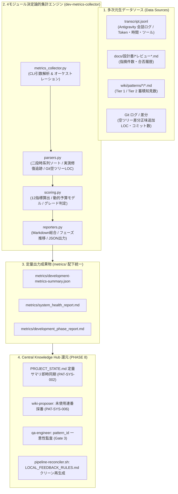

# 定量測定・フィードバック設計書 V2.5 (Quantitative Measurement & Pipeline Feedback Specification)

文書バージョン: 2.5  
作成日: 2026-10-25  
対象バージョン: AI駆動システム開発ライフサイクルテンプレート V2.5.0  
ステータス: 正式改訂版 (Current 正本 / 決定論的4モジュール自動集計エンジン & 複数セッション合算・フェーズ推移レポート完全連動版)  
関連文書:
- [AI駆動システム開発フェーズ定義書V2.5.md](./AI駆動システム開発フェーズ定義書V2.5.md)
- [AI駆動システム開発手順書V2.5.md](./AI駆動システム開発手順書V2.5.md)
- [V2.5改変計画書.md](./V2.5改変計画書.md)
- [レビューシステム設計書V2.5.md](./レビューシステム設計書V2.5.md)
- [エージェント設計書V2.5.md](./エージェント設計書V2.5.md)
- [状態管理機構設計書V2.5.md](./状態管理機構設計書V2.5.md)
- [20261024_metrics_collectorコードレビューおよび残余課題改善計画書.md](../../検討課題/v2.5/20261024_metrics_collectorコードレビューおよび残余課題改善計画書.md)
- [20261025_パイプライン全コード総合レビューおよび残余課題改善計画書.md](../../検討課題/v2.5/20261025_パイプライン全コード総合レビューおよび残余課題改善計画書.md)

---

## 1. はじめに

### 1.1 背景と課題認識
AI駆動システム開発ライフサイクルにおいては、5大エージェント協調体制、Single Writer 状態管理、3大レビューゲート、2層構造システムプロファイル、および Central Knowledge Hub 永続ナレッジ自己進化ループにより、極めて高い品質統制を実現している。

V2.5 においては、集計エンジン `metrics_collector.py`（972行）の単一モジュール肥大化（Anti-God Module）を解消し、Profile E（Zero-Dependency Python 3）に準拠した 4モジュール構成（`metrics_types.py`, `parsers.py`, `scoring.py`, `reporters.py`, `metrics_collector.py`）へ物理分割するとともに、測定精度（動的ターン予算・実測修復ターン追跡・二段時系列ソート）と出力パス統一（`metrics/` 配下）を確立した。

### 1.2 本設計書の目的と位置づけ
本文書は、**Antigravity の実行ログ（`transcript.jsonl`）およびワークスペース成果物（Git、レビュー報告書、Wiki）から 100% 決定論的かつ機械的にデータを自動集計し、Central Knowledge Hub およびテンプレート正本へ客観的知見を還元するフィードバック機構** を定義する。

---

## 2. 定量測定メトリクス体系（4大カテゴリ・12指標）

| コード | 指標名 | カテゴリ | 配点比重 | 算出ロジック・改善仕様 (V2.5) | 目標基準 |
| :---: | :--- | :---: | :---: | :--- | :--- |
| `M-RES-01` | 最大コンテキスト消費率 | リソース効率 | 8点 | `last_context_tokens / max_context_tokens * 100` | 50%以下満点 |
| `M-RES-02` | サブエージェント委譲率 | リソース効率 | 9点 | `subagent_delegation_count / total_turns * 100` | 40〜60%満点 |
| `M-RES-03` | 成果物トークン効率 | リソース効率 | 8点 | `net_loc_added (空ツリー通算差分) / (tokens_consumed / 1000)` | 2.0 LOC/kTok以上満点 |
| `M-QLT-01` | 初回レビュー合格率 | 品質・堅牢性 | 12点 | `(passed_reviews / total_reviews) * 100` (太字・揺れ許容) | 100%満点 |
| `M-QLT-02` | 重大欠陥発生数 | 品質・堅牢性 | 10点 | `Critical + High` 指摘件数 | 0件満点 |
| `M-QLT-03` | 重複ツール呼出率 | 品質・堅牢性 | 6点 | `duplicated_tool_calls / total_tools * 100` | 0%満点 |
| `M-QLT-04` | 自律修復収束ターン数 | 品質・堅牢性 | 7点 | **実測ステップ差分追跡**（エラー開始〜DONE完了までの平均ステップ） | 1〜2ターン満点 |
| `M-EVO-01` | プロジェクト固有知見数 | ナレッジ進化 | 8点 | `wiki/patterns/local/` 登録知見数 | 4件以上満点 |
| `M-EVO-02` | 全体共通知見昇格数 | ナレッジ進化 | 7点 | `wiki/patterns/universal/` 昇格知見数 | 3件以上満点 |
| `M-GOV-01` | Single Writer 違反数 | ガバナンス | 10点 | `PROJECT_STATE.md` 不正更新件数 | 0件満点 |
| `M-GOV-02` | 不変則・規約逸脱件数 | ガバナンス | 8点 | 生SQL、直書きモック、絶対パス等の規約逸脱数 | 0件満点 |
| `M-GOV-03` | 動的ターン予算超過率 | ガバナンス | 7点 | `total_turns / max(session_count * 25, 20)`（動的予算モデル） | 1.0倍以下満点 |

---

## 3. 集計エンジン アーキテクチャ仕様 (V2.5 4モジュール構成)

| モジュール | 役割 | 行数制限 | 依存関係 |
| :--- | :--- | :---: | :--- |
| `metrics_types.py` | `dataclass` 型スキーマ定義 (`MergedTranscriptData`, `ArtifactMetrics`, `ScoringResult`) | 400行以内 (実測114行) | 標準ライブラリのみ |
| `parsers.py` | トランスクリプト探索・パース、Git空ツリーLOC取得、`start_time` 二段時系列ソート | 400行以内 (実測386行) | `metrics_types` |
| `scoring.py` | 12指標スコアリング、動的予算モデル、自律修復実測反映、グレード判定 | 400行以内 (実測174行) | `metrics_types` |
| `reporters.py` | Markdown 総合健全性レポート、フェーズ推移レポート（パイプ文字エスケープ）、集計JSON出力 | 400行以内 (実測230行) | `metrics_types` |
| `metrics_collector.py` | CLI 引数解析 (`--all`, `--retroactive`, `--debug`)、オーケストレーション | 400行以内 (実測136行) | 全モジュール統括 |

---

## 4. PHASE 8 連携および成果物パス規約

1. **成果物出力パスの統一 (PAT-SYS-003)**:
   - 旧来の `docs/plans/metrics/` への分散出力を完全廃止し、すべての成果物を `metrics/` ディレクトリ直下へ統一する。
   - `metrics/system_health_report.md` (総合健全性診断レポート)
   - `metrics/development_phase_report.md` (フェーズ別推移レポート)
   - `metrics/development-metrics-summary.json` (定量集計JSON)
2. **PROJECT_STATE.md 定量サマリ即時同期 (PAT-SYS-002)**:
   - コンダクターは `dev-metrics-collector` 実行後、診断レポートの主要数値（総合スコア、グレード、各カテゴリスコア、消費トークン、LOC等）を `PROJECT_STATE.md` の「プロジェクト定量メトリクスサマリ」へ即時反映し、ヘッダーの最終更新日時を更新する。
3. **Central Knowledge Hub パターンID一意性保証 (PAT-SYS-006)**:
   - 新規起票時（`wiki-proposer`）に Knowledge Hub 全域（`active_claims/`, `archive/upstreamed/`）を走査して未使用最新連番を採番する。
   - 昇格時（`pipeline-reconciler.sh`）および Semantic Auditor（Gate 3）において重複衝突を Fail-Fast 検出しリナンバリングを強制する。
