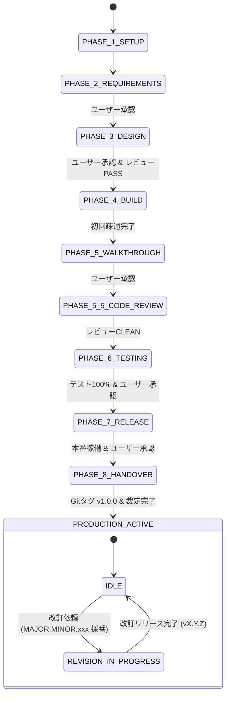

# プロジェクト状態管理機構設計書 V2.4

文書バージョン: 2.4  
作成日: 2026-10-23  
対象バージョン: AI駆動システム開発ライフサイクルテンプレート V2.4.0  
ステータス: 正式改訂版 (Current 正本)  
関連文書:
- [AI駆動システム開発フェーズ定義書V2.4.md](./AI駆動システム開発フェーズ定義書V2.4.md)
- [AI駆動システム開発手順書V2.4.md](./AI駆動システム開発手順書V2.4.md)
- [V2.4セマンティックバージョニング仕様書.md](./V2.4セマンティックバージョニング仕様書.md)
- [V2.4改変計画書.md](./V2.4改変計画書.md)
- [ProfileA詳細設計書.md](./ProfileA詳細設計書.md)
- [ProfileD詳細設計書.md](./ProfileD詳細設計書.md)
- [エージェント設計書V2.4.md](./エージェント設計書V2.4.md)
- [レビューシステム設計書V2.4.md](./レビューシステム設計書V2.4.md)
- [システム改訂ルール.md](../../../.agents/plugins/system-dev-pipeline/templates/システム改訂ルール.md)

---

## 1. 目的と基本思想

### 1.1 目的
サブエージェント（`architect`, `backend-engineer`, `ui-designer`, `qa-engineer`）およびメインエージェント（`conductor`）が協調して自律開発を推進するにあたり、以下の課題を解決する：
1. **文脈の断絶防止**: コンテキスト長過大によるリセットやセッション再開時にも、現在のフェーズ・残タスク・決定事項・**選定されたシステム展開プロファイル（Profile A〜E）、モック動作モード、および適用中の Immutable Core バージョン / Local Overlay 状態**を即座に復元できること。
2. **作業競合の排除**: 複数エージェントが同時に作業状態を更新することによるコンフリクトや破損を完全に防ぐこと（Single Writer原則: INV-01）。
3. **客観的品質ゲートの可視化**: 3大レビュー（基本設計、コード品質、システム総合）の合否判定、重大度別指摘件数、**定常コア8項目およびプロファイル適合性**を確実に記録・追跡できること。
4. **SemVer 2.0.0 統一運用と現在状態インジケータへの純化 (PAT-REV-001)**:
   - 現行バージョンを `vX.Y.Z`（例: `v1.0.0`）形式で厳格管理する。
   - `PROJECT_STATE.md` は「現在のプロジェクト状態を示す動的インジケータ」に専任化させ、システム改訂ルール §2.3.3 の「ドキュメント共通改定履歴表」の適用対象外とする。ターンごとの改訂作業履歴は `/revise-log/` および改訂レポートで一元管理し、状態管理台帳の肥大化・履歴重複を排除する。

### 1.2 設計基本原則
| 原則 | 内容 |
| :--- | :--- |
| **配置場所の分離** | `PROJECT_STATE.md` は **プロジェクトルート直下（`./PROJECT_STATE.md`）** に配置する。`docs/` 配下の一般仕様書と物理分離し、ドキュメント監査時のノイズ・誤判定を排除する。 |
| **Single Writer 原則 (INV-01)** | `PROJECT_STATE.md` への書き込み・更新権限は **👑 プロジェクトコンダクター（メインエージェント）のみ** が保持する。サブエージェントは完了サマリを返すのみとし、状態ファイルを直接編集しない。 |
| **人間可読・直接編集性** | GitHub Flavored Markdown 形式を採用。ユーザーがVSCode等で直接メモやチェックを更新することも許容する。 |
| **明示的承認ゲートの記録** | ユーザーが承認を与えた日時、コミット、承認ステータスを状態ファイルに明記する。 |
| **Knowledge Hub 状態との分離連携** | 案件固有の進行状態は `./PROJECT_STATE.md` で管理し、環境共通の Overlay 知見適用状態は `~/.gemini/knowledge-hub/LOCAL_HUB_STATE.json` で管理する。 |
| **改定履歴表の適用除外 (PAT-REV-001)** | `PROJECT_STATE.md` の末尾には改定履歴表を配置しない。改訂時の作業履歴は `/revise-log/vn.m/` に永続化する。 |

---

## 2. 状態ファイル詳細フォーマット仕様（`PROJECT_STATE.md` V2.4）

```markdown
# プロジェクト進行状態管理票 (PROJECT_STATE)

- **プロジェクト名**: {{PROJECT_NAME}}
- **現在のステータス**: PHASE_1_SETUP
- **システム展開プロファイル**:
  - 第1層 (定常コア): Universal Core Specifications (Anti-God Component 250行制限 / 型同期 / Pydantic Settings / Aware UTC / CI / 構造化ログ / モック制御 / グランドデザイン) 適用中
  - 第2層 (展開プロファイル): [Profile A: サーバーレス極小コストWeb型 (ゴールデンパス) / Profile B: Web SSR・フルマネージド / Profile C: 静的MPA・超軽量 / Profile D: PCローカルデスクトップ]
- **モック動作モード (MOCK_MODE)**: ENABLED (VITE_ENABLE_MOCK=true) <!-- [ENABLED / DISABLED] -->
- **現行バージョン**: v{{APP_VERSION}}
- **EXECUTION_MODE**: {{EXECUTION_MODE}} <!-- [GLOBAL_PLUGIN / LOCAL_STANDALONE] -->
- **TEMPLATE_SOURCE**: {{TEMPLATE_SOURCE}}
- **Knowledge Hub 連携状態**: SYNCED (Immutable Core v2.4.0 + Local Overlay)
- **現在の作業ブランチ**: main
- **最終更新日時**: {{UPDATED_AT}}
- **最終更新者**: 👑 プロジェクトコンダクター (Single Writer)

---

## 1. 開発フェーズ進捗一覧 (新規開発 PHASE 1〜8)
<!-- 各フェーズのチェックリスト項目および承認日 -->

---

## 2. システム改訂管理 (PHASE 8完了以降)

- **現在の改訂ステータス**: IDLE
- **進行中の改訂依頼番号**: なし
- **現行改訂ターン番号**: -
- **知見昇格ステータス**: 未昇格
- **コード品質レビュー判定**: -
- **直近の改訂レポート**: なし

### 改訂履歴テーブル
| 改訂依頼番号 | 対象バージョン | ターン | ステータス | 主担当 | 概要 | 完了日 |
| :--- | :--- | :--- | :--- | :--- | :--- | :--- |

---

## 3. WikiSkill & Central Knowledge Hub 自己進化ステータス (V2.4)
<!-- Spoke Wiki および Hub 投函状態 -->

---

## 4. プロジェクト定量メトリクスサマリ
<!-- トークン効率、品質・手戻り、健全性、リードタイム -->

---

## 5. 未決事項および決定事項ログ (Open Questions & Decisions)
<!-- 未決事項と決定事項 -->

---

## 6. システム・インフラ・Git状態
<!-- Gitブランチ、直近コミット、コンテナステータス -->
```

---

## 3. ステータス遷移モデル



---

## 4. ドキュメント改定履歴

| 改訂依頼番号 | 対象バージョン | ターン | 改定者 | 改定概要 | 完了日 |
| :--- | :--- | :---: | :--- | :--- | :--- |
| - | v2.4.0 | - | 👑 conductor | V2.4 正式改訂（SemVer 2.0.0 統一、PAT-REV-001 改定履歴表除外の明文化） | 2026-10-23 |
